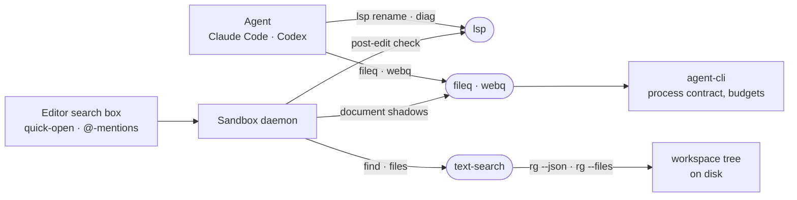

# Agent tools

The tools an agent runs inside a sandbox: compiler-backed rename and diagnostics, binary files and web pages read as budgeted markdown, the CLI framework those share, and the ripgrep searches behind the editor's search box.

| Package | Role |
| --- | --- |
| [lsp](lsp) | The `lsp` CLI: TypeScript rename and diagnostics over the native compiler. |
| [fileq](fileq) | Agent CLI reading binary files (docx, pdf, images, archives) as budgeted markdown. |
| [webq](webq) | Agent CLI fetching web pages as budgeted markdown, with bounded crawls. |
| [agent-cli](agent-cli) | Process contract and budgeted output shared by `fileq` and `webq`. |
| [text-search](text-search) | The search box's text and file-name searches, each a ripgrep walk of the tree with no index. |

All of them run inside the sandbox. `lsp`, `fileq` and `webq` are on `PATH`, and the daemon imports the `lsp` client for the post-edit check and fileq for the text shadows of workspace documents. The daemon runs each text or file-name search in its own process; nothing stays resident and no index is kept on disk.
