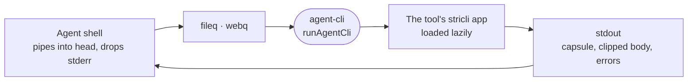

# agent-cli

The process contract, budgeted output and in-process test runner that the agent-facing CLIs `fileq` and `webq` share, so a failure never reads as an empty answer.



- The reader is an agent: it pipes into `head`, sends stderr to `/dev/null` and cannot tell a crash from an empty
  answer. So `runAgentCli` treats EPIPE as a clean stop, writes errors to stdout, reports a module graph that will
  not load as a broken install, and clamps the exit code to 0 content, 1 none, 2 anything else.
- Every failure is one line, `<tool>: error: <code>: <message>`, then `<tool>: next: <step>` when there is a step
  worth naming (`failure` in `./errors`). The code is one of a fixed set a reader may branch on, and a code is never
  renamed once shipped:

  | code | means |
  |---|---|
  | `usage` | the command line is wrong: a verb, a flag or a value |
  | `not_found` | the file or page is not there |
  | `unsupported` | the tool does not read this kind of input |
  | `too_large` | over the size the tool reads |
  | `unreadable` | it is there but cannot be read: permissions, damage, a password |
  | `missing_tool` | a program the tool needs is not installed |
  | `fetch_failed` | the site did not answer with the page |
  | `blocked` | the site refused: a sign-in, a bot check, a rate limit, robots.txt |
  | `timeout` | the deadline passed first |
  | `broken_install` | the tool itself will not start |
  | `internal` | the tool failed on its own |

  stricli's own errors go through the same shape on their way to stdout: a refused command line is `usage`, with the
  verb's `--help` as the next step, and a command that threw is `internal`, its first line kept and the stack
  dropped. `captureCli` rewrites them the same way, so a suite asserts what the binary prints. 2026-11-26, after
  orca's CLI errors (MIT): one fixed line reaches an agent that reads only the head, only the tail, or greps for
  `error:`; the free text before it gave nothing to branch on. orca prints that line on stderr; here it stays on
  stdout, where an agent that drops stderr still sees it.
- The app is passed as a `load` thunk, never a static import, so an engine or native module that fails to load
  fails inside the contract's catch and gets reported.
- `capsule` prints the line an agent reads first plus one `note:` per caveat; `clip` cuts markdown to a token budget
  and ends the cut with where to pick it up:
  `[cut at line 212 of 1480, ~19,100 of 23,100 tokens left: continue with Read <file> from line 212, or raise --budget]`.
  The line is the saved file's own, counted past its front matter (the caller says where the body starts), so Read
  from it shows the first line not printed. The cut falls on a line boundary when whole lines hold at least half of
  what fits; otherwise (one long paragraph, a title above one) it falls inside the line, between words where one is
  near, and says how many characters into that line it stopped. A budget of a token or more never prints an empty
  body. With no file saved, the continuation is the command that prints the whole answer, piped through
  `tail -n +<line>`. 2026-11-26: the trailer used to name only the file, so an agent re-read it from line 1, and a
  first line longer than the budget printed nothing; continuation lines follow pi's `read` tool and zest's
  `… +N more (raise --budget)` (both MIT).
- `toolHome` gives each tool its own directory: `<NAME>_HOME`, else `$XDG_CACHE_HOME/<name>`, else `~/.cache/<name>`.
- Each tool's end-to-end suites use `captureCli` from `./testing`, which runs the app in process and returns what
  a shell would see.

## Key files

- [src/run.ts](src/run.ts) — `runAgentCli`: the process contract every rule above lives in.
- [src/output.ts](src/output.ts) — `capsule` and `clip`, the capsule-then-content shape these CLIs print.
- [src/errors.ts](src/errors.ts) — the error codes, the failure line, and the rewrite of stricli's own errors.
- [src/env.ts](src/env.ts) — `toolHome` and `toolOutDir`, where a tool's own files go.
- [src/testing.ts](src/testing.ts) — `captureCli`, the in-process runner the tools' suites drive.
- [src/flags.ts](src/flags.ts) — `countParser`, which refuses negative, infinite and NaN budgets.

## Commands

```sh
pnpm --filter @intentic/agent-cli test
```
