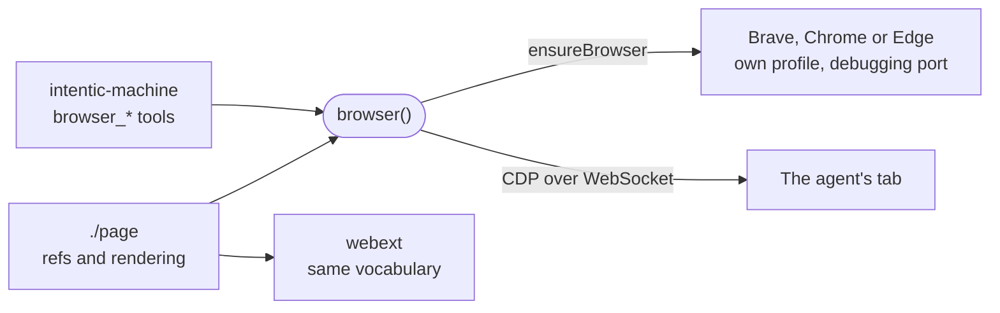

# browser

Drives a Chromium-family browser from Node over the DevTools protocol: opens pages, lists what can be clicked as numbered refs, clicks and types by ref, and captures, reads the console of and times the frames of what the GPU drew.

- Runs on the user's device inside [`intentic-machine`](../machine). It never touches the user's own profile, and
  never drives a browser it did not start: `ensureBrowser` starts the OS default Chromium-family browser with a
  profile of its own under `~/.intentic/browser/<browser>` and `--remote-debugging-port=0`, so the browser picks a free
  port and writes it into that profile's `DevToolsActivePort` with the path of its own debugging target, new every
  start. A browser is reused only when the endpoint on that port answers with that very target (`ownEndpoint`);
  whatever else answers on a debugging port, 9222 included, may be somebody's own Chrome and is never adopted. Edge
  ranks below any Chromium browser someone installed by choice (`pickBrowser`).
- A snapshot (`SNAPSHOT_SCRIPT`) lists visible interactive elements as refs `e0`, `e1`, … A ref lives until the next
  snapshot, and a stale one fails with a message instead of clicking whatever sits there now.
- Clicks and fills run as DOM calls inside the page and fire `input` and `change`, so they survive scrolling and
  reach a framework's state. Key presses go through `Input.dispatchKeyEvent`, since pages ignore synthetic keyboard events.
- (2026-11-03) **What the page looks like, logs and costs to draw**, for a web game on the device's own GPU
  ([`src/measure.ts`](src/measure.ts)). `screenshot(selector?)` captures from the compositor's surface (`fromSurface`),
  clipped to the visible page or one element and scaled by the browser to `MODEL_IMAGE_LIMITS`, after bringing the tab
  forward, since a background tab is not composited. `evaluate` runs an expression with its deadline both in the
  browser (`Runtime.evaluate`'s `timeout`) and on the wire. `frames` runs [`src/frames.ts`](src/frames.ts)'s page script:
  an optional condition polled once a frame, then N `requestAnimationFrame` intervals, a frame missing for 5 s read as
  a stall (a hidden tab), and the WebGPU adapter and unmasked WebGL renderer named. `console()` reads what the session
  collected ([`src/console.ts`](src/console.ts)): it enables Runtime and Log on attach, Chrome replays what the page
  logged before, and the newest thousand entries are kept per attached tab. The browser starts with
  `--disable-backgrounding-occluded-windows` and `--disable-renderer-backgrounding`, so a window behind the owner's
  own keeps drawing; no flag touches the GPU.
- The `./page` entry point has no DOM or Node imports, so the [browser extension](../webext) renders pages with
  the same `renderPage`.

## Key files

- [src/index.ts](src/index.ts) — `browser()`: one CDP session per object, and every page action.
- [src/launch.ts](src/launch.ts) — which binary to start, its flags, its profile directory and how its endpoint is recognised.
- [src/snapshot.ts](src/snapshot.ts) — the in-page script that numbers the elements.
- [src/page.ts](src/page.ts) — `PageState`, `renderPage` and ref parsing, shared with the extension.
- [src/cdp.ts](src/cdp.ts) — the DevTools protocol subset: find tabs, attach, send, hear events.
- [src/measure.ts](src/measure.ts) — screenshots from the GPU's surface, scripts with deadlines, frame timing.
