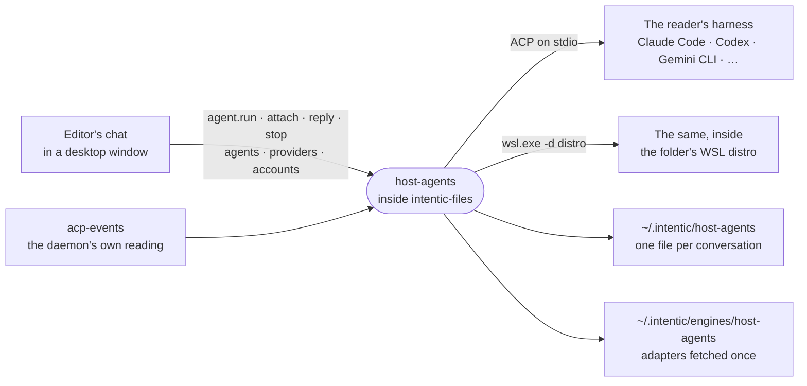

# host-agents

Coding agents run on the user's own computer, outside every sandbox: each harness is driven over the Agent Client Protocol and served to the editor's chat as the sandbox contract's own turns.



- **What it is for.** A reader whose sandbox is broken, whose machine cannot run one, or who wants their own harness
  with a chat on it, starts a conversation on this computer from a desktop window. It runs inside the app's file
  server ([local-files](../local-files)), which serves it beside each window's folder; nothing here listens by itself.
- **The chat is the sandbox's own.** Every procedure is answered in the sandbox contract's shapes (`procedures/`):
  `agent` (run, attach, reply, stop), `agents` (the cards, the transcript, the archive), `providers` and `accounts`. A turn's frames
  are folded by the contract's own `TranscriptFold`, read from the agent by [acp-events](../../_sandbox/acp-events), and
  each row is stamped with its run and its id by the contract's `RunRowIds`, as the daemon's are. So the editor draws a
  turn here with the components that draw one in a sandbox, and nothing in the wire is special to this side.
- **What is deliberately absent.** No private copy of the folder and no landing: an agent edits the reader's own files
  as they are. No fence: it runs as the reader. No subagents, automations, loops or schedules, no credential of
  Intentic's, nothing reachable from another machine, and nothing that calls the platform, so it works while Intentic's
  own servers are what is down. Work that should be contained, unattended or shared belongs in a sandbox.
- **Off until the reader turns it on.** `accepted()` is the app's word that the reader has read what running an agent
  on their own computer means. Until then no turn starts, nothing is fetched and nothing is signed in; a window may
  only read what is already there.
- **The posture is not a sandbox's.** There a container is the boundary and a turn may run without asking. Here every
  call the agent asks about goes to the reader on a permission card, a turn is put in the agent's asking mode before it
  is prompted, and no turn is ever put in an agent's run-without-asking mode: the contract's `bypassPermissions` is
  served as "accept file edits without a card", where the agent has such a mode (`turn.ts` `hostModeFor`). A harness's
  own allow rules still apply, as they do in the reader's terminal: one that allow-lists its shell asks nothing before
  running it (measured 2026-11-24 with Claude Code: a file written with no card, a web fetch outside its list asked
  about).
- **A conversation works in its window's folder, where the folder is** (`place.ts`). On this computer's own side the
  harness is started directly. For a folder inside a WSL distro (`\\wsl.localhost\<distro>\…`) it is started inside
  that distro, where the reader's tools and that side's sign-in live. Either way it is started with the environment the
  reader's own login shell has, asked once per side, so an agent finds what a terminal would (a version manager's
  PATH); a program on one of Windows' drives that a distro's PATH lists is never taken for the distro's own. A window
  sees only its own folder's conversations.
- **Harnesses** (`harnesses.ts`). One whose own program speaks the protocol (Gemini CLI, Grok Build, Kimi, Devin,
  OpenCode) runs where the reader installed it. One whose vendor publishes a separate adapter (Claude Code, Codex) uses
  that adapter from PATH, or fetches it once, at a version pinned here, under the reader's home in that place and
  never globally (`engines.ts`). It is fetched and run by this process itself acting as Bun where the computer has no
  Node (a compiled Bun program started with `BUN_BE_BUN=1`), and by the distro's own npm and Node inside WSL.
  _Measured 2026-11-24: Claude Code's adapter is 822 MB on disk on Linux (fetched in 26 s), 436 MB on Windows (79 s)
  and 457 MB inside a WSL distro (15 s, by the distro's npm); Codex's is 179 MB on Windows (5 s)._
- **Sign-in is the harness's own** (`sign-in.ts`). Nothing here holds a credential. A harness already signed in for the
  reader's terminal is signed in here. Otherwise the agent's own sign-in is run, the way it offers over the protocol:
  asked of the running agent, or as its own command with no terminal, its page's address read off what it prints. The
  browser opens on the computer the reader is at and the attempt finishes by itself (the contract's `device` flow).
  A harness that names an account and still refuses a turn (a stored login past its time limit) is treated as needing
  one: its account is listed with `needsReauth`, and the sign-in is really run again.
- **Kept small on purpose** (`store.ts`). One JSON file per conversation, holding the card's facts and every settled
  row, written behind each change with only the newest write landing. A sandbox's daemon keeps a compressed record log,
  a conversations database and a run journal because many agents and many readers share it; here one reader's
  conversations are written by the one process that runs them. When the app quits under a running turn, the turn is cut
  and what it had drawn is written before the process goes (`state.ts` `interruptAll`; the app gives the file server a
  moment for it), so the conversation opens again on what the reader saw, marked interrupted, and its next turn resumes
  the harness's own session. Only a crash loses a running turn's rows: no run is journalled as it goes.
- **One harness process per side of the computer**, kept across turns and ended after a quarter of an hour idle
  (`connection.ts`). Every one of them ends with this process, which ends with the app: nothing of an agent outlives
  it. A message sent while a turn runs waits on that turn's card and goes out as the next turn.

## Key files

- [src/host-agents.ts](src/host-agents.ts) — what the file server holds: the procedures for a folder, the roster's listeners, how many turns run.
- [src/turn.ts](src/turn.ts) — one turn over a harness's connection: session, mode, model, prompt, permission and question cards.
- [src/turns.ts](src/turns.ts) — a turn's life in its conversation: started, followed for its card, settled into the record.
- [src/place.ts](src/place.ts) — the two sides of a computer, and the login environment a harness is started with.
- [src/engines.ts](src/engines.ts) — how a harness is found in a place, and fetching its adapter.
- [src/sign-in.ts](src/sign-in.ts) — the harness's own sign-in, run for a card that only waits.

## Commands

```sh
pnpm --filter @intentic/host-agents test         # whole turns against a harness that is a real ACP process
pnpm --filter @intentic/host-agents typecheck
```
