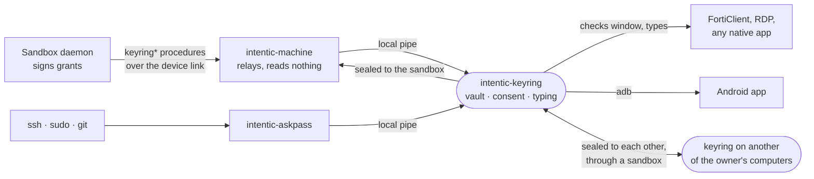

# keyring

`intentic-keyring`, the password vault on a user's own computer: a process of its own beside
[intentic-machine](../machine) that types a secret into a window, answers an ssh or sudo prompt, or hands a value to a
sandbox for one use, without the sandbox's agent ever holding the value.

## Why a process of its own

intentic-machine is the agent's hands on the computer: it runs the agent's `run_command`, reads files, types. A vault
key kept in its memory would be one bug in its scope checks away from the agent, and it updates itself on a timer at a
sandbox maintainer's word. The keyring does only what a vault does, updates only when a person says so
(`intentic-machine keyring upgrade` asks the running keyring, which asks the person), and trusts no caller on its pipe
for who it is. Every caller is a process of the same user, so the pipe is not the boundary; three things are:

- **A grant the sandbox signed.** A release or a typing for a sandbox carries a grant (`@intentic/sandbox-contract`
  `schemas/keyring.ts`), Ed25519-signed by that sandbox's own key, which the keyring fetched over TLS from the
  sandbox's address when the entry was shared (`GET /keyring/keys`), never from whoever relayed the share. A grant
  names one secret, one target and one nonce, and lives two minutes. The agent's own commands on this computer can
  reach the pipe but cannot sign one.
- **A person at this computer.** Anything that changes the vault, takes a value in, hands one to a local program
  (askpass), or answers an `each-use` share asks: Windows Hello where the computer has it, the keyring's passphrase
  otherwise. Every prompt says what is asked for, by whom, and where it goes.
- **The window it lands in.** Typing checks the focused window's program against the entry's list and, for a password,
  that the focused field is a password field. A value is never typed into a field that would echo it back to a
  screenshot unless the entry says `anyField`.

What a caller learns with none of these is names and rules, never a value.

## Share modes

Each entry is shared with each sandbox on its own terms:

| Mode | The sandbox gets a value when… | Works with the computer off |
| --- | --- | --- |
| `each-use` | the person at this computer says yes, each time | no |
| `while-here` | the keyring is unlocked: one Hello tap or passphrase opens it for up to the minutes chosen | no |
| `copy` | always: a copy, sealed to that sandbox, kept there as an ordinary secret and refreshed when the entry changes | yes |

`copy` is the explicit downgrade: the value then lives in the sandbox and its guards are the sandbox's.

## Files

Under `~/.intentic/keyring` (0700, its files 0600):

- `vault.json`: the entries, sealed under the vault key (AES-256-GCM), and the vault key wrapped once per way of
  unlocking: by a key derived from the passphrase (scrypt), and on Windows by a key derived from a Windows Hello
  signature over a fixed challenge (KeyCredentialManager signs with an RSA key in the TPM; PKCS#1 v1.5 signatures are
  deterministic, so the same challenge gives the same key, and only a Hello gesture produces one). The inbox and sync
  private keys live inside the sealed part.
- `keys.json`: what the keyring needs while locked: its `seal` key pair (for values sent to it to type) and each
  sandbox's pinned keys.
- `audit.jsonl`: one line per decision (who asked, for what, the answer), never a value.
- `keyring.log`, `keyring.pid`.

## The pipe

A named pipe on Windows (`\\.\pipe\intentic-keyring-<user hash>`), a unix socket in the keyring's directory elsewhere.
One JSON line in, one out (`src/protocol.ts`). A value sent in from this computer (`intentic-machine keyring add`, the
desktop app) is sealed to the vault's inbox key first, so a process squatting the pipe holds only ciphertext.

## Typing

On Windows the keyring inspects the foreground window (its process's executable, and through UI Automation whether the
focused element is a password field) and types with `SendInput` Unicode events, never `SendKeys`: the value goes to a
PowerShell helper on its standard input, never on a command line another process could read. It checks the
foreground window again after typing and says so if it changed. On Linux it types with `xdotool type --file -` or
`wtype -`, value on stdin; X11 cannot say whether a field is a password field, so a password there needs `anyField` or
a yes at the computer. On an Android phone attached over adb it checks the foreground app and the focused node's
`password` flag in a uiautomator dump, then types with `input text` through `adb shell` reading its commands from stdin.

## askpass

`intentic-askpass` is the keyring binary under a second name (a hard link beside it). Pointed at by `SSH_ASKPASS`,
`SUDO_ASKPASS` or `GIT_ASKPASS` (`intentic-machine keyring askpass install` sets them for the user), it sends the
prompt it was given to the keyring, which finds the entry whose `askpass` matcher fits (`ssh:user@host`,
`ssh-key:/path`, `sudo`, `git:https://host`, `prompt:<text>`), asks the person, and prints the value for the program
that asked. It asks every time unless the entry sets `askpassRememberMinutes`; a remembered answer is one any program
of this user could collect in that window, the agent's own commands included, and `keyring list` says so beside it.

## Password managers

An entry may name where its value is read at each use instead of holding it: 1Password (`op read op://…`, unlocked
by the 1Password app's own prompt, or a service-account token kept as another entry), Bitwarden (`bw get`, unlocked
with a master password kept as another entry) or KeePassXC (`keepassxc-cli show`, its database password kept as
another entry). Secrets reach those programs on standard input or in their environment, never on a command line.

## Two computers, one keyring

Two keyrings are paired once (`intentic-machine keyring sync pair`, or the editor's Pair), at a person's yes on each
computer, each prompt showing both sync-key fingerprints to compare. After that each change is sealed to the other's
sync key and left in a sandbox both are linked to, which carries ciphertext only; the other takes it in at its next
unlock. The newer revision of an entry wins.

## Hardened mode (Windows)

`intentic-machine keyring harden` (one UAC prompt) moves the vault out of the user's reach:

- The vault, its keys and its audit move to `%ProgramData%\Intentic\Keyring\<user SID>`, whose access list names only
  `LOCAL SERVICE`, SYSTEM and an elevated administrator. No process of the user, the agent's `run_command` included,
  can read the file or the memory of the process that holds it.
- That process is the keyring itself, run by a startup task (`\Intentic\Keyring-<SID>`) as `LOCAL SERVICE` from its
  own copy in `%ProgramData%\Intentic\Keyring\bin`, which only an administrator can replace. A task and not a Windows
  service because a compiled script cannot answer the service manager's start handshake (`src/service/task.ts`).
- A pipe the service created would refuse the user's writes, so it listens on loopback and writes its port and a random
  token to a door file only that user can read (`src/service/door.ts`). The token keeps other users out; it does not keep
  out the user's own programs, which is why every value still needs a sandbox's grant or a person's yes.
- The session helper, `intentic-keyring session`, starts at sign-in in place of `serve`. It answers the user's usual pipe
  by carrying each request through the door, so intentic-machine and intentic-askpass work unchanged, and it is the
  service's hands: it shows the prompts and does the typing. It proves itself once per sign-in with a Windows Hello
  signature over the service's challenge (or the passphrase), and every yes it relays afterwards is a Hello signature
  over a fresh challenge, checked by the service against the Hello key pinned at setup (`src/service/hello-verify.ts`),
  so a helper the agent started cannot say yes for the person.

- Undone by `intentic-keyring service uninstall`, run elevated by `intentic-machine keyring uninstall` and by the
  agent's `uninstall --purge`: the task is unregistered and the vault, its keys and its audit go back to
  `~/.intentic/keyring`. Then what the service left goes too (`src/service/leftovers.ts`): the user's emptied folder
  and, once no other user's `<SID>.hardened` marker is left, the service's copy in `bin`, the empty
  `%ProgramData%\Intentic\Keyring` and `Intentic` folders, and the empty `\Intentic\` folder in Task Scheduler. Its
  JSON answer names them in `swept`, and whatever could not go, with why, in `left`.

What it does not cover: a value being typed passes through the helper, a process of the user, for that moment. Every
other value, the vault key and the vault itself stay with the service.

## Limits

- Without hardened mode, a process of the same user can read the vault key from the keyring's memory while it is
  unlocked, and could trick a person into a Hello tap meant for the keyring; `while-here` is for a computer you are at.
- Windows Hello's own prompt says only "Making sure it's you": the topmost notice beside it is what names the request.
  A program that raises a Hello prompt of its own gets the same dialog without the notice.
- A Windows Hello prompt raised by a process with no window can open behind other windows; the keyring shows a
  topmost notice naming what is asked while it waits.
- Typing cannot be taken back: if focus moves between the check and the last character, the keyring stops and says
  where the rest went.
