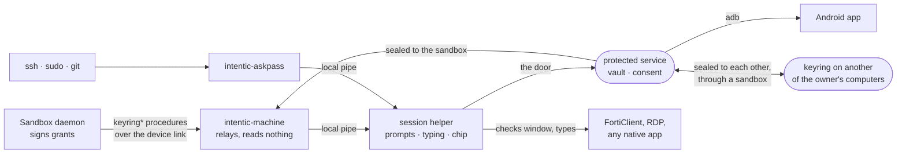

# keyring

`intentic-keyring`, the password vault behind Passwords on a user's own computer: a protected service of its own beside
[intentic-machine](../machine) that types a secret into a window, answers an ssh or sudo prompt, or hands a value to a
sandbox for one use, without the sandbox's agent ever holding the value.

## Why a process of its own

intentic-machine is the agent's hands on the computer: it runs the agent's `run_command`, reads files, types. A vault
key kept in its memory would be one bug in its scope checks away from the agent, and it updates itself on a timer at a
sandbox maintainer's word. The keyring does only what a vault does, updates only when a person says so
(`intentic-machine keyring upgrade` asks the running keyring, which asks the person), and trusts no caller on its pipe
for who it is. The vault itself is held by a service running as a system account of its own, so no process of the user,
the agent's own commands included, can read the vault file or the memory that holds its key (see "The protected
service" below). Every caller on the pipe is a process of the same user, so the pipe is not the boundary; three things
are:

- **A grant the sandbox signed.** A release or a typing for a sandbox carries a grant (`@intentic/sandbox-contract`
  `schemas/keyring.ts`), Ed25519-signed by that sandbox's own key, which the keyring fetched over TLS from the
  sandbox's address when the entry was shared (`GET /keyring/keys`), never from whoever relayed the share. A grant
  names one secret, one target and one nonce, and lives two minutes. The agent's own commands on this computer can
  reach the pipe but cannot sign one.
- **A person at this computer.** Anything that changes the vault, takes a value in, hands one to a local program
  (askpass), or answers an `each-use` share asks: a Windows Hello signature checked by the service against the key it
  pinned at setup on Windows, a polkit check the service runs itself on Linux, and the recovery key where neither can
  answer. Every prompt says what is asked for, by whom, and where it goes.
- **The window it lands in.** Typing checks the focused window's program against the entry's list and, for a password,
  that the focused field is a password field. A value is never typed into a field that would echo it back to a
  screenshot unless the entry says `anyField`.

What a caller learns with none of these is names and rules, never a value.

## Share modes

Each entry is shared with each sandbox on its own terms:

| Mode | The sandbox gets a value when… | Works with the computer off |
| --- | --- | --- |
| `each-use` | the person at this computer says yes, each time | no |
| `while-here` | the keyring is unlocked: one Hello tap or polkit yes opens it for up to the minutes chosen | no |
| `copy` | always: a copy, sealed to that sandbox, kept there as an ordinary secret and refreshed when the entry changes | yes |

`copy` is the explicit downgrade: the value then lives in the sandbox and its guards are the sandbox's.

## Files

In the service's own folder (`%ProgramData%\Intentic\Keyring\<SID>` on Windows, `/var/lib/intentic-keyring/<uid>` on
Linux), readable by the service's account and an administrator only:

- `vault.json`: the entries, sealed under the vault key (AES-256-GCM), and the vault key wrapped once per way of
  unlocking: by a key scrypt derives from the recovery key; on Windows by a key derived from a Windows Hello signature
  over a fixed challenge (KeyCredentialManager signs with an RSA key in the TPM; PKCS#1 v1.5 signatures are
  deterministic, so the same challenge gives the same key, and only a Hello gesture produces one); on Linux by the
  service's own key (`service-key.json`). The inbox and sync private keys live inside the sealed part.
- `keys.json`: what the keyring needs while locked: its `seal` key pair (for values sent to it to type) and each
  sandbox's pinned keys.
- `audit.jsonl`: one line per decision (who asked, for what, the answer), never a value.
- `keyring.log`.

`~/.intentic/keyring` (0700) keeps the session helper's pid file and the user's pipe. A vault left there by the per-user
keyring from before is moved into the service's folder by `service install`, and put back there by `service uninstall`.

## The pipe

A named pipe on Windows (`\\.\pipe\intentic-keyring-<user hash>`), a unix socket in `~/.intentic/keyring` elsewhere,
answered by the session helper, which carries each request through the service's door. One JSON line in, one out
(`src/protocol.ts`). A value sent in from this computer (`intentic-machine keyring add`, the
desktop app) is sealed to the vault's inbox key first, so a process squatting the pipe holds only ciphertext.

## Typing

Typing is the session helper's, the service's hands in the person's session. On Windows it inspects the foreground window (its process's executable, and through UI Automation whether the
focused element is a password field) and types with `SendInput` Unicode events, never `SendKeys`: the value goes to a
PowerShell helper on its standard input, never on a command line another process could read. It checks the
foreground window again after typing and says so if it changed. On Linux it types with `xdotool type --file -` or
`wtype -`, value on stdin; X11 cannot say whether a field is a password field, so a password there needs `anyField` or
a yes at the computer. On an Android phone attached over adb it checks the foreground app and the focused node's
`password` flag in a uiautomator dump, then types with `input text` through `adb shell` reading its commands from stdin.

## askpass

`intentic-askpass` is the keyring binary under a second name (a hard link beside it). Pointed at by `SSH_ASKPASS`,
`SUDO_ASKPASS` or `GIT_ASKPASS` (`intentic-machine keyring askpass install` sets them for the user), it sends the
prompt it was given to the keyring, which finds the entry whose `askpass` matcher fits (`ssh:user@host`,
`ssh-key:/path`, `sudo`, `git:https://host`, `prompt:<text>`), asks the person, and prints the value for the program
that asked. It asks every time unless the entry sets `askpassRememberMinutes`; a remembered answer is one any program
of this user could collect in that window, the agent's own commands included, and `keyring list` says so beside it.

## Password managers

An entry may name where its value is read at each use instead of holding it: 1Password (`op read op://…`, unlocked
by the 1Password app's own prompt, or a service-account token kept as another entry), Bitwarden (`bw get`, unlocked
with a master password kept as another entry) or KeePassXC (`keepassxc-cli show`, its database password kept as
another entry). Secrets reach those programs on standard input or in their environment, never on a command line.

## Two computers, one keyring

Two keyrings are paired once (`intentic-machine keyring sync pair`, or the editor's Pair), at a person's yes on each
computer, each prompt showing both sync-key fingerprints to compare. After that each change is sealed to the other's
sync key and left in a sandbox both are linked to, which carries ciphertext only; the other takes it in at its next
unlock. The newer revision of an entry wins.

## The protected service

There is one mode (2026-10-19; before it the vault was held by `intentic-keyring serve`, a process of the user, and
the service below was an optional "hardened mode" on Windows). `intentic-machine keyring setup` asks for an
administrator's yes once (UAC on Windows, `pkexec` on Linux) to run `intentic-keyring service install`, then starts the
session helper and sets the vault up. Setup refuses on macOS ("Passwords needs the Intentic desktop app's protected
service, which is not on macOS yet."), and on a Linux without systemd, polkit or setfacl, saying which.

Two processes share the work (`src/service/`):

- **The service** holds the vault and its key and decides every request (`service run --user <id>`). It cannot reach
  the person's desktop, so it never shows a prompt or types itself.
- **The session helper**, `intentic-keyring session`, starts at sign-in from the login entry intentic-machine registers.
  It answers the user's usual pipe by carrying each request through the service's door (`src/service/door.ts`), so
  intentic-machine and intentic-askpass work as they did, and it is the service's hands: it shows the prompts and the
  type-once box and does the typing. It proves a person is at the session once per sign-in before the service sends it
  anything; before setup there is no vault and nothing to prove with, so it is let in to enrol Windows Hello, and only
  while no vault exists.
- **The door** is a loopback port on Windows (a pipe the service created would refuse the user's writes) and a unix
  socket on Linux, beside a random token in a door file only that user can read. The token keeps other users out; it
  does not keep out the user's own programs, which is why every value still needs a sandbox's grant or a person's yes.

### Windows

- The vault, its keys and its audit live in `%ProgramData%\Intentic\Keyring\<user SID>`, whose access list names only
  `LOCAL SERVICE`, SYSTEM and an elevated administrator.
- The service is the keyring run by a startup task (`\Intentic\Keyring-<SID>`) as `LOCAL SERVICE` from its own copy in
  `%ProgramData%\Intentic\Keyring\bin`, which only an administrator can replace. A task and not a Windows service
  because a compiled script cannot answer the service manager's start handshake (`src/service/windows/task-windows.ts`).
- The helper proves itself with a Windows Hello signature over the service's challenge, and every yes it relays is a
  Hello signature over a fresh challenge, checked by the service against the Hello key pinned at setup
  (`src/service/hello-verify.ts`), so a helper the agent started cannot say yes for the person. Unlocking is a Hello
  tap; the recovery key opens the vault when Hello is reset.
- The marker `%ProgramData%\Intentic\Keyring\<SID>.hardened` says the service is installed for that user. The name is
  from hardened mode, kept so a PC set up before still reads as set up.

### Linux

- `service install`, run as root by pkexec for the user pkexec names (`PKEXEC_UID`), makes the `intentic-keyring` system
  user, copies the program to `/usr/lib/intentic-keyring/intentic-keyring` (root's), writes the templated unit
  `/etc/systemd/system/intentic-keyring@.service` and the polkit action
  `/usr/share/polkit-1/actions/dev.intentic.keyring.policy`, moves a per-user vault from before, writes the marker
  `/var/lib/intentic-keyring/<uid>.installed`, and enables `intentic-keyring@<uid>.service` (`src/service/linux/install-linux.ts`,
  `unit-linux.ts`).
- systemd runs the instance as `intentic-keyring` with the vault in `/var/lib/intentic-keyring/<uid>` (StateDirectory,
  0700) and the door in `/run/intentic-keyring/<uid>` (RuntimeDirectory, 0700), which the service opens to that one uid
  with setfacl: the folder may be entered, the socket written, the token read (`src/service/linux/service-run-linux.ts`).
- Node cannot read a unix socket's peer credentials, so the helper names its pid; the service checks that the pid is a
  live process of that uid (`/proc`) and runs `pkcheck --action-id dev.intentic.keyring.consent --process
  <pid>,<start time>,<uid> --allow-user-interaction` itself. polkit's agent in that session asks for the person's own
  password (`auth_self`, never kept), and the answer comes back to the service, not through the helper
  (`src/service/linux/polkit-linux.ts`). The action's `org.freedesktop.policykit.owner` annotation is what lets the service's
  user ask about another user's process. Every later yes is the same check, its dialog naming what is asked.
- A daily unlock is that yes: the vault key is wrapped once more under a random key in `service-key.json`, which only the
  service's user reads (`src/service/service-key.ts`). A vault moved in from before has no such wrap yet: its first
  unlock asks its recovery key (or old passphrase) once and adds it. Where polkit cannot ask (no agent in the session,
  pkcheck missing, a polkit too old for the owner annotation), the recovery key is asked through the helper instead.
- The helper starts from the login entry intentic-machine registers (a systemd user unit or an XDG autostart entry) and
  shows its dialogs with zenity or kdialog.

### Undone

`intentic-keyring service uninstall`, run as an administrator by `intentic-machine keyring uninstall` and by the agent's
`uninstall --purge`: the task or unit is removed and the vault, its keys and its audit go back to `~/.intentic/keyring`.
Then what the service left goes too (`src/service/windows/leftovers-windows.ts`, `install-linux.ts`): the user's emptied
folder and, once no other user's marker is left, the service's program, its folders, the Task Scheduler `\Intentic\`
folder (Windows), and the unit, the polkit action and the system user (Linux). Its JSON answer names them in `swept`,
and whatever could not go, with why, in `left`.

## The recovery key

Setup makes the recovery key, not the person: six groups of five Crockford base32 characters
(`XXXXX-XXXXX-XXXXX-XXXXX-XXXXX-XXXXX`, 150 bits, `src/service/recovery.ts`), shown once by `keyring setup` and never
stored. The vault wraps the vault key under it exactly as it wrapped a passphrase (scrypt), and the setup op still names
the field `passphrase`. Asked for in the passphrase box ("Type your recovery key"), it is read without regard to case,
spaces or dashes, with I, L and O read as 1, 1 and 0; anything else is tried as typed, so a passphrase from before
still opens a vault it made.

## The type-once box

When nothing in the vault answers a prompt (ssh asking for a password nobody saved, a program's password field, an
agent's need with no match), the service has the helper show its own box asking for the value once, with a "Remember
it" choice (consent.ts `ValuePrompt`). The answer goes to the service alone. On Linux it is zenity's `--forms` (a hidden
field and a Yes/No choice), or two kdialog dialogs; the Windows box is `consent-windows.ts`'s.

## The app chip

While the person lets Passwords remember what they type in programs (the vault's `remember.apps`, read through the
`state` op every minute), the session helper watches which field has the keyboard's focus (`src/watch/`). On Windows a
long-running PowerShell holds a UI Automation focus-changed handler, reporting whether the focused element is a password
field, its program's executable and where it is; a small topmost window that never takes focus then shows under the
field, "Fill with Intentic" when `candidates` has an entry for that program and "Save with Intentic" when not, and goes
when focus moves or after eight seconds. A click sends `fill-window`. On Linux the watcher is AT-SPI through python3-gi,
and the chip is a desktop notification with one action, since a Wayland compositor does not let a program place a
window; without python3's AT-SPI bindings the chip stays off. Nothing reads a field's value or hooks the keyboard.

## Limits

- A value being typed passes through the session helper, a process of the user, for that moment, and so does what the
  person types into the type-once box. Every other value, the vault key and the vault itself stay with the service.
- The helper is proven by a person's yes at sign-in, not by what program it is: a program of the user that gets the
  person to approve it is a helper too. The service checks every later yes itself (a Hello signature, a polkit check),
  so such a helper can show prompts and receive what it is asked to type, but cannot say yes for the person.
- Before setup, a helper is let in without proof, because there is no vault yet; a program of the user that set the
  vault up first would hold its recovery key. `keyring setup` sets it up right after installing the service.
- Windows Hello's own prompt for unlocking says only "Making sure it's you", without naming the request, and one
  raised by a process with no window can open behind other windows.
- On X11 every program of the same user can read keystrokes, those typed into the type-once box and those the helper
  types included; Wayland does not allow that.
- Typing cannot be taken back: if focus moves between the check and the last character, the keyring stops and says
  where the rest went.
- Password managers read at each use (`op`, `bw`, `keepassxc-cli`) run inside the service: on Linux its unit hides home
  folders (ProtectHome), so a manager that keeps its session there cannot be read from.

Not exercised by this package's tests: UAC, Task Scheduler and Windows Hello; systemd, pkexec, polkit's dialog, its
`$(title)`/`$(message)` substitution and the owner annotation; setfacl; UI Automation's focus events and the chip
window; AT-SPI and notify-send's action. What is tested is what is pure (paths, the unit and policy text, argv, the
door's messages, pkcheck's answers, the chip's decisions) and the door, helper and type-once box over real sockets with
fake hands.
