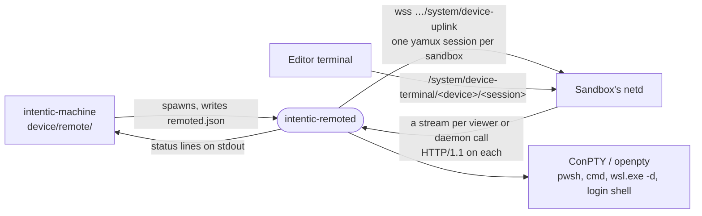

# remoted

`intentic-remoted`, the daemon on one of the owner's computers that serves people's terminals (and, from phase 2, its screens) to the editor over an uplink it dials to each sandbox that turned remote access on.



One process per computer environment, beside that environment's machine agent: the Windows side of a PC, a Linux
machine, and each WSL distro that runs an agent of its own, whose remoted is a Linux one serving native Linux shells
there. The machine agent starts it only while some link's remote switch is on, and it serves one uplink per linked
sandbox, each with that sandbox's own token, key and switches, and its own terminals: one sandbox cannot list, open or
end another's.

(2026-11-20) Each connection is served by its own remoted, and the sandbox decides it
([`remote-environments.ts`](../../_sandbox/sandbox/src/hosts/remote/remote-environments.ts)): a terminal opened on a
distro's row is that distro's own remoted's `native` shell, and the screen is the Windows side's alone (a distro's
connection offers none). The Windows side's remoted still lists `wsl:<distro>` for every distro `wsl.exe` can enter;
the sandbox leaves out and refuses there every distro with a connection of its own, so `wsl.exe -d` serves only a distro
with no agent. Rejected: the Windows side's remoted as the only one on a PC, reaching each distro through `wsl.exe -d`;
a distro with its own agent would have had two remoteds offering its shell.

## Command line, configuration, status

`intentic-remoted run --config <file> [--parent-stdin] [--sandbox-url <url> --device <name>]`; `intentic-remoted version`
prints the bare version (`0.0.0` from source, the release's when `build-remoted.sh --version` stamped it through
`INTENTIC_REMOTED_VERSION`).

- **`--config`** is JSON the agent writes 0600 by rename, read again within 500 ms of a change
  ([`src/config.rs`](src/config.rs)), so a switch reaches remoted inside the 2 s the agent promises without a restart:
  `{ paused, notBefore, uplinks: [{ id, url, device, uplinkToken, mediaKey, allow: {view, control, terminal},
  generation }] }`. `url` is the sandbox's daemon base (loopback when it runs on this computer); `mediaKey` is base64url
  and tokens are checked under its decoded bytes. A file that does not parse leaves the last good one standing, said
  once. With `--sandbox-url` and `--device` the file holds one uplink's fields at its top level instead (by hand, tests).
- **`--parent-stdin`**: remoted ends when stdin ends. The agent holds the pipe, so remoted never outlives it, on Windows
  included, where a killed parent takes no child with it. Its terminals end with it.
- **What changes do.** An uplink's terminal switch turned off ends that uplink's terminals (each viewer told why) and
  refuses new ones; an uplink removed is closed and its terminals ended; `notBefore` moving drops every person's socket
  and refuses every token minted before it (`intentic-machine remote end`); `paused` (the person's pause hotkey) drops
  everyone's typing. What stays allowed keeps running.
- **Status**: one JSON line on stdout at start and on every change ([`src/status.rs`](src/status.rs)):
  `{type: "status", version, pid, uplinks: [{id, state, generation, since, error?}], people: [{uplink, kind, session,
  readOnly, since}], terminals, environments, monitors, paused}`. `state` is `connecting`, `up`, `down`, `withdrawn` or
  `refused`; `generation` is the config's for that state, so the agent waits for `up` at the generation it just wrote.
  The log goes to stderr (`RUST_LOG`, default `info`), in castd's format.

## The uplink

([`src/uplink.rs`](src/uplink.rs)) `GET <url>/system/device-uplink` upgraded to a WebSocket with `authorization: Bearer
<uplinkToken>` and `x-intentic-device: <device>`; its binary messages carry one yamux session, exactly the ingress
tunnel's carrier: the tunnel crate's `pump` (`Liveness::Listens`, since netd pings every 15 s; either end drops a peer
silent 45 s) and `mux::server`. netd opens a stream per viewer and per daemon call and remoted serves each as one
HTTP/1.1 connection ([`src/http.rs`](src/http.rs)); remoted opens none. TLS is rustls with ring, trusting the bundled
Mozilla roots and this computer's own store.

- A drop is dialled again after 1 s, doubling to 30 s with a fifth of jitter, from the start again after an uplink that
  held 30 s: a sandbox restarting is back within one or two tries. A newer uplink of the same device closing this one
  (4001) is a drop like any other.
- The sandbox withdrawing it (4003) stops the dialling until the agent starts it again, which moves its `generation`.
- 401 or 403 on the upgrade (a token or a device the sandbox does not know) is `refused`, tried again on a backoff up to
  5 minutes, and at once when the agent writes a new token.
- A changed `url`, token or device closes a held uplink (1000) and dials again; a changed switch does not.

## What is served on a stream

| Route | Answer |
|---|---|
| `GET /health` | `{ok, version}` |
| `GET /info` | `{version, monitors, environments, encoders, allow, paused}`; `environments` is `native`, then `wsl:<distro>` for each distro on a Windows PC (Docker Desktop's own left out) |
| `POST /terminals` | `{session, environment?, shell?, cwd?, cols?, rows?}` → 201 `{session, title, environment, createdAt, viewers}`; 400 (a name not `[A-Za-z0-9_-]{1,64}`, an unknown environment or shell), 403 (terminal switch off), 409 (name taken), 429 (16 per uplink, 64 in all), 500 (the program did not start) |
| `GET /terminals` | the uplink's terminals, oldest first |
| `DELETE /terminals/<session>` | `{ok: true}`, or 404 |
| `POST /viewers/drop[?read_write=1]` | castd's drop for this uplink: closes its viewers with 4001 (only those that can type) and refuses tokens minted before now; `{dropped: n}` |
| `GET /stats` | `{uptimeS, terminals, viewers, uplinks}` |
| `GET /terminal/<session>?token=…` | a viewer's terminal socket (below); 401 without a token, 403 refused |
| `GET /media/<session>?token=…` | 501 until phase 2 |

The daemon's calls carry no token: the uplink is the sandbox's alone, and netd puts only viewer paths
(`/terminal/…`, `/media/…`) down it for a browser.

## Terminals

([`src/term/`](src/term)) Shells on a pseudo-terminal through portable-pty (wezterm's, MIT): ConPTY on Windows, openpty
elsewhere. On Windows `pwsh` where it is installed (on PATH or under Program Files), else Windows PowerShell; `cmd` and
`powershell` when asked for; `wsl.exe -d <distro> --cd <cwd or ~>` for `wsl:<distro>`. On Linux the user's login shell
(`$SHELL`, else the password database, run as `-bash`), or a shell `/etc/shells` lists when asked for by name, with
`TERM=xterm-256color`. A terminal outlives every viewer and the uplink dropping, for as long as remoted runs.

- **The socket is netd's terminal protocol exactly**: browser-wire's `TerminalClientMessage` in, `TerminalServerMessage`
  and the pane's bytes as binary messages out, `cols`, `rows`, `away=1` and `deflate=1` in the query, `ping`/`pong`, 45 s
  and 90 s silence rules, so the editor's terminal client opens one unchanged but for its URL. It also takes
  `{"type":"token","token":"…"}`: a fresh token keeping the socket's own access moves its expiry on.
- **Tokens** are castd's format ([`src/token.rs`](src/token.rs), castd's test vector holds the two equal) with `s =
  terminal/<session>`, signed under the uplink's media key; `ro: true` makes a watcher, whose typing is dropped and whose
  size bounds nothing. A socket outlives its newest token by `MEDIA_TOKEN_GRACE_SECONDS` (600 s) and is then closed with
  4002; a drop closes it with 4001. A debug build reads a shorter grace from `INTENTIC_REMOTED_TOKEN_GRACE_MS`, which the
  end-to-end test ("Measured end to end") uses to see a socket closed for its token and another kept by a fresh one.
- **One hub per terminal** ([`src/term/session.rs`](src/term/session.rs)), a single task, so a joining viewer's snapshot
  is cut exactly where its live output resumes. The grid is netd's rule: the per-axis minimum over the viewers in sight
  that may type, recomputed on join, resize, `away` and leave, applied to the pseudo-terminal only when it changes; with
  none in sight it stays. A viewer 1 MiB behind drops its backlog and, once its socket drained, is drawn a fresh snapshot.
- **The screen is kept by vt100** ([`src/term/screen.rs`](src/term/screen.rs)), 5,000 lines of history: a snapshot is a
  reset, the history scrolled into the viewer's scrollback, the screen, the cursor and the input modes (an alternate
  screen as the alternate screen). remoted is the terminal the program talks to: it answers the status and cursor-position
  queries (`ESC[5n`, `ESC[6n`) itself and keeps them from the viewers, so the answer is typed once however many watch.
  (2026-11-20) ConPTY asks for the cursor position as it starts (portable-pty opens it with
  `PSEUDOCONSOLE_INHERIT_CURSOR`) and holds the program's output until it is answered, so a terminal created before any
  viewer attached would otherwise hang. vt100 was chosen over alacritty_terminal for its formatted-redraw output, which is
  the snapshot; the cost is that a scroll region and the title are not re-sent.
- A program's exit ends the terminal, its viewers sent `exit` with its code; output still on its way is waited for until
  the pseudo-terminal is quiet 200 ms, 2 s at most (a ConPTY reader ends only once the pseudo-console is closed).

(2026-11-20) Rejected: one remoted per sandbox link (the design's `--sandbox-url` alone). A PC is linked to many
sandboxes, and two daemons would each hold the screen and its input in phase 2; one process with an uplink per link keeps
one owner of both. Rejected: building the tunnel's WebSocket and yamux plumbing again; the tunnel crate is depended on
by path, which brings quinn into the binary (about a megabyte) in exchange for netd's own liveness rules.

## Measured

`cargo test --test terminal -- --ignored --nocapture measure` against release builds (the Windows one from
`build-remoted.sh`; the Linux one glibc, where the shipped one is static musl), named to the suite through
`CARGO_BIN_EXE_intentic-remoted`, with a fake sandbox on loopback; keystroke echo is the round
trip through both yamux ends, the hub and the shell. 2026-11-20:

| | Windows 11, ConPTY, pwsh 7 (omen) | Linux, `/bin/sh` (Debian 13, z440) |
|---|---|---|
| uplink up after start | 69 ms | 53 ms |
| shell at its prompt after the create | 0.46 s | 8 ms |
| keystroke to its echo, median / p90 / worst of 20 | 15.7 / 16.2 / 28 ms | 0.70 / 0.76 / 0.90 ms |
| 20,000 lines printed and drawn | 3.4 s (`1..20000`) | 0.11 s (`seq`) |
| a second viewer drawn the screen and its 5,000 lines of history | 19 ms | 42 ms |

The Windows echo is ConPTY's own frame pacing (it renders about every 16 ms), and the long print is pwsh writing through
it; neither is remoted's. A `wsl:archlinux` terminal opened from the Windows side and answered in 1.3 s (debug build).
The release binaries are 4.8 MB (Windows, C runtime linked in) and 4.5 MB (Linux, glibc).

### Measured end to end

(2026-11-20) The whole path a person's keystroke takes, on the real binaries:
[`remote-terminal-netd.integration.test.ts`](../../_sandbox/sandbox/src/hosts/remote/remote-terminal-netd.integration.test.ts)
in the sandbox package starts the real netd and this remoted (debug builds), registers the device over netd's control
socket as the daemon does, opens a viewer's WebSocket at `/system/device-terminal/<device>/<session>` on netd's daemon
port, and times each keystroke from the WebSocket send to its echo arriving back: browser socket → netd → the yamux
uplink → remoted's hub → the pseudo-terminal (bash) and back, on loopback. Measured in an Intentic sandbox container
(Linux under WSL2 on rog), four runs of 20 keys each: median 0.51-0.68 ms, p90 0.62-1.03 ms, worst 1.21 ms. A typed
command's output arrives about 1 ms after its Enter. An uplink is up about 0.5 s after its config was rewritten, which is
remoted's half-second re-read of the file; a remoted started fresh reads it at once (69 / 53 ms above). The test also
runs in CI's netd-check job, which builds both binaries.

## Phase 2: the screen

[`src/media.rs`](src/media.rs) is the seam, and nothing else needs to change for it: `monitors()` (listed by `/info`
and the status line, and what `screen-<id>` sessions open), `encoders()`, and the `/media/<session>` route in `http.rs`,
which answers 501 now. The route should check the token with `token::MEDIA_SUBJECT` exactly as `terminal` does, require
`allow.view`, and gate input on `allow.control` and `paused` the way `Daemon::terminal_input_allowed` gates typing; a
person's socket registers with `Daemon::viewer(…, PersonKind::View | Control, …)` so the status, the notice and the
drops cover it. cast-core is not a dependency yet.

## Testing on Windows

The suite runs a built `intentic-remoted` against a fake sandbox with real shells, so on Windows it exercises ConPTY,
pwsh and `wsl.exe`. Cross-built here and run on a Windows PC:

```sh
cargo xwin test --no-run --target x86_64-pc-windows-msvc   # then copy intentic-remoted.exe and the terminal-*.exe beside it
.\terminal.exe --test-threads=1                             # on the PC; add `--ignored wsl` for a distro's terminal
```

## Key files

- [src/uplink.rs](src/uplink.rs) — dialling a sandbox, the backoff, and serving the yamux streams it opens.
- [src/http.rs](src/http.rs) — every route on a stream, the token check and the terminal socket's upgrade.
- [src/term/session.rs](src/term/session.rs) — one terminal: its pseudo-terminal, the shared grid and the viewers' hub.
- [src/term/screen.rs](src/term/screen.rs) — the screen remoted keeps, its snapshot, and the queries it answers itself.
- [src/daemon.rs](src/daemon.rs) — the configuration as it stands, enforced: switches, drops and the pause.
- [tests/terminal.rs](tests/terminal.rs) — the binary end to end against a fake sandbox's uplink.

## Commands

```sh
cargo test --manifest-path _devices/remoted/Cargo.toml
cargo xwin check --manifest-path _devices/remoted/Cargo.toml --all-targets --target x86_64-pc-windows-msvc
bash _tools/scripts/build/build-remoted.sh [--version <v>] linux-x64 linux-arm64 windows-x64
```
