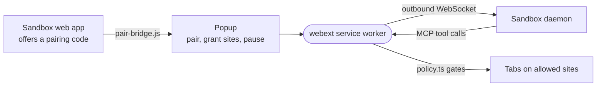

# webext

The Chrome extension that lets an intentic sandbox work in the user's own signed-in browser, on the sites they allow, over one outbound WebSocket.



- Runs in the user's Chromium browser as a Manifest V3 extension. Unlike [browser](../browser), which drives a
  separate profile, the agent here works inside the user's real sessions.
- The agent works in a window of its own ([`agent-window.ts`](src/background/agent-window.ts)), opened unfocused:
  Brave and Chrome put it behind the person's window, so the tab they are using is never taken over. Tools given no
  tab act on the agent's tab there, and one of the person's tabs is worked on by id without being brought forward.
  Covered, its page is throttled (no animation frames, timers about once a second) while clicks, typing and navigation
  still work; on a spare monitor it runs in full, and where the person puts it is where the next one opens. It is
  never created minimized: Brave ignores that and opens a focused window on top. The popup's "Where it works" switches
  back to the tab in front of them.
- `wait_for` waits in one call for a page that takes minutes (an image or a video being generated): for `text` to
  appear, `textGone` to go, `quietFor` seconds with nothing in the page changing, or all of them at once, for up to
  540 seconds. "Changing" is any child, text or attribute in the DOM, less the extension's own banner and question and
  the document's `<head>`; a CSS animation is no change, a clock rewriting its text is, and a wait that never saw the
  page still names what kept it busy, so the agent can wait for text instead. That page is throttled, so the waiter
  hears changes through a MutationObserver and uses timers only to end a round, never animation frames; the flip side is
  that a page which updates only from animation frames does not change at all while covered and looks still, so
  `text`/`textGone` is the surer wait when the finished page has a marker
  ([`waiting.ts`](src/page/waiting.ts)). Chrome stops a worker whose single call runs over 5 minutes, so the worker
  ([`page-wait.ts`](src/background/tools/page-wait.ts)) asks in 25-second rounds against one watch kept in the page;
  the sandbox's 20 s heartbeat over the socket and each round's call keep the worker alive (a WebSocket message counts
  since Chrome 116). A round that finds no watch means the document was replaced, and the answer says where the tab
  went. The deadlines nest outward: the wait (540 s), the sandbox's hub (10 minutes,
  `_sandbox/sandbox/src/peers/webext-call-deadline.ts`), then the agent's MCP client (11 minutes, set on the mount).
- A question the agent waits on ([`asking.ts`](src/background/asking.ts)) is asked on its page and on the icon at once:
  the badge lights, the popup opens by itself (unless turned off) and can answer it, and the agent's window flashes in
  the taskbar without taking focus. Whichever answers first wins, and the panel on the page is taken down.
- Pairing: the sandbox page posts a code, `pair-bridge.js` (the only content script, on intentic.dev pages) hands it
  to the worker, and the person finishes it with a click in the popup, which redeems it at `/system/webext/enroll`.
  Chrome closes the popup when its own permission dialog opens, so the click hands the pairing to the worker first
  and the worker redeems it once Chrome grants the sandbox's origin (`connecting.ts`): one Connect, one Allow.
  The token it gets back is the only secret the extension stores. The code carries the sandbox's name, which the popup
  lists it by.
- One extension serves several sandboxes (since 2026-10-28; before, pairing a second replaced the first). Each paired
  sandbox has its own socket ([`link.ts`](src/background/link.ts)), token, switches from its own card, agent window and
  pending site request, and every tool call acts for the sandbox whose socket it came over: its switches, its window,
  its token for `type_ticket`, `connect_site` and `lend_site`. What the person decides about the browser is shared: the
  allowed sites and their modes, pause, declines and settings. No sandbox's own app is a site any agent may work on.
  The popup's Sandboxes section lists them, disconnects one at a time, and pairs another.
- `policy.ts` decides every call. Chrome's own permission for the site comes first, and only a click in the popup
  grants one, so the agent can only ask (`ask_access`), which opens the popup with its reason (Chrome 127+, else the
  badge alone); a decline holds for 15 minutes. Then the switches on the sandbox's capability card, then the
  site's read-only or read-and-act mode. The sandbox's own origin is never a target, and the popup's pause stops everything.
- Chrome's permission dialog closes the popup that opened it, so the popup sends the person's Read or Read & act pick
  to the worker before asking Chrome, and [`site-grants.ts`](src/background/site-grants.ts) files it when Chrome's
  grant lands. A site allowed from Chrome's own menu while the agent is waiting on it is filed as read only.
- An action (`click`, `fill`, `key`, `select_option`) answers with what became of it, so the agent never has to
  repeat one to find out. It notes the page's address and marks its document first (`markDocument`, a value on the
  extension's isolated world, which dies with the document), then reads the tab back after it settles: the page's
  own answer, an address that changed without a new document (a single-page app's route, so earlier refs are stale),
  or a page that moved or reloaded. Chrome answers null, or throws, when the frame an action ran in went away
  mid-call, which is what ChatGPT's Send does when it opens `/c/<id>`; that used to read as "did not answer" though
  the message had been sent, and the agent sent it again. When nothing observable changed and the page gave no answer,
  the outcome is said to be UNKNOWN, with the page to check before repeating. The destination's permission is checked
  again before anything of it is read, and a page on a site not allowed is said to have moved without its address.
- `fill` puts text where the page's own editor sees it ([`typing.ts`](src/page/typing.ts)). An input or textarea gets
  its value through the native setter, past React's tracker. A contenteditable is a rich editor (ProseMirror,
  Lexical, Slate, Draft.js, Quill) that keeps its own model and ignores a direct `textContent` write, so its Send
  stayed disabled over a field that only looked filled: one line goes in with `execCommand("insertText")`, else a
  `beforeinput` the editor may take; several lines go in as a synthetic paste, the one input every one of those
  editors turns into its own paragraphs, and line by line when nothing took the paste. The field is then read back,
  and one that does not hold the text is reported and not submitted. `submit` presses Enter on the focused element
  with key, code, keyCode and which, and submits the form only for an `<input>` whose Enter no handler took, as a
  browser does, so a composer that sends on Enter is not sent twice.
- `connect_site` hands a site's session to the sandbox and `lend_site` borrows one back; both need the sessions
  switch and a confirmation in the page every time.
- `type_ticket` types a stored secret into the field in focus for the sandbox's own `type_secret`, and the agent's
  mount of the browser never lists it. The call carries a one-time ticket only; the extension collects the value at
  `/system/webext/secret` with the page's address, the sandbox's guard judges that host, and the value goes into the
  field (never submitted) and nowhere else: not the tool's answer, not the activity list.
- **Files between a page and the sandbox** ([`tools/media.ts`](src/background/tools/media.ts),
  [`tools/media-tools.ts`](src/background/tools/media-tools.ts), [`page/media-driver.ts`](src/page/media-driver.ts)).
  `save_media` takes a picture, video, sound or file the agent sees, by `ref` (an img, the button that wraps one, a
  download link, a canvas, a CSS background) or by `url`, and answers with the path it now has in the sandbox. Snapshots
  list content pictures and videos with their size (`[e129] img "Generated image 1" 1672×941`), and up to 20 more past
  the 150-element cap, since a long sidebar would otherwise hide them; icons, avatars and images marked decorative are
  left out. The page fetches the file itself, in the isolated world, so its cookies and its `blob:` addresses work; the
  worker reads it out in 4 MB base64 slices, one `executeScript` each, because one call's answer cannot carry tens of
  MB. Only when the page's fetch fails (another site that refuses it) does the worker fetch it, and then only from a site
  the agent is allowed on. The bytes are checked against the type they claim (a sign-in page where a picture was expected
  is refused) and POSTed raw to the sandbox's `/system/webext/media` on the extension's token, never inside a tool
  answer; the sandbox stores them under `.intentic/records/artifacts/chrome/`. One file is at most 50 MB
  (`WEBEXT_MEDIA_MAX_BYTES`), held here and again by the sandbox. A `ref` saves what the page already shows, so read
  is enough, and keeps any file but a web page. A `url` is fetched with the site's own sign-in and could be any of its
  answers (an account's JSON, a chat history), so it needs act on the site and brings in only pictures, video, sound,
  listed documents and archives, or a file the site serves as a download (`Content-Disposition: attachment`): never
  JSON, HTML or text (`keptFromAddress`).
- `upload_file` puts a sandbox file into a page's file input (or the input behind a button that opens the file chooser,
  matched by its `accept`). The extension cannot ask for a file by path: the daemon sees the call on its way here,
  checks the file is on the sandbox's artifacts shelf (chat attachments included; real path, links followed) and adds a
  one-time ticket, which the extension redeems at `/system/webext/file`. The person is then asked on the page every time,
  with the file's name and size, whatever their switches say, and only their yes puts it in, with `input` and `change`.
- **Downloads (optional):** a site's Download button saves into the person's Downloads folder, out of the agent's reach.
  The popup's "Save my agent's downloads to the sandbox" asks for the optional `downloads` permission (optional because
  a new required permission makes Chrome disable the store-installed extension until the person re-approves it), and
  `describe` says whether it is on. Then a download that starts while one of a sandbox's calls runs (or within 5 s of
  it), from the site of a tab in that agent's own window, is fetched again from its own address in that tab, stored like
  `save_media`, and taken out of the person's Downloads, since they did not ask for it
  ([`tools/media-downloads.ts`](src/background/tools/media-downloads.ts)). Chrome's download records do not say which
  tab started one, hence the rule; in "My tab" mode nothing is captured, and the person's own downloads are never read
  past their address. The answer to the call that started it says where the file went when the copy lands within 20 s,
  else the next answer does. A download that could not be copied (a page that revoked its `blob:` address at once) stays
  in Downloads, and the agent is told to use `save_media` instead.
- A sandbox's sign-in can finish here without a paste ([`src/background/loopback-catch.ts`](src/background/loopback-catch.ts),
  the device agent's `catchLoopback` answered from the browser): a tab reaching the provider's
  `http://localhost:<port>/…` redirect is handed back to the sandbox, which checks it, and the dead-end tab closes. It
  needs no new permission, so it works only where the owner allowed this extension on `http://localhost` like any
  other site, and `describe` advertises `loopback-catch` only then.
- **User scripts** (behind the card's `scripts` switch, off by default): the agent writes a script under a
  Tampermonkey-style `// ==UserScript==` header, tries it once in a tab (`script_try`, via `userScripts.execute`, after
  the person's yes for that site), and asks to install it. The request waits in the popup with its code, sites, the
  hosts it may reach and its hash, and only the person's click installs it; an update shows as a diff unless they let
  that script update without asking and its sites and hosts stay the same. Chrome's `chrome.userScripts` then runs it
  on every visit to its sites, with the sandbox offline too. It needs Chrome 135, the optional `userScripts`
  permission (popup → Scripts → "Turn on scripts") and the browser's own "Allow User Scripts" switch on the
  extension's details page ("Developer mode" before Chrome 138). Until both are on, the script tools and `describe`'s
  `Scripts:` line name what is missing; once they are, the facts carry the feature `user-scripts`.
- Each script runs in a `USER_SCRIPT` world of its own, named after it, whose content security policy allows only
  its own sites and `@connect` hosts. Measured on Chrome 156, that policy blocks its fetches and loads to any other
  host, and the page's own policy does not apply to the world, so the script's own requests reach only the hosts the
  person was shown. (A policy does not cover navigation: a script that sends the page elsewhere does it in view.)
  Its messages to the worker carry a secret of its own, since Chrome does not say which world a message came from.
  A script is unregistered while it is off, scripts are unavailable, the browser is paused, or one of its sites is no
  longer allowed in read and act, and comes back when that changes. Chrome clears registrations when the extension
  updates, so the worker registers them again from `chrome.storage.local`. Installed scripts are the person's: they
  stay and keep running when the sandbox that wrote them disconnects, and only its pending request is dropped.
- **Site kits** ([`src/background/kits/`](src/background/kits/kit.ts)): one site's whole job in one tool call, where
  the generic page tools would take an agent a snapshot, a click and a check per step. The ChatGPT kit has three:
  `chatgpt_send` (one prompt in, ChatGPT's answer out: words, images saved into the sandbox, files attached from the
  artifacts shelf, Deep research or agent mode chosen from the composer's tools menu), `chatgpt_read` (a chat's latest
  answer, waited for, for a job that outlived the call that sent it) and `chatgpt_image` (the same engine, done only
  when a picture comes). Each types the prompt into the composer the way a person's typing reaches a rich editor, sends
  it, waits up to 9 minutes, and saves pictures through `saveMediaFromTab` and long answers through `saveBytes`
  ([`tools/media.ts`](src/background/tools/media.ts)). It never presses ChatGPT's own confirmation buttons (an app
  searching outside the project, agent mode's sensitive step): the answer says ChatGPT is waiting on the person.
  A kit has no power the page tools lack: the browser not paused, the card's "Click and type", the site allowed in read
  and act (checked before anything opens, so a site never allowed is never loaded and the agent is told to
  `ask_access`), the banner and the activity record. Files are asked about on the page every time, as `upload_file`'s
  are, and travel on the same one-time tickets the daemon adds (`chatgpt_send`'s `files` get one each). It works in a
  new tab beside the agent's own and gives the front back when done, or in a new tab in front of the person when they
  chose to have it work in their tabs.
  - Since 2026-11-14 a kit's page knowledge, its steps in the page, its engine and every word an agent reads live in
    [`@intentic/site-kits`](../../_shared/site-kits), behind a host interface, so the sandbox's own browser can run the
    same kit and say the same things. This extension is one host:
    [`kits/chatgpt/chrome-host.ts`](src/background/kits/chatgpt/chrome-host.ts) holds what is Chrome's (the gates, the
    tabs and the agent's window, steps injected into the isolated world, file tickets and the person's yes,
    `chrome.storage`) and turns the kit's refusals into this extension's, and
    [`kits/chatgpt/chatgpt-kit.ts`](src/background/kits/chatgpt/chatgpt-kit.ts) defines the tools from the kit's own
    descriptions and inputs.
  - New chats go into one ChatGPT project per sandbox, "Intentic · <sandbox>", made on first use with project-only
    memory and instructions of its own ([`project.ts`](../../_shared/site-kits/src/chatgpt/project.ts) in the kit), and
    remembered in `chrome.storage.local`. Until 2026-11-14 every chat was temporary and unpersonalized, which kept the
    owner's memory out but also turned off apps and connectors (OpenAI's help page: an unpersonalized temporary chat
    "does not use memory, custom instructions, or plugins") and could not be opened again once its tab moved on. A
    project with project-only memory keeps their saved memories and other chats out while every tool works. Rejected:
    regular chats (their memory shapes the answer) and one project for every sandbox (one sandbox's chats would become
    another's context). When the project cannot be made, the call falls back to a temporary, unpersonalized chat and
    says so; `temporary: true` asks for one, and `personalized: true` uses a regular chat with the owner's memory.
  - A kit breaks when its site changes its page, and that is expected. Each keeps every string and element lookup it
    assumes in one table, `site.ts` in its folder of `@intentic/site-kits`, with each line marked as seen in a real
    snapshot or guessed, so the fix after a redesign is there. Elements are found by role and accessible name, as the
    snapshot names them, not by class names.
  - One call to this browser is capped at ten minutes, so a call waits at most 9 (`wait` shortens it; the daemon cuts
    it further for a runtime whose client gives up sooner) and answers that ChatGPT is still working; `chatgpt_read`
    collects the rest, never a second send.
  - ChatGPT's page is watched in rounds of 30 seconds from the worker rather than one long injected wait: Chrome ends a
    worker whose single call runs past five minutes, the page may be replaced mid-answer (sending moves it from `/` to
    `/c/<id>`), and each round re-checks pause and the site's grant. Inside a round the page is watched with a
    MutationObserver and single timers, never animation frames or chained timers, which a page behind the person's
    window does not get on time. A lost answer from the page is asked again, never treated as a failure, so a send is
    never repeated on that account.
  - Continuing (`chat`) uses the tab the chat lives in when it is still on it, kept from being discarded. A project chat
    whose tab has gone is loaded again by its address; a temporary one cannot be, and the agent is told to start a new
    chat. A chat id it does not remember is opened by address to see whether it sits in the sandbox's project; one that
    does not is one of the account's own, sent into only with `personalized: true` (its tab is closed again otherwise),
    and read by `chatgpt_read` either way. A tab a call opened is closed again when the call ends before sending; once
    a prompt is sent the tab stays for the chat, and when a chat falls out of the kit's memory (20 per sandbox) its tab
    is closed if it still sits in the agent's window on that chat, else made discardable again.
  - A kit's in-page helpers refuse to install on any host but the kit's own, so a tab redirected mid-call (a sign-in
    page) is never read.
- Chrome kills an idle MV3 worker, so the worker holds no state: everything lives in `chrome.storage.local`, and an
  alarm redials a dropped link.
- **Passwords (optional):** a separate "Turn on" in the popup asks once for `nativeMessaging` and all-site access.
  That grant is only for remembering and filling passwords via the desktop app's native host (`dev.intentic.keyring`);
  the agent still needs its own per-site allow in the list below. While on, a content script captures sign-ins on
  submit (never in incognito, never one-time codes or card fields), shows a short "Saved … · Undo" toast, and offers
  fill after you confirm on the computer. Values never go to a sandbox automatically.
- `scripts/size-budget.mjs` fails a build whose bundles outgrow their ceilings; import zod by name and the contract
  through `@intentic/sandbox-contract/webext`. [PUBLISHING.md](PUBLISHING.md) covers the store release.

## Key files

- [src/background/main.ts](src/background/main.ts) — the service worker: keepalive alarm, pairing, popup messages.
- [src/background/connecting.ts](src/background/connecting.ts) — a Connect press finished by Chrome's grant, since its
  dialog closes the popup that asked.
- [src/background/store.ts](src/background/store.ts) — everything kept, per sandbox or for the whole browser, and the
  move from a build that kept one sandbox.
- [src/background/policy.ts](src/background/policy.ts) — every allow or refuse decision, with its message.
- [src/background/mcp.ts](src/background/mcp.ts) — the tool surface the sandbox calls.
- [src/background/agent-window.ts](src/background/agent-window.ts) — the agent's own window: opened, reused, remembered.
- [src/background/asking.ts](src/background/asking.ts) — the person's yes, from the page or the popup.
- [src/page/driver.ts](src/page/driver.ts) — what runs inside a tab: snapshot, click, keys, the document's mark.
- [src/page/typing.ts](src/page/typing.ts) — `fill`'s steps inside a tab: focus, type into an input or a rich editor, read back, Enter.
- [src/page/waiting.ts](src/page/waiting.ts) and [src/background/tools/page-wait.ts](src/background/tools/page-wait.ts) — `wait_for`: the watch in the page, and the rounds the worker asks it in.
- [src/page/media-driver.ts](src/page/media-driver.ts) — what runs inside a tab to move a file: a ref resolved to
  media, a fetched file read out in slices, a file put into an input.
- [src/background/tools/media.ts](src/background/tools/media.ts) — `saveMediaFromTab`: fetch in the page, check the
  bytes, hand them to the sandbox.
- [src/background/tools/media-tools.ts](src/background/tools/media-tools.ts) — `save_media` and `upload_file`.
- [src/background/tools/media-downloads.ts](src/background/tools/media-downloads.ts) — the agent's own downloads, copied
  into the sandbox.
- [src/page/overlay.ts](src/page/overlay.ts) — what a tab shows the person: the action banner and the in-page Allow/No question.
- [src/popup/popup.ts](src/popup/popup.ts) — the popup, where every permission is granted; `preview` renders its states.
- [src/popup/sandboxes-section.ts](src/popup/sandboxes-section.ts) — the popup's list of paired sandboxes, and pairing another.
- [src/background/tools/scripts.ts](src/background/tools/scripts.ts) — the script tools, and the person's answers to install and update requests.
- [src/background/scripts/header.ts](src/background/scripts/header.ts) — reads a `// ==UserScript==` header, and the rules on `@match` and `@connect`.
- [src/background/scripts/kept.ts](src/background/scripts/kept.ts) — installed scripts, pending requests, logs and each script's storage.
- [src/background/scripts/runtime.ts](src/background/scripts/runtime.ts) — registrations, each script's world and its policy, and what a script may say to the worker.
- [src/background/scripts/view.ts](src/background/scripts/view.ts) — the popup's picture of scripts.
- [src/popup/scripts-section.ts](src/popup/scripts-section.ts) — the popup's Scripts section: turning scripts on, install requests, the installed list.
- [src/popup/line-diff.ts](src/popup/line-diff.ts) — the line diff an update is reviewed as.
- [src/background/kits/kit.ts](src/background/kits/kit.ts) — what a site kit is, its gates, and the tab it works in.
- [src/background/kits/chatgpt/chrome-host.ts](src/background/kits/chatgpt/chrome-host.ts) — the ChatGPT kit's Chrome host: what this browser does for the kit's engine in `@intentic/site-kits`.
- [src/background/kits/chatgpt/chatgpt-kit.ts](src/background/kits/chatgpt/chatgpt-kit.ts) — `chatgpt_send`, `chatgpt_read` and `chatgpt_image` on this extension's tool surface.
- [src/background/native.ts](src/background/native.ts) — the one native-messaging port to Passwords on this computer, requests correlated by id.
- [src/background/passwords.ts](src/background/passwords.ts) — registers the passwords content script and routes capture/fill.
- [src/content/password-capture.ts](src/content/password-capture.ts) — capture, toast, and fill UI injected on sites while Passwords is on.
- [static/manifest.json](static/manifest.json) — permissions, the content script, the minimum Chrome.

## Commands

```sh
pnpm turbo run build --filter=./_devices/webext   # dist/, loadable unpacked
pnpm --filter @intentic/webext test
pnpm --filter @intentic/webext package             # dist.zip for the store
pnpm --filter @intentic/webext preview             # the popup in an ordinary tab
```
