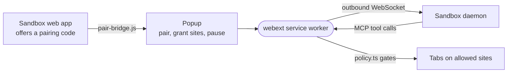

# webext

The Chrome extension that lets an intentic sandbox work in the user's own signed-in browser, on the sites they allow, over one outbound WebSocket.



- Runs in the user's Chromium browser as a Manifest V3 extension. Unlike [browser](../browser), which drives a
  separate profile, the agent here works inside the user's real sessions.
- The agent works in a window of its own ([`agent-window.ts`](src/background/agent-window.ts)), opened unfocused:
  Brave and Chrome put it behind the person's window, so the tab they are using is never taken over. Tools given no
  tab act on the agent's tab there, and one of the person's tabs is worked on by id without being brought forward.
  Covered, its page is throttled (no animation frames, timers about once a second) while clicks, typing and navigation
  still work; on a spare monitor it runs in full, and where the person puts it is where the next one opens. It is
  never created minimized: Brave ignores that and opens a focused window on top. The popup's "Where it works" switches
  back to the tab in front of them.
- A question the agent waits on ([`asking.ts`](src/background/asking.ts)) is asked on its page and on the icon at once:
  the badge lights, the popup opens by itself (unless turned off) and can answer it, and the agent's window flashes in
  the taskbar without taking focus. Whichever answers first wins, and the panel on the page is taken down.
- Pairing: the sandbox page posts a code, `pair-bridge.js` (the only content script, on intentic.dev pages) hands it
  to the worker, and the person finishes it with a click in the popup, which redeems it at `/system/webext/enroll`.
  The token it gets back is the only secret the extension stores. The code carries the sandbox's name, which the popup
  lists it by.
- One extension serves several sandboxes (since 2026-10-28; before, pairing a second replaced the first). Each paired
  sandbox has its own socket ([`link.ts`](src/background/link.ts)), token, switches from its own card, agent window and
  pending site request, and every tool call acts for the sandbox whose socket it came over: its switches, its window,
  its token for `type_ticket`, `connect_site` and `lend_site`. What the person decides about the browser is shared: the
  allowed sites and their modes, pause, declines and settings. No sandbox's own app is a site any agent may work on.
  The popup's Sandboxes section lists them, disconnects one at a time, and pairs another.
- `policy.ts` decides every call. Chrome's own permission for the site comes first, and only a click in the popup
  grants one, so the agent can only ask (`ask_access`), which opens the popup with its reason (Chrome 127+, else the
  badge alone); a decline holds for 15 minutes. Then the switches on the sandbox's capability card, then the
  site's read-only or read-and-act mode. The sandbox's own origin is never a target, and the popup's pause stops everything.
- Chrome's permission dialog closes the popup that opened it, so the popup sends the person's Read or Read & act pick
  to the worker before asking Chrome, and [`site-grants.ts`](src/background/site-grants.ts) files it when Chrome's
  grant lands. A site allowed from Chrome's own menu while the agent is waiting on it is filed as read only.
- `connect_site` hands a site's session to the sandbox and `lend_site` borrows one back; both need the sessions
  switch and a confirmation in the page every time.
- `type_ticket` types a stored secret into the field in focus for the sandbox's own `type_secret`, and the agent's
  mount of the browser never lists it. The call carries a one-time ticket only; the extension collects the value at
  `/system/webext/secret` with the page's address, the sandbox's guard judges that host, and the value goes into the
  field (never submitted) and nowhere else: not the tool's answer, not the activity list.
- A sandbox's sign-in can finish here without a paste ([`src/background/loopback-catch.ts`](src/background/loopback-catch.ts),
  the device agent's `catchLoopback` answered from the browser): a tab reaching the provider's
  `http://localhost:<port>/…` redirect is handed back to the sandbox, which checks it, and the dead-end tab closes. It
  needs no new permission, so it works only where the owner allowed this extension on `http://localhost` like any
  other site, and `describe` advertises `loopback-catch` only then.
- Chrome kills an idle MV3 worker, so the worker holds no state: everything lives in `chrome.storage.local`, and an
  alarm redials a dropped link.
- **Passwords (optional):** a separate "Turn on" in the popup asks once for `nativeMessaging` and all-site access.
  That grant is only for remembering and filling passwords via the desktop app's native host (`dev.intentic.keyring`);
  the agent still needs its own per-site allow in the list below. While on, a content script captures sign-ins on
  submit (never in incognito, never one-time codes or card fields), shows a short "Saved … · Undo" toast, and offers
  fill after you confirm on the computer. Values never go to a sandbox automatically.
- `scripts/size-budget.mjs` fails a build whose bundles outgrow their ceilings; import zod by name and the contract
  through `@intentic/sandbox-contract/webext`. [PUBLISHING.md](PUBLISHING.md) covers the store release.

## Key files

- [src/background/main.ts](src/background/main.ts) — the service worker: keepalive alarm, pairing, popup messages.
- [src/background/store.ts](src/background/store.ts) — everything kept, per sandbox or for the whole browser, and the
  move from a build that kept one sandbox.
- [src/background/policy.ts](src/background/policy.ts) — every allow or refuse decision, with its message.
- [src/background/mcp.ts](src/background/mcp.ts) — the tool surface the sandbox calls.
- [src/background/agent-window.ts](src/background/agent-window.ts) — the agent's own window: opened, reused, remembered.
- [src/background/asking.ts](src/background/asking.ts) — the person's yes, from the page or the popup.
- [src/page/driver.ts](src/page/driver.ts) — what runs inside a tab: snapshot, click, fill.
- [src/page/overlay.ts](src/page/overlay.ts) — what a tab shows the person: the action banner and the in-page Allow/No question.
- [src/popup/popup.ts](src/popup/popup.ts) — the popup, where every permission is granted; `preview` renders its states.
- [src/popup/sandboxes-section.ts](src/popup/sandboxes-section.ts) — the popup's list of paired sandboxes, and pairing another.
- [src/background/native.ts](src/background/native.ts) — the one native-messaging port to Passwords on this computer, requests correlated by id.
- [src/background/passwords.ts](src/background/passwords.ts) — registers the passwords content script and routes capture/fill.
- [src/content/password-capture.ts](src/content/password-capture.ts) — capture, toast, and fill UI injected on sites while Passwords is on.
- [static/manifest.json](static/manifest.json) — permissions, the content script, the minimum Chrome.

## Commands

```sh
pnpm turbo run build --filter=./_devices/webext   # dist/, loadable unpacked
pnpm --filter @intentic/webext test
pnpm --filter @intentic/webext package             # dist.zip for the store
pnpm --filter @intentic/webext preview             # the popup in an ordinary tab
```
