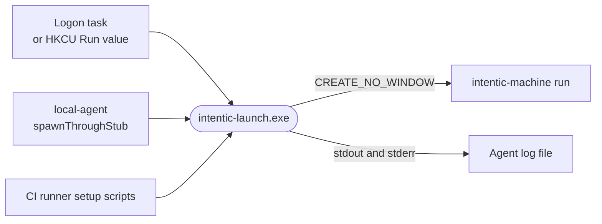

# win-launcher

A small Rust program, `intentic-launch.exe`, that starts an intentic agent on Windows with no console window and its output going to a log file.



- `powershell -WindowStyle Hidden` does not keep a window hidden on current Windows 11. With Windows Terminal as the
  default console host, the flag hides the console the PowerShell host owns, while the window on the desktop belongs
  to `WindowsTerminal.exe`, which never sees the flag. This program is built with `#![windows_subsystem = "windows"]`,
  so Windows gives it no console at all, and it starts its child with `CREATE_NO_WINDOW`, so the child gets none
  either. `build-win-launcher.sh` reads the PE header of every build and fails unless the subsystem is WINDOWS.
- Usage: `intentic-launch --log <file> [--wait] -- <program> [args...]`. It prints the child's pid and exits. With
  `--wait` it lives as long as the child and exits with the child's exact code, which is what lets a Task Scheduler
  task supervise the agent and the machine agent's `app_start` say how a program ended. Only the child's own 0 is a
  success: any other code, a crash's NTSTATUS included, is passed on whole (2026-11-02; before, a code that did not fit
  a byte became 1), and a wait that failed exits non-zero, so a dead child never reads as a finished one.
- With `--wait` the child also dies with the launcher (2026-10-05): it goes into a job object that is killed when the
  launcher's handle to it closes, which is when the launcher ends, however it ends. Before, a launcher ended from Task
  Scheduler left the agent running unsupervised, and the next watchdog start found its pidfile held and left again. The
  job allows silent breakaway, so what the agent starts to outlive itself (`ic` mid-swap, Mutagen's daemon, an upgrade)
  is never part of it. A job that cannot be made is noted in the log and the agent runs as before.
- It opens the log for appending and hands it to the child as stdout and stderr, rolling it to `<file>.1` at the
  same size as `LOG_ROTATE_BYTES` in [local-agent](../local-agent). A failed start is written into that log.
- Ships as the release asset `intentic-launch-windows-<arch>.exe`; [`intentic-machine`](../machine) keeps a copy
  beside its own binary, which is where `local-agent` looks for it. On any other OS it prints a note and exits
  non-zero. It uses only std (and Win32 calls declared by hand: three kernel32 ones for the job, the console ones `--ctrl-break`
  sends with, and the user32/gdi32 ones `--capture` reads the screen with), which keeps the download small.
- `intentic-launch --ctrl-break <pid> [--except <pid>]` asks a console program to stop, as its close button would
  (2026-11-02): it attaches to the program's console and sends CTRL_BREAK_EVENT to everything on it, which `taskkill`
  without /F cannot (it only posts WM_CLOSE, and a console program has no window). It exits 0 when sent, 2 when there
  is no console to send on, 3 when the program has a window (WM_CLOSE asks it, and a break on top could end a save
  midway), and 4 when the `--except` process (the agent asking) shares that console and would hear it too. A child
  started by this launcher has a console of its own (CREATE_NO_WINDOW), so `app_start` starts programs through
  `--wait` on Windows. [`@intentic/base` windows-stop.ts](../../_tools/base/src/node/windows-stop.ts) is the caller.
- `intentic-launch --capture <out> [--region x,y,w,h]` and `--frame` read the screen for
  [desktop-automation](../desktop-automation) (2026-10-27). Its PowerShell capture script was refused by Defender's
  script scanner as malware on both Windows test machines, 54 times in two weeks; the same GDI calls made from this
  signed binary leave no script to scan. `--capture` writes `IRAW`, width, height and BGRX rows, which the agent turns
  into a PNG; `--frame` prints `<width> <height> <left> <top>` of the virtual desktop. Both are per-monitor DPI aware.

## Key files

- [src/main.rs](src/main.rs) — argument parsing, the windowless spawn, log rotation, the `--wait` job and the tests.
- [src/capture.rs](src/capture.rs) — `--capture` and `--frame`: the screen through GDI, and their tests.
- [src/ctrl_break.rs](src/ctrl_break.rs) — `--ctrl-break`: a console program asked to stop, and its tests.
- [Cargo.toml](Cargo.toml) — no dependencies, and a release profile tuned for size.
- [../../_tools/scripts/build/build-win-launcher.sh](../../_tools/scripts/build/build-win-launcher.sh) — cross-compiles, checks the PE subsystem and signs.

## Commands

```sh
cargo test --manifest-path _devices/win-launcher/Cargo.toml
bash _tools/scripts/build/build-win-launcher.sh windows-x64
```
