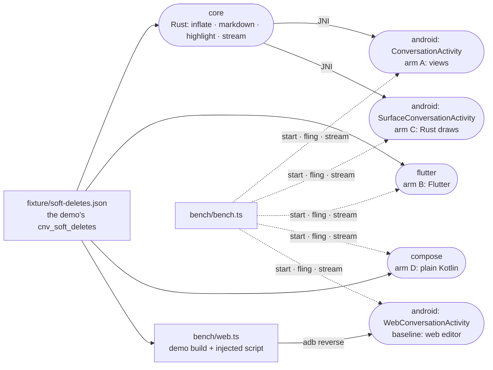

# android-native

The native Android client spike: the editor's longest conversation drawn five ways on one phone (today's web editor, plain Kotlin, Kotlin views over a Rust core, a Rust GPU renderer and Flutter), and the bench that measures them all the same way.



- **What it answers.** Which stack the native app should be built on, by measurement rather than by reputation: a cold
  start into a 2,000-row conversation, a fling through it, and a turn streamed under it, on the same phone, with the
  same text, read off the same counters.
- **The arms.** The baseline is today's web editor (the production build of `_site/demo`) in a WebView, the engine of
  the Trusted Web Activity the store app was before `../android-app` went native. Arm A draws rows the Rust core parsed and highlighted
  as `StaticLayout`s built off the main thread, in a RecyclerView of plain `View`s (`Rows.kt`, `RowView.kt`). Arm C
  draws the same rows with wgpu from Rust onto a `SurfaceView` (`core/src/surface`). Arm B is Flutter and arm D is plain
  Kotlin (Compose and a Kotlin markdown library, no Rust), each written as a typical team would write it
  (`flutter/README.md`, `compose/README.md`): arm D is the "native Kotlin" the others have to beat. Every native arm
  keeps the composer a platform text field.
- **Same text everywhere.** `fixture/make-fixture.ts` writes the demo's conversation, the addition `_tools/perf`
  inflates it with, and the turn `_tools/perf/src/chat/stream.ts` streams. The Rust core, the Dart arm and the web
  page (through the phone lab's own `inflateTranscript` and `streamTurn`, which `bench/web.ts` serves ahead of the app)
  and arm D's Kotlin apply the same rules, so 2,000 rows and a 10-second turn mean the same work in each.
- **One yardstick for four renderers.** Frame counters inside an app see only their own toolkit, so the bench reads
  what SurfaceFlinger presented (`dumpsys SurfaceFlinger --latency`) for each of the arm's layers and keeps the one
  that moved: arm C and Flutter draw into a SurfaceView under the window holding the composer. SurfaceFlinger keeps a
  layer's last 128 frames, about two seconds, so every layer is asked in one call each half second, and the bench warns
  when two answers fail to overlap. It also reads what the arm's processes spent on the CPU (a Perfetto trace of
  scheduler switches, the WebView's sandboxed renderer counted with the web arm). A start is the system's `TotalTime`
  and the arm's own `SPIKE_READY` line: process start to the first frame with rows. Each package is compiled ahead of
  time first (`cmd package compile -m speed`), as an install with a baseline profile is after a few runs, so no arm is
  timed in its JIT.
- **The bench stays off the phone while it measures.** It reads the log from one `adb logcat` stream rather than
  dumping it to wait for a line. Dumping it every 250ms over Wi-Fi had the phone's log daemon working beside the arm,
  and it held up the SurfaceFlinger polls long enough to lose frames, which then read as 650ms hitches.
- **An emulator checks the plumbing, a phone decides.** The emulator's GPU is SwiftShader, a CPU rasterizer, which
  charges every arm's drawing (the view system's RenderThread, the WebView's GPU thread, Flutter's Impeller, arm C's
  wgpu) CPU time a phone's GPU would take. Its numbers rank nothing; the Galaxy S10 (the device behind the web
  editor's p75 INP of 842ms) does.
- **A spike, not the app.** No network, sign-in or real transcript: the conversation is the fixture. Arm A's rows are
  not selectable yet (a selection overlay or a TextView swapped in on long press is the known way). Arm C has no text
  selection, IME or accessibility of its own, which is why its composer is native.
- 2026-10-19: Kotlin reaches Rust through hand-written JNI, not UniFFI. UniFFI's Kotlin bindings call through JNA,
  whose per-call marshalling is the overhead a per-row hot path should not pay; the surface is ten functions. A wider
  API may still want UniFFI.

## Results

Galaxy S10 (Android 12, 60Hz), 2026-10-19: five cold starts, three flings and three streamed turns per arm, taken in
rotation so no arm always ran last on a warmer phone (battery 32.8 → 34.6 °C, no thermal throttling), medians shown.

| | web editor | A: views + Rust | C: Rust draws | B: Flutter | D: plain Kotlin |
| --- | --- | --- | --- | --- | --- |
| Cold start, `TotalTime` ms | 311 | **190** | 280 | 281 | 220 |
| Cold start, rows on screen ms | 2,302 | **112** | 202 | 215 | 183 |
| Fling: fps, late frames | 29.1, 22.4% | 59.5, 0.4% | 59.7, 0% | 59.6, 0.2% | 59.5, 0.4% |
| Fling: CPU ms over 7.1s | 9,168 | 2,016 | **1,986** | 4,371 | 4,695 |
| Stream: late frames, longest gap ms | 0%, 66.9 | 0%, 67.3 | 0%, 19.0 | 0%, 50.0 | 0%, 17.4 |
| Stream: CPU ms over 11.5s | 22,178 | 6,021 | **4,176** | 7,693 | 8,550 |

- **Arm A beats plain Kotlin on every count.** It reaches its first frame 14% sooner, shows rows 39% sooner, and holds
  the same frame rate on 43% of arm D's CPU while flinging and 70% while streaming.
- **Arm C spends the least CPU and starts 90ms behind arm A.** The start pays for a Vulkan device and the fonts. Its
  stream is 31% cheaper than arm A's, and it would still need text selection, IME and accessibility built from scratch.
- **Flutter is level with Compose.** It shows the same frames for about the same CPU and starts 30–60ms later.
- **Every native arm leaves today's web editor far behind.** The web editor shows rows 20 times later than arm A,
  flings at 29 fps with one frame in five late, and spends almost four times arm A's CPU on a streamed turn, about two
  cores.
- **A stream's 50–67ms gaps are the turn, not jank.** Each tool call leaves 50ms with nothing new to draw. Arms that
  draw only on change (the web editor, arm A) show that pause as one long interval. Arms that redraw every frame while
  the turn runs (Compose here, arm C) don't. A stream frame counts as late only past 75ms.
- **The highlighter decided arm A's start.** With syntect's pure-Rust regex engine, the first code block compiled the
  JavaScript grammar while the start waited. Arm A then took 300ms to its first frame and lost to Compose; with
  Oniguruma it takes 190ms (`core/README.md`).
- **CPU figures compare arms within one run.** Between sessions on the same phone they moved by up to a fifth. Memory,
  battery drain, 90/120Hz screens and other phones are not measured. Arm D is Compose with the library's defaults, as
  a team would first ship it. A hand-tuned Compose, which builds styled text off the main thread, would close part of
  its CPU gap by moving toward arm A's design.

## The app itself, as an arm

2026-10-20: `../android-app`'s bench build (`dev.intentic.app.bench`, its `PreviewConversation` over the same fixture,
which `../mobile-core` opens and streams) is the bench's `app` arm. On the S10, on battery, medians of 5 starts and 3
runs, beside the two arms it was chosen between:

| | A: views + Rust | D: plain Kotlin | the app |
| --- | --- | --- | --- |
| Cold start, `TotalTime` / rows on screen ms | 163 / 100 | 189 / 167 | 183 / 121 |
| Fling: late frames, CPU ms, PSS MB, battery mA | 0.4%, 1,916, 48, 307 | 0.8%, 4,766, 62, 338 | 0.6%, 2,159, 61, 338 |
| Stream: late frames, CPU ms, PSS MB, battery mA | 0%, 5,967, 54, 247 | 0%, 8,378, 62, 294 | 0.9%, 7,000, 70, 270 |

- **The app keeps arm A's lead over plain Kotlin** in starting and scrolling, and streams on less CPU and current.
- **It pays for being a whole client.** A session store, an async runtime and an HTTP stack sit beside the renderer,
  which is most of the 13 to 16 MB it holds above arm A. The core kept every drawn row until 2026-10-20; it now keeps a
  few screens' worth.
- **Its stream is 1,000ms of CPU above arm A on battery.** On USB power it measured 6,308ms, level with arm A. Two
  changes got it there: a streamed row rebuilt once per frame on the main thread, and the conversation requested the
  moment the core starts.
- **The Baseline Profile changed nothing measurable.** Macrobenchmark on the S10 gave the same start (271 vs 272ms to
  rows) and the same frame times with and without it. The framework is compiled ahead of time already, and the
  core is native, so the app's own Kotlin is a small part of each path.

## Bridge: JNI or JNA

Galaxy S10 (Android 12), 2026-10-19, measured by [bridge-bench](bridge-bench/README.md): one Rust library called from
Kotlin four ways. `uniffi` is JNA direct mapping with the structs UniFFI 0.32's generated Kotlin passes (a status struct
per call, strings in buffers allocated and freed through Rust), written out by hand. Ten cold starts and five runs of
100,000 calls per mode, in rotation, compiled ahead of time; medians.

| | JNI | JNA direct | JNA interface | UniFFI's convention |
| --- | --- | --- | --- | --- |
| Cold start: library load, ms | 1.6 | 7.8 | 6.0 | 8.6 |
| Cold start: first call, µs | 126 | 55 | 1,171 | 410 |
| Call, no arguments, µs | 0.08 | 0.13 | 1.2 | 23 |
| Call, 200 bytes of JSON in, a new string out, µs | 1.1 | 4.8 | 12 | 131 |
| Call, 200 bytes in, new bytes out, µs | 0.8 | 2.0 | 16 | 129 |

- **JNA costs the cold start 6–7ms.** That is loading JNA's own library and binding the functions; the system's
  `TotalTime` medians (153–164ms) differ by less than their spread.
- **UniFFI's convention costs every call.** A string call takes 115 times as long as with JNI, and 2,000 rows crossing
  once each would take a quarter of a second. Most of it is JNA building structs by reflection on every call
  ([uniffi-rs#3011](https://github.com/mozilla/uniffi-rs/issues/3011) traces it on a desktop JVM, 3.5–4µs there), and
  sustained calls keep the garbage collector and JNA's cleaner thread busy. JNA direct mapping alone costs 1.8–4.2
  times JNI.
- **The `jni` crate's `get_string` adds 0.85µs a call** (2.0 against 1.1µs) by looking up `java.lang.String` every
  time. `_editor/mobile-core`'s bridge uses it; a hot function should use `get_string_unchecked`.
- **JNA adds 405KB to an APK with both ABIs**, 267KB of it for arm64 (`libjnidispatch.so` and its classes).
- **Keep one JSON function over JNI plus hand-written hot functions.** UniFFI everywhere would cost little at start but
  23–131µs a call, too much for anything per row or per frame; only a wide, rarely called API could afford it.

## Key files

- [fixture/make-fixture.ts](fixture/make-fixture.ts) — the conversation, its inflation and its streamed turn, from the demo.
- [core/src/render.rs](core/src/render.rs) — a row to one string and its style spans: what the native arms draw.
- [android/app/src/main/kotlin/dev/intentic/spike/Rows.kt](android/app/src/main/kotlin/dev/intentic/spike/Rows.kt) — arm A's rows, laid out ahead of the scroll.
- [bench/bench.ts](bench/bench.ts) — the scenarios and what each reads.
- [bench/web.ts](bench/web.ts) — the web baseline: the demo build served with the phone lab's scripts ahead of it.

## Commands

Toolchain: JDK 21, the Android SDK (platform 37, build-tools 36, NDK 29), Rust with `cargo-ndk` and the
`aarch64-linux-android` and `x86_64-linux-android` targets, Flutter 3.47. `.intentic/config/environment.d/android.Dockerfile`
in the workspace installs them into the sandbox.

```sh
cd _site/demo && bun --conditions=@intentic/src ../../_editor/android-native/fixture/make-fixture.ts   # rewrite the fixture
cargo test --manifest-path _editor/android-native/core/Cargo.toml
node --test _editor/android-native/bench/frames.test.ts
bash _editor/android-native/android/scripts/gradle.sh :app:assembleRelease                       # arms A, C and the web baseline
bash _editor/android-native/compose/scripts/gradle.sh :app:assembleRelease                       # arm D
(cd _editor/android-native/flutter && flutter build apk --release --target-platform android-arm64,android-x64)
adb install -r _editor/android-native/android/app/build/outputs/apk/release/app-release.apk
adb install -r _editor/android-native/compose/app/build/outputs/apk/release/app-release.apk
adb install -r _editor/android-native/flutter/build/app/outputs/flutter-apk/app-release.apk
node _editor/android-native/bench/bench.ts --serial <serial> --runs 5                              # every arm, every scenario
```

The release APKs are signed with the machine's debug key, which a rebuilt sandbox makes anew. A phone holding an
install signed with the old key refuses the update (`INSTALL_FAILED_UPDATE_INCOMPATIBLE`), and an install that fails
quietly leaves the bench timing the old build: `adb uninstall` the three packages first. Wireless debugging also
trusts the sandbox's adb key, so after a rebuild the phone needs pairing again (`adb pair <ip>:<port> <code>`),
unless the key was kept: in an Intentic sandbox, a copy in `/work/.intentic/local/adb/` (outside git) goes back into
`~/.android/` before `adb connect`.
