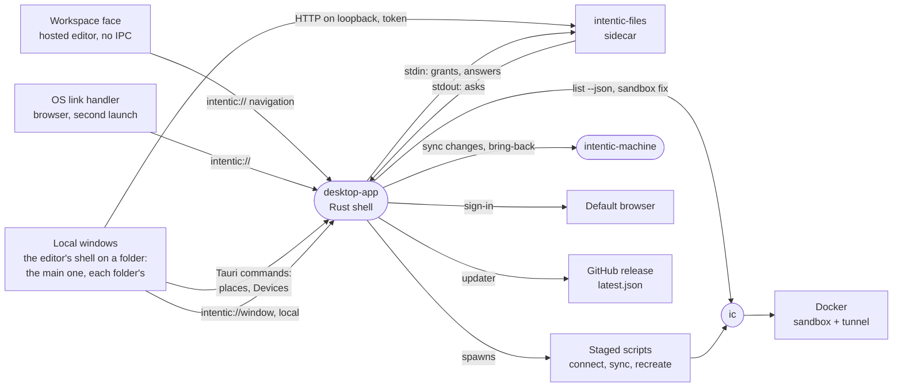

# desktop-app

The Tauri app for Windows and Linux that opens on the hosted workspace's Home from the first launch, opens the editor on a folder of the user's own computer with no account, runs sandboxes on that computer from its Devices view, and shows both in the same window.



- **One window, two faces** (2026-10-21, `src-tauri/src/frame.rs`). The main local window (webview `home`) and the
  workspace face (webview `workspace`) are two webviews in ONE native window, the frame (label `frame`, built with
  Tauri's multi-webview API, its `unstable` feature). A switch shows one face and hides the other inside the frame in
  one turn of the main thread (`frame::show`, `windows.rs` `swap_in`), so there is one taskbar button, one place, size
  and maximised state, and nothing for a face to hand over. A face is added to the frame, out of sight, the first time
  it is wanted. On Windows a face steps aside by hiding its webview's own child window, never through WebView2's
  `IsVisible`, which reports a viewport of about 70×39 to a hidden page (`webview_sync.rs`); on Linux by hiding its GTK
  widget, kept out of the `show_all` tao answers every `show` with. Tauri attaches a frameless window's resize borders
  only to a window's own content webview, so the frame attaches them for its faces. The frame wears the title of the
  face it shows ("<folder> · Intentic", a setup's, or "Intentic"), and the platform's title bar only while that face's
  page has none (`fit_decorations`). Capabilities name webviews, not windows: a capability naming the frame would
  grant the main window's commands to the workspace's remote page too. The workspace face loads the hosted
  [web](../web) editor from `https://app.intentic.dev` (or the `appUrl` setting, or `INTENTIC_APP_URL`) as remote
  content with no IPC. The main window is the local face: the same editor built into this package's bundle
  (`dist/files/`, `local/main.ts`), on a folder of this computer. A panel the editor floats out gets a frameless window
  of its own, and so does a folder or document opened on its own. This package's own `src/` bundle (`index.html`) now
  draws one thing, the close question (`CloseConfirm.vue`). _(2026-10-21) Each face was a window of its own, and a
  switch swapped the two in one place. The first switch after a launch built the second window on the spot and showed
  it before its page had drawn, so the reader saw their window close and an empty one open where it had been; every
  later switch still made and dropped a taskbar button and played Windows' open and close animations._
- **Only a press moves the reader** (2026-10-26, `src-tauri/src/windows/present.rs`). Nothing the app or a page does
  on its own puts a face in the frame, takes a face to another of its screens, or brings the frame or a window forward:
  not a sign-in coming back, this PC's own setup, a sandbox's setup, a folder's, a Docker start, a recreate, a fix, a
  sync, a repair, a first task. Every function that does any of that (`swap_in`, `show_*`, `raise_window`,
  `local.rs` `open_home_later`, `frame::show`) takes a `Press`, which says who pressed: the tray's rows, a launch, a
  second launch, a page's own press that names where it goes (This computer, Back to the workspace, Manage on this
  computer, a process's Open), a notification, the shell's keys, a window opened again. A face is remembered as the
  one in use only when a press draws it. The modules that run processes are held to it by a test that reads their
  source (`present.rs` `a_process_never_moves_the_reader`). _(Until 2026-10-26) The app swapped Devices in over the
  workspace for a setup handed over, a sign-in begun on a folder, a run that stopped or asked something, a parked
  setup or a sleeping engine at launch, a recreate, a fix and a sync; and the workspace in for a sign-in's return, a
  finished setup, a Docker that woke, a folder's first task. A reader who signed in on Home was taken off it to a card
  about preparing their PC._
- **One list of processes, drawn in both faces** (2026-10-26, `src-tauri/src/processes.rs`, `src/processes.ts`; the
  web's `processReport.ts` holds the shape and its rules). Every run on this computer or for it is one report in one
  list: what it is (`kind`, an `id` of `<kind>:<what>`), how it stands (`running`, `waiting` and on what, `failed` and
  why, `stopped`, `done`), how far, what it asks of the reader (`needs`), and what can be done about it (`actions`). The
  workspace hears the whole list as the `intentic-processes` event (again every few seconds while anything runs, and at
  once when its page says `intentic://process?hello=1`); a local window by `desktop://processes` and `processes_list`.
  Both draw each process as a tile in their own rail and a page in their own place, so the reader follows and answers
  it where they are. Writers: the main window's page for the runs it drives (`process_report`: a setup, this PC's own,
  a Docker start, a sync, a fix, a recreate, a move between engines), the app itself for its own (`auth.rs` a sign-in
  waiting in the browser, `folder_setup.rs` each folder on its way, `first_task.rs`, Repair), and the workspace's page
  for the runs only it holds (`intentic://process?report=…|clear=…`: a machine of ours, a connected machine), which
  This computer draws too. An answer (`intentic://process-act?id=…&act=…[&need=…]` from the workspace, `process_act`
  from a local window) goes to the run's owner: the workspace's page by `intentic-process-act`, the app for its own,
  the main window's page by `desktop://process-act`. An Open on a finished run is the reader's press, the one press made
  there. A run that starts asking something asks for the reader's eye and never moves them (`attend`): nothing while
  they look at the app, the taskbar's flash while it is on screen behind something, the system's notification while it
  is not on screen, whose press opens that process's page in the face last used (`/home?process=<id>` in the
  workspace, `/process/<id>` in a local window).
- **No internet: this computer's own sandboxes** (2026-10-16, `src-tauri/src/machine_face.rs`, `local/sandbox.ts`).
  When the workspace's address does not answer, the workspace window shows the sandbox face instead of WebKitGTK's
  error page: the same editor built into this bundle (`files/sandbox`, `dist/files/sandbox.html`), whole (every route
  and extension, unlike the folder face), on the sandboxes `ic sandbox list --json` lists here. Its platform questions
  are answered in the page (`local/machineFace.ts`): who is signed in is the account `roster.json` names, the list is
  each sandbox with a loopback port, at `http://127.0.0.1:<localPort>` and keyed by the platform's id for it (or
  `machine-<id>` before one is known), and anything else of the platform answers in plain words that it needs the
  internet. Each running sandbox is opened with a session the machine minted for its owner (`ic sandbox session`,
  kept in the app's memory only), written where the editor's sandbox client reads one; a sandbox that wakes later, or
  whose daemon refuses its session, gets one minted again and handed over on the editor's own session channel. The
  daemon admits the face's origin on the loopback port alone (the sandbox daemon's README). The page is granted
  `machine_face`, `machine_face_renew` and `machine_face_online` (`capabilities/machine-face.json`) as local content
  in the workspace window, which the hosted editor in the same window never is. Every 30 s it asks whether the
  workspace answers again and then offers it ("Intentic is answering again", said of Intentic rather than the
  internet, since the face is as often up while only the platform is down), never taking the page away. On Linux (so
  on Intentic OS) `offline.rs` decides: a load of the workspace that fails for a network reason (WebKitGTK's
  `load-failed`), one that commits with an unusable answer (500 or 502–599, `unusable_status`), or a 4 s probe at the
  start that finds nothing answering at all while nothing has started to show (`machine_face::reached`: a 530 is left to
  the load, which the hosted editor's service worker may answer with its cached copy), sends the window to the face on a
  computer that hosts sandboxes, else to `offline.html`, which also offers the face. On Windows the offline page offers
  it after WebView2 says a load failed or answered that way (its `status` is then `http-<code>`). The page draws where
  the break is, in the reader's look, as the route a request takes (this computer, the internet, Intentic): no network
  at all snaps the first link, an HTTP status marks Intentic, and any other failure puts a question mark on the
  internet. Each retry sends a spark down that route to the break. To
  answer is to answer usably everywhere (`machine_face::answers`), and the offline page asks the app that
  (`machine_face_online`) rather than fetching the workspace itself. _(2026-10-26) Any HTTP status used to count as the
  workspace answering. The platform's editor and API sit behind one Cloudflare tunnel, so a dead platform host is
  Cloudflare's 530 or 52x page: the window stayed on it for good, with no retry and no way to this computer's
  sandboxes, and the offline page's no-cors check took that page for the workspace being back._ Two more ways in:
  Devices' Open on a sandbox of this computer (`local_sandbox_open`) opens the face on it directly while the workspace
  does not answer, and opens one the platform never named in the face at any time; and the hosted page, told
  `machineFace: true` (only the workspace window, on a build with the face and a computer that hosts sandboxes), offers
  the face itself when it cannot reach the platform, through `intentic://machine-face`. Not yet: an agent's preview
  site on the loopback port (netd routes preview hosts there, the editor does not dial them yet), a panel floated out
  of the face, and a sandbox asleep when the workspace cannot be reached, which the face lists but nothing wakes.
- **The main window.** The editor's shell with the sandbox shell's rail, holding what needs no sandbox and no
  account: at the top the place chip (the folder this window shows, and the account's sandboxes, each opening the
  workspace on itself at `/?sandbox=<id>` and picked from anywhere in the window by Alt+1–9 as in the workspace, or
  the sign-in before an account), then Files (the folder's tree and documents, `/workspace`), then Devices
  (`/device`), then Passwords (`/passwords`) once this computer has it set up or an agent's request waits on it. Until
  then Passwords has no tile, so a new owner doesn't meet a password manager, and a quiet "Set up Passwords" card at
  the foot of Devices (`src/passwords/PasswordsOffer.vue`) is the way in. Passwords checks that the running keyring
  understands its app requests before loading. A keyring left on an older release offers **Update Passwords**, through
  `intentic-machine keyring upgrade`: a verified download, the person's consent, and the protected service installer.
  This update is separate from the desktop app's and the machine agent's updates. At the foot of the rail is the sandbox
  shell's own account control (who is signed in, Settings, Sign out), or the sign-in in the default browser until
  there is an account. The **first task** the reader writes on Devices' card
  for this PC (below) is kept in `first-task.json` under the app config dir, announced on `desktop://first-task`,
  given its folder's own sandbox, and opened in the workspace with `?task=` once the folder is in; the workspace answers
  on `intentic://first-task?do=sent|failed&id=…`. "Ask about this" while no sandbox can answer leaves a draft of one
  (`first_task.rs` `prefill_from_ask`: announced on `desktop://first-task-draft`, and kept in memory for a main window
  still being built, which takes it with `first_task_take_draft`), a process on both faces' rails whose Open is the way to
  Devices' card. A task whose folder is in is a process too, ready for the reader's Open, which hands it to the
  workspace; nothing opens by itself (2026-10-26). Settings open in the window itself (`#/settings`), and
  signing out leaves it on its folder. The sandboxes are what the workspace last told the app, and the account what the
  platform last answered (below): the workspace's switcher hands both over on `intentic://roster` whenever either
  changes, a sign-out empties them, and the app keeps them in `roster.json` (`local_roster`), with no address, token or logo, so a row carries a name, where it runs and
  whether it is shared, and no count or state, and the account an address, a name and an `https` avatar. Before the
  workspace has listed any, Add sandbox is the place chip's one row; the account menu shows the named account at once
  and then what the platform answers (below). It opens on the folder it was last
  pointed at (`home-folder.json`), or on `~/intentic/local`, which its first opening creates: nothing is asked before
  the first screen. A folder picked in the system's dialog from an empty folder's page, or one of the folders that page
  offers (below), takes the window's place
  (`local_pick`, then `point`: a grant of its own, and the new face handed to the page as `intentic:repoint`). The page
  moves to the folder in place, with no reload (the web's `local/folderSwitch.ts`): to the editor a folder is one
  sandbox, `local-<id>`, so the move is the editor's own sandbox switch, the rail stays put, and the old folder's page is
  held until the new one has drawn its files, then crossfades into it. The old grant is revoked ten seconds later, once
  what the page had in flight on it has finished. A page that does not take the event (still booting) is reloaded onto
  the new face at `#/workspace`. A folder another window already shows raises that window instead. Other folders and documents open
  from the tray, each in a window of its own. The main window's ×, like the workspace's, is a question and a hide (`request_close`), so nothing it holds
  is lost and the tray brings it back as it was. The shell's routes ride the page's hash (`files/local#/device`),
  since the asset protocol answers `files/local` with the local page and an address below it with the bundle's other
  page.
- **What this computer already uses.** `found_on_machine` (`src-tauri/src/found.rs`) reads what the AI tools and
  editors on this computer say about it, so a first launch can offer that instead of an empty folder and a blank
  sign-in. It reads this computer's home and, on Windows, the home of every WSL distro that is running (through
  `\\wsl.localhost`; a stopped distro is never started for it). Two things come back. The subscriptions signed in here
  (Claude Code, Codex in ChatGPT mode, Gemini CLI, and the logins opencode, Hermes and OpenClaw hold), each named by its
  account's email and plan and never by a token: the sandbox signs in to each on its own from Connect, because these
  logins renew with single-use refresh tokens and a copy would log one side out. And the folders the tools' histories
  name (Claude Code's sessions and trusted folders, Codex's trusted projects and sessions, the VS Code family's last
  windows, JetBrains' recent projects), newest first, at most twelve. Folders that are gone, someone's whole home, the
  system's, Intentic's own (`~/intentic`) and a folder that only holds other found ones (unless it is a repository
  itself) are dropped. The reading is kept for two
  minutes. The main window's empty folder offers those folders under its own recents (the web's
  `local/LocalEmptyFolder.vue`, opened with `point`), the rail's sign-in tile names the subscriptions, and the addresses a sandbox is first met
  at (a `/setup` page the app opens, and a folder's own sandbox opened on its folder) carry their ids as
  `found=claude,codex` (`with_found`, read from the last reading so a window is never kept waiting on the disk), so the
  new sandbox's Connect offers them. Nothing found leaves the computer
  except those ids.
- **The OS shell.** Linux kiosk sessions use `src-tauri/src/shell/`: sway's IPC over `$SWAYSOCK`, through the
  framing `ic`'s screen service shares (`_sandbox/ic/sway-ipc`), subscribes to sway’s bindings, workspace focus and
  windows. Super+1–9 opens the account’s roster in order, Super+0 This computer; the visible face moves
  into that Space. Sandbox windows are matched only by sway’s `sandbox_engine=dev.intentic.sandbox` and the attested
  `sandbox_app_id` (the security context’s app id), then the slug’s `ic sandbox list --json` platform id. Unknown ids stay where they opened. Holding those
  windows to their rules (never fullscreen, closed once their sandbox may not draw) is `ic os screen serve`’s, which
  hands out the sockets; This computer’s Sandbox windows card (`device/intenticOs/screen/SandboxWindowsCard.vue`,
  `shell/screen.rs`) is where the owner lets each sandbox draw, and every one is off until they do. Roster handovers also emit `desktop://roster` to the windows and rename occupied
  Spaces. Super+Space uses `/chat?sandbox=<id>&shellChat=<nonce>` to reveal an empty draft and focus its message box;
  the query is consumed once and sends no message. External `intentic://shell?open=device` and
  `?open=sandbox&id=<id>&at=agents` links only navigate, and a sandbox must still belong to the stored roster.
  The desktop edition’s Security card calls `ic os lock` through local-only commands; PINs travel on stdin, and
  settings store no PIN. The machine agent’s lock tools are separate from this shell.
- **Devices.** A view this app adds to the local shell (`src/host.ts`, the web's
  `app/environments/localHost.ts`), named and tiled as the workspace's Devices view is, so one glyph on the rail has one
  name (the code keeps `device` as its route and `src/device/DeviceView.vue` as its file), where the launcher's card
  used to be. It is the workspace's page for one machine, opened on this one: the same masthead (`DeviceEnvironmentRow`
  from `@intentic/ui`: the computer's name, its OS, its engine's size, its agent's build and Restart), the same
  Sandboxes list with every verb the workspace has for them (start, stop, restart, update, rollback, resources, logs,
  remove). It has no Danger zone: the app comes off a computer the way every app does, through the system's own
  uninstaller (below), and not from a page inside it. There is no board to go back to: All devices opens the
  workspace's. Between the masthead and the list stand the Docker engine the sandboxes run in and the app's own work here, which leads while it runs: a
  setup handed over from the workspace, with its requirements and its plan, and a sync enrollment. A folder's own
  sandbox being made is said in that folder's window, not here (below). Its state is a store
  (`src/device/useDevice.ts`) rather than the page's, so a setup keeps running and reporting while the reader is on
  their files, and the rail's tile carries it (`src/device/badge.ts`: the running mark for a setup, a folder's sandbox
  being made or a Docker start, a warning mark for one that stopped for the reader, a dot for an update). A computer that runs no sandbox is told what
  one is for and offered one, made in this window (its "Set one up" opens the local shell's `/sandbox-new`, which asks
  `new_sandbox_offers` and `new_sandbox_create`: this computer, or a machine of ours followed until it reports in,
  `src-tauri/src/new_sandbox.rs`; until 2026-10-26 it opened the workspace's setup page), and nothing about Docker. Only the main window takes the work the app parks
  for its face (a setup, a recreate, a sync, a sleeping engine); every local window draws the same view and runs its
  verbs. The machine is read when the page opens and every 30 seconds while it is on screen. At its foot stands which
  build of the app this is ("Intentic 0.x.y", `src/device/AppBuild.vue`), with a copy of the app's version, its OS and
  the machine agent's build in one line for a bug report. It is there because this page is the one the main window
  always has, with no account and no sandbox. The tray's update row names the same build while no update is on offer
  ("Intentic 0.x.y is up to date", `update.rs`), for a window that will not draw.

  On Windows the one Docker engine serves Windows and every WSL distro, and `ic` on either side lists every sandbox on
  it. A sandbox the other side keeps (`keptElsewhere` in `ic sandbox list --json`, named by its distro where `ic`
  stamps one, `keptElsewhereName` or `linux/<distro>`) keeps its verbs here, since a person's start, stop and restart reach it from either side, and
  says on its row's own line where it is kept ("kept by WSL (archlinux) on this computer"), as the workspace's Devices does. The machine agents of this computer's environments are
  read off their files (`src-tauri/src/agents.rs`: this app's own home, and through `\\wsl.localhost` each distro that
  is running, never one that is stopped): their binary, their pidfile and `ic`. Devices names the other environments
  whose agent runs under its masthead, and so does the tray's agent row ("Machine agent: … · also in WSL
  (archlinux)", or "Machine agent: in WSL (archlinux)" where Windows has none). _(2026-10-05) The app read the Windows
  home alone: blind to a WSL agent, it drew WSL's sandboxes as its own, and its setup put a second agent beside it._

  A listing proves when this machine hosts no sandbox any more: `ic` answered with no row of this side's own, `ic`'s
  trash holds nothing a restore could bring back (its `intentic-trashed-*` volumes), and no folder's own sandbox is on
  its way here. Then `hosts-sandboxes.json` is cleared, and a launch stops starting Docker Desktop
  for one (`state.rs` `forgets_hosting`). A listing that failed, or a trash that could not be read, clears nothing.
  _(2026-10-05) It was written once and never cleared, so every launch after the last sandbox was removed still started
  Docker Desktop._
- **The account in a local window.** Who is signed in, the plan, API tokens and the data export, as the account menu
  and Settings ask for them. The page cannot hold the platform's session (an HttpOnly cookie on the API's host, which
  the platform answers only from the workspace's origin), but every window of the app shares one browser profile, so
  the cookie the workspace's sign-in set is in the store a local window's webview reads. `account_relay`
  (`src-tauri/src/account.rs`) reads it there, sends the call with the workspace's origin (Better Auth's check on an
  auth call that changes something), and writes back whatever cookie the answer sets, so the session rolls forward.
  Only a short list may be asked, checked in Rust: `get-session`, `update-user`, `sign-out`, the hosted plan and
  its checkout and portal, the tokens, `me/export`, and the account's sandboxes as the switcher reads and tidies them
  (`sandbox/list`, `delete`, `leave`, `trash`, `restore`, `hosted-rollback`). Deleting the account is not on it, since
  it must first take the account's access off every sandbox's daemon, and a local window reaches no daemon but its
  folder's.

  _(2026-10-21) The sandbox calls joined the list so a local window draws the workspace's own switcher
  (`SandboxSwitcher.vue`) instead of a place chip of its own that could only list what `roster.json` held: a sandbox
  can be removed, left or rolled back from This computer as from the workspace, through the same dialog. In the page
  (`local/platform.ts`), the sandbox list is the folder's own row at once on a window's first ask, the boot guard's, so
  no first paint waits on the network, and the folder's row followed by the account's on every later ask. The remove
  dialog's door onto this computer is the app's own `ic` (`machine` in `src/host.ts`), since every sandbox's daemon
  refuses this page's origin off the loopback port. As before, only the app's bundle can call the relay: the
  documents a local window draws run no script there._ A sign-out also
  deletes the session from the store, empties `roster.json` and reloads the workspace window, so both faces are signed
  out together. In the page, `src/account.ts` asks for the account (the host's `account`, `updateAccount`,
  `signOut`) and `local/platform.ts` routes the plan, token and export calls of the editor's API client; who is
  signed in for the page's own session check stays the folder's placeholder, so a platform out of reach never holds
  the first paint.
- **The workspace, opened somewhere.** A press that opens the workspace at a path (a sandbox on the place chip,
  deleting the account from a local window's Settings) draws the workspace face in the frame and, when its page is already loaded, tells
  that page the path instead of loading it again (`open_in_place` in `windows.rs`): a script the app runs in the page
  calls the opener the page registered (`__INTENTIC_OPEN__`, the web's `installDesktopOpener`), which selects the
  sandbox the path names and routes there in place. A page that registered none, from another origin or still
  loading, is loaded at the address, as before the opener existed. The press comes from a window, and the workspace
  comes up in that window's place (`workspace_open`, `show_workspace_from`): in the main window it is the usual switch
  of the two faces; in a folder or document window (`files-<n>`, the window `intentic .` opens) the frame takes that
  window's place, size and maximised state, and the folder window is hidden and closed. Unsaved edits hold that close as they hold any other, so the
  window comes back in front with its page's question. _(2026-10-16) The workspace always took the main window's frame,
  so a sandbox picked in a window `intentic .` had opened came up as a second window beside it, and the workspace's ×,
  answered "Quit", closed both._
- **Native work is the public scripts.** Setup, sync and everything done to a sandbox run the same `connect`,
  `sync` and `recreate` scripts the copy-paste one-liners run. `stage-desktop-scripts.sh` copies them from
  `_site/site/public/scripts` at the current commit, so an uncommitted script edit does not reach `tauri dev` or a
  local installer. Each run is told this build's own release (`IC_URL`, `IC_VERSION`), and a shim fetches `ic` only
  when the installed one is older than that: the pin is a floor, compared as a version (major.minor.patch, a pre-release
  below its release), never a ceiling. The installer carries that release's `ic` beside the app as `intentic-ic` /
  `intentic-ic.exe` (the second `externalBin`; never `ic`, which the deb and rpm would put on every PATH as
  `/usr/bin/ic`, ahead of the `ic` the machine agent keeps current), each run is told where (`INTENTIC_IC_PATH`,
  `commands.rs` `app_env`), and a shim that has to install `ic` copies that file to `~/.intentic/ic/bin/ic` instead
  of downloading it, when it answers `--version` with
  exactly the pinned release; otherwise it downloads as before, so installing `ic` does not need github.com. A build
  that pins nothing (`0.0.0`) always downloads.

  A run's child writes its two streams to two files beside its transcript (`~/.intentic/logs/desktop-<run>-<stamp>.out`
  and `.err`, `scripts.rs` `Spool`), which the app reads back as they grow for the window and the transcript
  (`desktop-<run>-<stamp>.log`, both streams, stderr lines marked `! `). A run followed to its end leaves only its
  transcript. The logs folder keeps the newest 30 runs' files, counted at launch and after every run; `ic`'s own logs
  there are not counted.

  _(2026-10-05) The shims used to fetch `ic` whenever the installed one was not exactly the app's pin, and the machine
  agent moves `ic` up by itself, so an app left in the tray for days put an older `ic` back on every Start, Stop or
  Restart. A run's child used to write to a pipe the app held: a Quit mid-run broke it, and `ic`, which prints with
  `println!`, panicked on the broken pipe half way through a recreate or a removal; now it finishes, and its files are the
  record of the rest, which its transcript names. The transcripts used to be kept for good._
- **A Windows setup across restarts.** A setup that needs Windows to end the session (exit 4) is parked in
  `resume-setup.json` with the time its code was minted (the link's arrival, since a link does not say), and the
  `HKCU\…\CurrentVersion\Run` value `IntenticResumeSetup` starts the app at the next sign-in with `--resume-setup`
  (`src-tauri/src/resume.rs`). Windows keeps a Run value until the app takes it away: when that setup's run ends,
  however it ends, when the setup is given up, and at any launch that finds nothing parked (this PC's own setup parked
  for a restart that has not come yet counts as parked, below). So a launch that crashed
  gets another, and a finished setup never starts the app again. A resumed setup whose code is older than 20 minutes
  runs on a fresh code the app mints itself with the workspace's session (`setup_fresh_code`, as for this computer's
  own sandbox), and so does a run whose claim the platform refused as invalid or expired. The card says the code ran
  out, with the way to a fresh one, only when none can be had. A run with consent on a Windows machine whose Docker is
  not listening yet also starts `ic image prefetch` (`src-tauri/src/prefetch.rs`): the `ic` beside the app, else
  `~/.intentic/ic/bin/ic.exe`, with no window, one at a time, logging to `~/.intentic/logs/prefetch-<stamp>.log`, and
  left running when the setup ends. The sandbox image downloads while Docker is installed, and `ic sandbox connect`
  loads it instead of pulling. Devices reports each step's and each requirement's time
  (`desktop_install_step`, `desktop_install_requirement`, `src/device/installTelemetry.ts`) and a failed run's last
  error line, scrubbed of the home folder, the account, addresses and the code (`desktop_install_finished.reason`).

  _(2026-10-08) The entry was a RunOnce value, which Windows deletes before the launch it makes, and a resumed setup
  never got a new code: two restarts outlast a code's thirty minutes, and "Try again" ran the dead one again._
- **What runs is `ic`'s to say.** Devices' list is `ic sandbox list --json` from the installed `ic` (the shim's
  `--list` when that one is missing or older than this app, whose fetch brings it level). Start, stop and restart are
  `recreate --start|--stop|--restart`, and the Resources form's Apply and Save are `recreate --shape`, all `ic` verbs
  behind the shim's switch, so a Restart here applies a shape saved for the next restart exactly as a Restart from
  the web does. Remove is `recreate --remove`, `ic sandbox remove -y`: the sandbox goes into `ic`'s trash, and its
  `/work` and `/history` stay recoverable for a week (`ic sandbox restore`), as they do from every other door. The
  confirmation says so, in place of the kit's "cannot be undone". The app reads nothing off `docker inspect`; the
  short children it waits on (Docker probes, the listing, the agent's status) share `ic`'s time-limited capture
  crate, `_sandbox/ic/bounded`, and read docker's refusals and find Docker Desktop with `ic`'s own readings,
  `_sandbox/ic/docker-host`: an engine that answers every request with an error stops a start's wait after 20 seconds
  as `broken` (quit Docker Desktop and open it again) instead of running out the five minutes as `tookTooLong`, and
  a Docker Desktop installed per user or in a folder of its own is found where `ic`'s probe finds it. A removal also has this machine's sync let go of the sandbox: `intentic-machine sync
  forget <slug>`, or, from an agent older than that verb, `sync uninstall --sandbox <id>` with the platform id this app
  remembers for the slug. _(2026-10-05) A removal used to forget only the sandbox's display name, and the agent went on
  syncing its folder until a new sandbox was made for that same folder._
- **Fixing a sandbox the workspace cannot reach.** The workspace's recovery panel sends `intentic://fix?slug=…`; the
  app brings Devices forward in the main window, and it runs `ic sandbox fix <slug> [--code <code>] --source app
  --json` with the installed `ic`, looked for where Devices' listing looks, with no console window, one run at a
  time and never beside another run of the app's on this machine, stopped with everything it started after ten minutes
  (`src-tauri/src/fix.rs`). A second link while one runs brings that run forward. The card at the top of Devices
  is built from `ic`'s `intentic-fix:` progress lines and its final report (`src/fixReport.ts`, `src/device/fix.ts`):
  what `ic` is doing now, every check with its state and, for one that warns or fails, the problem and the remedy,
  then the outcome and what the exit code leaves (3: a yes nobody could give in a terminal; 4: a restart or sign-out).
  Each check whose fix waits on consent becomes a button that runs the fix again with `--accept <that check>` and no
  code. An `ic` that ends without a report, one from before `sandbox fix`, is said to be unable to fix yet, with
  setting the sandbox up again as the way to update it, and nothing retries. While it runs, the rail's Devices
  tile spins for a reader who went back to their files. `ic` posts every run to the platform itself; the app never
  talks to the platform about it.
- **Waking a sandbox asleep on this computer at once.** A page that finds its sandbox asleep asks the platform to
  wake it, and the machine agent here collects such requests on its own poll, every fifteen seconds while anything
  sleeps. The workspace page then sends `intentic://sandbox-wakes`, and the app runs `ic sandbox wakes --json
  --source app` right away, the agent's own command, on a thread of its own with no window and a five-minute limit
  (`src-tauri/src/sandbox_wakes.rs`). The link carries nothing and is heard only from the app's own windows: `ic`
  starts only what the platform says somebody asked for. Links that land while one collection runs make one more after
  it. The init script's `sandboxWakes: true` is what tells the page to send it; an older app is sent nothing, and the
  keeper's poll wakes the sandbox as before. _(2026-10-15) Opening the app on a sleeping sandbox waited out that poll
  on top of the start and the boot._
- **Tray-resident.** The × of either face hides it into the tray, once the first × has asked whether that is what
  closing should do (`close-action.json`, "Keep Intentic in the tray" or "Quit Intentic"). While a folder or document
  window is on screen beside it, a face's × hides that face alone and asks nothing, since the app is not closing
  (`face_close`); with "Quit" chosen, the app ends when the reader closes its last window on screen, a folder window's ×
  included (`quit_with_last_window`). _(2026-10-16) "Quit" ended the app from any face's ×, taking every folder window
  open beside it down too._ The tray's "Open Intentic"
  opens the last face, "This computer" the main window, "Open workspace" appears once an account has been seen, then
  "Open a folder…" and "Open a file…" (each in a window of its own), the wake word's two rows once there is an account
  (below), the machine agent's row (Devices), the update row, "Start Intentic at login" and Quit. Updates download
  in the background and install on quit or from the editor's banner or Devices;
  setup and project operations hold an install, while the resumable onboarding downloads pause before it and resume
  on the next launch (or when the install fails). The update smoke checks both the installed bytes and the restarted
  app's native version, so an old window still on screen cannot count as a successful update.
  deb and rpm installs cannot replace themselves and link to the download page instead. A local window never draws the
  editor's update banner: Devices says it instead. A deb or rpm upgraded under the running app (the file at the path
  it started from is no longer the one it runs, `update.rs` `replaced_on_disk`) is offered as a restart onto it ("Restart
  to use the new Intentic"), at every check and whenever the workspace comes back on screen. _(2026-10-05) A deb and an
  rpm have no maintainer script that restarts the app, so the old app and its file server ran on until Quit, and the next
  check offered the release the package manager had just installed, as a download._
- **What needs the reader, with the window out of sight.** The workspace's page decides, the app only puts it up:
  the tab's mark (the web's `shell/browser-tab/`: a count of what needs you, a check for a turn that finished while
  you were away, a dot while agents work, grey while the sandbox is not answering) on the tray icon, with its meaning
  in the tray's tooltip, as the overlay on the Windows taskbar button of whichever face is up, and as a count on a
  Linux dock that draws one (the `com.canonical.Unity.LauncherEntry` signal, sent by the app itself since tao's
  speaks only while Unity runs) (`src-tauri/src/badge.rs`, `intentic://badge`). The page draws both images with the
  tab icon's own drawing. And the same news the chimes ring for, as the system's notifications (a toast on Windows,
  the desktop's `org.freedesktop.Notifications` on Linux, `src-tauri/src/notice.rs`, `intentic://notice`): one when
  an agent needs you and one when a turn somebody started finishes, only while no window of the app has the focus,
  a burst of more than three as one that counts them, on by default with a switch each in Settings ▸ Notifications.
  Each makes the system's own sound, so Do Not Disturb and Focus assist silence it like any other app's, the first of
  a burst only and never twice within four seconds, and none when the page rings its chime for it. An ask answered
  elsewhere takes its notification down, and all of them go the moment the reader is back in the app, and when it
  quits. A press opens the workspace at the conversation: on Windows the toast's protocol activation hands the app
  `intentic://notice?do=open&token=…` through the OS, which works from the notification centre and needs no COM
  activator; on Linux it is the server's `ActionInvoked`. The token is minted per notification and means nothing
  outside the run. The toasts go out under the app's id, which the installer puts on the Start menu shortcut
  (tauri-bundler's `SetLnkAppUserModelId`), or PowerShell's for a copy run from the build tree.

  A system with notifications switched off drops every one without a word, so Settings ▸ Notifications asks the app
  (`notice?do=status`) and says where to switch them on: Windows answers per app (`ToastNotifier.Setting`), a Linux
  desktop only whether a notification service answers.

  The app also tells each page window whether it is on screen (`intentic-desktop-shown`, `src-tauri/src/shown.rs`):
  WebView2 keeps `document.visibilityState` at `visible` for a window hidden in the tray or minimised (`webview_sync.rs`
  says why the app does not change that), so the page reported its reader present all day, and the sandbox held back
  every push to their phone while the app sat in the tray.

  _(2026-10-02) Rejected as overkill: flashing the taskbar button or a dock's "urgent" state for an ask, which repeat
  what the mark already shows and do it again each time; the taskbar's progress bar while agents work; a notification
  while the reader is in the app, where the board and the mark already show it; and notify-rust, which would bring a
  second `windows` and its own toast wrapper for the two calls the app makes itself on the `windows` and `zbus` crates
  already in its graph._
- **The wake word, with the window in the tray** (`src-tauri/src/wake.rs`, 2026-10-13). The workspace's page can listen
  on the microphone for a wake word ("Leon" unless the reader named another) and does all of it itself: the microphone,
  the audio worklet, the transcription. The app's part is to keep that page where it can go on listening, and to say in
  the tray what it is doing. Only the workspace face is told `wake: true` (`window.__INTENTIC_DESKTOP__`), and only
  there does the page offer to listen. Its microphone is granted with no prompt, to the app's own origin and nothing
  else (`microphone.rs`): on Windows through WebView2's `PermissionRequested`, for that request alone and never saved in
  the profile every window shares; on Linux by turning on WebKitGTK's media stream setting for that webview and allowing
  a request for the microphone alone. Every Windows webview runs with `--autoplay-policy=no-user-gesture-required`
  (`BROWSER_ARGS`, which every webview must share), so the page's audio starts again after a reload with nobody there to
  click. The page says what it is doing on `intentic://wake` and is told what to do with `intentic-desktop-wake` (the
  tables below). In the tray, "Listen for “Leon”" is ticked while listening is wanted, and under it "Pause listening for
  1 hour", "Resume listening" while paused, or "Click to resume listening", which brings the workspace up when the
  browser holds the audio until a click. Both rows come with "Open workspace", once there is an account. The × hides
  the workspace as it always has, so the listening goes on in the tray. Whether it is wanted, and the word, are kept in
  `wake.json`, and a launch that finds it on loads the workspace hidden: nothing on screen, nothing focused, and the
  last face left as it was (`windows.rs` `load_workspace_hidden`). On Linux WebKitGTK holds a `getUserMedia` made while
  the window is off screen, unanswered, until the window is shown, so a page loaded hidden starts listening the first
  time the reader opens it ("Click to resume listening" is the way there when the page reports `blocked`); listening
  that began on screen goes on after the ×. Measured on WebKitGTK 2.54 with its mock microphone, 2026-10-13: the
  request answered the moment the window came up, and after the × the track stayed live and the audio kept arriving.
  WebView2 leaves the page visible in a hidden window (`webview_sync.rs`), so Windows has no such wait. The deb and rpm
  recommend the GStreamer plugins WebKitGTK records the microphone through (PipeWire's, PulseAudio's, plugins-good), as
  recommends rather than depends, since a desktop without them only loses the wake word.

  "Start Intentic at login" in the tray (`autostart.rs`) is off until ticked. On Windows it is the `HKCU\…\Run` value
  `Intentic`, which the uninstaller takes away; on Linux an XDG autostart entry,
  `~/.config/autostart/dev.intentic.desktop.desktop` (under `$XDG_CONFIG_HOME` when that is set), naming the AppImage
  itself for an AppImage. Either starts the app with `--background`: the tray and no window, except for a setup parked
  across a restart, and then the hidden workspace when its page was listening. A second launch with `--background`
  while the app runs does nothing. The row's tick is read back from the registry or the file after every press.
- **Google's sign-in runs in the default browser**, because Google refuses OAuth inside an embedded webview. The
  credential returns over `intentic://auth`, which also records that this install has an account (`account-seen.json`)
  and opens the workspace at `/desktop-auth/complete`, in the main window's place. The workspace never shows a sign-in
  screen of its own (2026-10-26): wherever it would have gone to `/login` (Home's Sign in, Add sandbox signed out, a page
  that needs an account, a session that lapsed), it asks in a dialog over the view it is on, and a completion that
  reaches a page already showing something is redeemed in that dialog, so the reader stays on that view (the web's
  `features/auth/signInDialog.ts`). An account that signs in by emailed code needs no browser: the code is typed in that
  dialog, since the mail's link would open the system browser instead. Its hand-off from the browser, when it signed in there, carries the session alone (no Google token),
  and the workspace's daemon sessions come from the platform's identity assertions. A sandbox that checks Google itself
  needs a Google credential the webview cannot mint: the workspace takes the one the platform holds for a signed-in
  Google account (`desktop.googleIdToken`, the same one `/desktop-auth` asks for first) without asking, and sends the
  reader to the browser only when the platform holds none (2026-10-26, the web's `client/auth/useGoogleIdentity.ts`).
  Before that, a sandbox just made from Home asked for the browser trip the moment it answered.
- **The last face.** `last-face.json` (`home` or `workspace`) is the face the user was last seen choosing: every
  showing of the workspace writes `workspace`, and the main window shown on purpose (a launch into it, the tray's "This
  computer", the workspace's way back) writes `home`. An install without the file (a first launch, or one after an
  uninstall that removed the app's data) reads `workspace`, so it opens on the workspace's Home (`/home`). _(Until
  2026-10-27) It read `workspace` only if the install had ever shown the workspace (`workspace-seen.json`), so every clean
  reinstall opened the main window on `~/intentic/local` instead of Home._ A launch opens the last face, whatever else is going on
  (`opening` in `src-tauri/src/lib.rs`): a setup parked across a Windows restart and an engine asleep under a sandbox of
  this computer are the main window's work, built out of sight for it when the launch opens the workspace, and are
  processes on both faces' rails (`work_for_main_window`). A launch at sign-in (`--background`, above) shows nothing;
  a parked setup it resumes is a process like any other, and so is the resume entry's launch finding the app already up.
  A bare second launch opens the last face too. _(Until 2026-10-26) A parked setup or a sleeping engine opened Devices
  instead, and an engine that woke handed over to the workspace by itself._ `home_facts` hands the shell `accountSeen` (a
  sign-in, or the workspace ever shown), `lastFace`, `hostsSandboxes` and `homeFolder`.
- **Local windows.** The main window, and a folder or a document opened from the tray, the folder menu, a
  double-click ("Open with Intentic" on documents, folders, the space inside one and a drive root) or a second launch
  in a window of its own (`files-<n>`, `src-tauri/src/local.rs`). Each is the same shell. A document inside the folder of
  a window already open is handed to that window instead (`intentic:open`), and a path already being opened is not
  opened twice. Its file reads are answered by the `intentic-files` sidecar ([local-files](../../_devices/local-files))
  instead of a sandbox. The app starts the sidecar (with the main window, or a few seconds after a launch with recents),
  grants each window one folder by a random token on the sidecar's stdin, and revokes it when the window closes
  (`src-tauri/src/sidecar.rs`). What else a local window may do is the commands its capability names
  (`capabilities/local.json`): the shell's (its place chip, its folder menu, its account) and Devices', granted by name (`build.rs`); its links are only its
  own title bar and `local`. The documents it draws can do none of it: the page's policy runs no script but the
  bundle's own (`vite.local.config.ts`), a frame a document opens is another origin, which holds no capability, and a
  link it carries is heard only as `window` or `local`. No sandbox, account or Docker is needed to open anything. What
  fails to open is said in a native dialog in the user's words (the folder menu shows the same sentence under the row),
  and the original error goes to stderr. The folder menu is the folder's name at the head of its explorer
  (`LocalFolderMenu.vue` in [web](../web)): "Open a folder…" by the system's dialog, then the folders opened lately,
  newest first, and never a document. A folder takes the window's place (`local_point`, `local_pick`), asked about first
  when that would discard unsaved edits; Ctrl+click (Cmd+click on macOS) gives it a window of its own. The explorer's "Show in file
  manager" opens the window's folder itself, and selects an entry picked in the tree in the folder that holds it
  (`local.rs` `reveal`).

  (2026-10-07) An opened folder had no way to another one: the place chip had lost its folders (below), and the tray,
  which still opens them, is not where anyone looks from inside a window. The folders came back on the folder's own
  name, not on the chip, which stays about sandboxes. In the same change "Show in file manager" with nothing picked
  stopped revealing the folder in its parent: a project in Downloads opened Downloads with the project highlighted,
  which is not the folder the window shows. The menu offers folders only: "Open a file…" and documents among the recents
  were dropped the same day, since a document alone shows without its folder's tree and is gone once its tab closes,
  which reads as a lost file to anyone who does not know editors. The file just saved or downloaded is found in its
  folder instead, by the folder page's date grouping. A document the system hands over (Open with Intentic, a
  double-click) still opens in a window of its own, and so does the tray's "Open a file…".

  (2026-10-03) The local window's account menu became the sandbox shell's own (Settings and Sign out), and its Settings
  open in the window, where they used to swap in the workspace on whichever sandbox was last open. The account's calls
  ride the app (`account_relay`) rather than the page, for the reason below: the page still holds no session and
  reaches no platform. Opening the workspace's own Settings, or a Settings in the window with every account section
  read-only, were rejected: the first is the face swap the reader asked to lose, and the second leaves Profile, the one
  section they came for, unusable. The place chip lost "On this computer" (the folder, its recents, Open folder…/Open
  file… and Devices' cog): the window already shows its folder, the rail already holds Devices, and the tray
  opens the rest, so the chip lists the sandboxes, as the workspace's switcher lists only this computer.

  (2026-10-01) The sandboxes joined the place chip, where "Your workspace" alone stood for them: a reader on this
  computer took two presses and a face swap to reach the sandbox they meant, while the workspace's switcher reached
  this computer in one. The local window cannot list them itself (its page reaches only loopback and the app, and the
  app holds no session), so the workspace tells the app. Giving the local page a platform session and the platform
  in its policy was rejected: that page draws documents nobody vouched for. With them came the rest of the sandbox
  shell's shape: the same digits for the same places in both windows (Alt+0 this computer, Alt+1–9 the sandboxes),
  the account at the rail's foot where the way to agents was (that way is the place chip now), one name for this
  machine on screen, and a switch that does not reload the workspace. Renaming the view This computer everywhere
  was rejected: the workspace's Devices tab says "This device" of a paired machine, a different thing. (2026-10-20) The
  view is Devices on screen now, as the workspace's is: one glyph on the rail had carried two names, and the page under
  it had drifted from the workspace's page for the same machine. It opens on the workspace's own masthead, list and
  Danger zone (`DeviceEnvironmentRow`, `DeviceDetail`), and wears the same wallpaper.

  (2026-09-30) The launcher window is gone. It was a card of its own design between the reader and everything else:
  Home (open a folder or a file, recents, sign-in), Devices (Docker, the agent, sandboxes), and a handed-over setup,
  none of it in the editor's shell, and a first launch without an account opened on it. The main window replaced it,
  so every window of the app is the editor's shell from the first launch, and Devices became a view of that shell.
  The local windows were granted the commands to draw it. The alternative, keeping them capability-less and asking the
  app for Devices by `intentic://` links answered with events, was rejected: a link is a navigation any document
  can make on a click, while a command needs script, which the page's policy lets only the bundle run.
- **The warm window.** After the first folder or document window of a run (never for the main window alone, which
  most runs never go past), the app keeps one hidden spare files window whose page
  has loaded the editor and waits for its face: the next open, once that page has finished loading, registers its
  grant under the spare's label, hands it the face (`window.__INTENTIC_LOCAL__`, then `intentic:face`), sizes, places
  and shows it, and builds the next spare. A spare still loading is left for the open after. The spare goes after
  five minutes with no local window open. `INTENTIC_WARM_WINDOW=0` turns it off. A window's face is kept in its own
  session storage for its reloads, which is also how a sidecar that had to restart on another port moves every window
  to it (each is reloaded onto its new `daemonUrl` and token).
- **Unsaved changes.** A local window's page says whether it holds unsaved changes (`window?do=dirty`); a page
  starting in the window clears what the one before it said, and says it again once it mounts. A close of a dirty
  window, whoever asks for it, is held: the window comes to the front and its page hears `intentic:close-requested`,
  then saves or answers `window?do=close&confirmed=1`. The question is handed over by an `eval` whose completion is
  the page's receipt, so a page that has died or hung is seen not to take it: three seconds later, or at a second
  close, the app asks in its place ("Discard unsaved changes?" / "Close anyway"). Quit, the ×'s "Quit" and a restart
  with dirty windows ask first in a native dialog ("Quit anyway" / "Cancel"), and an update refuses to install until
  they are saved or closed, asked again just before the installer runs and before the restart onto it (a restart
  held that way is what the update's offer means from then on), since the Windows installer ends the process where
  nothing can ask.

  A Quit while the app is still working on this computer (a setup handed over, a start, a recreate, a removal, a fix,
  a sync's setup, a folder's bring-back) asks too, after the unsaved windows: "Quit when it's done" waits in the tray and
  quits once nothing runs, "Quit now" quits and leaves the work to finish on its own (each run's transcript says where the
  rest of its words went), "Cancel" stays. A folder's own sandbox's setup is not asked about: a quit stops it and the
  next launch runs it again. _(2026-10-05) Quit used to ask about unsaved windows alone, and abandoned every run under
  way with a dead pipe (`windows.rs` `hold_quit`)._
- **A folder becomes its own sandbox, copy-first** (2026-10-21). "Work on this with an agent" in a folder's window opens
  the folder's own page for it (the web's `local/setup/LocalSandboxSetup.vue`), drawn from `project_preview`
  (`src-tauri/src/project.rs`): the folder's name and path, what its first copy carries, anything to beware of (another
  sync service, a network drive, a large first copy), whether a sign-in comes first, roughly how long making the sandbox
  takes (`seconds`, the setup's own plan, which turns on whether the sandbox image is here already), or why it cannot
  have one (a disk, a home folder, a system folder, one inside or around a folder that already has a sandbox, or one on
  its way to one), each by kind for the page to word. Its steps are listed (sign in where nobody is, make the sandbox,
  copy the folder in). "Create sandbox" is `project_create`: the folder's name in `/work` is its own (sandbox-contract's
  `projectDirNameFor`; the sandbox is the folder's alone, so it never steps aside for another's), and the press is
  answered at once, whatever is under way; nobody signed in is sent to sign in by the same press, and the page says to
  finish in the browser until the app hears who signed in, then follows the setup on its own. Once the folder is in,
  the window that asked opens its sandbox on the folder by itself when the reader is looking at it, and otherwise keeps
  the page's Open sandbox, its rail tile ticked. A folder that already has a sandbox opens that one (after
  `ic sandbox list`, starting it if stopped).

  **Who is signed in is the platform's answer** (`account.rs` `learn_account`, `take_session`). Every `get-session`
  answer the app carries for a local window, `project_preview`, and every setup round while a folder waits on a sign-in
  with no account named, are taken as the account in `roster.json` and told to every window (`desktop://roster`).
  _(2026-10-21) The account used to be only what the workspace's sandbox switcher announced, which is drawn only once
  the account has a sandbox: a reader signing in for their first one was signed in at the rail's foot and signed out to
  the folder's dialog, its setup and This computer's card, and the setup asked them to sign in again once its 90-second
  grace ran out._

  The app makes the folder's sandbox, not the window (`src-tauri/src/folder_setup.rs`). A thread started at launch runs
  every folder's setup, one at a time on this docker (a folder in line says whose goes first), and a handed-over setup
  and a folder's each wait for the other. A setup makes the platform row (named after the folder) and mints its setup
  code with the workspace's session (`account.rs` `platform_post`, fixed paths, never a page's), then runs the connect
  script as the run `folder-setup:<key>` with the folder as its project (`SYNC_DIR`, `SYNC_REMOTE_DIR=/work/<name>`,
  `SYNC_PROJECT=1`, `commands.rs` `setup_script`, which also passes `INTENTIC_PC_READY=1` on a Windows PC its check
  found ready moments ago, so connect.ps1 does not examine it again). Its `intentic: [phase]` lines are read in Rust
  into a step, a percent and roughly how many seconds are left by the plan's weights (`setup_progress.rs`, held to
  sandbox-run's setup-progress.fixture.json): the folder's
  link comes right after the daemon answers, ahead of the public address's checks, so its first copy runs while they
  wait on the edge. Each folder's record is a line of `folder-setups.json`, written on every change and sent whole to
  every window (`desktop://folder-setups`, and `folder_setups` for a window that opens later), which draws its own
  folder's: `queued` (`behind` another folder's), `signedOut`, `signedIn`, `needsDocker` (not installed, not running,
  or turning this account away), `creating`, `waiting` (this PC's own setup, a yes to what the setup's first pass
  found, or a restart or sign-out), `copying` (made; its first copy followed in `intentic-machine status --json` until
  Mutagen watches for changes, with the agent's `heldBy` when held, then `status: opening` until the workspace is up,
  below), `ready`, `failed` (with its log; a made sandbox
  whose folder never started syncing says so and offers the sandbox), and `interrupted`. A quit stops a setup under way
  with everything it started; the next launch finds it `creating`, and runs it again on the same row with its code
  minted afresh. A run holds a lock in the app's data folder (`folder-setup-<key>.pid.json`), so a launch after a hard
  crash follows that run from its files rather than starting a second. A setup that fails before it started its
  container takes its row off the account (`/rpc/sandbox/delete`), so a Try again makes a fresh one. Docker is never
  installed or started unasked: the folder's page offers Start Docker, and the next round notices. The records of
  folders that went in are forgotten at the next launch: which folder is in which sandbox is the agent's pairing. The
  system's notification says once that a folder is in and once each time it newly needs the reader, and nothing while a
  window of this computer has the focus; a press on one about the folder opens its window (`notice.rs` `FOLDER`).
  Each step's seconds are sent as `desktop_install_step` with `run: folder`, and the press-to-ready time as
  `desktop_folder_sandbox_ready` (`launch.rs` reports), so the time to a folder's first copy is measured. The agents'
  own steps inside the plan's are timed apart with the plan's step as their `parent` (2026-10-22): `sync-preparing`
  (the sync shim and the agent's self-update, before its first step), `sync-enrolling`, `sync-linking`,
  `sync-starting`, and the same `device-*` inside `connecting-machine`, so the plan's own steps still sum to the run.
  The ready event carries `copySeconds`, `openingSeconds` (the wait for the workspace's page, below) and `workspace`
  (`shown`, `late` past `WARM_FOR`, or `cold` when no page was put up).

  **A folder is made before this computer is a device** (2026-10-22). `ic` connects this computer as a device last,
  after `verifying` passed, and never fails a setup over it. The folder is made when that step starts
  (`folder_setup.rs` `made_ahead`): its copy is followed and its workspace put up while the device connects behind
  it, and the script's end only files its log.

  **The machine agent is there before the first folder** (`agent_install.rs`, 2026-10-22). At launch, a computer with
  no `intentic-machine` runs the bundled sync script with `INTENTIC_AGENT_ONLY=1`, which fetches and checks the agent
  and stops; a setup that starts meanwhile waits for it rather than writing the same partial download. Every script the
  app runs also carries `INTENTIC_AGENT_FLOOR` (its own release, `commands.rs` `app_env`): an agent at it or newer sets
  up without asking the release channel and every WSL side first (the machine agent's `install.ts` `meetsFloor`).

  **Ready means Open shows a drawn page** (2026-10-22). Once the sandbox answers end to end (its `connecting-machine`
  phase), the app puts the workspace's page up out of sight (`windows/warmth.rs` `warm_workspace`), built at Home when
  the frame has none, so Open routes a page already drawn. A workspace already in the frame is never sent anywhere,
  on screen or not: a page the reader left is theirs to come back to where they left it (2026-10-26). The folder stays
  `copying` with `status: opening` until a page says it shows the sandbox (`intentic://window?do=shown&sandbox=<id>`,
  the web's `SandboxGate.vue`), and is ready at once otherwise, since no page was put up for it. Nothing opens it: its
  tile on both faces' rails says it is ready, and the reader's Open goes there. _(2026-10-22 to 2026-10-26) The page out
  of sight was routed to the folder's sandbox ahead of its Open, and a reader who came back to it by the tray found it
  moved._

  _(2026-10-21) **One sandbox per computer went.** From 2026-10-05 the app made one sandbox for the whole computer after
  sign-in ("Local", `machine_sandbox.rs`), with `SYNC_PROJECTS_HOST=1` and no folder of its own, and attached every
  folder into it (`intentic-machine sync attach`). It was a failure: every folder's agents shared one house, a stuck or
  removed "Local" stood between every folder and an agent, and Devices led with a card about it ("This computer's
  sandbox · gone · Set it up again"). A folder now becomes its own sandbox on its press, and the work goes into making
  that fast. A "Local" sandbox a computer still runs is an ordinary sandbox, listed on Devices like any other: the machine
  agent stopped syncing its attached folders, whose copies and agents' history stay in it, and pressing such a folder
  again makes it a sandbox of its own. The record and lock it left (`machine-sandbox.json`, `machine-setup.pid.json`)
  are removed at launch._

  **The agent's pairings are the one record of which folder is in which sandbox** (`src-tauri/src/bindings.rs`,
  2026-10-20). The app reads them through the agent (`intentic-machine status --json`) at launch, every round while a
  folder's copy is followed, and after each write it makes through the agent (a folder's setup, uninstall, forget, a
  project's sync script), and keeps what it read in memory only. A pairing names its sandbox the agent's way, by its
  address (`sandbox-<id>-sbx-intentic-dev`), and the app files the folder under the platform's row, which the roster and
  the workspace's address use: the rows it knows are each folder setup's (row, slug, address) and what `ic sandbox list
  --json` last said of each sandbox here (its `platformId`; asked again, at most every two minutes, when a pairing names
  a sandbox no row does). A sandbox whose row is unknown reads as undecided, never as gone.

  The folder is copied into the sandbox's `/work/<name>` and kept up to date from here; agents change the copy, and
  nothing in the folder changes until the window's "Bring back changes", which keeps a restore point first. The window
  asks `changes` on its own once the folder's first copy is done, and again when the reader comes back to it (at most
  once a minute), and draws Bring back only when the sandbox holds something to bring back. A folder inside one that has
  a sandbox is covered by it (`covering_project`): its window is told it has a sandbox, its button opens that one, and
  Bring back runs on that folder's sync, narrowed to this folder's own files. A folder around one that has a sandbox, or
  one on its way to one, is refused, so no file is ever synced twice. The workspace's own
  `/setup?project=<name>&machine=mine` can still hand a project's setup back as `intentic://setup?…&project=<name>`, for
  the folder this app parked. A hosted sandbox's project, asked for by name, is enrolled with
  `intentic://sync?…&project=<name>&sandbox=<id>`, whose sync script runs here on the parked folder (a folder is asked for
  in a system dialog when none is parked). Either way the folder is the window's own or the one this app parked (never a
  path on a link or a command). A project whose sandbox the account no longer lists is a folder with none: its button
  asks again, and asking first has the machine agent let go of the dead one's sync of the folder (`intentic-machine sync
  uninstall --sandbox <id>`), since the agent keeps one sync per folder. The window's project verbs (`changes`,
  `bring-back`, `restore`, `direction`) each run the machine agent, `intentic-machine sync <verb> --dir <folder> …
  --json`, and hand its JSON object back to the window as `intentic:project`. The paths a bring-back is limited to go in
  a JSON file (`--paths-file`, in the app's cache, removed after the run), never on the command line, which Windows caps
  at 32,767 characters. One bring-back, restore or direction change runs per folder at a time, and an update waits for
  it.

  _(2026-10-05)_ A paths file older than a day is swept at launch: only a run that ended removed its own, so a crash mid
  bring-back left one naming the reader's files for good. When the workspace's roster no longer lists a sandbox (a
  roster that names who is signed in, compared with the same account's last one), this machine's sync lets go of it
  (`intentic-machine sync forget <slug>`, falling back to `sync uninstall --sandbox <id>` on an agent older than the
  verb), but only for a sandbox the agent syncs, and its folders' pairings go with it. A sandbox a folder's setup made
  moments ago, which the workspace may not list yet, is never let go of for a roster.

  **Whose a folder's sandbox is** (2026-10-25). Every roster that names who is signed in teaches the app which account
  each listed sandbox belongs to (`sandbox-owners.json`, by platform row, kept across a sign-out; `state.rs`
  `learn_owners`). A sandbox counts as gone only when the account that owns it stops listing it (`project.rs`
  `stale_projects`); one whose owner was never seen goes only when the same account's next listing drops it. Before
  this, signing in with a second account read every sandbox of the first as gone, and the app had this machine's sync
  let go of all their folders. `project.rs` `holder` sorts a folder's sandbox as the signed-in account's own (or shared
  with it), another account's, or unknown while nobody is signed in. Home's Recent projects shows "Has a sandbox" only
  for the first. Another account's says "Other account", and its row opens in place into whose it is, with three
  actions: "Switch to <owner>" (a sign-in that asks which account, `sign_in` with `switchAccount`), "Open just the
  files", and "Unlink it from that sandbox…" (`local_unlink_folder`, after a second press: this machine stops syncing
  the folder, and the folder and that sandbox keep their files). A folder window on such a folder is told `otherAccount`
  and `owner` in its face, so its button reads "Sign in as <owner>" rather than offering a second sandbox for the same
  files. `project_create` refuses that too, and refuses a folder around or inside one. Windows hear a sign-in, a
  sign-out or a switch as `intentic:holder` (`local.rs` `holders_changed`), so the button follows without a reload.
- **"Ask about this".** A local window can hand one of its files to the workspace: the app grants it to the sidecar
  read-only, for the workspace's origin alone and for fifteen minutes (a handoff grant, never a window), and opens
  the workspace at `/?handoff=<base64url of { url, token, name }>`, where `url` is the sidecar's
  `/workspace/raw?path=<name>`.
- **Uninstalling on Windows** (`src-tauri/installer-hooks.nsh`, 2026-10-18). The uninstaller ends the app and its
  file server (`intentic-files.exe`, which an install over the app ends too: a slow exit held its file), and the rest of
  Intentic goes through `ic uninstall`, run from the copy of ic the app ships beside itself (`intentic-ic.exe`), so it
  is there even where ic was never set up. Its first page asks ic what this PC holds (`ic uninstall --dry-run --ini`)
  and offers one choice: **Remove everything**, preselected (the sandboxes and runners with their data, the saved
  passwords, the intentic engine, the machine agent, folder sync, ic, caches and logs), or **Keep my sandboxes** (they
  keep running, with the engine, the agent and ic that keep them up; only the app, folder sync and caches go). With
  sandboxes on the PC, Remove everything asks once more, naming them, with No as the default; with nothing of the
  reader's own there, the page only says that everything goes. The hook then runs `intentic-ic.exe uninstall
  --without-app --yes`, with `--delete-data --confirm <n>` or `--keep-sandboxes`. A passive or silent uninstall shows
  no page and keeps the sandboxes; an update, or a reinstall (a newer setup running this uninstaller in place), calls
  no ic and keeps the shortcuts and the session; and when ic itself started the uninstaller (`INTENTIC_UNINSTALL=done`,
  the last step of `ic uninstall`) the hook leaves the rest to it. When ic is missing, cannot look or fails, the app
  still goes, the sandboxes stay, folder sync is stopped through the machine agent (`intentic-machine sync uninstall
  --folders`), and the uninstall details say to run `ic uninstall` in a terminal; a copy with no `intentic-ic.exe` at all
  asks "Also remove the Intentic machine agent from this PC?" as before. The app's own folders
  (`%APPDATA%\dev.intentic.desktop` and `%LOCALAPPDATA%\dev.intentic.desktop`, the webview's profile with the session
  cookie in it) go on every real uninstall, "Delete app data" ticked or not; the install folder
  `%LOCALAPPDATA%\Intentic` is never deleted whole, since the engine's disk is in it. The platform's own record of the
  session is left to expire, since the uninstaller has no way to send it. Docker Desktop, WSL and the synced folders'
  files are not Intentic's. _(2026-10-21)_ Successful removal finishes in the wizard without an extra summary popup
  or its notification sound; the first page already explains what goes and what stays. An interactive uninstall
  still shows an error if `ic uninstall` fails. _(2026-10-05 to 2026-10-18) The uninstaller
  asked about the machine agent alone, stopped folder sync, and said on its last page that the sandboxes, their data,
  the engine and `ic` stayed, with the commands that remove them. Before that it removed the app alone and said
  nothing._

  _(2026-10-21)_ **The system's uninstaller is the one way to remove the app.** Devices used to end on a Danger zone
  with "Uninstall Intentic…", a dialog of its own that ran the same `ic uninstall` with the same two choices and then
  removed the app (`uninstall.rs`, `src/device/uninstall/`). Two doors to one job drifted apart, and nobody looks for
  an app's removal inside the app, so the dialog went with everything it needed (the stand-downs of the engine keeper
  and this computer's sandbox, the quit that skipped the update, `ic uninstall --dry-run --json` and its
  `intentic-uninstall:` lines). Windows keeps this uninstaller, which already offered all of it. On Linux the app
  comes off with its package (`apt remove intentic`, `dnf remove intentic`); the package's scripts run as root and
  keep out of the home folder where the sandboxes, the agent and folder sync are each user's own, so the removal
  (`src-tauri/linux/after-remove.sh`, the deb's `postrm` and the rpm's `%postun`) says what stays and that
  `curl -fsSL https://intentic.dev/uninstall | sh`, run as that user, removes the rest with the same two choices. An
  AppImage has no uninstaller: the same command removes it with the rest.
- **"Open with Intentic" in Windows 11's own menu** ([explorer-menu](explorer-menu), 2026-10-07). The installer used to
  register it as classic registry verbs only, which Windows 11 shows under "Show more options" and never in its new
  menu: that menu lists only commands declared by an app package. `intentic_explorer_menu.dll`, installed beside the
  app, is such a command, on folders, the space inside one and the document types the app opens, and the installer
  hooks register the identity package that declares it (`regsvr32 /n /i:<mode>`). A release that holds the code-signing
  certificate ships that package signed and it registers silently; otherwise the first interactive install signs one
  on the PC behind one UAC prompt, which Windows labels as its own rundll32, so the progress line says first that it may
  come and what it is for. Updates and passive installs never prompt. Wherever the package is not in place
  (Windows 10, a declined prompt, a failure), the classic verb is written instead, so the entry is in one menu or the
  other and never both.
- **`intentic .` in a terminal** ([src-tauri/cli](src-tauri/cli), 2026-10-11), the way `code .` opens VS Code. The
  Windows installer puts two launchers in `$INSTDIR\bin` and that folder on the user's PATH: `intentic.cmd` for cmd and
  PowerShell, and `intentic`, a sh script that WSL (which appends the Windows PATH to its own) and Git Bash find on
  the same PATH. Each hands its paths to `intentic-desktop.exe` beside it, which opens them like any launch argument
  (`open_args`): a folder gets its window, or the window already showing it is raised. The sh script turns a Linux
  path into its Windows name first (`wslpath -w`: `~/project` becomes `\\wsl.localhost\<distro>\home\…\project`,
  `/mnt/c/x` becomes `C:\x`; `cygpath -w` in Git Bash). Both return the prompt at once and leave the app none of the
  terminal's handles: the `.cmd` starts it through PowerShell's `Start-Process`, since cmd's `start` would hand it the
  caller's redirected or captured output, and a captured `intentic .` would then wait until the app quit. cmd.exe cannot
  stand in a `\\…` folder and falls back to `C:\Windows`, so the `.cmd` refuses a relative path there and says to use
  WSL or a full path. The PATH edit is PowerShell's as well (`INTENTIC_CLI_PATH`): NSIS strings stop at 1024
  characters, and a longer user PATH read and written back by NSIS would come back cut short. Every install adds the
  entry (so an existing install gets the command with its next update) and the uninstall removes it, leaving the rest of
  the value and its registry type as they were. A terminal that was already open keeps its old PATH. When the PATH edit
  fails (on a loaded PC PowerShell can outlast its minute), the installer leaves `cli-path-pending` in the app's config
  folder and the app adds the entry itself at its next launch (`src-tauri/src/cli_path.rs`), the same way: whole
  entries, unexpanded, under the value's own type. _(2026-10-12) The failure was only a line in the install's details,
  under an install that said it completed, and the command stayed missing._ Linux gets no
  launcher: the deb and rpm put `intentic-desktop` itself on PATH, and it reads the same path arguments.
- **Intentic OS** ([src-tauri/src/os.rs](src-tauri/src/os.rs), 2026-10-13), the immutable Linux whose desktop edition
  boots into this app ([_os](../../_os/README.md)). Where `/usr/lib/intentic-os/release.json` exists, Devices draws
  a This system card (`src/device/intenticOs/`): edition, version and channel from `ic os status --json`, the boot's
  health with each failed check, how sandboxes are isolated, and, with an update staged or a rollback queued, "Restart
  to update" or "Restart into the previous version", confirmed first: every sandbox restarts with the computer and its
  running turns resume after. Below that: Check for updates (and Download), Roll back, and the stable/beta channel. Every
  call runs the OS's own `/usr/bin/ic`, never the `ic` beside the app (only the OS's is sure to know `ic os`), and never
  bootc or systemctl. Changes run one at a time and stream like an engine move, each line to every window on
  `desktop://os-run`; a restart is refused while any other run of the app's is going. The sway session starts the app
  with `INTENTIC_KIOSK=1`: sway tiles both faces below its system bar, the × is refused instead of hiding the only thing on screen,
  minimise and maximise do nothing, and the app never updates itself, since the OS image carries it (nor anywhere
  release.json is present).
- **This computer's own settings on Intentic OS** ([src-tauri/src/os_settings.rs](src-tauri/src/os_settings.rs),
  2026-10-16). Under This system, a This computer heading holds five cards (`src/device/intenticOs/ThisComputer.vue`),
  each shown once `ic os` has said what it is and hidden where it says there is nothing (exit 3, not Intentic OS; exit 4,
  no screen on the server edition, for the screen and keyboard cards). Network: online by Wi-Fi (with its strength), by
  cable or not at all, Wi-Fi on and off, the networks nearby with a lock on those that want a password, Join (a locked
  network not joined before asks for its password first, and again after a wrong one, `ic os network wifi connect`
  exit 5), and Forget for one joined before. The password goes to ic on its stdin (`--password-stdin`, through
  `intentic_bounded::capture_with_input`), never on its command line. Sound: a volume slider sent once it rests,
  mute, and which speaker it plays on. Screens: each by what a person calls it (the built-in one, else its model), its
  resolution and refresh rate, and the size of text and apps (100% to 200%); a change is on trial for 15 seconds and
  goes back by itself unless the reader keeps it, since a screen that went black cannot be read to undo it. Keyboard:
  every layout by name with a box to find one, its variants, and a line to try it in. USB drives and memory cards: each
  by its label, else its model, with its size; Copy into a sandbox on this computer (into a folder the reader names, or
  a new one in Imports), its progress while it runs and a Stop, how much it copied and where, or that there was no room
  (exit 6) and nothing was copied; and Eject. The commands, one per verb, check what reaches ic's command line as the
  contract's schemas do (a drive is `/dev/…`, a folder stays inside `/work`, a screen or layout is a plain name, a
  network's name goes after `--`), and read ic's answers strictly, tested against the contract's golden examples.
  The statuses are read as the page opens and every 10 seconds while it is on screen; the Wi-Fi list (a rescan of
  seconds) as the card opens and at Look again. A thread of the app's (`os_settings::start`) asks `ic os drives list`
  every 3 seconds while the app runs on Intentic OS and tells every window when the list changes
  (`desktop://os-drives`). A drive plugged in after its first read is fresh: it gets a system notification ("USB drive
  KINGSTON plugged in", "Choose where it goes") whose press opens Devices, where the Drives card is brought into
  view with the drive lit up. Once the card has been on screen a few seconds the drive is seen, and its notification is
  taken down, as it is when the drive leaves, is copied or is ejected. The notification is in the reader's language:
  each window hands the app its words as it starts and when the language changes (`os_drive_words`), and the app says
  them in English until one has. A copy runs one at a time, transcribed and stoppable like every run of the app's
  (`os-drive-import`), each progress line and its end told to every window (`desktop://os-drive-import`).
- **Deletes go to the Recycle Bin.** A delete in a local window reaches the sidecar, which asks the app (`ask`,
  `verb: trash`); the app moves the entry to the OS's Recycle Bin or Trash (the `trash` crate) when it lies strictly
  inside the folder of an open folder window, and answers.

## The link surface

`intentic://` is the only channel from the workspace's page into the app, and a local window's for its own title bar
and folder (its other verbs are Tauri commands, above). Navigations in the app's own windows are intercepted
in `windows.rs`. Links from anywhere else arrive through the OS scheme handler, which on Linux is the desktop entry
built from [src-tauri/main.desktop](src-tauri/main.desktop). [setup_link.rs](src-tauri/src/setup_link.rs) parses
every link and drops what an outside sender may not ask for. The editor builds them in
`_editor/web/src/app/environments/desktop.ts`.

| Link | Accepted from | Does |
| --- | --- | --- |
| `setup?code=…[&sandbox=…][&name=…][&syncDir=…][&stay=1]` | anywhere; outside asks first | The main window runs that sandbox's setup here, out of sight (built hidden when it is not up yet): the run is `sandbox-setup:<id>` on both faces' rails, answered there (`windows/links.rs` `park_setup`). `cfToken`, `platform` and `project` count only from the app. `stay=1` is read and changes nothing since 2026-10-26: every setup stays out of sight. A run parked behind this PC's own setup tells the page `consent` while that setup waits on the reader's press, and `pcSetup` only while it runs by itself (`pcSetup/pcGate.ts` `parkedWaitingFor`). |
| `signin[?switch=1]` | anywhere | Opens platform sign-in in the default browser; `switch` asks for the account chooser. |
| `auth?handoff=…&state=…[&profile=…]` | anywhere | Completes a sign-in this app started: the workspace's page is told `/desktop-auth/complete` where it stands, in place when it is up, built out of sight when it is not, and nothing is put in front of the reader (`windows.rs` `tell_workspace`). A sign-in pressed in a local window carries `back=agent` on that path, and the page sends `launcher?to=agent` once it is redeemed. While it waits in the browser it is `sign-in:app` on both faces' rails. |
| `sync?url=…&pair=…[&name=…][&takeover=1][&mirror=1]` | app windows | Enrolls this device in desktop sync: the folder is picked in a system dialog over the window the reader pressed in, and the run is `sync:enrollment` on both faces' rails. |
| `sync?url=…&pair=…&project=<name>[&sandbox=<id>]` | app windows | A hosted sandbox's project: syncs the parked folder with `/work/<name>` and remembers it with that sandbox. |
| `recreate?slug=…[&hash=…][&rollback=1]` | app windows | Moves the sandbox to the `:stable` base, a pinned overlay, or its previous image, run by the main window out of sight as `recreate:<slug>`. |
| `fix?slug=…[&code=…]` | app windows | Runs `ic sandbox fix` for that sandbox here, out of sight, as `fix:<slug>` (a check `ic` can close on a yes is one of its needs); `code` is the recovery panel's fix code, which `ic` claims so the panel follows the run. A slug or code that is not a plain token drops the link. |
| `update` | app windows | Installs the downloaded update and restarts. |
| `setup-stop?sandbox=<id>` | app windows | Stops the setup Devices runs for that sandbox, as its card's Stop does, and shows nothing: the setup page sends it when the reader takes a slow download's offer of a machine of ours, which takes over the sandbox's address. A setup for another sandbox, or none running, is left alone; an id that is not a plain token drops the link. |
| `launcher[?to=files\|agent]` | app windows | The reader's press that names This computer: the main window in the workspace's place, at Devices, or at its folder with `to=files` (the sandbox switcher's "This computer"). `to=agent` moves nobody: it is the page saying a sign-in begun in a local window is redeemed, so a folder waiting on it goes on (2026-10-26; until then it brought that window forward on its folder's way to a sandbox). An app that predates a `to` reads the bare link, which is Devices. |
| `process?report=<JSON>\|clear=<id>\|hello=1` | the workspace window | A run only the workspace's page holds (a machine of ours, a connected machine), kept as the workspace's so This computer draws it too; that run gone; the page starting to listen, answered with the whole list at once (`processes.rs`). A report out of shape drops the link; one under the id of a run of the app's own is ignored. |
| `process-act?id=…&act=…[&need=…]` | the workspace window | The reader's answer to a run, given on the page it is drawn on, sent to the run's owner (`processes.rs` `act`). An id, act or need out of shape drops the link. |
| `badge?mark=…[&count=…][&tooltip=…][&icon=…][&overlay=…]` | app windows | The workspace tab's mark (`none`, `asks`, `done`, `working`, `offline`) on the app's icon: `icon` for the tray and `overlay` for the Windows taskbar button, each a PNG as unpadded URL-safe base64 of at most 64 KiB and 256 pixels a side; `count` for a Linux dock, heard only with `asks`; `tooltip` after the app's name in the tray's, one line of at most 100 characters. A value out of shape drops the link. |
| `notice?do=show&key=…&kind=asks\|finished&title=…[&body=…][&path=…][&silent=1]` | app windows | Puts up one of the system's notifications, replacing the one under the same `key`. `path` is a workspace route (`/?sandbox=<id>&conversation=<id>`) a press opens, `silent` asks for no sound. `do=withdraw&key=…` takes one down, `do=clear` all of them, and `do=status` asks whether the system shows them at all (answered as `intentic-desktop-notices`). A line that is empty, too long or holds a control character, or a path that is not rooted or starts `//`, drops the link. |
| `wake?state=off\|listening\|paused\|blocked\|error&word=…[&until=…]` | the workspace window | What the workspace page's wake-word listening is doing, whenever that changes: kept for the tray's rows, and whether it is wanted (any state but `off`) and the word written to `wake.json` for the next launch. `word` is one line of 1 to 40 characters; `until` (epoch milliseconds, a positive whole number) rides only with `paused`. A value out of shape drops the link. |
| `machine-face` | the workspace window | Sends that window to the face (`files/sandbox`, machine_face.rs), as the offline page's button does: the hosted page's offer of this computer's sandboxes when it cannot reach the platform, made only where the app told it `machineFace: true`. It carries nothing; a build without the face drops it. |
| `notice?do=open&token=…` | anywhere | A press on one of the app's notifications, as Windows delivers it through the OS: the workspace at that notification's route. A token this run did not issue, letters and digits only, opens the workspace as it is. |
| `roster?list=<JSON>[&account=<JSON>]` | app windows | The account's sandboxes as the workspace's switcher lists them (`id`, `name`, `place`, `shared`) and who is signed in (`email`, `name`, `image`), kept in `roster.json` for the rail's foot and the app's own reads (a local window's switcher asks the platform itself, through `account_relay`); `[]` and no account after a sign-out. One value out of shape drops the link: an id that is not a plain token, a name empty, over 200 characters or holding a control character, a place that is not a lowercase word, an account without an address, an avatar that is not an `https` address. |
| `window?do=…` | app and local windows | The editor's own title bar: `ready`, `minimize`, `maximize`, `close[&confirmed=1]`, `dirty&value=0\|1`, `drag`, `raise`, `fit`, `mode`. |
| `local?do=…` | local windows only | `open-folder` and `open-file` in the system dialog, `reveal[&path=…]` an entry of the window's own folder, `sandbox` (the folder's sandbox opened, or the window asked to put up its dialog), `ask&path=…`, and the project's `changes`, `bring-back[&paths=<JSON array>]`, `restore&point=…`, `direction&value=to-sandbox\|both`. |

A local window is heard on those two links and nothing else: never a setup, a sync, a recreate, a fix or a sign-in,
since it draws documents nobody vouched for (`Source::Files` in `setup_link.rs`). Every value a local verb carries is
held to its shape before it reaches a folder or a command line: paths are root-relative with forward slashes, never
absolute, never `..`, never starting with `-`, and never holding a `:` (a drive, `C:/x` or `C:x`, or an alternate data
stream); a `paths` that is not a non-empty JSON array of such paths, a restore point that is not a plain token, or a
direction other than the two drops the link. A project verb is answered only for a folder window whose folder the
machine agent has a pairing for (`bindings.rs`). A `sync` link naming a `project` that is not a project folder's name, or naming one beside `mirror`,
is dropped whole: read without its project it would sync the folder with the sandbox's whole `/work`.

## What the app tells pages

Nothing is returned over a link. The app answers with DOM events it dispatches into the page by `eval`, one way:

| Event | Window | Detail |
| --- | --- | --- |
| `intentic-desktop-window` | workspace, floating, local | `{ maximized }`, for the page's own maximise button. |
| `intentic-desktop-shown` | workspace, floating, main window | `{ shown }`: whether the window is visible and not minimised, on each change and once its bar is up. |
| `intentic-desktop-notices` | the window that sent `notice?do=status` | `{ setting }`: `on`, `off-user` (Windows has every app's notifications off), `off-app`, `off-policy`, `none` (no notification service answers on this Linux desktop) or `unknown`, for Settings ▸ Notifications to say beside its switches. |
| `intentic-desktop-update` | workspace | `{ version }` of a downloaded update. |
| `intentic-desktop-wake` | workspace | `{ do: "on" \| "off" \| "pause" \| "resume", minutes? }` from the tray's rows, heard only by a page of the app's origin. Said again every three seconds for up to a minute until the page reports a state that agrees, since a page still loading in the tray has no listener yet. |
| `intentic-desktop-setup` | workspace | Devices' setup progress (`SetupReport`). |
| `intentic:face` | a worn spare | none: `window.__INTENTIC_LOCAL__` has just been set. |
| `intentic:repoint` | local window pointed at another folder | the folder's face, kept for the window's reloads. Cancelable: the page takes it to move in place (`local/main.ts` seeds the folder's session, the web's `local/folderSwitch.ts` moves), and a page that does not take it is reloaded onto it. |
| `intentic:open` | local folder window | `{ path }` of a document inside its folder, root-relative. |
| `intentic:close-requested` | local window | none: a close is held for unsaved changes. |
| `intentic:project` | local folder window | `{ kind: "changes" \| "brought-back" \| "restored" \| "direction", result }`, `result` being the machine agent's own `{ ok, … }`; or `{ kind: "error", verb, error }` when the agent is missing, would not start, timed out or printed no JSON, or the folder has a run under way already. |
| `intentic:navigate` | main window | `{ path }`, a route of the local shell (`/device`): the screen the app raised the window for. |
| `intentic:sandbox` | local folder windows | `{ sandbox: true }`: the window's folder has its own sandbox now (`project.rs` `remember`), kept in its face for its reloads. |
| `intentic:project-ask` | local folder window | none: put up the folder's sandbox dialog (`sandbox` asked by link for a folder with none). |
| `intentic:sandbox-opening` | local folder window that asked `sandbox` | `{ stage: "starting" \| "shown" }`: its sandbox was stopped and is being started first, or the workspace is going up (`project.rs` `open_existing`). The folder's button says "Opening" from the press until `shown`, and "Starting" in between. |
| `intentic:drop-copy` | workspace, floating (Windows) | `{ id, kind, … }` for a drop the page handed over: `received`, `declined` (`reason`), `scanning`, `copying`, `progress` and `finished`. See "A big drop" below. |

A local window also hears the app's Tauri events, which Devices listens on: `desktop://run` (a script run's
`started`, `line` and `exit`), `desktop://pending-setup`, `desktop://setup-stop` (a sandbox id),
`desktop://pending-recreate`, `desktop://pending-sync`, `desktop://update`, `desktop://folder-setups` (every folder's
own sandbox's setup, the whole list on every change), `desktop://roster` (who is signed in), `desktop://processes` (the
whole process list on every change) and, in the main window, `desktop://process-act` (`{ id, act, need }`, an answer to
one of its runs), and on Intentic OS `desktop://os-run` (a change to the
system's `started`, each `line` and its `exit`), `desktop://os-drives` (the drives plugged in, `{ drives, fresh }`,
whenever that changes) and `desktop://os-drive-import` (a copy off a drive: `started`, `progress` with `bytes` and
`total`, and its `exit`).

## A big drop, copied by the app (2026-10-09)

A folder dropped on the workspace's explorer goes the browser's way, read and uploaded over HTTP, unless it is big and the
sandbox is on this computer. On Windows, the page posts the drop's `File`s to the app with
`chrome.webview.postMessageWithAdditionalObjects`, naming the folder they go into and the loopback port it reaches its
sandbox on. The message is a JSON string. wry's handler, which carries Tauri's IPC, hears every message first and reads
it as a string. An object makes that handler fail, and WebView2 then calls no handler after it. Tauri logs one
`console.error` in the page for the string, which is none of its calls. WebView2 hands the app each file's
place on disk (`ICoreWebView2File`).

The app (`src-tauri/src/drop_copy.rs`):

1. Finds the `intentic-sandbox-*` container that publishes that port.
2. Walks the dropped folders with the page's own skip rule, which the page sends.
3. For a drop of at least 1,000 files or 1 GiB, copies each file the way that is fastest for its size:
   - **Staged:** folders and files under 2 MB. The app reads them 16 at a time into tar archives in a folder of its own
     under the temp folder, each closed at 2,000 files, 256 MB or 2 seconds. A helper container
     (`intentic-drop-copy-<id>-stage`, the sandbox's own image, no network) mounts that folder read-only and unpacks
     each archive into the workspace volume as it is completed. At most two wait on it at once, so the copy holds
     under 1 GB of this computer's disk.
   - **Mounted:** files from 2 MB up. A second helper (`intentic-drop-copy-<id>`) mounts each dropped folder read-only
     beside the workspace volume and tars them across with 1 MiB records.
   - **Streamed:** one archive into the sandbox's own `tar -x` (`docker exec -i -u 0 <container>`), for what the
     helpers cannot take: a big file on a place that will not mount (a network share), an archive that did not
     unpack, a file a helper had trouble reading, and everything when no helper will run.
4. Counts a file done only on the word of the tar writing it into the workspace: each route's writing tar runs with
   `-v` and its complaints on the same stream, so a file is whole once tar names the next with no complaint between,
   or exits 0 after it. The mounted route's reading tar must also have read the file without complaint. Anything put
   into a pipe that tar then failed to write (a full disk) is not done.
5. Removes from the workspace any file a tar started and did not finish: a failed read (tar pads it out to its size),
   a failed write, or the file a cancel stopped it on. A failed file is missing rather than there and wrong. A file
   no tar started on is left alone, so an older copy of it stays: after a cancel, the archives the staging helper
   never opened, and the rest of the one it was on, are untouched, and what it finished stays.

Measured on omen (Docker Desktop for Windows) on 2026-10-09. Each class is about 512 MB, except the stills (164 MB).
These ran with five of the CI runner's jobs on the same Docker engine; a row from an idle engine says so.

| Files | Streamed (`docker exec -i … tar -x`) | Mounted | Staged (written / unpacked) |
| --- | --- | --- | --- |
| 20,000 × 8 KB | 40.5 s | 142.8 s | 0.7 s / 3.9 s |
| 2,000 × 256 KB | 33.3 s | 30.6 s | 2.2 s / 11.2 s |
| 256 × 2 MB | 34.8 s | 9.2 s | 1.2 s / 7.7 s |
| 64 × 8 MB | 22.2 s | 6.3 s | 1.2 s / 6.9 s |
| 1 × 1 GiB, idle | 47 s | 5.6 s | not measured |

Each unpack includes about 3 s of starting a container, which the staged route pays once. The staged writes for the
three bigger classes were made by Windows' `tar.exe` reading one file at a time; the stills' 0.7 s was the app's
reader with 16 at a time, on files already in the cache. Read one at a time, the same 20,000 stills took 72 s, about
3.6 ms a file. That, not Docker, was why the first version crawled through small files.

With six CI jobs holding 18 of the Docker VM's 26 GB, two of the mounting helper's reads failed partway with "Cannot
allocate memory". Repeated runs under the same load all landed, at every record size from 10 KiB to 1 MiB. That
failure is the reason a helper's trouble goes back through the streamed route.

The page draws the same card as an upload from the `intentic:drop-copy` events. Anything else is `declined`, and the page
uploads the drop itself: no Docker, no container on that port, a smaller drop (which keeps the upload's skipping of
unchanged files), or a file with no place on disk. The page can only name files a person dropped. The folder it names
is held to a plain relative path below `/work`. The init script's `nativeCopy: true` is what tells the page to ask, and
only Windows builds say it.

_(2026-10-09) A 30 GB folder of 66,000 films and stills, dropped from Explorer onto a local sandbox, froze the page while
it was read and never started uploading. Rejected: compressing first, since the films were already compressed and the
transfer was never the slow part; one archive streamed through Docker's API for everything, which the table above
shows is the slowest way to move a big file; `docker cp -` for the streamed route, which unpacks through Docker
Desktop's backend (20,000 stills took 170 s with six CI jobs running); and staging the big files too, which writes every
byte of a film to this computer's disk before the helper reads it again._

## The sidecar's control lines

The app writes JSON lines on `intentic-files`' stdin and reads its stdout (`_devices/local-files/src/control.ts`).
When its stdin closes it lets go of the office editor for at most 3 seconds, closing the editor's idle connections first,
and exits: _(2026-10-05)_ that close used to wait for every open connection, and kept the process, and its file, past the
app's own exit. Each spawn is a generation: a start that does not hear `ready` within 20 seconds kills its child, only the current
generation's exit restarts it, with every grant handed back on the same port, and an event the app does not know is
passed over. When that port is taken the restart takes a fresh one, and first gives every window and handoff a new
token, since whatever holds the old port hears the old tokens from pages still calling it; the windows are then
reloaded onto their new address and token.

| Line | Direction | Meaning |
| --- | --- | --- |
| `{"op":"grant","token","id","path","kind"}` | in | Serve a folder or a file for one window. |
| `{"op":"grant",…,"id":"handoff-<n>","kind":"file","readOnly":true,"origins":[…],"expiresInMs":900000}` | in | A handoff: one file, read-only, for the workspace's origin. |
| `{"op":"revoke","token"}` | in | The window closed. |
| `{"op":"answer","id","ok"[,"error"]}` | in | The answer to an `ask`. |
| `{"op":"prefetch-office"}` | in | Fetch the office editor now: once per run, after the first local window opens (the main one at launch included), never with `INTENTIC_DISABLE_UPDATE_CHECK` set. |
| `{"event":"ready","port"}`, `granted`, `refused`, `revoked` | out | Where it listens, and what it made of each grant. |
| `{"event":"ask","id","verb":"trash","path"}` | out | Move this entry to the Recycle Bin or Trash. |
| `{"event":"office","state":"ready"\|"failed"[,"error"]}` | out | Where the office editor's download went; logged. |

## Key files

- [src-tauri/src/lib.rs](src-tauri/src/lib.rs) — startup: plugins, the command list, the tray and what a launch opens onto.
- [src-tauri/src/local.rs](src-tauri/src/local.rs) — the local windows: the main one and its folder, each window's grant, pointing a window at another folder, the warm window, handoffs, launch arguments; the `intentic-files` process itself, its generations and trash asks, is `sidecar.rs`.
- [src-tauri/src/setup_link.rs](src-tauri/src/setup_link.rs) — every `intentic://` link and which senders it is believed from.
- [src-tauri/src/drop_copy.rs](src-tauri/src/drop_copy.rs) — a big drop on the workspace, copied into a sandbox on this computer through helper containers (Windows).
- [src-tauri/src/commands.rs](src-tauri/src/commands.rs) — the Tauri commands Devices calls, and the script each run starts.
- [src-tauri/src/resume.rs](src-tauri/src/resume.rs) and [src-tauri/src/prefetch.rs](src-tauri/src/prefetch.rs) — a Windows setup across restarts: the sign-in entry that resumes it, and the sandbox image fetched while Docker is installed.
- [src-tauri/src/wake.rs](src-tauri/src/wake.rs), [src-tauri/src/microphone.rs](src-tauri/src/microphone.rs) and [src-tauri/src/autostart.rs](src-tauri/src/autostart.rs) — the wake word with the window in the tray: what the page says and is told, the tray's rows, the microphone for the workspace alone, and the start at sign-in.
- [src-tauri/src/found.rs](src-tauri/src/found.rs) — what this computer already uses: the subscriptions its AI tools are signed in to, by who they are for, and the folders their histories name.
- [src-tauri/src/agents.rs](src-tauri/src/agents.rs) — the machine agents of this computer's environments: this app's own, and each running WSL distro's.
- [src-tauri/src/agent_install.rs](src-tauri/src/agent_install.rs) — the machine agent put on a computer that has none, at launch, so a first folder's sync does not wait on its download.
- [src-tauri/src/project.rs](src-tauri/src/project.rs) — a folder and its sandbox: what its dialog draws, the folder asked for a sandbox of its own, and the project verbs its window runs.
- [src-tauri/src/folder_setup.rs](src-tauri/src/folder_setup.rs) — each folder's own sandbox: the records every window hears, the thread that makes them one at a time, and each first copy followed in.
- [src-tauri/src/setup_progress.rs](src-tauri/src/setup_progress.rs) — a setup's own lines read into a step, a percent, what it asks for and why it stopped.
- [explorer-menu](explorer-menu) — "Open with Intentic" in Windows 11's own context menu: the menu command and the identity package it needs.
- [src-tauri/cli](src-tauri/cli) — `intentic .` in a terminal on Windows: the launchers for cmd/PowerShell and for WSL/Git Bash that the installer puts on PATH.
- [src/host.ts](src/host.ts) — this app's half of the local shell: its places, the account and its sandboxes, and the Devices view it adds to the rail.
- [src/device/useDevice.ts](src/device/useDevice.ts) — Devices' store: the machine's sandboxes, agent and engine, and the setups, recreates and syncs the app runs here.
- [src-tauri/src/engine.rs](src-tauri/src/engine.rs) and [src/components/EngineCard.vue](src/components/EngineCard.vue) — which engine this PC's sandboxes run on (Docker Desktop or Intentic's own), and the move between them (`ic engine move`), step by step on the card.
- [src-tauri/src/engine_keeper.rs](src-tauri/src/engine_keeper.rs) — Intentic's engine started again when it stops while this app runs.
- [src-tauri/src/os.rs](src-tauri/src/os.rs) and [src/device/intenticOs/SystemCard.vue](src/device/intenticOs/SystemCard.vue) — Intentic OS: the system as `ic os` reports it, the changes Devices makes to it, and kiosk mode.
- [src-tauri/src/os_settings.rs](src-tauri/src/os_settings.rs) and [src/device/intenticOs/ThisComputer.vue](src/device/intenticOs/ThisComputer.vue) — Intentic OS: this computer's network, sound, screens, keyboard and drives as `ic os` reports them, the changes the This computer cards make, and the thread that watches the drives.

## Building

Linux builds need the WebKitGTK development packages (`libwebkit2gtk-4.1-dev`, `libgtk-3-dev`,
`libayatana-appindicator3-dev`, `librsvg2-dev`, `patchelf`), plus `xdg-utils` and `file` for the AppImage.
[build-desktop.sh](../../_tools/scripts/desktop/build-desktop.sh) installs the full list on Debian and builds the
release artifacts.

Every installer carries two programs beside the app, both `externalBin` in `tauri.conf.json` and staged per target
triple into `src-tauri/binaries/` (gitignored), which every cargo command against the crate needs, a check or a
bundle:

- `intentic-files`, the local windows' file server, compiled with bun by
  [stage-local-files.sh](../../_tools/scripts/desktop/stage-local-files.sh) (`pnpm stage:local`). The same script
  stages the ripgrep its search runs into `src-tauri/binaries/search/`, which `resources` carry and `sidecar.rs` names
  to it (`--search-tools`; `INTENTIC_SEARCH_TOOLS` overrides): rg 15.2.0, checked against GitHub's sha256 for each
  asset, and on Windows a static Linux rg beside `rg.exe`, which runs inside a WSL distro for a folder that lives there.
- `intentic-ic`, the `ic` CLI every script the app runs installs (as `ic`, in `~/.intentic/ic/bin`), staged by
  [stage-desktop-ic.sh](../../_tools/scripts/desktop/stage-desktop-ic.sh) (`pnpm stage:ic`). A release stages the
  binaries `build-ic.sh --version <v>` made for the GitHub Release (release.yml's `ic-build` job hands them to both
  desktop builds) and refuses any other version. Any other bundle reuses a fresh build in `_sandbox/ic/dist-bin` or
  runs `build-ic.sh` itself, and fails when it cannot. `test:rust`, `lint:rust` and `dev` stage a debug cargo build
  for this host, or a placeholder the script warns about when there is none, since `cargo clippy` and `cargo test`
  only need the file to exist.

### Which Linux runs it

The Linux artifacts are linked on `_tools/ci-base`'s Debian 13 (glibc 2.41), and the binary imports `GLIBC_2.39`
symbols, so every Linux artifact needs glibc 2.39 or newer: Ubuntu 24.04, Debian 13, Fedora 40, RHEL, AlmaLinux and
Rocky Linux 10, openSUSE Tumbleweed and Leap 16.0, and anything newer. Ubuntu 22.04, Debian 12, RHEL 9 and Leap 15
are too old. The AppImage vendors WebKitGTK and GTK but never glibc, so the same floor applies to it.

`tauri.conf.json` declares the floor where package managers read it: the deb depends on `libc6 (>= 2.39)` and the
rpm requires `libc.so.6(GLIBC_2.39)(64bit)`, the capability glibc provides and rpmbuild itself would generate. The
rpm entry is a capability name rather than `glibc >= 2.39` because the bundler writes every rpm depends entry as a
bare name, and a name with a version in it matches no package. The deb's entry is the one source:
[glibc-floor.mjs](../../_tools/scripts/desktop/glibc-floor.mjs), run by `verify-desktop-bundle.sh` on every build,
reads it, fails when the rpm's entry disagrees, when a built package's metadata lacks the floor, or when any ELF in the
deb, rpm or AppImage (vendored libraries included) imports a newer `GLIBC_` version, and names the file and symbol.
Moving the floor means both entries, the download page (`_site/site/src/pages/download.astro`) and the quickstart's
desktop section. To check a local build, run `bash _tools/scripts/desktop/verify-desktop-bundle.sh <dist-bin dir>`.

The local face runs in a plain browser too, on the dev server alone: open
`http://127.0.0.1:47147/files/local?daemon=…&token=…&id=…&name=…&path=…[&home=1]` against a running `intentic-files`
granted that token. With no app behind the page, its commands are answered by a stand-in (`local/devDesktop.ts`,
Tauri's own IPC mock), for a machine picked by `?machine=fresh|host|setup`: a first launch, one hosting two sandboxes,
or one mid-setup; and this PC's own setup by `?pc=` (`ready`, `needsSetup`, `settingUp`, `restart`, `cantRun` and the
rest the stand-in lists), so every phase of Devices' card for it can be looked at in a browser.

## First launch on Windows (2026-10-09)

At launch the app runs a read-only `ic docker prepare --dry-run` and streams the result to every local window as
`desktop://onboarding` (`onboarding.rs`, `src/onboarding/pc.ts`). The reader sees it on Devices, in a card of its
own (`src/device/pcSetup/PcSetupCard.vue`, its phase from the pure
`pcSetup/pcCard.ts`): only on Windows, for as long as the PC is not ready, or nobody is signed in, or the first task
failed to start. Under a heading that says what agents are and where they run, it walks three numbered steps
(`pcCard.ts` `pcSteps`, drawn by `PcStep.vue`): **Prepare this PC**, **Sign in**, **Give agents a first task**. Each
step's marker says whether it is done, running, the next press, waiting on the reader, stopped or not open yet; only
open steps carry their controls. The sign-in never waits for the setup, but it only becomes the main action once the
PC is ready or its setup is running. The first task stays closed until someone is signed in, unless a task was already
begun, saved or failed. A PC that cannot run agents, or a check that could not say, gets the same heading with no
steps. While the card leads a computer with no sandboxes, the page's own lead line stands back. Step one lists only the
rows still to do; the met ones are a count beside the machine. Rows are labelled in
the desktop app's i18n (`desktop.onboarding.rows.*`), falling back to `ic`'s own `title` for an id the catalog does not
name; a row is ours, the reader's or blocked by `ic`'s `action` (`onboarding.rs` `row_state`). While the card is up,
Devices' no-sandbox card stands back, and a folder asked for meanwhile says on its own card that it waits for this PC's
setup; the rail's tile spins while the setup runs, marks it needing the reader while
it waits or failed, and shows a quiet mark while it is offered (`src/device/badge.ts`).

> 2026-10-12: this card replaced the local shell's **Agents** view (`/agents`, a rail tile of its own), whose
> signed-out checklist listed every requirement already met, several under raw ids, and whose first-task step said its
> own heading twice. The dev stand-in draws every phase with `?pc=` (below).
>
> 2026-10-13: the card became the three steps above. Before, it was three blocks of equal weight under "Set up agents on
> this PC" beside a green check: signed out on a ready PC, its biggest element was a first-task box that could do
> nothing yet, and the one action that mattered, Sign in, was a small button between two rules.

While the setup runs, step one (`pcSetup/PcSetupRunning.vue`) names the requirement it is on in the app's words
(`desktop.pcSetup.doing.*`, from the row id the setup's payload carries; `ic`'s own sentence only for an id the catalog
lacks), with the minutes left and the percent above the bar. Under the bar it says how that row stands
(`pcSetup/setupLine.ts`). On the `engine-move` row, `ic` moves this PC's sandboxes off Docker Desktop inside the setup
and prints the same `intentic-move:` lines as the engine card's move. `onboarding.rs` reads them through
`setup_move.rs`, so the line names the sandbox in hand, which of how many, its step and its bytes. The row's share of
the bar fills as they copy. Any other row shows `ic`'s latest reading when it differs from the sentence the row opened
with. While this card carries the move (the setup is running, or still has to finish one that moves sandboxes), the
engine card stands back (`pcCard.ts` `carriesMove`), so the move appears in one place only.

> 2026-10-26: a reader's setup sat at 50% with "8 min left" for the whole move. The setup counted it as one row with
> no percent, dropped its lines, and showed `ic`'s English sentence on a Polish screen. A reload brought up the engine
> card as well, knowing only that some move was running: a full, pulsing bar labelled "Preparation". `?pc=moving` draws
> the new state in the dev stand-in.

A few seconds after the first launch, on an unmetered connection, the app prefetches what agents need: `ic engine fetch`
then `ic image prefetch`, parsing both with the same `intentic-prefetch:` markers (`prefetch.rs`). The reader can pause
it from Devices' card; a metered connection waits until unmetered or the reader starts it anyway. The office editor download
(`sidecar.rs` `prefetch-office`) waits until that prefetch is `done` or `failed`.

"Set up this PC", the `/device` setup flow, and a folder's "Work on this with an agent" when Docker is not ready all
run the same consenting setup: `ic docker prepare --yes` with `INSTALL_DOCKER=1` (`onboarding_set_up`). When the PC is
ready and someone is signed in, `folder_setup.rs` makes the folder's own sandbox; until then the folder's card waits on
the PC setup, and a PC that cannot run a sandbox is offered a hosted machine.

Restarts use `/r /t 0` only — never a timed `/t` above zero, because Windows then implies `/f` and force-closes unsaved
work elsewhere (`commands.rs` `end_session`). Both a restart and a sign-out wait are parked in `~/.intentic/onboarding-pc-parked.json` as soon as setup
asks for them, with a sign-in entry that resumes setup automatically. “Sign out now” ends the Windows session;
its card asks the reader to save other work first. The entry stays through launches before the session ends:
the sign-in launch (`--resume-setup`) marks the park `resumed`, and only then does the entry go
(`onboarding.rs` `waits_for_session_end`).

Product events from the first launch (`onboarding_launched`, `onboarding_check`, `onboarding_prefetch`,
`onboarding_setup`, `onboarding_cloud`) are sent from `src/onboarding/pc.ts` through `analytics.ts`, keyed to the
install id; reasons are scrubbed with `installTelemetry.ts` `scrubReason`.

```sh
pnpm --filter @intentic/desktop-app tauri:dev        # the close question's page on :47146, workspace from INTENTIC_APP_URL
pnpm --filter @intentic/desktop-app dev:local        # the local face on :47147, proxied under :47146's /files
pnpm --filter @intentic/desktop-app check:rust       # rustfmt, clippy, cargo test
pnpm --filter @intentic/desktop-app stage:downloads  # local installers into _site/site/public/desktop/
```

## Intentic's engine (2026-10-09)

On a PC whose sandboxes run on Intentic's engine (`~/.intentic/engine/engine.json`, `active`), every `docker` this app
spawns goes to it (`scripts.rs` `docker`), the engine counts as listening when its TLS port takes a connection rather
than when Docker Desktop's pipe exists, and the Docker card's Start runs `ic engine start` instead of launching Docker
Desktop. A record that is installed but not switched on (a Docker Desktop PC holding the engine ready for a move)
changes nothing.

The engine keeper (`engine_keeper.rs`) looks every 20 seconds and, after two misses in a row, runs
`ic engine start --quiet`, waiting longer after each failed start (1, 2, 5, then 15 minutes). It leaves alone an engine
stopped on purpose (`held`), one the PC does not run on, and everything while a move or a setup runs; each start it
makes is reported as `desktop_engine_restarted`. Every desktop event carries `desktop_engine`.

The engine card on Devices says which engine the sandboxes run on and moves them (`ic engine move`, confirmed
first): onto Intentic's engine from Docker Desktop, or back. While the migration's switch is off (`ic`'s
`engine/choice.rs`) the move is only kept in reach; once it flips, the card offers it, and "Not now" saves a preference
for Docker Desktop (`ic engine prefer`). A sandbox handed the GPU keeps the PC on Docker Desktop.

## Repair

Repair is an agent that runs in this app on the reader's PC, outside every sandbox. It can run read-only checks (`ic sandbox doctor`, `ic engine status`, `ic docker prepare --dry-run`, sandbox list/logs, setup transcript) and, after the reader taps **Allow**, mutating fixes (`ic sandbox fix`, `ic engine start`, `ic engine move` between Docker Desktop and Intentic's engine, sandbox restart/rollback). It has no shell and cannot edit project files. A move it starts runs through the engine card's own run (`engine.rs` `run_move`), so the card shows its steps.

Open it from the tray (**Repair Intentic…**), the workspace recovery panel (**Repair**), or `intentic://repair?slug=…&from=…&reason=…`. The web route is `/repair` in the local shell; Rust lives in `src-tauri/src/repair/`, TypeScript in `src/repair.ts`.

## Product analytics

`POSTHOG_KEY` enables reporting in a release build. `POSTHOG_HOST` selects the capture origin for both the webview and Rust launch reporter; it defaults to `https://us.i.posthog.com` and can be set to `https://eu.i.posthog.com`. The app records events only after the editor's Data & privacy consent is allowed.

## Process lifecycle telemetry and session-end smoke test

Rust queues `desktop_launched` for every process start, including launches into Workspace or only the tray.
It records the opened face, a new `launch_id` and the previous run's `previous_exit_reason`.
Every webview gets the same string as `window.__INTENTIC_LAUNCH_ID__`. Crash reports retain the panic's own
RFC3339 event timestamp, `at_exit` and `exit_cause` (`quit`, `restart`, `update`, `session-end`, `unknown`).
Older launch markers and queued reports remain readable. Consent still applies to this queue.

The Windows smoke workflow installs the candidate, runs `scripts/endsession-smoke.ps1`, and uninstalls it
before the existing installer tier. On a disposable Windows desktop with the app installed and closed:

```powershell
pwsh -File _editor/desktop-app/scripts/endsession-smoke.ps1 -Executable 'C:\path\intentic-desktop.exe'
```

It finds only the launched process's “Tao Thread Event Target”, sends `WM_ENDSESSION(1, ENDSESSION_CLOSEAPP)`,
and requires exit code 0, an exited session-end marker, and no `crash.json`. It does not sign Windows out.
The tao 0.37.1 handler calls `loop_destroyed()` then immediately `process::exit(0)`
([upstream fix #1157](https://github.com/tauri-apps/tao/pull/1157)), after Tauri's Exit cleanup, so this app
needs no extra process-exit guard. The direct Windows/WebView2 pins match wry's versions; zbus 6 removes
the blocking API, so notifications and dock updates now use its async API on Tauri's runtime.

`rust-ini` is constrained to 0.21.1: deep-link 2.6.2 constructs a two-field `ParseOption`, while
0.21.2/0.21.3 added required public fields. The latest plugin otherwise fails to compile on Linux.
Remove this compatibility constraint once upstream defaults the newly added fields.
