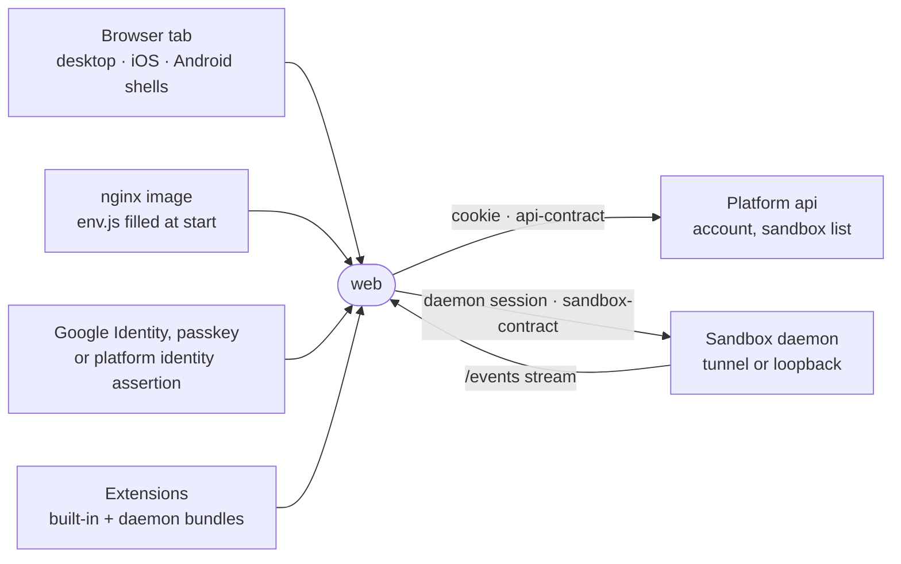

# web

The Vue app the user works in, with files, chat, terminals and agents, talking to the platform for the account and straight to the sandbox daemon for everything else.



- **Where it runs.** A static SPA served by the nginx image in `Dockerfile`. `entrypoint.sh` fills `API_URL` and
  `POSTHOG_KEY` into `assets/js/env.js` at container start, so one build serves any environment, and inlines that
  script into `index.html` so the first page load does not wait on a second, uncached request for it. The desktop app,
  the iOS shell and the Android shell all open this same app, and `_site/demo` builds it through `vite.shared.ts`.
- **Two backends, two credentials.** The platform api (`src/lib/useApi.ts`) rides the Better Auth cookie and
  answers sign-in, the sandbox list, invites and the hosted plan. Every workspace call goes directly to the daemon
  through `sandboxRpc`, with a daemon-minted session that a proof establishes (`sandboxSession.ts`). The platform is not
  in that path. The daemon is reached over its tunnel, or over a certified loopback name when it runs on this machine
  (`client/endpoint/endpoint.ts`).
- **Two ways to sign in.** Google (one ID token minted in the browser, spent on the platform and on each daemon), or a
  six-digit code mailed to an address on any domain (Better Auth's email-OTP plugin, `client/auth/useAuth.ts`). One
  mail carries one code, offered two ways: typed on `/login` (`features/auth/EmailCodeSignIn.vue`), or followed from
  the mail's link to `/login/confirm`, which names the address and spends the code only on a press, since mail scanners
  fetch links; it clears the code from the address bar on mount and loads nothing from another origin (index.html keeps
  Google's script off it). The login page offers the code only where `GET /me/sign-in-options` says the platform mails
  them. Inside the desktop webview and the iOS shell the code runs in place, typed, because the mail's link opens the
  system browser. An account's ways in come from `/me` (`signInMethods`, absent meaning Google), held in
  `client/auth/signInMethods.ts` for the session module.
- **The proof chain a daemon session is minted from**, in order (`sandboxSession.ts`): a live daemon session; a cached
  Google token; the platform's identity assertion (`pa1.…`, minted per sandbox, spent at once, never stored) for an
  account with `email` among its ways in, only for a call somebody waits on and only where the daemon's `/health`
  lists `email` in `signIn.proofs` (`client/session/daemonDoor.ts`); the owner ticket on a hosted machine; then the
  sign-in wall. An account with no Google sign-in never meets Google's prompt: a daemon too old for email sign-in is
  named on the wall, a person the sandbox has not opted in to email sign-in gets the no-access gate saying so (the
  owner flips it per member on the Access tab), and a first session by email code is followed by a nudge to add a
  passkey, which opens the sandbox while the platform is down.
- **When the platform is down or forgets.** Only the sandbox list needs the platform, so this device remembers it per
  account, names and addresses only (`features/sandbox/recovery`). The outage screen opens a remembered sandbox
  directly, the workspace running unchanged on that remembered list; a list that offers nothing to open while this
  device remembers sandboxes of the account's own goes to `/recover` rather than onboarding; and a sandbox's own
  address opens it through `/open?url=`. [recovery/README.md](src/features/sandbox/recovery/README.md) has the rules.
- **AI literacy notice.** When enabled in Sandbox ▸ Access, every member, including guests, confirms the current notice before continuing. A new text opens it again. Maintainers can read the confirmation list. The default is off.
- **Keyboard access.** The first Tab reveals “Skip to main content” in the workspace and local shells. It focuses the visible main surface, including a side panel filling the centre. Agent and workflow titles are native buttons beside their independent actions. The jump palette is a named dialog with an input combobox, named result groups and active-descendant navigation. The backend-free accessibility checks live in `_tools/e2e/accessibility/demo.spec.ts`.
- **Results one press away.** The documents a turn made (Word, OpenDocument, RTF, PDF, decks, sheets, web pages) are
  chips under its answer, each with Download and Print beside it (`features/chat/transcript/deliverables/`). A press on
  the chip opens the document in Files as before; a guest, who has no Files, gets it over the chat instead
  (`parts/workspace/ResultPreview.vue`), read through the daemon's route that serves a
  conversation's recorded documents and nothing else (`resultFiles.ts`). The file viewer's bar has Download for every
  file and Print over a surface that reads as pages. Print copies what is on screen into a hidden frame of its own,
  with no script, no handler and nothing loaded from outside the app (`printRendered.ts`): a document keeps its page
  layout, a web page prints as its sealed frame shows it, a PDF goes to the browser's PDF printing. In plain words
  (Settings ▸ Appearance ▸ "I don't" write code) a conversation's review leads with those documents instead of the diff,
  with no branch, status letters or line counts, and ends in Accept under one sentence saying what accepting does
  (`features/agents/review/results/PlainResultReview.vue`); that press carries the documents even where git ignores
  them. A developer's review and land are unchanged.
- **A first run.** The agents board is always its three lanes, even empty: a first run draws the first agent's
  dashed slot in Active, where its card will arrive, and says in each empty lane what will land there
  (`features/agents/board/view/firstScreen.ts`). A maintainer's first run also carries a getting-started checklist,
  opened from a ring at the foot of the rail or from the top of the phone's Menu tab: bring work in, start an agent,
  connect your own models, land its work. A step is done when the sandbox's own data says so, never by pressing Next
  (`features/gettingStarted/useGettingStarted.ts`). The sandbox keeps only what each member chose (put away, steps
  passed over), per member, under `settings.gettingStarted`. One beacon at a time points at the next press, from the
  rail tile, the page or the control itself, the closest one on screen leading (`features/tour/`). The list is never
  offered on a sandbox where work has already landed, so nobody who is past their first run meets it. `?mode=fresh`
  in `_site/demo` shows it.
- **Map.** `/sandbox/map` (`features/sandbox/map/`, maintainer and up) closes the hub's Reach group and draws the three
  rows above it as one picture. On the left are the ways in: people, control tokens and other sandboxes' links. In the
  middle is the box, with its areas, personas and secrets. On the right is everything it reaches: services, accounts
  and browsers, machines, other sandboxes, what it publishes, and models. Pointing at a way in lights what it reaches
  and dims the rest. Pointing at a thing lights who reaches it, and threads it to what it is tied to (a persona to its
  accounts, an area to the personas that live there). A click keeps the focus. It opens compact, with each outward group one block that counts what it holds (and, under a focus, how many of them the focus reaches) and opens into rows on a click, and the secrets one chip; Detailed draws every row. The choice is kept per device. Each line is worked out with the rules
  the daemon refuses on (`reachModel.ts`): a grant's areas and edit scope, the personas its fence holds
  (`fenceHoldsPersona`), its credential reach, and for someone who only chats or a link's tasks, what their personas
  allow (`personaAllowsCapability`, shared with the daemon through the contract). A connection whose tile is not loaded
  still appears under its own id. The roster is the owner's to read, so a maintainer's map shows tokens, links and
  themselves, and says so. It is core rather than an extension for the same reason as the audit log: it describes the
  security model, and a copy of those rules that drifted, or that someone switched off, would misstate it.
- **Oversight: Privacy & safety, then Activity.** The hub's last group (`sandboxNav.ts`), two rows for pages few
  readers open. Privacy & safety is one row standing for four pages, drawn as tabs above whichever is open, each at its
  own address (`HubTab.parts`, `workbench/hub/HubLayout.vue`); every one is still a palette destination by name. They
  hold what the whole box does with what passes through it, each a page that sets it: Data protection (below), Privacy
  shield (`features/sandbox/privacy-shield/`: the shield, its trusted providers, and Intentic's product analytics),
  Guardrails (`features/sandbox/guardrails/`: the command judge, its policy, project installs, then per service whether
  an outward action runs, asks first or is refused, `settings.actionRules`, and whether work started from outside may
  run, `settings.admission`) and Retention (`features/sandbox/retention/`: every record's period, the audit trail's
  included, then the rest of how the audit trail is kept, `settings.audit`: whether reads are recorded, a forward
  address and the stored secret sent with it). A setting about one thing stays with that thing (a gate on Secrets, a
  role on Access). An organisation's Agent lock holds the three that write settings (`organisations/useOrgPolicy.ts`),
  as the daemon files their routes under it. Activity is what happened (`features/sandbox/activity/`, `?section=`): the
  Activity extension's turns, drawn inside it as the one view `intentic.activity` may fill under that name, then every
  command the judge checked and every request the shield handled, which stay when the extension is switched off, then
  the audit log. Each settings page ends on the way to its record, and each record on the way to its settings
  (`SectionLink.vue`). 2026-10-17: these were two groups of six rows (Privacy & safety, then Records); collapsible
  groups were the alternative, rejected because a folded group still costs its heading and can hide the page open.
- **Data protection.** `/sandbox/data-protection` (`features/sandbox/data-protection/`, maintainer and up) draws the
  daemon's compliance report as three steps (`?step=`), each a tile that says how it stands before it is opened.
  Protections: every measure, the public-office preset's changes filed under the measure each switches (current →
  proposed, ticked, applied together by the owner after a confirmation), then the optional ones with a link to where
  each is set, then those in place, folded. Where data goes: what only the office can answer, then every outbound path
  in use with its personal-data, shield and location facts, then the ones one switch would open. Documents: the three
  drafts in Polish or English, as Word or Markdown, with a note while recommended changes are unapplied.
- **Audit log.** Activity's last part (`/sandbox/activity?section=audit`; the old `/sandbox/audit` redirects there),
  for the owner and maintainers (`features/sandbox/audit/`): whether the daemon's hash-chained trail is intact
  (`/audit/verify`), a period downloaded as the JSON Lines the daemon stored, and the records, filtered by who and by
  what was touched and paged backwards on asking. How it is kept is Retention's (`audit/AuditKeeping.vue`), which the
  outside-copy chip opens.
- **Personas.** `/sandbox/personas` shows square selectors with the selected persona's editor below.
  `PersonaSelector.vue` wraps `components/PersonaTile.vue` (face, label, selected appearance) for renaming and removal
  directly on the selector. It saves a queued edit against its original persona when the selection changes. A persona
  is a posture a chat wears, not someone to talk to: a chat picks it on its composer's **Acts as** pill or with
  `@persona:`, or routing matches one from its first message. The chat list neither groups nor scopes chats by
  persona.
- **Live state.** Server state lives in vue-query, mirrored per user to IndexedDB so a reload paints the last-known
  workspace. What the cache cannot paint yet is outlined as it last looked. Each loading placeholder is drawn from an
  imprint `@intentic/ui` took of its content, stored in IndexedDB as one record per sandbox and view
  (`lib/skeletonPersistence.ts`). The active sandbox's imprints are read before the first route mounts, and every
  other sandbox's at the first idle moment, so a switch draws them on its first frame. They survive a new build,
  which the query cache does not, and a sign-out clears both, along with everything else the account left in this
  browser: the keys `app/storage/browserStorage.ts` declares as the account's (open chat tabs, closed drafts, recent prompts,
  question and commit drafts, which sandbox was open), the transcript mirror in IndexedDB, and the sandbox scope's
  module state. Device preferences (theme, language, layout) stay. One `/events` stream per active sandbox
  (`useSandboxLiveness.ts`) invalidates what each frame makes stale (`systemEvents.ts`). Push refreshes let an
  in-flight read finish and queue one catch-up when another frame arrives. Hello reannounces file, runtime, derived-text and repository changes with wildcard batches to recover
  frames missed while disconnected. Terminals, the browser view and the desktop view (the sandbox's own screen, or one
  window on it, which a maintainer can take over) use WebSockets opened with a short-lived ticket (`wsTicket.ts`); a terminal's is spoken on a stream of the edge's WebTransport session where the sandbox row says the
  edge serves one (`features/terminal/channel/`). Each of them, and a connected account's browser window, rides one
  live socket (`client/session/liveSocket.ts`): minted, pinged, closed when silent, and redialled on one
  ladder that starts over when the sandbox answers again.
- **Work a person starts outlives the view that started it.** Adding a runner on a laptop, cloning a repo, landing an
  agent or moving a hosted plan keeps running on the server whatever the reader opens next. So its state (running or
  not, the lines it streamed, the answer, the refusal) is kept in the operations ledger
  (`workbench/operations/operations.ts`), keyed by what the work is about and stamped with the sandbox it began on
  (a key under `account/`, such as a plan change, is filed once for every sandbox), never in the component. Any view naming the same key reads the same run, so the page the reader comes back to still
  shows the build going and keeps its button held. An outcome read where it ended goes when that view closes, as it
  always did. One that ended while nobody watched raises a receipt with a way back, and waits in its view until it has
  been seen. A view inside a hub also marks that hub's row while the work runs. `useAsyncAction()` and
  `useConcurrentActions()` keep their state per caller, so `viewWork.guard.test.ts` refuses them anywhere they would
  die with a view. Questions (a confirm dialog, a form's inputs) stay the view's own.
- **When the sandbox stops answering.** A failed `/events` stream starts a diagnosis (`features/sandbox/diagnosis/`):
  bounded probes of the sandbox's address (netd's own `/system/vitals`, which answers whatever state Node is in,
  plus an opaque reach check), the platform, a hosted machine's power state, this computer's loopback where no
  permission prompt is raised, and the report the machine it runs on posted (`hostReport`, written by
  `ic sandbox fix`). `diagnose.ts` names one cause from them. A sandbox with any sign of life is **busy**, never down:
  the tab does not say Offline, no card shows for 90 s, the watchdog stretches to 30 s, and a restart is offered only
  after five minutes, among "other options". Everything else gets one sentence and at most one thing to press
  (`presentation.ts`): the platform's restart or rollback for a machine we run, and for the owner's own machine one
  command, `/fix`, which runs `ic sandbox fix` there and reports its progress back to the panel through a fix code
  (or `intentic://fix` in the desktop app). The recovery panel (`gates/SandboxRecovery.vue`) shows when the diagnosis
  found a way back, never on a timer: inside the connecting gate on a screen with nothing to paint yet, and as a card
  in the notification lane everywhere else. Both read one answer to which screen that is (`gates/established.ts`).
  _2026-09-30: replaced a panel that appeared after two minutes of silence with three commands (restart, rollback,
  doctor) for the reader to choose between. It was shown to sandboxes that were only busy, and the choice was the
  reader's to get right._
- **Too old to open.** A sandbox whose daemon is older than `OLDEST_SUPPORTED_DAEMON` (the contract's floor, read off
  the head of the hello's `build` by `useDaemonVersion.ts`) gets one page in place of its own, `gates/SandboxTooOld.vue`:
  which version it runs, the oldest this app works with, the Sandbox page's Update card and the update one-liner. A
  checkout's build (`0.0.0`) is never too old. Above the floor, a call onto a route the daemon lacks fails in words
  naming the part of the app (`routeAreas.ts`, the Sandbox page's area names), never the route's id.
- **Older sandboxes.** A view drawn from fields an older daemon does not send never rebuilds them from what it did
  send. It shows what was served as served, and `SandboxOutdatedNotice.vue` says the sandbox needs an update, what the
  view lacks until then, and how to update: the sandbox page's Update card, or `ic sandbox update <slug>` for a sandbox
  installed by hand. The chat's accounts read "older" off the routes the daemon advertises (`supportsRoute`,
  `accountsOutdated`): `agent.switchAccount` arrived in v1.313. Such a sandbox's account rows carry no verdict
  (`state`) and read as unknown, no held turn is offered another account, and the model picker, the continue card and Sandbox ▸ Models say it needs an
  update. The editor sends a session id only for a conversation the daemon has no record of (a past session opened
  from the history menu), and reads the account a failed turn ran on only off its error frame. Nothing else is guessed
  either: a card without `awaitingWake` is not waiting on a wake, a reading without `memoryRoom` warns of nothing, and a
  device row's card is its own `card`, never parsed out of its key.
- **A folder on this computer.** The desktop app's local face reaches a sidecar, not a daemon, whose hello says
  `surface: "folder"` and lists only what it serves (`useDaemonRoutes.ts`). The file tree offers no verb whose route is
  missing (`VERB_ROUTES` in `entryMenu.ts`) and none whose seam the window leaves out (`fileVerbSeams.ts`: a terminal,
  extract, download, a ZIP), so a folder window renames, moves, copies and deletes (to the OS trash, with no in-app
  undo) and offers "Ask an agent about this". Files dropped from the system's file manager land in the folder row or
  home tile they are dropped on, and anywhere else in the window in the folder itself (`useRootDrop.ts`, the
  workspace's own floor), as writes alone: the upload queue skips the unchanged-file diff, the archive and the install,
  which a folder does not serve. A document's own window takes no drop. A refused call says the feature is not there for a folder rather than
  asking for an update, and a recording plays from its bytes over `/workspace/raw` where no media ticket is minted.
  `local/` holds the window's own parts: its shell (`LocalShell.vue`, the sandbox shell's rail from
  `shell/rail/iconRail.css`, holding the place chip `LocalPlaceSwitcher.vue`, Files with the folder menu on the folder's
  name (`LocalFolderMenu.vue`: open a folder, and the folders opened lately; one opened in the window's place is moved
  to in place by `folderSwitch.ts`, as the editor's own sandbox switch to `local-<id>`, crossfaded with no reload), the views the app adds, and at
  the foot the sandbox shell's own account control `shell/AccountPanel.vue`, or the sign-in `LocalAccountTile.vue`
  before there is an account), Ctrl+P, Ctrl+Shift+F, Ctrl+W (by default: they follow the keymap's overrides for the workspace commands they stand
  for) and Alt+1–9 (`localKeys.ts`), the close guard for unsaved edits, held by the shell so a close is asked about
  from any screen of the window (`unsaved/useUnsavedGuard.ts`), a project folder's Bring back section (`bring-back/LocalBringBack.vue`, drawn only when a check the window runs on its own,
  on arrival and on focus, finds changes to bring back), and the way to a folder's own
  sandbox (`LocalProject.vue`): the window's dialog for "Work on this with an agent" (`LocalProjectDialog.vue`), and the
  card the sandbox's build stands on in the notification lane while the reader keeps working (`LocalProjectBuild.vue`),
  drawn as the agent's house going up with the setup's real phases (`AgentHouse.vue`, `agentHouse.ts`). A new Windows
  PC's own first-run setup (the PC check, the setup, the sign-in, the download, the first task) is the desktop app's,
  drawn on its This device view from `LocalOnboardingHost` (`localHost.ts`); the shell's own Agents view that held it
  was removed on 2026-10-12, and a folder taken in on a PC not ready yet goes to `project.detailsPath`. The folder's own
  button at the foot of the window says what the sandbox is doing while it is doing it, and IS the next step wherever it
  is stopped on the reader instead — "Set this computer up for agents", "Start Docker", "Sign in" — running the card's
  own verb (`machineCard.ts` `folderButtonOf`, `machineAction.ts`, shared with `LocalMachineCard.vue`); before this it
  read "Waiting for this computer's sandbox" in those states and its press unfolded a card already on screen, so the one
  button in the window did nothing at all. A press that asks for a card that is open flashes it (`attention`). The place chip names the
  window's folder and lists the account's sandboxes, the only other places the window goes, as the sandbox switcher
  lists "This computer" first in the app's workspace window, with the same digits for the same places in both: Alt+0
  this computer, Alt+1–9 the sandboxes. What only the desktop app can answer (the recent places, whether there is an
  account, who is signed in and the sandboxes as the workspace last told it, This device, and the account itself)
  comes from the host it installs before the editor runs (`app/environments/localHost.ts`); a page without one gets
  the link-only host. The account is `client/auth/useAccount.ts`: in the workspace the editor's own session, in a local
  window the one the workspace signed in with, which the app asks the platform about for the window. A local window's
  editor runs as a placeholder for its folder, so the account is kept apart from it: the account menu, Settings and
  the plan read `useAccount`, and a sign-out or a refused call ends the account and never the folder's session
  (`useAuth.ts` skips its teardown there). The workspace's switcher is what tells the app the account and those sandboxes
  (`announceDesktopRoster` in `app/environments/desktop.ts`), and a sign-out tells it there are none. A sandbox picked
  there reaches a workspace page already loaded without a reload: the app calls the opener the page registered
  (`installDesktopOpener`), and `openInPage` (`router/index.ts`) selects the sandbox the path names and routes there.
- **Routes.** `/login` and `/setup` sit outside the shell. Everything else lives under `/` in
  `WorkspaceShell.vue`, guarded by `requireAuth` and `requireSetup`, which renders `ShellDesktop.vue` (rail, side
  panel, terminal and status bar) or `ShellMobile.vue` (tab bar, full-screen views). A link naming a sandbox (`/?sandbox=<id>`, the
  desktop app's, for a synced folder or a sandbox picked on a local window's place chip) opens the shell on it if the
  account lists it, and otherwise says that sandbox is not on the account any more; the id leaves the address either
  way (`router/sandboxArrival.ts`). A desktop window on a local folder builds another table instead: `/` is
  `local/LocalShell.vue`, with `workspace/:path*` (the folder), one route per view the app adds (`device`) and
  `settings/:tab?`, the same Settings hub, open while there is an account. There it leaves out Notifications (a
  sandbox's), and Data hands deleting the account to the workspace, which knows every sandbox it must leave first. The
  routes are kept in the hash (`files/local#/device`), since the app serves that page at one address only.
- **On a phone.** `ShellMobile.vue` shows one screen at a time. The Sandbox and Settings hubs open on an index of
  their sections, grouped as the desktop rail groups them, and each section is a page with a way back to that
  index (`workbench/hub/hubDrill.ts`). The Menu tab uses the same grouped rows (`shell/MenuRow.vue`). A card's or row's
  own buttons fold behind one ⋯ that opens a sheet (`OverflowActions`). A screen's one create button floats over its
  corner (`FloatingAction`): New agent on the board, upload in the file tree. The review's Land button sits under the
  Changes tab instead of in the header. _2026-09-29: an index page, not a strip of section chips wrapping above
  every section. With extensions installed that strip was seventeen chips over every page of the sandbox hub._
- **The agents board between a phone and a desktop.** The board measures its own width, not the window's, so a docked
  chat counts. Under 48rem the lanes stack; from 48rem to 72rem it is two columns, Attention over Active in the first
  and Finished in the second; from 72rem it is three. On a desktop a card's header keeps only its filing press
  (archive, close or restore) and one ⋯. The ⋯ opens the same menu a right-click does, and the card's other presses
  (rename, add a reaction, review) are rows in that menu. A touch screen too wide to count as a phone, such as a
  tablet, shows the ⋯ without hover. _2026-10-15: three columns from 48rem, with a hidden 30px seat per press, left a
  card's title some 60px on a small laptop._
- **The rail and the status bar.** The rail holds places a reader goes. What the sandbox is running sits in the
  status bar at the foot of the window instead (`shell/status-bar/`): the terminal's toggle, always there for a
  developer, then a chip for each live thing (Browsers, counting the live apps that answer, the agents' open browsers and the
  windows on the sandbox's desktop, since all three are tabs of one view; a port open to the internet; a connected
  tunnel), each there only
  while it is live or its page is in front, so a chip arriving is news and the rail never moves for it. Geek metrics
  (Settings ▸ Appearance) add CPU, memory and disk at the bar's far end, whose panel and the docked terminal take turns
  above the bar. Resource sizes use binary units (MiB/GiB). The panel separates the sandbox's counted working set
  (daemon, counted file cache and kernel memory included) from process RSS grouped by kind or session: those groups
  overlap and are not an additive breakdown. Optional cgroup accounting shows measured categories and the inactive
  file cache excluded from the total; scope explanations stay in tooltips, including for older daemons without invented readings.
  _2026-10-08: the terminal, Browsers and the live app left the rail. As tiles they were always on (a
  closed browser still listed, a repo with a panel counted as running), and tightening them would have made the rail
  move with every agent turn 2026-10-13: the live app, Browsers and Desktop chips became one Browsers chip, as all three
  opened the same view; its hover card says what is behind the count._
- **The side panel.** The rail owns the main area; the side panel (`shell/side/`, its tabs and views registered in
  `workbench/side/`) is where the reader looks at another section's
  things without leaving the one they picked. A reference (a file a chat names, a server a turn left running, an
  extension's side view) opens in its home while that home is the main area, and beside it everywhere else, as a peek
  the next one replaces unless kept. "Open in …" moves it into its home. The chat whose home is the side is the
  panel's lower part, under the tabs. A popped-out chat has a panel of its own, right of the chat where its checklist
  and usage strip stand while it is empty; "Open in …" from there goes to the main window, and a popped-out terminal
  or Browsers hands its references to the main window's panel. A phone has no side panel: there every reference
  navigates as before. A file peek reads the copy it names (`VIEW_SCOPE`)
  without switching the Workspace's scope, and never edits, since the Workspace may hold the same path unsaved.
  _2026-09-29: peeks stack above the chat rather than sharing tabs with it. A tab would hide the chat that linked to
  the file, and typing to an agent while its preview updates needs both on screen. References from the side panel's
  own chat open beside, not in the main area as a side chat does in an IDE: that would let one click replace the
  section the rail picked._
- **Browsers.** Everything live the sandbox shows is a tab of one view at `/browsers` (`shell/browsers/`): the live
  apps its dev servers and forwarded ports serve, framed straight from them in the reader's own browser
  (`features/preview/PreviewTab.vue`); the windows of its own Chromium, streamed (`features/browsers/`); and its
  desktop and each window on that desktop, streamed and cropped to the window (`features/desktop/DesktopTab.vue`,
  addressed `desktop://` and `app://<program>`). The strip leads with the reader's pins (apps, desktop, windows), set off
  by a hairline from the web pages of the window in front; what a tab is shows in its glyph and the glyph's colour (a
  live app's eye is green while it answers, blue while it starts), never a word beside its title. The + opens a
  launcher of all of it, and the start page offers the same. The toolbar is the browser's, with whatever the tab in
  front owns teleported into it (an app's Start and Stop, the hand on the desktop), and a phone frame for an app or a
  web page (`emulate` on the browser's socket). The view is one panel per window above the router
  (`shell/window/PoppablePanels.vue`), moved between `/browsers`, a side panel tab and a window of its own, never
  rebuilt: parked, a framed app keeps its state and the streams pause. Its state (pins, the tab in front, opening one
  beside) is `workbench/browsers/`, which any feature may call; a tab's key is the route's tail (`browsersPaths.ts`).
  _2026-10-08: the Preview and Desktop views became tabs of Browsers. Both had been a screen of their own for one kind
  of live thing, with a picker standing in for tabs; `/preview` and `/desktop` redirect to their tabs._
- **The browser tab.** `shell/browser-tab/` (its chimes and preferences in `workbench/browser-tab/`) shows the fleet's
  news to a reader who is looking elsewhere. One mark at
  a time, the first that holds: `(2)` for what needs you (the Agents tile's own count), `Offline` when the sandbox is
  not answering (never while the diagnosis sees it alive and busy), `✓` for a turn someone started that finished while you were away (gone when you come back), and a dot
  on the icon while a turn runs. The icon carries every mark; the title carries all but the last. Two opt-in sounds
  (Settings → Notifications), one when something new needs you and one when a turn finishes, ring only while no
  window of the app has the focus, and from one tab at a time.
  _2026-09-29: work under way stays out of the title. A browser marks a background tab whose title changed (Chrome
  dots a pinned one), so a title that changed at every turn's start and end would flag the tab all day._

  Inside the desktop app, whose window has no tab and spends most of its life in the tray, the same mark goes on the
  app's icon (`desktopBadge.ts`: the tray, the Windows taskbar button, a Linux dock's count), drawn with the tab
  icon's own drawing, and the same news, for the same reader, becomes the system's notifications
  (`desktopSignal.ts`): one per agent that needs you and per turn someone started that finished, a burst of more than
  three as one, the system's sound for the first only and none when a chime rings for it, an ask answered elsewhere
  taken down, and all of them cleared the moment you are back. Both are on by default, with their switches in
  Settings → Notifications, and both are links the app puts up (`app/environments/desktopNotices.ts`), only to an
  app that says it takes them (`notices`). The app also says whether its window is on screen
  (`workbench/window/onScreen.ts`), which WebView2 does not for a window in the tray: without it the page reported its
  reader present all day, and the sandbox held back every push to their phone.
- **Extensions.** `src/extension-host/loader.ts` activates what the daemon lists. First-party extensions are compiled
  in (`builtins.ts`); the rest arrive from the daemon as single-file ESM bundles imported from a Blob URL.
  `hostModules.ts` and `public/ext-shims/` hand every bundle the app's own `vue`, vue-query and
  [extension-ui](../../_shared/extension-ui) instances. Before linking a bundle the loader checks the names it imports
  from extension-api and extension-ui against what those shims export (`bundleLinks.ts`), and an extension asking for
  one the app lacks is shown as incompatible, needing an update, rather than failing with the browser's link error.
- **Session replay and events.** A browser whose time zone is in the EEA, the UK or Switzerland is asked first, on a question card in the notification lane (`analytics-consent` in `shell/notifications/notificationSources.ts`), and records nothing until it answers; everywhere else analytics is on unless this browser was switched off. Settings → Data & privacy holds the one switch, and the answer is stored locally (`app/analyticsConsent.ts`). An active sandbox needs loaded settings with `productAnalytics: true` before any event or recording runs. `POSTHOG_UI_HOST` chooses the dashboard host for replay links (default `https://us.posthog.com`), while `POSTHOG_API_HOST` and `POSTHOG_ASSETS_HOST` choose the proxy targets.
  _2026-10-13: the consent popup is gone and the default is on; switching it off still sends no cookieless counts, since off should make no analytics request._
  _2026-10-15: European browsers are asked again, by time zone, before anything is recorded; the rest of the world keeps the 10-13 default. Chosen over asking everyone (it costs the analytics no law asks us to ask for) and over the platform's `cf-ipcountry` (a request before the first screen, and absent on a self-hosted platform)._
- **Funnel milestones.** Besides the setup events, `analytics.ts` sends `signed_up` (an account made within 30 minutes of being seen, from `User.createdAt`) and `first_turn_completed` (the first agent turn that settled on its own, from `turnClient.ts`), each once per account per browser, and registers the `utm_*` tags the visit arrived with on every event of the tab, reading them as the module loads so a redirect to `/login` cannot drop them. The marketing site hands those tags over in its links (`_site/site/src/lib/visit.ts`).
- **Session replay and events.** `src/app/replayPrivacy.ts` decides what a PostHog recording may hold and
  `src/app/eventPrivacy.ts` does the same for every event, through `before_send`. `analytics.ts` hands both to
  `posthog.init`. In a replay every text node goes through `src/app/replayText.ts`, which keeps wording from an i18n
  catalog (`staticCopy` in `@intentic/ui/i18n`), punctuation, the product's name and a number standing alone, keeps the
  wording of a message with placeholders (`copyTemplates`) while judging each value by its placeholder's name ("3 files
  changed" whole, "Delete report.pdf?" as "Delete ***********?"), stars everything inside `pre` and `code`, and keeps
  the words of what a machine reported inside `[data-replay="diagnostic"]` with its paths, addresses, emails and
  identifiers starred (the setup page's failure list). Everything else turns into asterisks. The code editor, its diff,
  terminals, images and embedded pages are blocked, and canvas, console output, request bodies, network timing and web
  vitals attribution are switched off by name, since the PostHog project's own settings would otherwise decide. In an
  event every address becomes the router's route pattern (`routePatternOf` in `router/routePattern.ts`, for example
  `/workspace/:path*`), the text and attributes of a clicked element pass the same rules, and an exception's message is
  masked while its stack stays. Decided 2026-09-29 as default-deny because workspace names show all over the app (rail,
  tabs, board, search), not only in the editor and chat, so a list of content views would miss the next one. Widened
  2026-10-04 to sentences around values, numbers and setup diagnostics: replays of a failed onboarding showed a
  screen of asterisks, the error included, and a deny-list of content views was rejected again for the reason above.
  Rejected: a marker on each content view, and one on each piece of chrome. The privacy policy
  (`_site/site-content/src/legal.ts`) states what leaves the browser, so change both together.
- **Gotcha.** The dev server must stay on `https://localhost:47145`: CORS, Better Auth and the Google OAuth client
  trust that exact origin. It serves with the local certificate from
  [localhost-https](../../_tools/localhost-https).

## Words

One word per idea on screen and in code. The retired spellings are refused by
[`vocabulary.mjs`](../../_tools/constants/src/vocabulary.mjs).

| Word | Means |
| --- | --- |
| slot | An empty element a mounted surface publishes for a panel to teleport into (`workbench/window/panelSlots.ts`) |
| pin | A Browsers tab that is the reader's own rather than a web page of one of the open windows: a live app, the desktop, a window on it (`workbench/browsers/browsersSurface.ts`) |
| docked | A panel living in the main window, as opposed to floating in a window of its own (`floating.ts`) |
| status bar | The line at the foot of the desktop window: the runtime chips (`shell/status-bar/`) and, opted in, the geek metrics' segment, which opens its panel above the bar (`features/agents/status-bar/`). On a phone, the metrics alone at the Agents board's foot |
| subagent | Any agent another agent started: in-process by its runtime's own Agent tool, or spawned by the sandbox as a conversation of its own. Drawn one way wherever it shows, on the card of the call that started it (`features/chat/tools/subagentCard.ts`) and in its parent card's tray; how it was started changes only what else it offers, such as its own conversation. Not "child agent" |
| tray | The rows hung under a board card, and under a card in the chat's list (`features/chat/tabs/chatTrays.ts`), for every subagent it started: the ones it spawned, which are conversations of their own, and the ones its runtime ran in-process, from the roster (`models/fleet/subagentRoster.ts`). Open only under the card the reader is on, a card whose subagent is on screen, and every card while a filter is on, folding open and shut with what stands below sliding to make room, on the compositor (`features/agents/board/view/foldMotion.ts`); every other card counts its subagents on itself instead (`parts/fleet/ChildCount.vue`) and keeps only a subagent asking the reader in sight. Open, asks and working ones in sight, stopped ones one row per thing they stopped on, settled ones folded behind a count (`models/fleet/board/childFold.ts`). A row shows its subagent in the chat: a spawned one's own chat, an in-process one's transcript in its parent's column (`models/conversations/panel/subagentView.ts`) |
| quick bar | The parked chat's pill that opens into a scratch pad: the composer alone, open while the reader is in it (`ChatQuickBar.vue`). Open, a header names the chat and its last words and leads to /chat; it draws no transcript |
| send later | When a message goes, when not now: a time, or once another agent's work lands (`models/conversations/drafts/sendLater.ts`). The send is a split button: its press (and Enter) sends now, its caret opens the menu, hours first (the next twelve whole hours), a day of one's own and another agent's land behind their rows (`ComposerSendLater.vue`); a pick there is the send, booked for then. A booking the words came back with (Edit) or typed at `@send:` shows on the press, which books it again. Booked messages wait in the conversation's queue, each on its own time, drawn as scheduled with its own Change and Send now (`models/conversations/drafts/bookings.ts`) |
| land when done | A conversation's own answer to whether its finished work lands by itself, the board menu's "Land automatically" reached from the composer (`features/chat/composer/composerLanding.ts`); a chat not on record yet carries it on its opening message |
| quick look | A card a hover raises: a home tile's preview, a bigger picture, an attached file's first lines |
| peek | A tab opened as a look, which closes when the reader moves on unless kept (`Conversation.peek`, the side panel's `peek`), and nothing else |
| side panel | The desktop shell's right-hand column: what the reader opened beside the section the rail put in the main area, one tab each, stacked over the chat when the chat's home is the side (`shell/side/`). Not the Workspace's second editor pane, which is its companion pane |
| side view | What one side panel tab shows for one input: the core's file and Browsers, or an extension's (`workbench/side/sideViews.ts`) |
| page | A self-contained HTML document the agent showed in a chat (`show_page`), or asked the reader to answer on (`ask_page`), drawn inline in a sealed frame in the chat's own theme (`features/chat/transcript/pages/`). Its scripts run, with no network and no reach into the app; what it asks of the app (its height, a link, words for the composer, an answer) goes over the MCP Apps bridge (`pageBridge.ts`) and is acted on only after the reader's own press. A connected MCP server's app is drawn the same way. Not "artifact", not "widget" |
| cover | One file name read in every folder (README.md, package.json): the explorer tree lists folders alone and marks those holding it, and the home shows the current folder's copy in place of its tiles (`features/workspace/home/homeCover.ts`); on screen, "Show README.md in every folder" |

The status bar still stores its panel under `ui-board-dock-*` in local storage: renaming a stored key would close
every reader's open panel.

## Layout

The directories under `src/` are layered, lowest first, and a value import may only reach its own layer or a lower
one ([layers.json](layers.json), checked by `editor-boundaries` and drawn by the Dependencies view). Where a lower
layer needs something only a higher one knows (the built-in views, the account, the transcript mirror), the higher side
registers or hands it in at startup (`main.ts`). The router is one: the route table installs it into
`workbench/navigation/navigation.ts` where it creates it, and everything below composition navigates and reads the
route through `navigation()` rather than importing `router/index.ts`. Inside each unit `subunits` lists (`features/chat`, `features/sandbox`,
`features/workspace`, `features/agents`), each immediate subdirectory and the unit's root files are subunits, and a new
value import closing a cycle between two of them fails too (standing ones: `_tools/checks/baselines/editor-subunits.json`).

<!-- >>> generated from layers.json: edit it there, then run node _tools/checks/layer-tables.mjs --fix -->
| Layer | Holds | Directories |
| --- | --- | --- |
| foundation | the app's own plumbing and generic helpers: the API client, query keys, markdown, environments, analytics | `lib/` `app/` `skins/` `styles/` `assets/` `design-system/` |
| client | the editor's clients of what it talks to: the platform account and the sandbox daemon's session, endpoint, RPC and queries | `client/` |
| components | UI parts shared by several features that know no feature | `components/` |
| workbench | the services and registries features are written against, one unit per workbench/&lt;x> | `workbench/` |
| models | domain state and projections several features read: daemon query stores, pure derivations and their words; renders nothing and knows no feature, one unit per models/&lt;x> | `models/` |
| parts | Vue parts that draw one model several features show and know no feature: a provider's logo, an agent's seal, a secret's field; one unit per parts/&lt;x> | `parts/` |
| features | one directory per product area; a feature may use another, but no two may form a cycle | `features/` |
| composition | what puts the features on screen: the shell, the router, built-in views, the extension host, local windows | `core-views/` `extension-host/` `shell/` `local/` `router/` `testing/` |
<!-- <<< end of generated layers.json -->

`models/<topic>/` holds what features read across one another without rendering it: an agent's standing and the
words for it (`models/agent-status/`), the capability, sandbox, extension and terminal query stores, the provider
accounts and catalog (`models/providers/`), the chat store and its conversations (`models/conversations/`: `useChat`,
its tabs, sessions, turns and transcripts), the fleet store (`models/fleet/`: `useAgents` and the board's helpers), the
working tree's changes and history (`models/changes/`), voice input and the wake word (`models/voice/`), the
workspace's shared helpers (`models/workspace/`), and the browsers, hosted-plan, preview and needs projections. Units
import one way: conversations below fleet below changes. `parts/<topic>/` holds the Vue that draws one of those models
for several features (a provider's logo, an agent's seal and its count of subagents, a secret's field, the notice that
a sandbox is older), and `components/` the parts that read no model at all (a decision button, a command block). Route helpers live in `lib/routes/`; the whole-app looks are described in [skins](src/skins/README.md) and the first-run
flow in [setup](src/features/setup/README.md). `components/` holds app-specific parts; parts shared beyond the app go to
[ui](../ui). `local/` is the desktop app's window on a folder or document of this computer, and `testing/` holds the
suites' fakes (daemon client, router, workers).

## Key files

- [src/main.ts](src/main.ts) — boot order: self-heal, appearance, i18n, then mount with router, vue-query and `@intentic/ui`.
- [src/router/index.ts](src/router/index.ts) — every route and the guards that gate the shell.
- [src/client/sandbox/sandboxRpc.ts](src/client/sandbox/sandboxRpc.ts) — the typed daemon client every contract call goes through.
- [src/lib/useApi.ts](src/lib/useApi.ts) — the typed platform api client.
- [src/extension-host/loader.ts](src/extension-host/loader.ts) — lists, gates and activates extensions.
- [src/shell/WorkspaceShell.vue](src/shell/WorkspaceShell.vue) — the persistent shell, split by form factor.

## Commands

```sh
pnpm --filter @intentic/web dev        # API_URL defaults to https://localhost:6480
pnpm --filter @intentic/web test
pnpm --filter @intentic/web typecheck
```

## Local shell: Repair

`/repair` (`local/repair/LocalRepair.vue`) is the Repair view in the desktop app's local shell (no rail tile). Copy: `local.repair.*` in `src/app/i18n/locales/en.json`.
