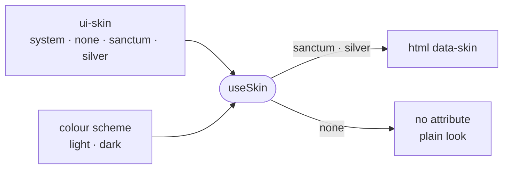

# skins

A skin is the editor's whole look, worn as one `data-skin` attribute on `<html>`; this directory holds the skin's stylesheet, the preference that picks it, and the wallpapers behind the agents board.

- `sanctum.css` and `silver.css` scope every rule to their own `[data-skin=...]` and are imported by
  `src/styles.css`, so the skin `none` needs no stylesheet: it writes no attribute and the app shows its plain look.
- The setting is stored under `ui-skin` and holds `system`, `none`, `sanctum` or `silver`. `system` is the default
  and follows the colour scheme: dark wears `sanctum`, light wears `none`, and an OS that flips at dusk carries the
  look with it. Silver is worn only when picked.
- Both skins are built on a dark canvas and have no daylight dress. Pinning either with `setSkin` also sets the
  scheme to dark. Settings offers them as two of five looks on the theme row (`themeRow.ts`) rather than as their
  own control, since two controls could put a light scheme under a dark skin.
- `index.html` runs the same rule in its pre-paint script, so the attribute is in place before the bundle loads
  and there is no flash of the plain look. Anything that needs a fixed look, such as a profile link or the
  screenshot tooling, writes `ui-skin` and `ui-color-scheme` before boot.
- Sanctum's accent is its gold. It restates the whole `--color-primary-*` ramp, with 500 as the house gold and
  300 as the bright gold, so every selection, tab, check, toggle, focus ring and the Send button share that one
  metal (the rule is "One signal colour" in [../../../ui/README.md](../../../ui/README.md)). The colour picked in
  Appearance still tints the stone through the neutral ramp, and its row says so while Sanctum is on.
- Silver is smoked glass in a misty room, in neutral greys. The room is `valley-ground.avif`, the valley blurred past
  recognition (`wallpaper:art` makes it). The canvas, the panes and the raised surfaces (composer, dialogs, menus)
  each paint that same ground, fixed to the window, under a veil of their own weight. So a pane shows the room's
  light through it, yet stays opaque and never stacks darker when nested. Elements that also carry a `hover:bg-*`
  utility keep a plain colour, so their hover still shows. Separation comes from tone, not drawn rules. The accent
  ramp is near-colourless silver, and the loud button is a polished plate. Over a wallpaper, the board's cards are
  true `backdrop-filter` glass. Their hover fades a wash in over the fill instead of swapping the fill, which made
  the card flash clear.
- A new skin needs its name in `Skin` and `SKINS`, a stylesheet scoped to its attribute, its name in the
  pre-paint scripts (`index.html`, `_site/demo/index.html`, the desktop app's `local.html` and `sandbox.html`),
  a place on the theme row, and a spelling in the desktop app's `Look` and the Android app's `Looks`.

## Wallpapers

A wallpaper is a picture behind the agents board (`/agents`) only, picked on its own row in Appearance and worn under any of
the five looks. `useWallpaper.ts` stores it under `ui-wallpaper` (`none`, `mist` or `valley`, `mist` by default) and writes it as
`data-wallpaper` on `<html>`; `wallpapers.css` draws it as the backgrounds of `.agents-board`. All other views keep
their normal canvas background. The scheme picks each picture's dark or light version and its scrims, and every picture is toned the
same way: dimmed by a veil that keeps its own hue (warm paper by day, dark by night), never desaturated, which read as grey. While one is worn the board's lane headers drop their
canvas band and stop pinning, since a pinned header with nothing behind it would slide over the cards under it.

- A picture's masters are `src/assets/wallpaper/<name>-dark.png` and `<name>-light.png`, 16:9;
  `pnpm --filter @intentic/web wallpaper:art` encodes every master into the AVIF rungs under
  `public/assets/wallpaper/`, which are committed, plus the blurred grounds its `GROUNDS` list names.
- Picking the Silver look in Appearance also puts on `valley`, the misty valley it was drawn over, unless
  wallpapers are off; the wallpaper row can change it straight back.
- A new wallpaper needs its masters, its name in `WALLPAPERS`, its `--wallpaper-art` rules in `wallpapers.css` and
  a `settings.appearance.wallpaper.<name>` label in every locale.

## Key files

- [useSkin.ts](useSkin.ts) — the preference, the rule that resolves `system`, and the dark pin.
- [sanctum.css](sanctum.css) — the carved-stone skin, as role tokens and surfaces under `[data-skin="sanctum"]`.
- [silver.css](silver.css) — the frosted-glass skin, under `[data-skin="silver"]`.
- [themeRow.ts](themeRow.ts) — how the five looks map onto scheme and skin.
- [useWallpaper.ts](useWallpaper.ts) — the wallpaper preference and the attribute it writes.
