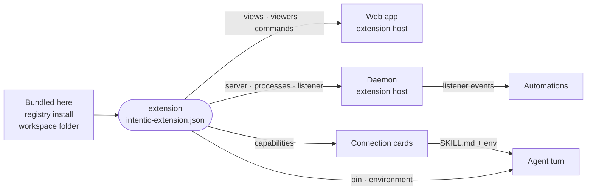

# Extensions

The first-party extensions that sit on the lean core: the panels, connection cards, chat providers and messaging gateways, each declared by one `intentic-extension.json`.

- The manifest is the approval surface: the install dialog shows it, and the host refuses any registration or daemon route it does not declare. Its schema is [extension-manifest](../_shared/extension-manifest), the runtime API is [extension-api](../_shared/extension-api), and [extension-example](../_tools/extension-example) carries one contribution of every kind.
- An extension depends on six `@intentic/*` packages and their subpaths, never on another: the SDK halves [extension-api](../_shared/extension-api), [extension-ui](../_shared/extension-ui) and [connector-runtime](../_shared/connector-runtime), [extension-manifest](../_shared/extension-manifest), the wire contract [sandbox-contract](../_shared/sandbox-contract) (bare, and only the subpaths extension-api's [`EXTENSION_WIRE`](../_shared/extension-api/src/wire.ts) lists, the slice the extension API versions), and [base](../_tools/base), the dependency-free helpers extension-manifest itself stands on. Its suites may add [testing](../_tools/testing), as a devDependency. The `no-restricted-imports` override in [.oxlintrc.json](../.oxlintrc.json) holds the imports to that list, and [extension-deps.mjs](../_tools/checks/extension-deps.mjs) holds the manifests to it. The kit's `intentic-kit-check`, in every extension's `typecheck`, refuses a contract subpath outside `EXTENSION_WIRE` too, in a standalone repository as here: a subpath an extension needs joins the list with a new extension API minor, recorded in `surface.json`.
- Nothing outside this area depends on an extension, apart from its hosts: the web app, which compiles the UI extensions into its bundle; the desktop app's files sidecar ([local-files](../_devices/local-files)), which runs ONLYOFFICE's browser engine for folders on the user's own disk through the one entry the extension exports for it, `@intentic/ext-onlyoffice/local-office`; and (2026-11-26) the owner's browser extension ([webext](../_devices/webext)), which runs the ChatGPT kit's engine in their own Chrome through `@intentic/ext-chatgpt/kit/chatgpt`. Each engine stays in its extension, which also runs it in a sandbox; `CONSUMERS` in [lib/extension-deps.mjs](../_tools/checks/lib/extension-deps.mjs) holds each host to its entries, and refuses another.
- UI extensions compile into the web bundle ([builtins.ts](../_editor/web/src/extension-host/builtins.ts)) and bake only their manifest into the sandbox image, so the Extensions tab lists them beside every other extension with one on/off switch. The five with a backend, onlyoffice, repo-apps, visitor-chat, pipelines and product-health, bake their built `dist` beside it as well (`BUNDLES` in [prepare-image-trees.sh](../_tools/scripts/image/prepare-image-trees.sh)); visitor-chat's also holds its gateway process and the widget a customer's page loads.
- Data-only packs (cards, skills, Dockerfile fragments) copy into the image as they are. connectors and chatgpt bake their backend's built `dist` beside their manifest too (`BUNDLES`), so every sandbox runs them. Gateway extensions bake their manifest everywhere and ship their runnable tree in the `messaging` image pack.
- A sandbox the platform hosts sleeps when nobody uses it, and a gateway's live connection sleeps with it. An extension
  that must hear what arrives meanwhile declares a public route with `wakes: true` and hands its provider the URL
  `api.sleep.wakeUrl(path, { automationId })` answers (a webhook in place of long polling or a socket): a call there
  while the machine sleeps is answered 503 with `Retry-After` and wakes it, so the provider's retry reaches it, while an
  automation on the extension's provider is switched on. `api.sleep.beforeSleep(handler)` runs in the backend or a
  gateway process right before the machine sleeps (about ten seconds, shared), and `api.sleep.boot()` says whether the
  last stop was such a sleep and whether a request woke this boot (2026-11-27,
  [extension-api](../_shared/extension-api#hosted-sleep)). A provider that never retries still loses what it sent while
  the machine slept.
- Optional first-party extensions live in their own repositories and install from the registry like third-party ones: acceptance, deployments, documentation, e-urzad (EZD RP and e-Doręczenia for Polish public offices, [intentic/extension-e-urzad](https://github.com/intentic/extension-e-urzad)), issues, knowledge, maintenance, prawo (Polish acts and rulings, [intentic/extension-prawo](https://github.com/intentic/extension-prawo)) and workflows (the workflows page; the engine that runs workflows, their release gate and the run cards on the agents board stay in the daemon and the web app). The daemon ([src/extensions](../_sandbox/sandbox/src/extensions)) enumerates baked, git-installed and workspace extensions as one list.

| Package | Role |
| --- | --- |
| [acp-agents](acp-agents) | Chat-provider cards for OpenCode, Gemini CLI and any ACP agent. |
| [activity](activity) | Sandbox tab auditing what reached the agent and how it went. |
| [approvals](approvals) | Inbox of posts, actions, held wakes and hooks awaiting the owner. |
| [automations](automations) | Rail view to create and watch the agent's scheduled and triggered wake-ups. |
| [browsers](browsers) | Cards connecting the owner's own Chrome or Edge. |
| [chatgpt](chatgpt) | The ChatGPT kit's tools in a sandbox account's browser or the owner's own, its images there as background jobs, and the engine both run. |
| [connectors](connectors) | CLI and browser cards: GitHub, GitLab, Sentry, Postgres and more; the npm and GitHub release watch kinds. |
| [devices](devices) | Cards pairing the owner's Windows or Linux machine. |
| [discord](discord) | Discord bot card, message listener and voice-transcribing gateway. |
| [git-history](git-history) | Per-repository commit graph with branch, stash and undo actions. |
| [google-workspace](google-workspace) | `gw` CLI for Gmail, Calendar, Drive, Docs and Sheets, plus a watcher. |
| [imap](imap) | IMAP inbox card, an `imap` CLI for reading and sending (password or OAuth2), and a mailbox watcher that wakes automations. |
| [microsoft-365](microsoft-365) | `m365` CLI for Outlook mail, calendar and OneDrive/SharePoint, with approval holds and a mail listener. |
| [onlyoffice](onlyoffice) | Office documents in an ONLYOFFICE editor, run in the browser or as a Docker document server. |
| [phones](phones) | Card pairing the owner's Android phone through the Intentic Device app. |
| [pi-agent](pi-agent) | The Pi coding agent as a chat provider. |
| [pipelines](pipelines) | Rail view of CI runs on the workspace repositories' remotes, with a backend holding main's one fix agent and the board's reads (2026-11-26, the daemon's `ci/` repair until then). |
| [preview](preview) | Sandbox tabs for exposed ports and the served `public/` directory. |
| [product-health](product-health) | The PostHog card, and a rail view of what PostHog finds wrong in the product (errors, firing alerts, health checks, Inbox reports), each with the press that puts an agent on it. |
| [repo-apps](repo-apps) | Per-repository panels for a monorepo's apps, tests and dependencies, with a backend that reads the package graph. |
| [slack](slack) | Slack card plus a gateway heard over Socket Mode, or on a hosted sandbox at a Request URL that wakes it. |
| [social](social) | Browser cards for acting as the owner on Reddit, X, YouTube, Facebook, Instagram and TikTok. |
| [telegram](telegram) | Telegram bot card plus a long-polling gateway. |
| [viewers](viewers) | File viewers for images, PDF, media, office formats and EPUB. |
| [visitor-chat](visitor-chat) | The chat widget a customer's site embeds, its public door and its listener, whose visitors wake an agent. |
| [whatsapp](whatsapp) | WhatsApp linked-device card plus its gateway. |
