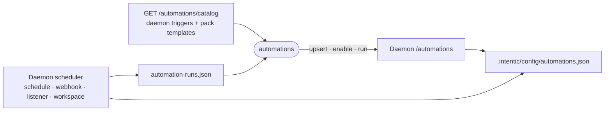

# automations

The Automations rail view, where the owner creates, edits and watches the agent's wake-ups: a trigger, an optional guard and the prompt the agent wakes with.



- Runs in the browser, compiled into the web bundle. The daemon fires every automation and records its runs ([src/automations](../../_sandbox/sandbox/src/automations)); this view only reads and writes the definitions through the `/automations` routes.
- Names no integration itself. The trigger picker and template gallery come from one catalogue read, which merges the daemon's own triggers with the listener sources and `automationTemplates` of every enabled extension. An automation whose extension is gone degrades to a generic, still-editable source. The one exception is wording: this view's catalogs translate the Microsoft 365 listener's labels, each only while the pack still says what `en.json` holds, never its ids or its starter prompt.
- The Visitor chat form keeps the AI disclosure on by default and lets the owner supply its wording or explicitly turn it off.
- Schedules are edited as a structured form ([cronSchedule.ts](src/cronSchedule.ts), drawn by [ScheduleFields.vue](src/ScheduleFields.vue) wherever a schedule is changed) that composes and parses cron, and read as a sentence ([scheduleWords.ts](src/detail/scheduleWords.ts): "Every hour from 09:07 to 22:07", "Every Tue and Fri at 11:07"), the cron itself shown only for a shape it has no words for. Webhook and Visitor chat automations hand over what to paste after saving: the tokened URL or the site snippet.
- Automations are filed on shelves by what they are for ([grouping.ts](src/shelves/grouping.ts)): the `group` an automation names, else the code chores, else the persona it runs as, else Other. A rail names the shelves once there are two, with a count and a red point where something on it is failing; the shelf rides `?shelf=` and is remembered per browser. A group and a persona of one name share a shelf, so filing a persona's jobs by hand never splits them in two. (2026-10-25: chosen over a fixed chores/integrations split, which put every schedule that was not a chore under "Integrations" and did not scale past a dozen.)
- A row is two lines: its name and marks, then its trigger and its gist, the note without the shelf's name it opens with ("Marketing: replies on X" reads "replies on X" under Marketing), else the prompt's first line. Opened ([AutomationDetail.vue](src/detail/AutomationDetail.vue)), a failing automation says so first with the error in full; then a document (its instructions as markdown folded to a screenful, its check, its history as a timeline where repeats of one outcome for one reason fold into one entry, [runHistory.ts](src/detail/runHistory.ts)) beside a column of its settings as label and value ([properties/](src/properties)): schedule and next run, the service authority (Runs as) with its steward and profile limits, the persona posture (Speaks as) by its face, the model by its catalog name with the composer's effort rungs, whether it waits for anyone, its group.
- Every value shown is changed where it is shown, and saved on its own ([useAutomationPatch.ts](src/properties/useAutomationPatch.ts)): a panel hanging off the schedule, the approval and the group, the persona picker, the shell's own model picker, and the instructions and the check written in place in the same type they are read in. The full form is behind All settings, for what has no value of its own on the page (a listener's filters, tools, sender rules), with its way back at its top. (2026-10-26: chosen over an Edit button that swapped the whole automation for the form, which hid what was being changed and had no way back but the bottom of a long form.)
- Two lenses on one list, remembered per browser, both narrowed by the shelf the rail stands on. **List** is home: every trigger kind with its state and controls. **Calendar** is one week on the reader's own clock, for the questions that span rows: what wakes when, what piles onto the same night, what ran and failed. Only `schedule` and `once` automations are placed on it, and the rest are named under the grid. The past comes from the run ledger, the future from the cron read in the zone the daemon fires it in, and a rule firing more than six times a day becomes one bar in a lane above the grid. Clicking a slot opens its run, edit and switch controls; clicking free time starts a one-time wake there. A narrow pane gets the same week as an agenda.
- Runs as defaults to the owner and round-trips service ids, including per-sender overrides. The service picker is hidden when services cannot be listed; personas only narrow service authority.
- Held wakes (`requireApproval`, `holdForSeconds`) belong to [approvals](../approvals), so this view carries no badge.

## Key files

- [src/AutomationsView.vue](src/AutomationsView.vue) — the page: the shelf rail, standing rows, offers and inline editing.
- [src/shelves/grouping.ts](src/shelves/grouping.ts) — which shelf an automation is filed on, and what its row says it does.
- [src/useAutomations.ts](src/useAutomations.ts) — queries and mutations over the daemon's automation routes.
- [src/catalog.ts](src/catalog.ts) — the trigger and template catalogue, with connected-state per capability.
- [src/useAutomationForm.ts](src/useAutomationForm.ts) — one form for create and edit; `load` and `build` round-trip.
- [src/AutomationComposer.vue](src/AutomationComposer.vue) — the inline composer and template gallery.
- [src/detail/AutomationDetail.vue](src/detail/AutomationDetail.vue) — one automation opened: its failure, its instructions, check and history, beside [its settings](src/properties/AutomationProperties.vue), each changed in place.
- [src/calendar/calendarModel.ts](src/calendar/calendarModel.ts) — the calendar's week as a pure function of the list, the clock and the zone; overlap layout.
- [src/calendar/AutomationCalendar.vue](src/calendar/AutomationCalendar.vue) — the week grid, its lane and its agenda; [src/calendar/CalendarPeek.vue](src/calendar/CalendarPeek.vue) is the card a slot opens.

## Commands

```sh
pnpm --filter @intentic/ext-automations test
```
