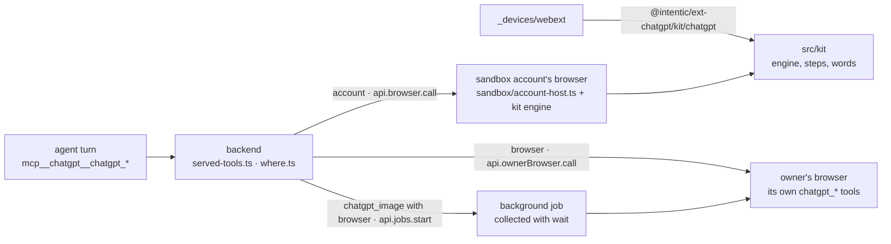

# chatgpt

The ChatGPT kit as an extension: `chatgpt_send`, `chatgpt_read` and `chatgpt_image` in a sandbox account's signed-in browser or in the owner's own, and the kit's engine the owner's browser extension runs too.

- One call per prompt, where the page tools would take an agent a snapshot, a click and a check per step. The tools
  keep the names and arguments the agent knew from the `browser` server (`account`) and the owner's browser
  (`browser`), on this extension's own server, `mcp__chatgpt__…`. A call runs where its turn's grants say
  ([`where.ts`](src/where.ts)): the account named, else the one account on chatgpt.com the turn holds, and the
  owner's browser only when named. Anything else is refused before a browser is touched, with what to pass instead.
- **In a sandbox account's browser** ([`sandbox/account-host.ts`](src/sandbox/account-host.ts)) the kit's engine drives the account's
  one tab through `api.browser.call`, held to the page's own tools and the account's own sites: each page step is ONE
  `browser_evaluate` that installs the step's helpers, calls it, and takes them off ChatGPT's window as soon as the step
  has them. Files leave only from the artifacts shelf and go in as an agent puts one in
  ([`sandbox/attach.ts`](src/sandbox/attach.ts)): a click on the composer's "Add files and more" button, one on the
  menu's "Add photos & files", and `browser_file_upload` answering the file chooser that opens.
  `browser_run_code_unsafe`, which put the file into the input from Playwright's process while the kit lived in the
  daemon, is no tool an extension may call. Pictures and long answers land in `.intentic/records/artifacts/chatgpt/`
  ([`sandbox/shelf.ts`](src/sandbox/shelf.ts)); what the kit remembers (its project, its chats) is a cache, one file per
  account under this extension's own state. One kit call at a time per account, and `chatgpt_image` holds its call:
  a sandbox browser closes with its turn, so a job there could not outlive it.
- **In the owner's own browser** ([`owner.ts`](src/owner.ts)) the browser extension runs the kit itself
  ([_devices/webext](../../_devices/webext)), so a call is that browser's own tool through `api.ownerBrowser.call`,
  where its site switches and asks apply and the daemon adds the tickets its `files` are collected with.
  `chatgpt_image` there does not hold the turn (2026-11-17, the shinobi-society audit: four calls averaged 345 s): it is
  filed as a job in the calling conversation (`api.jobs.start`) and the agent is answered within seconds with its id,
  which `wait` collects; a turn ended on it is woken by its end. Two run at once per browser and the rest queue in a
  lane of this extension's own, one chat's calls one after another; one the browser refuses within 5 s is the call's own
  answer, and a turn with no conversation to wake waits in the call.
- **The kit** ([`src/kit`](src/kit)) is everything that does not depend on the browser running it, so both hosts answer
  in exactly the same words: every lookup and string ChatGPT's page is assumed to have ([`site.ts`](src/kit/chatgpt/site.ts),
  each marked as seen in a real snapshot or guessed, the first place to fix after a redesign), the steps that run inside
  the page, the chat engine (opening or reopening a chat in the sandbox's own ChatGPT project, a mode, files, one prompt,
  the watch in rounds), and the tools' descriptions and inputs. A host is what a browser does differently, its contract
  at the top of [`kit/chatgpt/host.ts`](src/kit/chatgpt/host.ts). The owner's browser extension imports it through
  `@intentic/ext-chatgpt/kit/chatgpt`, the one entry `CONSUMERS` in `_tools/checks/lib/extension-deps.mjs` lets it name.
  Neither host presses ChatGPT's own confirmation buttons: the answer says ChatGPT waits on the person.
- 2026-11-26: moved out of the daemon (its `browser` router listed the three tools, and its peer door ran the owner's
  images as jobs) onto the extension API's turn primitives (2.55.0). The engine was `_shared/site-kits` until then; an
  extension may name only the SDK's packages, so the engine became this extension's, as ONLYOFFICE's is onlyoffice's.
  The kit's tools are listed in every turn while this extension is on, since a tool list is not told the turn's grants;
  switch it off, or leave it out of a role's `extensions`, where nobody uses ChatGPT. A role that names its `extensions`
  gets the kit only once it names `intentic.chatgpt`: before, the `browser` router listed it to any turn holding a
  chatgpt.com account.
- Not carried: the daemon cut `chatgpt_send`'s and `chatgpt_read`'s `wait` to fit a runtime whose MCP client gives up
  sooner (Cursor, 60 s), and refused `chatgpt_image` there. An extension's tool is not told its client's ceiling, so on
  such a runtime a long wait is cut off by the client; the prompt was sent, and `chatgpt_read` collects the answer.

## Key files

- [src/served-tools.ts](src/served-tools.ts) — the three tools, their inputs, and where each call goes.
- [src/where.ts](src/where.ts) — which browser a call runs in, read off the turn's grants, and the refusals.
- [src/sandbox/account-host.ts](src/sandbox/account-host.ts) — the kit's host in a sandbox account's browser, over `api.browser.call`.
- [src/sandbox/attach.ts](src/sandbox/attach.ts) — files into ChatGPT through the page's own file chooser.
- [src/owner.ts](src/owner.ts) — the owner's browser, and its images as background jobs.
- [src/kit/chatgpt/engine.ts](src/kit/chatgpt/engine.ts) — the chat itself: gates, opening or reopening a chat, sending, the watch in rounds.
