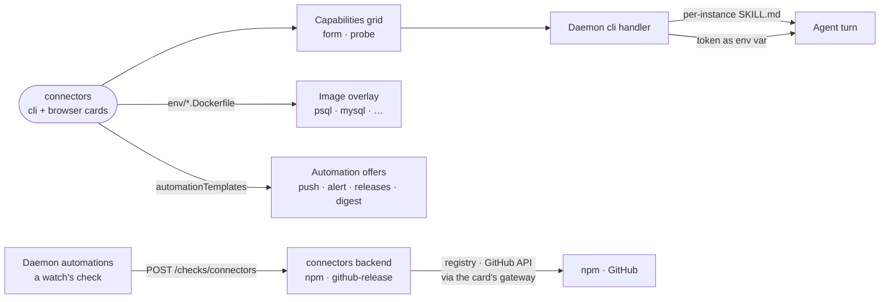

# connectors

Adds the first-party connection cards for developer and business services, from GitHub and Sentry to Postgres and Stripe, each with its agent skill, and checks the npm and GitHub release watches automations name.

- Every entry under `contributes.capabilities` is one card: its form fields, an `env` template, an optional `probe` that checks the credential reaches the service, the `hosts` its credential is meant for, and the `skills/<id>/SKILL.md` the agent reads once it is connected.
- `hosts` (templated over the fields like `env`, so a self-hosted card names `${url}`) turns the credential's host guard on by default, set to these hosts: its `{{secret:<id>/<field>}}` reference goes without a person's click only there. The owner can change the hosts or turn the guard off on the Secrets view. It does not reach the environment variable the same credential rides in.
- Most cards are `cli` kind: the daemon injects the credential into the agent's environment each turn, suffixed with the instance id so two accounts of one service coexist, and never writes it to a file. `npmjs` and `website` are `browser` kind: a signed-in session in the sandbox's own browser.
- Cards that need a client tool (`postgres`, `mysql`, `posthog`) name a Dockerfile fragment in `env/`, restricted to `RUN` and `ENV` and built into the sandbox's image overlay.
- `postgres` and `mysql` are not spoken to over HTTP, so their `probe` names `connect` instead of a URL: the daemon signs in as their command-line clients would, before the client tool is even installed, and says whether pg_hba, a grant, the password or the network stood in the way.
- The manifest also offers automation templates tied to these cards: push webhooks for GitHub and GitLab, Sentry alerts, a package's release (`npm`), a repository's releases (`github-release`), and a weekly digest across linked sandboxes.
- Its one piece of code is a backend ([src/server/server.ts](src/server/server.ts), built to `dist/server.js`, which the image bakes beside the manifest: `BUNDLES` in `_tools/scripts/image/prepare-image-trees.sh`) answering the two watch kinds it declares in `contributes.watchKinds`, `npm` and `github-release`, through `api.checks.serve`. The daemon checked both itself until 2026-11-26; they kept their ids and parameters, so a watch stored before reads and checks the same, and the contract keeps their declarations (`BUILT_IN_WATCH_KINDS`) for an editor talking to an older daemon, which [src/manifest.test.ts](src/manifest.test.ts) holds equal to these. A GitHub check reads through the GitHub card's credential-gateway address the daemon hands it (`capabilities: ["github"]`, narrowed by the automation's role), else a `GITHUB_TOKEN` in the host's environment, else no login. It reaches no daemon route.
- `npm` lives here rather than in the automations extension because it is a provider's client, beside the npmjs card, and because one backend serving both kinds is one bundle in the image; the automations extension stays the interface of the core's engine and its own page check. Switching this extension off switches both kinds off: a stored watch of either fails as an error on every run, naming this extension, until it is back on.
- Baked into every sandbox image; switching it off on the Extensions tab removes exactly these cards.
- The EZD RP and e-Doręczenia cards for Polish public offices live in the e-urzad extension ([intentic/extension-e-urzad](https://github.com/intentic/extension-e-urzad)), beside the CLI, tools and view that use them.

## Key files

- [intentic-extension.json](intentic-extension.json) — every card, its fields, env, hosts, probe and skill, plus the automation templates and watch kinds.
- [src/server/github-releases.ts](src/server/github-releases.ts) — the GitHub release check, and how it finds its way in through a connected card.
- [skills/github/SKILL.md](skills/github/SKILL.md) — a typical connector skill, templated per connected instance.
- [env/postgres.Dockerfile](env/postgres.Dockerfile) — a client-tool fragment for the image overlay.
- [../../_sandbox/sandbox/src/capabilities/handlers/cli.handler.ts](../../_sandbox/sandbox/src/capabilities/handlers/cli.handler.ts) — the generic handler every `cli` card runs through.
