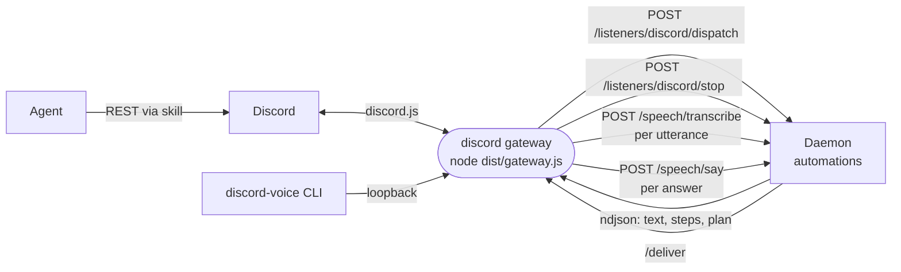

# discord

The Discord connection: a bot-token card and skill for the agent, plus a gateway process that turns a mention into a thread the agent works in, and voice calls into automation events.



- The card is a `cli` capability: the bot token reaches the agent's environment through the credential broker, and
  [the skill](skills/discord/SKILL.md) teaches it the Discord REST API with `curl`, including the invite link for the
  owner's server (with the thread, embed and reaction permissions a reply needs).
- The gateway is an `autoStart` extension process the daemon supervises while a Discord card or listener automation
  wants it. It holds one discord.js client per bot token and posts each human message to the daemon's listener route.
  The daemon itself holds no Discord connection.
- A message is for the bot when it mentions or replies to it, is a direct message, or is written in a thread the bot
  opened or answered in ([src/inbound.ts](src/inbound.ts)). A mention in a channel opens a thread named after the
  message. Discord gives a thread started from a message that message's id, so the dispatch already names the thread
  before it exists, and the thread is only opened once an automation answers: a message nobody takes leaves no empty
  thread. The daemon keys one conversation per thread, so a request, its follow-ups days later and its worktree stay
  together.
- The answer ([src/reply.ts](src/reply.ts)) is the shared team-chat reply from connector-runtime, which Slack's
  runs on too; this package supplies only how it looks in Discord. 👀 the moment the message is heard, "typing…" while the turn runs, and a
  status card ([src/card.ts](src/card.ts)) once the work outlasts a quick answer. The card is one embed edited in place
  (current step, the last few, the agent's checklist, elapsed time) with **Stop** and **Open in Intentic** under it,
  and it collapses to one line when the turn ends. The reply itself is posted as ordinary messages, never streamed by
  edits (which flicker on Discord and leave no unread mark), cut at code-aware seams with tables redrawn as code. A
  short line the agent says before acting goes on the card rather than into the thread. The message ends ✅, ❌, ⏹️,
  or ✋ while a hold waits for the owner. The card's detail follows the card's `progress` setting (each step, steps
  without what they touch, or no card).
- A reply in the thread while the turn runs goes into that turn between its tool calls (the daemon's steering), and
  takes its reactions from the turn that answers it. **Stop** asks the daemon, which lets the presser stop the turn
  only if the automation's sender rules answer them without the owner's approval.
- Everything the daemon sends into Discord outside a turn goes through the gateway's `/deliver`: a conversation's
  reply placed between turns, an approved hold's answer, a need's ask, an owner-approved post. It lands in the
  conversation's thread when there is one. With no automation holding a client, delivery uses the bot token over REST
  rather than opening a socket, and answers with a link to the message it posted.
- Every write a reply makes goes through plain REST routes ([src/discord-rest.ts](src/discord-rest.ts)) on the
  client's own REST handle, not through discord.js's cached objects, so the same code posts with or without a socket.
- Voice runs in the gateway so a call outlives any single turn. The agent joins and leaves with `discord-voice` (on
  its PATH via `contributes.bin`); each utterance is transcribed on this machine by the daemon's own speech engine
  (`POST /speech/transcribe`, the one the composer's microphone uses) and dispatched as `voice_utterance`, and the
  finished transcript lands under `.intentic/records/artifacts/voice/`.
- The agent answers in the call with `discord-voice say` (and cuts itself off with `discord-voice stop`). The gateway
  asks the daemon's voice for the text (`POST /speech/say`, which streams mono PCM in the voice the owner set for the
  text's language), upsamples it to Discord's 48 kHz stereo, encodes it to Opus with the same codec that decodes what
  the bot hears, and plays it into the call one utterance at a time. What the bot says is written into the transcript
  as its own lines and dispatches no `voice_utterance`, so an automation never answers itself.
- The manifest offers a **Team assistant on Discord** automation template (a mention-only listener with a prompt
  written for threads), so the setup after pasting a token is: invite the bot, pick the template, pick a model. When
  the bot joins a new server while an automation is on, it says hello in the server's system channel.
- Only the manifest is in every image. The built gateway ships in the `messaging` image pack; on a core image the card
  says the runtime is not included.
- Reconcile, status and shutdown come from [connector-runtime](../../_shared/connector-runtime), as do the reply's
  lifecycle, the status card's content, the progress model and the chunker; this package is only what is
  Discord-specific.

## Key files

- [src/gateway.ts](src/gateway.ts) — the process entry: reconcile hooks, delivery, button presses, loopback voice routes.
- [src/inbound.ts](src/inbound.ts) — whether a message is for the bot, and which channel, thread and room it belongs to.
- [src/reply.ts](src/reply.ts) — what the shared reply looks like in Discord: thread, reactions, quoting, typing.
- [src/card.ts](src/card.ts) — the status card drawn as an embed.
- [src/listener.ts](src/listener.ts) — messages to listener events, history, the Stop button, delivery.
- [src/voice.ts](src/voice.ts) — the voice session: capture, transcribe, dispatch, speak, write the transcript.

## Commands

```sh
pnpm --filter @intentic/ext-discord build   # tsc to dist/, which the process runs
pnpm --filter @intentic/ext-discord test
```
