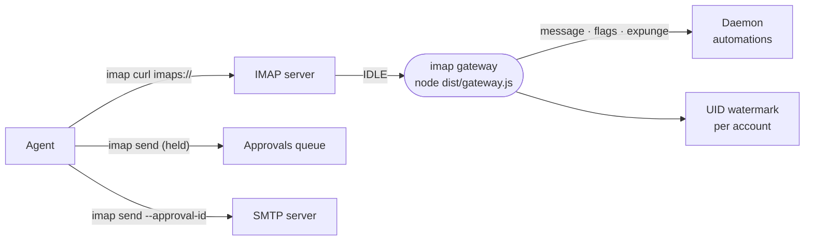

# imap

The IMAP connection: an email card that gives the agent `imap`, a small CLI for reading the inbox through `curl` and sending SMTP mail, plus a gateway that watches the mailbox and wakes automations when mail arrives.



- The card is a `cli` capability: host, port and credentials reach the agent's environment, and [the skill](skills/imap/SKILL.md) covers listing, searching and fetching with `imap curl`, which is curl with the card's login in a `0600` config file rather than on the command line, where every process could read it.
- **Signing in.** A password (or app password), or OAuth2 through SASL XOAUTH2 where a provider has switched passwords off: Exchange Online always, Gmail for accounts without app passwords. An OAuth2 card holds a refresh token and mints a fresh access token for every connection and every send, so the watcher keeps working past the hour an access token lasts. For Exchange Online, `imap login` runs Microsoft's device-code sign-in and stores the refresh token on the card through the daemon's write-only oauth-token route (the manifest declares the field as `refreshToken`); each rotation Microsoft hands out is stored the same way. A Gmail refresh token is pasted. A card can also hold a plain access token someone else keeps current.
- **Sending.** Optional SMTP host, port, STARTTLS or implicit TLS, username and password fields enable outgoing mail; blank SMTP credentials reuse the IMAP login, and under OAuth2 one sign-in covers both protocols. `imap send` builds MIME with reply threading headers and attachments; a draft with `html` goes out as `multipart/alternative` with its required plain-text part, wrapped in `multipart/mixed` when files are attached. `imap.message.send` defaults to an approval draft whose digest covers both bodies and the attachment bytes; an explicit `allow` action rule sends directly and `deny` refuses.
- The gateway is an `autoStart` extension process holding one imapflow connection per account. It opens the watched mailbox read-only, catches up from its persisted UID watermark, then IDLEs and dispatches normalized events to the daemon's listener route.
- The watermark survives restarts, so mail that arrived while the gateway was down is delivered on reconnect. A changed `UIDVALIDITY` or mailbox re-baselines without replaying history.
- A bad credential or a refused OAuth2 sign-in is fatal until the card is edited or someone signs in again, since providers lock accounts after repeated failed logins.
- Events carry a bounded text excerpt and attachment names; the agent fetches the full message by `extra.uid`. The manifest also offers a "New email" automation template.
- For an Outlook mailbox together with its calendar and OneDrive or SharePoint files, the [Microsoft 365](../microsoft-365) card is the better fit; a Microsoft Graph token from it cannot log in to IMAP.
- Only the manifest is in every image; the built gateway and CLI ship in the `messaging` image pack.

## Key files

- [src/gateway.ts](src/gateway.ts) — the process entry: reconciles one connection per account.
- [src/connection.ts](src/connection.ts) — one account's lifecycle: sign in, connect, catch up, IDLE.
- [src/oauth.ts](src/oauth.ts) — OAuth2: minting access tokens, Exchange Online's device-code sign-in.
- [src/cli.ts](src/cli.ts) — the `imap` CLI: `send`, `curl`, `login`.
- [src/normalize.ts](src/normalize.ts) — IMAP events to listener messages, pure and tested.
- [src/watermark.ts](src/watermark.ts) — the per-account resume point on disk.
- [src/send.ts](src/send.ts) — MIME composition, approval preparation and SMTP transport.
- [intentic-extension.json](intentic-extension.json) — the card, listener events, gateway process and template.

## Commands

```sh
pnpm --filter @intentic/ext-imap build   # tsc to dist/, which the process and bin/imap run
pnpm --filter @intentic/ext-imap test
```
