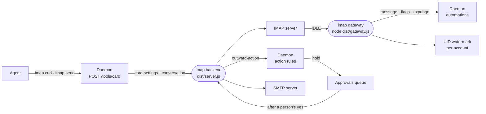

# imap

The IMAP connection: an email card whose backend alone holds the mailbox's login, the agent's `imap` command for reading the inbox and sending mail through it under the owner's action rules, and a gateway that watches the mailbox and wakes automations when mail arrives.



- The card is a `cli` capability with a backend of its own. Its host, port, username and SMTP settings reach the agent's environment, and its password, refresh token, client secret and access token do not: the backend ([server.ts](src/server.ts)) is the only place they are used. The daemon hands the backend the card's settings, credentials included, with each call to the tools it serves for the card (`contributes.tools.perCard`), and names the conversation that asked.
- **The `imap` command** ([cli.ts](src/cli.ts)) holds no credential. It reads the agent's draft and its attachments from the workspace, calls the card's tools from the turn's own shell through the daemon's `POST /tools/<card>`, which the daemon answers only for a conversation whose running turn was given the card, and prints or writes what comes back. The model sees the same tools as `mcp__<card>__…`.
- **Reading.** `imap curl` runs one curl request in the backend with the card's login in a `0600` config file ([request.ts](src/request.ts)). It takes only a URL on the card's own host and port, `-X` with an IMAP command, and the options that cannot carry the login elsewhere or print it (`-s`, `-S`, `-f`, `-l`, `-m`, `--connect-timeout`); `-o` is the CLI's own and writes the answer into the workspace. [The skill](skills/imap/SKILL.md) covers listing, searching and fetching.
- **Signing in.** A password (or app password), or OAuth2 through SASL XOAUTH2 where a provider has switched passwords off: Exchange Online always, Gmail for accounts without app passwords. An OAuth2 card holds a refresh token and mints a fresh access token for every connection and every send, so the watcher keeps working past the hour an access token lasts. For Exchange Online, **Sign in with Microsoft** on the card's form runs Microsoft's device-code sign-in through the daemon, as the manifest declares it (`refreshToken.deviceCode`): the form shows the code and Microsoft's page, and Save installs the refresh token, which never reaches the browser. `imap login` runs the same sign-in in the backend for an agent and stores the token through the daemon's write-only oauth-token route; each rotation Microsoft hands out is stored that way too. A Gmail refresh token is pasted. A card can also hold a plain access token someone else keeps current.
- **Sending.** Optional SMTP host, port, STARTTLS or implicit TLS, username and password fields enable outgoing mail; blank SMTP credentials reuse the IMAP login, and under OAuth2 one sign-in covers both protocols. `imap send` hands the backend the draft with its attachments' bytes; the backend builds MIME with reply threading headers, and a draft with `html` goes out as `multipart/alternative` with its required plain-text part, wrapped in `multipart/mixed` when files are attached ([send.ts](src/send.ts)).
- **Who decides a send.** The daemon, not this extension. Before it sends, the backend asks the daemon's outward-action door (`POST /capabilities/<id>/outward-action`) for the owner's verdict on `imap.message.send`, which holds while no rule names it. Allowed, it sends and reports the outcome for Activity; denied, it refuses with the rule's reason. Held, the daemon writes an approvals-queue item whose `performer` is this extension and whose digest is the SHA-256 of the exact message the backend keeps in its state directory ([held.ts](src/held.ts)); once a person approves it, the daemon's approvals executor hands it to `api.approvals.perform`, which checks the digest, the card and the rule again and sends it. No agent turn runs for it. The card's `commandActions` entry is what Guardrails and the preset read the key from: `gatedBy: "backend"` keeps the command guard from refusing a held send in the shell before it reaches the door that drafts its approval, and `unruled: "hold"` is the default Guardrails shows while no rule names it (2026-11-26, extension API 2.52.0; until then one `selfGated` flag said both).
- 2026-11-26: before, the CLI read the action rules and the approval's status from workspace files the agent can write, and the password sat in the agent's environment, so the gate was advice. A held send the older CLI drafted (instructions naming `imap send … --approval-id`) is not carried out: the new CLI refuses the flag and says to propose the draft again.
- The card says where mail goes for the Data protection page (`processors`): read from the server its `host` names, and
  sent through the one its `smtpHost` names once that is filled in; the office names who runs them.
- The gateway is an `autoStart` extension process holding one imapflow connection per account. It opens the watched mailbox read-only, catches up from its persisted UID watermark, then IDLEs and dispatches normalized events to the daemon's listener route.
- The watermark survives restarts, so mail that arrived while the gateway was down is delivered on reconnect. A changed `UIDVALIDITY` or mailbox re-baselines without replaying history.
- A bad credential or a refused OAuth2 sign-in is fatal until the card is edited or someone signs in again, since providers lock accounts after repeated failed logins.
- The form's Test (`probe.connect: imap`) signs a password card in with one LOGIN before it is saved, over TLS on 993 and STARTTLS elsewhere as the gateway connects, and says the server's own refusal. With no password (an OAuth2 card) it only checks the server answers.
- Events carry a bounded text excerpt and attachment names; the agent fetches the full message by `extra.uid`. The manifest also offers a "New email" automation template.
- For an Outlook mailbox together with its calendar and OneDrive or SharePoint files, the [Microsoft 365](../microsoft-365) card is the better fit; a Microsoft Graph token from it cannot log in to IMAP.
- Only the manifest is in every image; the built gateway, backend and CLI ship in the `messaging` image pack.

## Key files

- [src/server.ts](src/server.ts) — the backend: the card's tools, the send and its verdict, carrying out an approved send.
- [src/cli.ts](src/cli.ts) — the `imap` CLI: `send`, `curl`, `login`, through the card's tools.
- [src/gateway.ts](src/gateway.ts) — the watcher process: reconciles one connection per account.
- [src/connection.ts](src/connection.ts) — one account's lifecycle: sign in, connect, catch up, IDLE.
- [src/send.ts](src/send.ts) — MIME composition and SMTP transport.
- [intentic-extension.json](intentic-extension.json) — the card, its tools, listener events, gateway process and template.

## Commands

```sh
pnpm --filter @intentic/ext-imap build   # tsc to dist/, which the backend, the process and bin/imap run
pnpm --filter @intentic/ext-imap test
```
