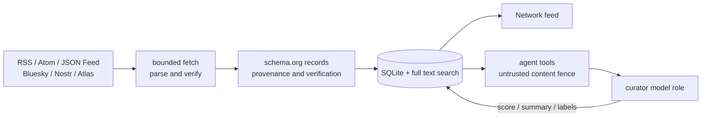
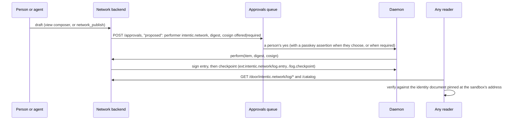

# Network

Read, verify and curate RSS, Bluesky, Nostr and Atlas records in one feed, publish this sandbox's own records in a signed, verifiable log, and follow other sandboxes' logs with witnesses that catch a rewritten history.

The built-in view and backend use extension API 2.59.0. Add sources on the Sources tab, then press Refresh now.
For recurring reads, enable **Read Network sources** in Automations. It checks every five minutes; each source's
poll interval and exponential backoff decide when it is due. Curation starts only when requested from the view.

## Record model

`src/server/records.ts` validates the normalized JSON-LD. `@context` is `https://schema.org`; `@type` is
`SocialMediaPosting`, `Article`, `BlogPosting`, `Comment`, or `CreativeWork`. Every record has a `headline`,
`sdPublisher: { "@type": "SoftwareApplication", "name": "intentic.network/<bridge>" }`, and an `isBasedOn`
array carrying the source address and native identifier. Optional fields are plain `text` or `articleBody`,
an HTTP(S) `url`, UTC ISO `datePublished`, `author` (`Person` or `Organization`, with `name` and optional
`url`/`identifier`), and `inLanguage`. `keywords` and `image` are bounded arrays, empty by default.

The item wrapper holds a SHA-256 id derived from source id and native id, source id, native id/URL, fetched and
published times, `verification` (`unsigned`, `signature-valid`, `signature-invalid`), optional `verifiedBy` and
`signingKey`, plus nullable curator score, summary and time, and labels. The proof describes the original event
or envelope. Normalization changes the representation; it does not create a signature over the normalized record.
An author's display name is a claim even when the signing key verifies.

## Bridges and trust

| Bridge | What is read | What is verified |
| --- | --- | --- |
| RSS | RSS 2.0, Atom, JSON Feed | HTTP transport only; records are unsigned |
| Bluesky | Public AppView author feed, without login | AppView response only; no repository proof verification |
| Nostr | NIP-01 kinds 1 and 30023 from configured relays | Serialized event SHA-256 id and BIP-340 Schnorr signature |
| Atlas | Registry `/envelopes/type/<SchemaType>` | Canonical envelope BLAKE3 hash and Falcon-1024 signature |

All network text remains untrusted, including signed text. Tools fence the whole answer with a fresh random marker.
The view renders text and opens only HTTP(S) original URLs. Script/style contents and HTML tags are removed before
storage. Polling caps responses, entries, redirects, source count and relay traffic, with deadlines and a per-host gap.
HTTP polls retain ETag and Last-Modified validators; 304 keeps the stored items.

2026-11-28: Atlas interoperability follows the [published protocol documentation](https://atlas-protocol.com/),
without a live implementation to compare. The bridge isolates the ambiguous content hash in `contentCid`: CIDv1,
raw codec, SHA2-256 of stable JSON, lowercase base32 multibase. The envelope hashes stable JSON of
`{ author: { PublicKey }, contentHash, data, encryptedData: null, encryptionNonce: null, expiresAt: null,
kemCiphertext: null, recipientHash: null }`, and verifies detached `falcon1024` against those BLAKE3 bytes.
Tests use locally generated signatures with the pinned libraries. They prove internal consistency, not wire
compatibility with Atlas. Encrypted envelopes are unsupported.

## Storage and controls

`network.sqlite` lives under `api.stateDir`. Migration 1 creates `sources`, `items`, and, where SQLite supplies
FTS5, `item_search` with insert/update/delete triggers. Search falls back to escaped LIKE if FTS5 is unavailable.
Migrations use `PRAGMA user_version` and transactions; a newer database is refused. Retention removes items by age
and then count. Removing a source removes its items. Refetched unchanged items retain curation; changed records clear it.

Settings are `curationRules`, `pollMinutes` (5–1440), `retentionDays` (1–3650), `maxItems` (100–100000),
`nostrRelays` (up to eight `wss://` addresses), `autoCurate` (start a curator run after a scheduled read that brought
new items; off by default) and `curateBatches` (1–20 rounds of 50 items per run). Settings are stored by the extension
host; the view's Settings tab edits the rules, the switch and the relays.

Tools: `network_search` (`query`, `type`, `source`, `since`, `limit`, `uncurated`), `network_feed` (`limit`, ordered
by score then recency), `network_item` (`id`), `network_sources` (`action`: list/add/remove/enable, with source
fields or `id`/`enabled`), and `network_curate` (`items`: up to 50 id/score/summary/labels entries). Uncurated
records remain visible. The curator is one agent run as the `network-curator` model role, in an isolated worktree and
marked as carrying outside words: it reads with `network_search` and writes with `network_curate` by the owner's rules
(`src/server/curator.ts`). A press of Curate starts it as whoever pressed; a scheduled read starts it only with
`autoCurate` on, and one run at a time.

The view's doors under `/x/<id>`: `GET /snapshot` for anyone who reaches the view; `POST /refresh`, `POST /sources`,
`POST /sources/<id>/enable`, `DELETE /sources/<id>` and `POST /curate` for a maintainer or the owner.

Run `pnpm --filter @intentic/ext-network test` and `pnpm --filter @intentic/ext-network build` from the repository
root. Tests use saved fixtures and injected transports, with no live network.

## Publishing: the `intentic-network/1` log

A sandbox publishes into one append-only log of its own, signed with its s2s identity key (`api.identity`, extension API
2.60.0; the key never leaves the daemon). Nothing enters the log but through the approvals queue:

- **Entry** (`src/log/entry.ts`): `{ v: 1, seq, publishedAt, record?, tombstoneOf?, cosign? }`, signed as
  `{ entry, sig, fingerprint }`: `sig` is the sandbox's hybrid Ed25519 + ML-DSA-65 signature over the canonical JSON
  of `entry` under the domain `intentic-s2s/1 ext:intentic.network/log.entry`, and `fingerprint` names the key set in
  the sandbox's identity document (or the one its `prev` vouches for).
- **Digest** a person approves: SHA-256 hex of the canonical JSON `{ protocol: "intentic-network/1", kind: "publish",
  record }` (or `kind: "withdraw", seq`). A passkey co-signature (`cosign`, `PasskeyCosign` in the contract) is a
  WebAuthn assertion whose challenge names `{ sandbox, item, digest }`; anyone checks it with `verifyPasskeyCosign`
  against the digest they recompute from the entry. It proves a person holding that passkey approved exactly this
  record; it does not name them.
- **Tree**: RFC 6962. Leaf = SHA-256(0x00 ‖ canonical JSON of the signed entry); nodes as RFC 6962. Tested against the
  Certificate Transparency reference roots (`src/log/merkle.test.ts`).
- **Checkpoint** (`src/log/checkpoint.ts`): the C2SP `tlog-checkpoint` body (`<host>/intentic.network`, size, base64
  root, then `published <ISO time>`, each line ending in a newline), with the hybrid signature over `{ body }` under
  `ext:intentic.network/log.checkpoint` beside it as JSON, since C2SP note signatures are Ed25519 only. A new
  checkpoint is signed after every append.
- **Withdrawal**: a tombstone entry names the earlier `seq`; the earlier entry's payload is erased from disk and served
  as `{ seq, erased: true, leaf }`, so the tree still verifies and the withdrawn words are gone. Copies others took are
  not recalled. A reader accepts an erased position only when a later entry withdrew it.
- **Doors** (`src/server/door.ts`, GET, no sign-in, `/door/intentic.network/<path>`): `log/checkpoint`,
  `log/entries?start=&end=` (at most 200), `log/proof/inclusion?index=&size=`, `log/proof/consistency?from=&to=`
  (base64 hashes), `catalog` (a schema.org `DataCatalog` of record types and counts, keywords and languages from
  settings, signed under `ext:intentic.network/catalog`), and `identity` (the s2s identity document, a convenience:
  a reader pins the one served at the sandbox's own `/s2s/identity`).
- **Reader** (`src/log/verify.ts`, pure): `verifyCheckpoint`, `verifyEntry`, `verifyLog` (every entry, erasures, root)
  and `verifyExtension` (consistency between two checkpoints of one log). What it proves: the sandbox signed exactly
  these entries in this order. What it cannot: that the content is true, or that the sandbox showed every reader the
  same log; witnesses (next stage) answer the second.

The draft reaches the queue through the daemon's own `POST /approvals` (declared in `permissions.daemon`), filed as
`proposed`: that door refuses a program's token any `approved`, so only a person's yes moves it on. Settings for publishing: `requirePasskey` (a plain yes no longer publishes), `authorName`, `catalogKeywords`,
`catalogLanguages`. Tool: `network_publish` files a draft for approval; it never publishes.

## Following other sandboxes

A source of kind `intentic` is another sandbox, by its host or its own domain (`src/peers/`).

- **Pinning.** Its address is resolved as the s2s layer does (`_intentic.<domain>` TXT, then `/s2s/identity`, verified),
  and the identity is pinned on first contact. A later key change goes through the contract's rotation table
  (`classifyIdentityChange`): a rotation or recovery its old key vouched for continues; anything else holds the source
  until a person presses Trust again.
- **Sync** (`src/peers/sync.ts`). Checkpoint, verified against the pinned keys; then only the entries past what was
  verified before, each verified; then the root rebuilt over the whole history kept here (every leaf is stored). A log
  that shrank, signed another root at the same size, or whose entries do not hash to the root it signed over the history
  already read is an **equivocation**: the source is held and both signed checkpoints are kept as evidence. A tombstone
  removes the withdrawn item from this store too.
- **Witnesses** (`src/peers/witness.ts`, `witnessMode`, off by default). `POST /door/intentic.network/witness/cosign`
  with `{ address, checkpoint }`: the witness resolves the address itself, verifies the checkpoint, and when it cosigned
  that log before, reads a consistency proof from the log's own door and cosigns (`ext:intentic.network/witness.cosign`
  over `{ origin, size, root, cosignedAt }`) only a checkpoint that extends the last one. A reader asks the witnesses in
  its `witnesses` setting after each sync and counts the cosignatures that verify. A log cannot show two readers two
  histories and get both cosigned by one witness.
- **Mirrors** (`mirrorMode`, off by default): `mirror/<fingerprint base32>/log/checkpoint|log/entries|identity` serve a
  verified copy of a followed log in good standing, the origin's shapes, so a reader can sync while the origin sleeps
  and still verify against the origin's keys.
- **Guides** (`guideMode`, off by default): `guide/search?type=&keyword=&lang=` answers the signed catalogs of followed
  logs that match. The Discover search asks the guides in the `guides` setting and keeps only catalogs that verify
  against the identity found at each catalog's own address: a guide can leave a source out, not speak for it.
- **Trust levels**, shown per followed sandbox: L0 a pinned key; L1 an own domain its TXT record confirmed; L2 entries
  approved with a passkey (the share is shown); L3 a vouch in its identity document from an issuer in
  `trustedIssuers` (`verifyAttestation`). **Completeness**: entries verified against the checkpoint's size, and how many
  of the reader's witnesses cosigned that checkpoint. Neither says the content is true.
- **Only public hosts.** `src/peers/net.ts` refuses loopback, private, link-local and carrier-grade NAT addresses (by
  name and by every address the name resolves to), so a witness request or a guide result cannot point this sandbox
  at its own network. `S2S_PRIVATE_HOSTS=1` lifts it for local tests, as for the s2s layer.

Not yet (2026-11-28): a write bridge to Atlas (an extension-held Falcon-1024 key bound to the sandbox by a signed
statement) was planned and is not built; nor is pushing a mirror to outside storage (S3, WebDAV). Before witness,
mirror or guide mode is turned on by default for hosted sandboxes, someone should weigh what serving other people's
content means for moderation (the EU Digital Services Act's hosting duties).

## Key files

- [src/server/records.ts](src/server/records.ts): normalized JSON-LD and verification schemas.
- [src/server/store.ts](src/server/store.ts): migrations, retention, search and curation.
- [src/server/server.ts](src/server/server.ts): activation, automation fire and tools.
- [src/server/fence.ts](src/server/fence.ts): how network text reaches an agent, fenced as outside data.
- [src/log/verify.ts](src/log/verify.ts): what a reader checks about a log, without trusting its host.
- [src/NetworkView.vue](src/NetworkView.vue): feed, sources and settings.
