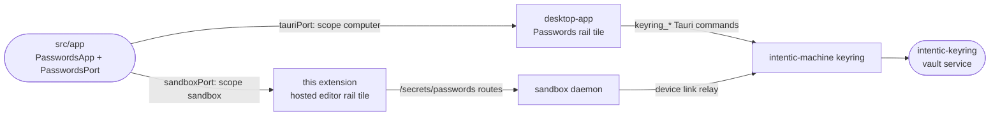

# passwords

Passwords is the owner's password manager. The passwords live on the owner's own computers, are saved as they are typed, and agents use them without ever seeing them. One app runs in two hosts.



- **One door.** The app under [src/app](src/app) knows nothing of Tauri, the sandbox daemon or the keyring's pipe. It is handed a `PasswordsPort` ([src/app/port.ts](src/app/port.ts)) and draws what the port says. Its `capabilities` say what a host can do:
  - `scope: "computer"`: the desktop app, where the vault is. Everything is managed there.
  - `scope: "sandbox"`: the hosted editor. It shows what this sandbox may use, the requests it waits on, and its activity, and offers "Manage on this computer".
- **Two hosts.**
  - The hosted editor activates this package as a rail extension with the sandbox's port.
  - The desktop app mounts the same app through the one entry it may import, `@intentic/ext-passwords/app` (`_tools/checks/lib/extension-deps.mjs` CONSUMERS), with its Tauri port.
- **Built on the extension SDK alone.** It uses `@intentic/extension-ui`, `@intentic/sandbox-contract` and `@intentic/base`, so it cannot reach into an editor's internals.
- **Removing it** means deleting this package and its two adapters. **Making it an application of its own** means mounting the app with the Tauri port in a shell of its own.
- **The list as a pure function.** Categories, the index's filters, search and order live in [src/app/model.ts](src/app/model.ts).
- **The rest lives elsewhere.** Where a password belongs, and how a captured one is named and matched to an entry, is the contract's [`policy/keyring-origins.ts`](../../_shared/sandbox-contract/src/policy/keyring-origins.ts), shared with the keyring and the sandbox.

## The app

[src/app/PasswordsApp.vue](src/app/PasswordsApp.vue) takes `{ port, selection? }` and emits `update:selection`; each host keeps the selection in its own address.

- **The vault, set up.** Three panes: the index, the list and one password.
  - The index holds the kinds, "Agents can use" by sandbox, and Attention: Just saved, Requests, Weak or reused.
  - The list carries a strip of the week's captures and a `new` pill on each capture not yet looked at.
  - The password shows its user, its value behind Show and Copy (the person's yes at the computer), and "Works on" chips.
  - Below those: Ask / While I'm here / Always / Off per sandbox, its activity and its history.
  - A narrow pane folds to list, then password, with the index as a row of chips.
- **First run** ([src/app/FirstRun.vue](src/app/FirstRun.vue)) goes in four steps: Turn on Passwords (one administrator prompt), the recovery key shown once, the one yes to remembering per source, and an optional import.
- **Requests** ([src/app/RequestsView.vue](src/app/RequestsView.vue)) holds the needs agents raised and nobody answered yet, answered here. With no match, the password is typed once.
- **Settings** ([src/app/SettingsView.vue](src/app/SettingsView.vue)) holds the remember switches per source, locking, the recovery key, never-save places and import.
- **Import** ([src/app/import/](src/app/import)) parses CSV exports from Chrome, Edge, Brave, Firefox, Safari, 1Password, Bitwarden and KeePassXC in the page, recognising each by its header. The rows go to the port, which seals them.
- **Toasts** ([src/app/ToastStack.vue](src/app/ToastStack.vue)): "Saved github.com · Undo · View" for what the port reports captured.

## In the hosted editor

[src/extension.ts](src/extension.ts) registers the `passwords` rail view. A new owner doesn't see it: the tile comes onto the rail once Passwords means something on this sandbox ([src/presence.ts](src/presence.ts)). That is when one of the owner's computers has Passwords set up, a password is shared here, or a request waits. Once shown, it stays for the rest of the session even if that computer goes to sleep. Its badge counts the credentials this sandbox asked for (`secrets want`) that still wait on the owner's answer. A poll reads the requests and the shared list once a minute, because both change on another computer and nothing here hears it. Passwords is set up in the desktop app, which keeps its own tile hidden until then too.

[src/sandboxPort.ts](src/sandboxPort.ts) is the sandbox's `PasswordsPort`. It reads the daemon's three owner-only routes, which the manifest lists in its permissions:

| Route | What the port makes of it |
| --- | --- |
| `GET /secrets/passwords` | `list`: each entry a keyring shares here, with its computer and this sandbox's access. `status`: ready while any computer has Passwords set up, otherwise a sentence pointing to the desktop app. |
| `GET /secrets/passwords/needs` | `requests`: this sandbox's needs still pending. |
| `GET /secrets/passwords/activity` | `activity`: this sandbox's uses of keyring-held passwords, from its own use ledger. |

Its capabilities are `{ scope: "sandbox", manage: false, reveal: false }`. Every method that would change the vault rejects with "Manage it in Passwords on your computer.". `manageOnComputer` opens `intentic://passwords?entry=NAME` instead, which the desktop app handles. [src/PasswordsView.vue](src/PasswordsView.vue) mounts `PasswordsApp` with this port. The app's selection is kept in the route's query (`?filter=…&item=NAME&q=…`), so a view of one password can be linked.

The editor compiles the package in (`_editor/web/src/extension-host/builtins.ts`), and the sandbox image bakes its manifest (`_sandbox/sandbox/Dockerfile`). The Secrets view's keyring rows have a quiet "Open in Passwords" link to the view.

## Key files

- [src/app/port.ts](src/app/port.ts): the `PasswordsPort` every host implements, and the app's own view of a password.
- [src/app/model.ts](src/app/model.ts): categories, filters, search and order.
- [src/app/PasswordsApp.vue](src/app/PasswordsApp.vue): the app, its panes and its states.
- [src/app/index.ts](src/app/index.ts): the host-neutral entry the desktop app imports.
- [src/sandboxPort.ts](src/sandboxPort.ts): the hosted editor's port, over the daemon's `/secrets/passwords` routes.

## Commands

```sh
pnpm --filter @intentic/ext-passwords test
pnpm --filter @intentic/ext-passwords typecheck
```
