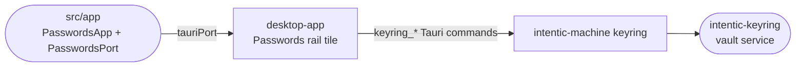

# passwords

Passwords is the owner's password manager. The passwords live on the owner's own computers, are saved as they are typed, and agents use them without ever seeing them. The app here is mounted by one host: the desktop app, as This computer's Passwords.



- **One door.** The app under [src/app](src/app) knows nothing of Tauri or the keyring's pipe. It is handed a `PasswordsPort` ([src/app/port.ts](src/app/port.ts)) and draws what the port says.
- **One host.** The desktop app mounts it through the one entry it may import, `@intentic/ext-passwords/app` (`_tools/checks/lib/extension-deps.mjs` CONSUMERS), with its Tauri port.
- **No sandbox hosts it (2026-11-11).** A sandbox deals in secrets. What a keyring shares with it is a pointer, listed in the hosted editor's Secrets view beside every other secret with "Open in Passwords" (`intentic://passwords?entry=NAME`, which the desktop app opens here). The credentials its agents asked for (`secrets want`) and still wait on are rows under that view's Needs attention, read from the daemon's `GET /secrets/wants`, and the count on its Secrets row.
- **Not an extension any more.** The package has no `intentic-extension.json` and nothing activates it. It lives under `_extensions` because it is still built on the extension SDK alone (`@intentic/extension-ui`, `@intentic/sandbox-contract`), so it cannot reach into an editor's internals. Its catalog keeps the id `intentic.passwords`.
- **Removing it** means deleting this package and its Tauri adapter. **Making it an application of its own** means mounting the app with the Tauri port in a shell of its own.
- **The list as a pure function.** Categories, the index's filters, search and order live in [src/app/model.ts](src/app/model.ts).
- **The rest lives elsewhere.** Where a password belongs, and how a captured one is named and matched to an entry, is the contract's [`policy/keyring-origins.ts`](../../_shared/sandbox-contract/src/policy/keyring-origins.ts), shared with the keyring and the sandbox.

## The app

[src/app/PasswordsApp.vue](src/app/PasswordsApp.vue) takes `{ port, selection? }` and emits `update:selection`; the host keeps the selection in its own address.

- **The vault, set up.** Three panes: the index, the list and one password.
  - The index holds the kinds, "Agents can use" by sandbox, and Attention: Just saved, Requests, Weak or reused.
  - The list carries a strip of the week's captures and a `new` pill on each capture not yet looked at.
  - The password shows its user, its value behind Show and Copy (the person's yes at the computer), and "Works on" chips.
  - Below those: Ask / While I'm here / Always / Off per sandbox, its activity and its history.
  - A narrow pane folds to list, then password, with the index as a row of chips.
- **First run** ([src/app/FirstRun.vue](src/app/FirstRun.vue)) goes in four steps: choose a passphrase and Turn on Passwords (one administrator prompt), the recovery key shown once as the passphrase's backup, the one yes to remembering per source, and an optional import.
- **Requests** ([src/app/RequestsView.vue](src/app/RequestsView.vue)) holds the needs agents raised and nobody answered yet, answered here. With no match, the password is typed once.
- **Settings** ([src/app/SettingsView.vue](src/app/SettingsView.vue)) holds the remember switches per source, locking, Windows Hello for a vault set up without it, the passphrase (set or changed, never removed: the keyring's `master` wrap), the recovery key as its backup, never-save places and import.
- **Recently deleted** ([src/app/RemovedView.vue](src/app/RemovedView.vue)): Delete asks nothing where the vault keeps removed passwords, says "Moved github.com to Recently deleted · Undo", and the index lists them for 30 days, each put back or deleted for good.
- **Windows Hello, later.** A vault set up without Hello asks for the passphrase (or, with none set, the recovery key) at every yes, so a strip offers to turn Hello on until it is.
- **Import** ([src/app/import/](src/app/import)) parses CSV exports from Chrome, Edge, Brave, Firefox, Safari, 1Password, Bitwarden and KeePassXC in the page, recognising each by its header. The rows go to the port, which seals them.
- **Toasts** ([src/app/ToastStack.vue](src/app/ToastStack.vue)): "Saved github.com · Undo · View" for what the port reports captured.

## Key files

- [src/app/port.ts](src/app/port.ts): the `PasswordsPort` every host implements, and the app's own view of a password.
- [src/app/model.ts](src/app/model.ts): categories, filters, search and order.
- [src/app/PasswordsApp.vue](src/app/PasswordsApp.vue): the app, its panes and its states.
- [src/app/index.ts](src/app/index.ts): the entry the desktop app imports.

## Commands

```sh
pnpm --filter @intentic/ext-passwords test
pnpm --filter @intentic/ext-passwords typecheck
```
