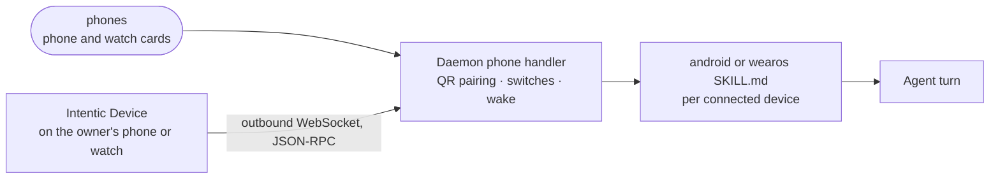

# phones

A data-only extension that adds the "Android phone" and "Wear OS watch" connection cards, which let the agent work on the owner's own phone or watch through the Intentic Device app.

- For what only the phone has: an app with no web version, a code that arrives as a notification, a photo or a file on
  it. The agent acts on the phone's screen in the apps the owner allows, and the phone shows when it is connected.
- Holds no code. The manifest declares two `phone`-kind cards (`android`, `wearos`) with their download links and setup
  steps; the daemon's generic peer handler pairs the device through a QR code and writes the skill.
- A watch has no camera, so the Wear OS card's QR code is an `intentic.dev/watch/pair` link: the phone beside the watch
  scans it, and Intentic Device on that phone sends the code on to the watch, which asks its wearer before it pairs.
  The same app runs on both; on a watch it answers no folder or notification tools.
- The far end is the app in [_devices/android](../../_devices/android), which connects out to the sandbox, enforces the
  card's switches and its own per-app allow-list, and can be paused from the phone's Quick Settings.
- [skills/android/SKILL.md](skills/android/SKILL.md) is templated per connected phone; the tool table and the rules
  every phone shares come from the daemon (`PHONE_TOOLS_NOTE`).

## Key files

- [intentic-extension.json](intentic-extension.json) — the card, its download link and guide.
- [skills/android/SKILL.md](skills/android/SKILL.md) — what is particular to Android, under the shared tool note.
- [skills/wearos/SKILL.md](skills/wearos/SKILL.md) — what is particular to a Wear OS watch, and pairing one through adb.
- [../../_sandbox/sandbox/src/capabilities/handlers/phone.handler.ts](../../_sandbox/sandbox/src/capabilities/handlers/phone.handler.ts) — pairing, switches and connection status for a `phone` card.
