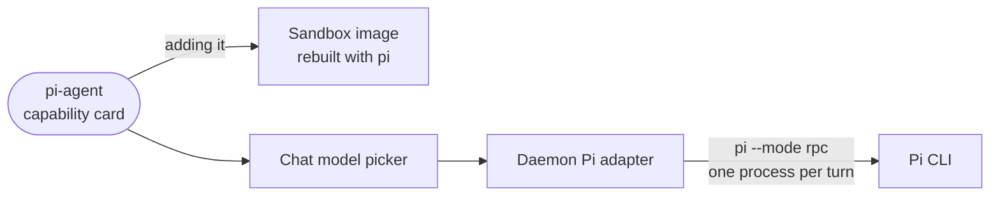

# pi-agent

A data-only extension that adds the Pi coding agent as a chat provider: a capability card, and a Dockerfile fragment that installs the `pi` CLI.

- Holds no code. The manifest declares the `pi` capability (`kind: agent`) and an `environment` fragment. The
  directory is copied into the sandbox image whole.
- Add the card, then rebuild from Sandbox > Environment to install the pinned CLI. A missing CLI leaves the card
  saved and pending, so its install fragment can join the rebuild. After that the card's `command`, `env` and login
  fields configure how the daemon spawns it.
- The daemon checks Pi over its own RPC protocol, including whether Pi has configured models. The card distinguishes
  a missing CLI from a missing provider sign-in. It never sends Pi an ACP handshake or a model prompt for this check.
- Pi's RPC carries mid-turn steering and an effort level. The daemon's extension mounts the sandbox's MCP tools,
  loads the turn's instructions and skills, and puts tool calls and results through the sandbox's hooks.
- Use **Sign in** on the card to open Pi, then `/login` and `/model` to save a provider and default model. For Claude
  Pro/Max, use `/login anthropic` and choose subscription sign-in; remote OAuth flows accept a pasted redirect URL
  or code. [Pi's authentication guide](https://github.com/earendil-works/pi/blob/main/packages/coding-agent/docs/providers.md)
  describes its current providers. Claude subscription authentication in third-party harnesses uses paid extra usage,
  billed per token, rather than the plan's included allowance. API keys can instead go in the card's environment field.
- Pi keeps its own credentials and settings in `~/.pi/agent` (or `PI_CODING_AGENT_DIR`). A chat uses that same directory
  inside its isolated namespace; it does not import the sandbox's Claude Code or Codex account credentials.

## Key files

- [intentic-extension.json](intentic-extension.json) — the capability card, its guide and its fields.
- [env/pi.Dockerfile](env/pi.Dockerfile) — the image fragment that installs the Pi CLI.
- [../../_sandbox/sandbox/src/runtimes/pi/pi-agent.ts](../../_sandbox/sandbox/src/runtimes/pi/pi-agent.ts) — the daemon side that runs a turn over Pi's RPC.
