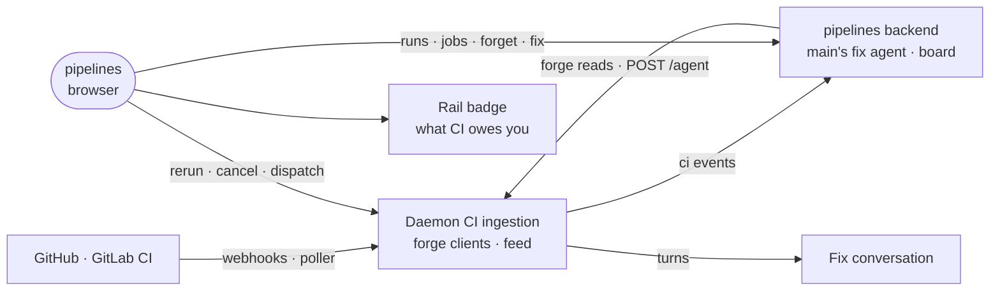

# pipelines

The Pipelines rail view and main's one fix agent: CI runs from the workspace repositories' GitHub and GitLab remotes on one board, a failing main line with the fix agent this extension puts on it, and rerun, cancel and fix actions.



- Two halves. The views run in the browser, compiled into the editor app as a builtin. The backend (`src/server`,
  `dist/server.js` in the image) runs in the daemon's extension host, since 2026-11-26: main's one fix agent and the
  board's own reads and presses, which were the daemon's `ci/` until then. CI ingestion stays the daemon's (its webhook
  door, poller, forge clients, runs cache and CI feed, docs/architecture/core-and-extensions.md), and the backend builds
  on it: it hears each run that finished and each job that failed on its event stream (`permissions.events: ["ci"]`),
  reads the forges through the daemon's CI routes (failed steps, passed jobs, a job's whole log, annotations, a run, the
  workflow file a run ran, re-run its failed jobs), and starts and tells its fix agents through POST /agent under its
  `pipeline-fix` job, hearing their runs end (`run`). It keeps its streaks, passes, fleet re-runs and owner steps in its
  own `repair.json` (`src/server/repair-store.ts`), taken over once from what the daemon kept
  (`POST /ci/repair/hand-over`), holds work while a run's failures wait to be handed over (`permissions.work`), and
  claims main lines' failures while its `autoRepair` setting is on (`POST /ci/main-lines/claim`), so no `ci` automation
  listening on every branch puts a second agent on main.
- The views read the runs (with main's failures and the owner steps), a run's job graph, and press forget and Fix through
  the backend (`api.backend`, `src/backendRoutes.ts`); against a daemon older than the backend they read the daemon's
  own routes instead (`src/backendCall.ts`). Rerun, cancel and dispatch are the forge's, answered by the daemon.
- **Repair main's CI** (`autoRepair`, the extension's own setting, on by default; the sandbox's Agent tab switch until
  2026-11-26, whose value the hand-over carried over): off, main's failure is only reported.
- `agents ci` reads what main is known to fail on from the backend's `main_failures` tool, every turn's (`contributes.tools`),
  through the turn's own shell door (`POST /tools/pipelines`), with what the sandbox's own test runs at main saw fail
  from the daemon (`GET /ci/main/local`).
- Its manifest offers the "Fix failing CI" automation template (2026-11-26, from the sandbox's own catalogue): an agent
  woken by the core `ci` source the moment a branch that was passing breaks, for any repository, not only main.
- Its manifest declares the **Pipeline fixes** job (`contributes.modelRoles`, `pipeline-fix`, suggested High;
  2026-11-26, from the sandbox's own table under the same id), which the owner places on a model setup in Sandbox ▸
  Agent ▸ Models. A Fix press names it, and so does main's fix agent, which this extension's backend starts.
- The tile appears only when a GitHub or GitLab `cli` capability is connected. The board shows the open project's
  repositories, ranks them by how loudly they ask (`src/repoStandings.ts`) and draws each run's jobs as a layered graph
  (`src/graph/pipelineDag.ts`). A GitHub run is drawn the way GitHub's own run page draws it: the same columns, cards and
  order, with every job the workflow declares, including the ones the run has not reported yet or never ran.
- The strip above every job graph switches its layout between Columns (stages left to right, as above, fitted into a
  band) and Rows (stages top to bottom, each job one line of status, name and duration, a call its card's jobs share
  named once above them). Rows draws the run whole and as tall as it is, and the wheel scrolls the page over it instead
  of zooming. The choice holds for every graph in this browser: the board, the full-screen dialog and the side panel
  (`src/graph/graphLayout.ts`). A side panel narrower than 36rem always draws Rows and shows no switch.
- A failing main-line branch is one incident card above its repository's runs (`src/fixes/MainFailureBanner.vue`, in
  `RowGroup`'s `lead` slot rather than its list), drawn so it cannot pass for one more run: a danger rim, a bar down its
  edge, a filled header and a square plate where rows have round status glyphs. Its header reads in the order a reader
  asks: one title row holding the branch and since when, who has it (a pill that opens the agent), Mark resolved and the
  one press; then one sentence on where the fix stands and the reader's move; then each failing workflow as an aligned
  row of name, jobs (a link to its failing run) and what blocks it (`failingWorkflowsOf`, from the contract's
  `workflows`), whether or not the board lists that run: the backend keeps a failure per workflow, so a nightly that
  fails while every CI run passes keeps main failing over a board of green rows, and the card is where the reader learns
  which. A row's blocker and its press wrap under its jobs as one unit in a narrow pane, and in a card narrower than
  28rem Mark resolved is its glyph alone, so the pill and the press keep one line on a phone. The sentence is read off
  the agent's live stance (`storyOf`): working, waiting on you, ready to
  review, landed ("commit and push it: the next run on main shows whether it worked"), being measured by a run that
  started after it landed, stalled (the push happened, and no failing workflow has a run going or a push's run to come:
  each was cancelled, runs on a schedule, or has gone quiet), new failures after landing ("New failures found", with
  "Fix now" even while the run is still going), or handed back with a two-word reason from the contract's
  `MainFailureHandBack`. Only a run of one of the failing workflows says anything about them: before 2026-11-03 a
  Scorecard or CodeQL pass after the push read as "newer runs on main pass" while CI itself had been cancelled.
- Each workflow line says what stands between it and passing, and the press that clears it (`blockerOf`): a run of it
  going now; its newest run cancelled after the failure (that run is drawn in the block, with its own Re-run); a
  scheduled workflow, with Run now (`ci.dispatch`, a fresh run on the branch's head rather than the old commit again);
  or quiet for days, with when the backend drops it by itself (`MAIN_FAILURE_STALE_MS` after it last failed) and Stop
  tracking (`ci.forget`). Jobs that ran out of time are marked, since GitHub calls them cancelled. The header's since is
  the longest-failing workflow's (`failingSince`) and each line's own is in its run's tip, so the common case no longer
  prints one date twice; the agent's pill counts its attempts once there has been more than one, and Mark resolved ends
  the whole failure behind a confirm. Auto-fix still collects a run's
  failures until it finishes or reaches its wait cap; the manual press starts with the failures reported so far,
  and only additional failed jobs follow automatically. A newer run with no failures reported keeps the measuring
  state. Under the header
  sit the runs it is about (`coveredRuns`: the branch's failures nothing has passed since, the ones the backend names
  failing whatever passed on a later commit, its runs still going, and each failing workflow's newest run when it was
  cancelled after the failure, so the block agrees with the forge's own page), indented and joined to the header's plate by a
  drawn lane, a trunk with an elbow into each run's status glyph, measured from where they sit so it survives a row
  opening into its job graph. Every other run follows in time order. It never shows the daemon's sentence or a turn's
  error: those are in the agent's conversation. The agent is joined by the id the failure names (`fixer`), never by a
  later run's derived id (`src/fixes/mainFailures.ts`).
- One fix control per breakage. On a failing main line it is the block's: the runs inside show the run, Re-run and
  Cancel, and no Fix, Continue, Start over or agent pointer (`leadsRows`), since every press on main goes to the same
  agent anyway. The block's press is the rows' own split button, so its caret still re-points the model and, over an
  agent that already tried, ends in Continue or Start over. Any other branch keeps "Fix with agent" on its failed run
  rows, except beside a landed fix (the next push measures it, which its chip says) or a step outside the repository. A
  landed fix never promotes Re-run: it is uncommitted in the workspace, and a re-run repeats the commit that failed.
- The badge counts what CI owes the reader, not what is red (`src/attention.ts`): a failure nobody is on, one whose fix
  agent stopped or handed it back, a fix waiting for an answer or a review, a landed fix still to push (a release's: to
  release again), a step outside the repository, a pushed fix nothing is measuring. Danger only for a failure with nobody
  on it; a step or a stall is a warning, the rest the ordinary tone. A failure a fix agent is working, one waiting on its
  allowance, or one a run is measuring needs nobody: it rides the tile's running mark ("1 being fixed") beside the runs
  in flight. A failing main line is read through the backend's failure and its banner's story, so the tile and the banner
  agree; any other branch through its head commit's failed runs and their fix agents. It counts only the open project's
  repositories, as the board shows them, and never clears on viewing. `startCiAttention` polls the runs, and the fleet's
  roster when anything failed, from activation, so the badge is live while the board is closed. Until 2026-11-12 it
  counted every branch whose last commit failed, tags included, so a failed release whose fix had landed kept it at
  "1" for hours with nothing to do on the board but start a third agent.
- A release tag (`v1.2.3`) is no branch: nothing newer ever lands on it (`src/ciStreaks.ts`, `releaseFailures`). Each
  release workflow's newest finished run is its state: open while it failed, history once a later release's run of the
  same workflow passes, or the failed run itself is re-run to a pass.
- No commit fixes some failures: a field in a store's dashboard, a secret's value, an account setting. The fix prompt asks
  the agent to open its final message with `Owner step: …` instead of committing something for its sake; the backend keeps
  that line per agent (`src/server/owner-steps.ts`, the contract's `ownerSteps`) and the row shows "Step for you" with it, and
  promotes Re-run, which measures the step once it is taken. On a failing main line the banner says it, and the step
  outranks both what the agent holds and a "no fix found" hand-back (an agent that names a step commits nothing, which
  the fix agent hands back as no change): one sentence, then the step itself rendered as markdown (its commands are code)
  under a rule, folded to four lines with Show all, and Continue fix drops to quiet since the step is the move. Until
  2026-11-25 the step was spliced raw into the sentence, backticks and all, as one paragraph of up to 600 characters.
- "Fix with agent" asks the backend to start a fix conversation, as whoever pressed (`api.caller`, handed back to
  POST /agent). Its id is derived from the run, so the board pairs
  runs with their fixes without a store of its own (`src/fixes/ciFixes.ts`). Ids minted before 2026-11-12
  (`ci-fix-<repo>-<run>`, later attempts `-attemptN`) are still read: a run with attempts under the old spelling keeps
  that family (the contract's `ciFixBase`), so a press continues it rather than opening a second attempt 1. A plain press runs on the `pipeline-fix` job's
  setup, which POST /agent resolves; the button's `fallback` is still sent for a daemon older than the backend, which
  runs it when no pinned model can (`src/usePipelines.ts`).
- The press opens the agents board at once (`api.chat.launchAgent`) rather than when the backend answers. The backend
  reads the failed jobs' list and whole logs before any agent exists (about 1 s and 2 s for a 4 MB log on GitHub), so
  a dashed card on the board stands in for the agent meanwhile: the title it will wear (the contract's `ciFixTitle`),
  "Reading the failed jobs' logs" and the seconds so far. The agent's own card takes its place once it exists, and a
  refusal (a runner failure, an attempt already in play) is said on that card, with the way back here.
- When the button's model has no allowance left, the press shows the time the allowance comes back, by the same rule
  the composer's Send uses (`api.models.allowance`). Pressing it opens the fix conversation now and books its task for
  that time (`sendAt`, `sendAtReopen`), naming that model, so picking a model with no allowance schedules the fix for
  later. Until it starts, its chip says Scheduled (the contract's `fixStance`).
- Under the runs, a Runners section shows the self-hosted GitHub Actions runners on the owner's connected computers
  (`src/runners/`). It asks the daemon's device list which live computers advertise the `ci-runners` feature (a Linux
  agent: runners are systemd units), then reads each one through `GET /system/devices/{id}/ci-runners` every 15 s while
  the view is open. A computer gets a group when it has runners, when its CI fleet service is installed, or when the read
  failed, which says why in the daemon's words; with none of those the section draws nothing. A group's head says the
  fleet service's state (running and its version, not answering with its problem, or not installed, which leaves the
  runners read-only) and, where the service holds test-memory slots, how many of them CI may use. Each runner row has a
  status glyph (a busy runner spins like a running run), its name and light-lane mark, what it is doing (its job and for
  how long, idle, held down and why, draining, or a systemd unit that is gone and needs registering again), its version,
  and the presses the fleet service takes for it as it stands (`runnerPresses`): Start for a stopped, failed or held
  runner; Drain, Restart and Stop for a running one, with Stop refused mid-job in favour of Drain; its log; and Remove,
  behind a confirm. Each press answers in the daemon's own sentence under the computer and reads it again at once. "Add
  a runner" suggests the next `<host>-worker-<n>` name and the labels docs/ops/ci-runner.md gives (`intentic,desktop`,
  or `intentic-light` alone for a `-light-N` name), for one of the workspace repositories with a GitHub remote. The fleet
  service's last janitor, keeper and prune pass sit folded at the foot of the group. The section is drawn only for an
  owner or a maintainer, the floor of the runner routes.

## Key files

- [src/extension.ts](src/extension.ts) — registers the rail view: when it shows, its badge and its warm-up query.
- [src/PipelinesView.vue](src/PipelinesView.vue) — the board: repository picker, failing main lines, run rows.
- [src/ciStreaks.ts](src/ciStreaks.ts) — when a branch counts as failing, and a release's failures apart from it.
- [src/attention.ts](src/attention.ts) — what CI owes the reader, the rule behind the badge.
- [src/fixes/mainFailures.ts](src/fixes/mainFailures.ts) — a failing main line and its one fix agent, joined by the fixer's own id.
- [src/runners/runnerFleet.ts](src/runners/runnerFleet.ts) — the Runners section's reading: which computers get a group, a runner's words and presses.
- [src/graph/pipelineDag.ts](src/graph/pipelineDag.ts) — a run's flat job list turned into layers, cards and GitHub's order.
- [src/server/server.ts](src/server/server.ts) — the backend's activation: what it hears, claims, takes over and serves.
- [src/server/main-fixer.ts](src/server/main-fixer.ts) — main's one fix agent: streaks, handovers, turn limits, hand-backs.
- [src/server/board.ts](src/server/board.ts) — the board's backend: runs with main's failures, a run's job graph, forget, Fix.
- [src/server/daemon.ts](src/server/daemon.ts) — every daemon route the backend asks, and nothing else.
- [src/backendCall.ts](src/backendCall.ts) — a view's call to the backend, or to an older daemon's own route, and back to the backend when that route is gone.

## Commands

```sh
pnpm --filter @intentic/ext-pipelines test
pnpm --filter @intentic/ext-pipelines build    # dist/server.js, the backend bundle the image carries
```
