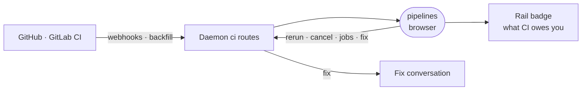

# pipelines

The Pipelines rail view: CI runs from the workspace repositories' GitHub and GitLab remotes on one board, a failing main line with the one fix agent on it, and rerun, cancel and fix actions.



- Runs in the browser, compiled into the editor app as a builtin. It holds no CI state: runs, jobs and main's failures come
  from the daemon's `ci` procedures, which keep them fresh from vendor webhooks and backfill when stale.
- The tile appears only when a GitHub or GitLab `cli` capability is connected. The board shows the open project's
  repositories, ranks them by how loudly they ask (`src/repoStandings.ts`) and draws each run's jobs as a layered graph
  (`src/graph/pipelineDag.ts`). A GitHub run is drawn the way GitHub's own run page draws it: the same columns, cards and
  order, with every job the workflow declares, including the ones the run has not reported yet or never ran.
- The strip above every job graph switches its layout between Columns (stages left to right, as above, fitted into a
  band) and Rows (stages top to bottom, each job one line of status, name and duration, a call its card's jobs share
  named once above them). Rows draws the run whole and as tall as it is, and the wheel scrolls the page over it instead
  of zooming. The choice holds for every graph in this browser: the board, the full-screen dialog and the side panel
  (`src/graph/graphLayout.ts`). A side panel narrower than 36rem always draws Rows and shows no switch.
- A failing main-line branch is one incident card above its repository's runs (`src/fixes/MainFailureBanner.vue`, in
  `RowGroup`'s `lead` slot rather than its list), drawn so it cannot pass for one more run: a danger rim, a bar down its
  edge, a filled header and a square plate where rows have round status glyphs. Its header says the branch and since
  when, then each failing workflow by name with its jobs and a link to its failing run (`failingWorkflowsOf`, from the
  contract's `workflows`), whether or not the board lists that run: the daemon keeps a failure per workflow, so a
  nightly that fails while every CI run passes keeps main failing over a board of green rows, and the card is where the
  reader learns which. Then who has it (a pill that opens the agent) and the one press, then one sentence on where the
  fix stands and the reader's move, read off the agent's live stance (`storyOf`): working, waiting on you, ready to
  review, landed ("commit and push it: the next run on main shows whether it worked"), being measured by a run that
  started after it landed, stalled (the push happened, and no failing workflow has a run going or a push's run to come:
  each was cancelled, runs on a schedule, or has gone quiet), new failures after landing ("New failures found", with
  "Fix now" even while the run is still going), or handed back with a two-word reason from the contract's
  `MainFailureHandBack`. Only a run of one of the failing workflows says anything about them: before 2026-11-03 a
  Scorecard or CodeQL pass after the push read as "newer runs on main pass" while CI itself had been cancelled.
- Each workflow line says what stands between it and passing, and the press that clears it (`blockerOf`): a run of it
  going now; its newest run cancelled after the failure (that run is drawn in the block, with its own Re-run); a
  scheduled workflow, with Run now (`ci.dispatch`, a fresh run on the branch's head rather than the old commit again);
  or quiet for days, with when the daemon drops it by itself (`MAIN_FAILURE_STALE_MS` after it last failed) and Stop
  tracking (`ci.forget`). Jobs that ran out of time are marked, since GitHub calls them cancelled. Each line carries its
  own since when the block lists several, the header's since is the longest-failing workflow's (`failingSince`), the
  agent's pill counts its attempts once there has been more than one, and Mark resolved ends the whole failure behind a
  confirm. Auto-fix still collects a run's
  failures until it finishes or reaches its wait cap; the manual press starts with the failures reported so far,
  and only additional failed jobs follow automatically. A newer run with no failures reported keeps the measuring
  state. Under the header
  sit the runs it is about (`coveredRuns`: the branch's failures nothing has passed since, the ones the daemon names
  failing whatever passed on a later commit, its runs still going, and each failing workflow's newest run when it was
  cancelled after the failure, so the block agrees with the forge's own page), indented and joined to the header's plate by a
  drawn lane, a trunk with an elbow into each run's status glyph, measured from where they sit so it survives a row
  opening into its job graph. Every other run follows in time order. It never shows the daemon's sentence or a turn's
  error: those are in the agent's conversation. The agent is joined by the id the failure names (`fixer`), never by a
  later run's derived id (`src/fixes/mainFailures.ts`).
- One fix control per breakage. On a failing main line it is the block's: the runs inside show the run, Re-run and
  Cancel, and no Fix, Continue, Start over or agent pointer (`leadsRows`), since every press on main goes to the same
  agent anyway. The block's press is the rows' own split button, so its caret still re-points the model and, over an
  agent that already tried, ends in Continue or Start over. Any other branch keeps "Fix with agent" on its failed run
  rows, except beside a landed fix (the next push measures it, which its chip says) or a step outside the repository. A
  landed fix never promotes Re-run: it is uncommitted in the workspace, and a re-run repeats the commit that failed.
- The badge counts what CI owes the reader, not what is red (`src/attention.ts`): a failure nobody is on, one whose fix
  agent stopped or handed it back, a fix waiting for an answer or a review, a landed fix still to push (a release's: to
  release again), a step outside the repository, a pushed fix nothing is measuring. Danger only for a failure with nobody
  on it; a step or a stall is a warning, the rest the ordinary tone. A failure a fix agent is working, one waiting on its
  allowance, or one a run is measuring needs nobody: it rides the tile's running mark ("1 being fixed") beside the runs
  in flight. A failing main line is read through the daemon's failure and its banner's story, so the tile and the banner
  agree; any other branch through its head commit's failed runs and their fix agents. It counts only the open project's
  repositories, as the board shows them, and never clears on viewing. `startCiAttention` polls the runs, and the fleet's
  roster when anything failed, from activation, so the badge is live while the board is closed. Until 2026-11-12 it
  counted every branch whose last commit failed, tags included, so a failed release whose fix had landed kept it at
  "1" for hours with nothing to do on the board but start a third agent.
- A release tag (`v1.2.3`) is no branch: nothing newer ever lands on it (`src/ciStreaks.ts`, `releaseFailures`). Each
  release workflow's newest finished run is its state: open while it failed, history once a later release's run of the
  same workflow passes, or the failed run itself is re-run to a pass.
- No commit fixes some failures: a field in a store's dashboard, a secret's value, an account setting. The fix prompt asks
  the agent to open its final message with `Owner step: …` instead of committing something for its sake; the daemon keeps
  that line per agent (`ci/owner-steps.ts`, the contract's `ownerSteps`) and the row shows "Step for you" with it, and
  promotes Re-run, which measures the step once it is taken. On a failing main line the banner says it.
- "Fix with agent" asks the daemon to start a fix conversation. Its id is derived from the run, so the board pairs
  runs with their fixes without a store of its own (`src/fixes/ciFixes.ts`). Ids minted before 2026-11-12
  (`ci-fix-<repo>-<run>`, later attempts `-attemptN`) are still read: a run with attempts under the old spelling keeps
  that family (the contract's `ciFixBase`), so a press continues it rather than opening a second attempt 1. A plain press sends the model the button
  names (the job's pin in Models, else the model a new chat would open on) as `fallback`: the daemon holds no chat pick
  of its own, so it runs that one when no pinned model can, while it can serve its provider (`src/usePipelines.ts`).
- The press opens the agents board at once (`api.chat.launchAgent`) rather than when the daemon answers. The daemon
  reads the failed jobs' list and whole logs before any agent exists (about 1 s and 2 s for a 4 MB log on GitHub), so
  a dashed card on the board stands in for the agent meanwhile: the title it will wear (the contract's `ciFixTitle`),
  "Reading the failed jobs' logs" and the seconds so far. The agent's own card takes its place once it exists, and a
  refusal (a runner failure, an attempt already in play) is said on that card, with the way back here.
- When the button's model has no allowance left, the press shows the time the allowance comes back, by the same rule
  the composer's Send uses (`api.models.allowance`). Pressing it opens the fix conversation now and books its task for
  that time (`sendAt`, `sendAtReopen`), naming that model, so picking a model with no allowance schedules the fix for
  later. Until it starts, its chip says Scheduled (the contract's `fixStance`).

## Key files

- [src/extension.ts](src/extension.ts) — registers the rail view: when it shows, its badge and its warm-up query.
- [src/PipelinesView.vue](src/PipelinesView.vue) — the board: repository picker, failing main lines, run rows.
- [src/ciStreaks.ts](src/ciStreaks.ts) — when a branch counts as failing, and a release's failures apart from it.
- [src/attention.ts](src/attention.ts) — what CI owes the reader, the rule behind the badge.
- [src/fixes/mainFailures.ts](src/fixes/mainFailures.ts) — a failing main line and its one fix agent, joined by the fixer's own id.
- [src/graph/pipelineDag.ts](src/graph/pipelineDag.ts) — a run's flat job list turned into layers, cards and GitHub's order.

## Commands

```sh
pnpm --filter @intentic/ext-pipelines test
```
