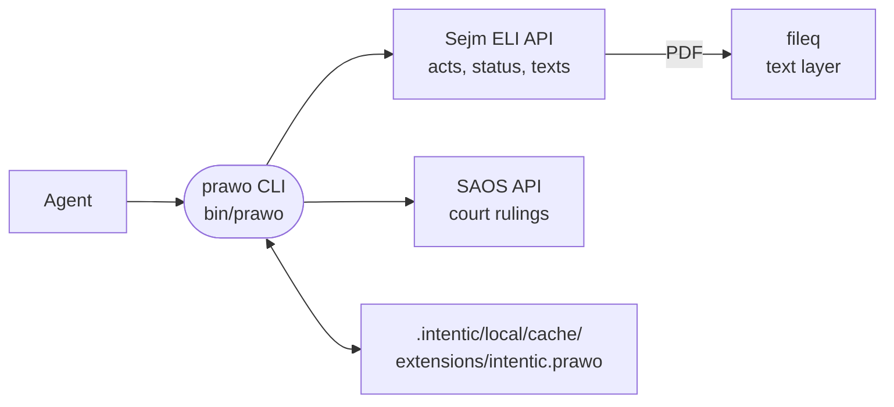

# prawo

Polish law for the agent: one card that gives it `prawo`, a CLI that finds acts in the Sejm's database, says whether they are in force, quotes the current text article by article with the citation to put under it, and searches court rulings. A clerk's assistant can then answer "what does the KPA say about the deadline" with the wording of art. 35 § 3 and *(Dz. U. z 2025 r. poz. 1691)* rather than with a web search.



- Both sources are public and need no account or key. The card has nothing secret on it; adding it installs the skill
  that teaches the agent the commands and how to cite. The card's text is in English and Polish side by side, since a
  card contributed by an extension is shown in its manifest's own words.
- Which text is current is decided in one place ([src/law/law.ts](src/law/law.ts)): the act's newest consolidated text
  ("tekst jednolity"); the act as published when nothing amended it; otherwise the Chancellery's unified text
  ("tekst ujednolicony"), which is up to date but has no legal force and is marked so. Amendments that take effect after
  the consolidated text's legal-status date are listed with each answer, future ones as pending.
- The newest consolidated texts are usually published as PDF only, so most quotes come from the PDF's text layer, read
  with `fileq`. The reader ([src/text/pdf.ts](src/text/pdf.ts)) drops running heads, lifts footnotes and margin notes
  out of the wording and keeps them as notes on the unit they mark, and restores article numbers the layer flattened
  ("Art. 391." is art. 39¹). When an HTML version exists it is used instead ([src/text/html.ts](src/text/html.ts)).
- Every line of a quote carries a stable marker, `[Art. 31 ust. 2 pkt 3]`, `[Art. 35 § 1]`, `[§ 4 ust. 1]` in a
  regulation, `[Załącznik nr 1 § 5]` in an annex, so a quote and its citation cannot drift apart.
- Fetched texts, act records, searches and rulings are kept in the workspace cache. A published text is kept for good;
  records and searches are refreshed after a few hours. With no network, the cached copy answers.
- SAOS is current for the common courts only: the Supreme Court ends in 2016, the Constitutional Tribunal in 2015, the
  National Appeal Chamber in 2018, and the administrative courts are not in it. The NSA's own database has no API.
- The built tree ships in the `messaging` image pack, beside `gw`; a core image lists the card as not included.

## Key files

- [src/cli.ts](src/cli.ts) — the commands and their flags, errors on stdout with exit 2.
- [src/law/law.ts](src/law/law.ts) — status, the choice of text, amendments after it, the cache in front of the sources.
- [src/law/citation.ts](src/law/citation.ts) — journal addresses and the Polish citation forms.
- [src/sources/eli.ts](src/sources/eli.ts) and [src/sources/saos.ts](src/sources/saos.ts) — the two APIs, with the
  shapes and quirks observed.
- [src/text/](src/text) — PDF text and HTML into articles and units.
- [skills/prawo/SKILL.md](skills/prawo/SKILL.md) — what the agent is told: find, check status, quote, cite.
- [src/fixtures/](src/fixtures) — trimmed real answers of both APIs and real `fileq` output, for the tests.

## Commands

```sh
pnpm --filter @intentic/ext-prawo build   # tsgo to dist/, which bin/prawo runs
pnpm --filter @intentic/ext-prawo test    # no network: every request is answered from src/fixtures
prawo search "o dowodach osobistych" --type Ustawa
prawo show DU/1960/168
prawo article DU/1960/168 35 § 3
prawo rulings search "bezczynność organu" --act DU/1960/168
```
