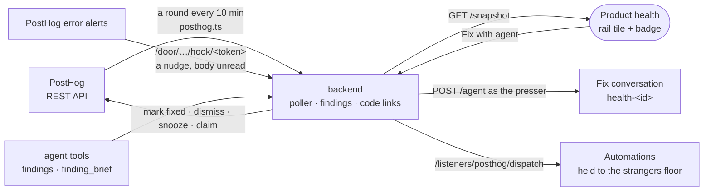

# product-health

The Product health rail view: what PostHog finds wrong in your product (errors, firing alerts, health checks, Inbox reports), each with the press that puts an agent on it.



- Built in, like Pipelines: the view compiles into the web bundle and the backend (`dist/server.js`) is baked into the
  image. It also carries the **PostHog card**, its skill and the CLI's image fragment, which lived in connectors until
  2026-11-27: the daemon serves a connection's credential only to the extension that contributes its card, and this
  backend needs the key to read PostHog. Saved connections kept their id (`cli:posthog`) and resolve here unchanged.
- The tile appears once a PostHog connection exists, one tile however many there are; a row names its connection when
  there is more than one.

## What a round reads, and what it becomes

Every ten minutes, and within a minute of a nudge, the backend reads each connection's lists once and turns them into
findings (`src/server/sources.ts`, pure and tested). A finding's **lane** is the decision that matters most:

| Source | PostHog | Lane |
| --- | --- | --- |
| Health checks | `health_issues`, plus each one's detail for PostHog's own `remediation` | `fix`; a PostHog setting (`authorized_urls`, anything about warehouse, billing or integrations, or guidance only for a person) is the owner's `step` |
| Errors | `error_tracking/query/issues` (active, last 7 days): the top five always, past them only new ones or ones that came back | `fix` |
| Insight alerts | `alerts` | firing is `fix`, a broken alert `setup`, the rest `watch` |
| Inbox reports | `signals/reports` | ready and unclaimed is `fix`; waiting on a person is a `step`; claimed elsewhere or with a pull request open is `watch` |
| Setup advice | `error_tracking/recommendations` | `setup` |
| Experiments | `experiments` running past two weeks, or ended with no conclusion | `decide` |

Every path is the one PostHog's own agent CLI calls for the same tool, recorded on 2026-11-26, and every answer is
parsed loosely, so a field PostHog adds never fails a read. Rate limits are per organisation and shared with everyone
using it, so a round asks each list once and reads at most five details of each kind; a source that fails is said on
the connection and leaves the others standing.

## Things worth knowing before you edit this

- **The badge counts what is owed, not what is red** (`src/owed.ts`, the rule Pipelines settled on). A finding counts
  when its next move is the reader's: nobody is on it, its agent ended or handed it back, its agent waits on an answer
  or a review, its fix landed and has to ship, or no commit fixes it. An agent at work, decisions, setup advice and
  quiet alerts are shown and never counted. Danger only for something critical nobody is on. Viewing never clears it.
- **The agent is found by its id, never a store.** Every attempt at a finding derives from `fixBase` (`health-` and two
  FNV digests of the finding's id), and attempt 2 onward is `<base>_<n>`, the contract's spelling, so the plan for a
  press is `planFixAttempt` (continue an ended attempt, refuse a second one while one is in play, start over on request)
  and the stance on a row is `fixStance`, as on the Pipelines board. An automation's wake is joined by the conversation
  its dispatch opened instead (`woken` in the state).
- **What came from users' browsers is fenced.** An exception's message, a frame, a check's payload and even a health
  issue's title may carry somebody else's words. The brief (`src/server/brief.ts`) puts them between marks carrying a
  fresh random nonce nothing inside can know, keeps PostHog's own `remediation` outside as trusted guidance, and every
  fix turn is marked `outsideWake: "PostHog"`. The listener declares `strangers: "report"`, so an automation's wakes
  are held to the owner's floor for a stranger's report. The view renders all of it as text.
- **A step the agent names outranks its stance.** A fix turn told that no commit fixes it ends with `Owner step: …`;
  the backend hears the run end (`permissions.events: ["run"]`) and the row shows the step as the owner's.
- **Writes are presses, and a maintainer's.** Mark fixed resolves the issue in PostHog (`pending_release` is refused
  there now), and PostHog's own reopening is what turns the row red again as "came back". A health issue's snooze is
  PostHog's own; anything else snoozes here for a week. Dismiss is only for setup advice. Starting an agent on an Inbox
  report claims it in PostHog, so its own agent or another sandbox's does not start on it too. Nothing writes to PostHog
  by itself.
- **The alert door never reads its body.** `Send alerts here` creates PostHog webhook destinations for the three
  error-tracking lifecycle events, pointed at `/door/<id>/hook/<token>`; a post there only brings the next round
  forward, and the token keeps strangers from spending PostHog's budget even that way.
- **Links go to the connection's real host**, never the credential gateway's address that `posthog-cli` hands back.

## Key files

- [src/server/server.ts](src/server/server.ts): the backend's activation: routes, tools, the door, the run events.
- [src/server/posthog.ts](src/server/posthog.ts): PostHog's REST API as far as this reads and writes it.
- [src/server/sources.ts](src/server/sources.ts): what a round read, as findings and their lanes.
- [src/server/poller.ts](src/server/poller.ts): one round per connection, its details, code links and transitions.
- [src/server/joins.ts](src/server/joins.ts): where a finding points: the SDK pin, a frame's file, a release's repository.
- [src/server/brief.ts](src/server/brief.ts): what an agent is handed, and the fence around users' words.
- [src/server/fix.ts](src/server/fix.ts): Fix with agent, on the contract's attempt plan.
- [src/server/wake.ts](src/server/wake.ts): waking automations through the `posthog` listener.
- [src/owed.ts](src/owed.ts): what a finding owes the reader, the badge's rule.
- [src/ProductHealthView.vue](src/ProductHealthView.vue): the board, in the order its sections owe a decision.

## Commands

```sh
pnpm --filter @intentic/ext-product-health test
pnpm --filter @intentic/ext-product-health build    # dist/server.js, the backend bundle the image carries
```
