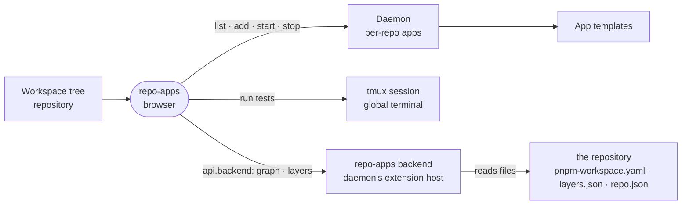

# repo-apps

Adds the Apps and Dependencies panels to a repository in the Workspace tree: a monorepo's apps with start, stop and tests, and its package dependency graph, which a backend of its own reads.



- The views run in the browser, compiled into the editor app as a builtin. Both use the `directory` surface, so they
  open from a repository in the Workspace tree.
- The backend (`src/server/`, built to `dist/server.js`, the manifest's `server`) runs in the daemon's extension host
  and reads the workspace straight from disk. It reaches no daemon route, so the manifest declares no
  `permissions.daemon`, and `permissions.sandbox` lists only the app, test, template and tree routes the views call.
  The image bakes its bundle beside the manifest (`BUNDLES` in `_tools/scripts/image/prepare-image-trees.sh`).
- Apps is the full panel for a monorepo and a flat Tests list for any other repository with tests. A monorepo with a
  deploy config or the `intent` role counts as a plain repository and gets no Dependencies panel.
- An app is a process the daemon manages: the panel lists it with its preview URL and status, and starts or stops
  it. Adding apps scaffolds from the daemon's templates in a one-shot terminal session. Those stay the daemon's: the
  same template manifest says how every app previews, which the Preview's targets and Start read too.
- Every test run is its own tmux session in the one global terminal, so a second run never collides with one still
  going. Test projects are found from the shared workspace tree (`src/useTests.ts`), with no extra fetch.
- Dependencies shows a monorepo's architecture as its files state it, in three tabs. The backend reads every declared
  workspace dependency and what the dependent's own files do with it: imports a value from it, imports only its types,
  names it in a shipped file such as a Dockerfile, uses it only in tests and tool configs, or nothing at all.
  - Overview opens on the counts, the findings and every area against every other. The findings are runtime
    dependencies nothing uses, runtime dependencies only tests use, and pairs of areas that depend on each other.
  - Graph draws the packages without the edges a longer path already implies. The few packages most others use are
    chips on each card rather than lines, and packages with no line left are listed under the graph. A toggle brings
    back each one.
  - Inside opens one package. Its directories are stacked in the layers its `layers.json` declares, or in the tiers
    its own imports imply when it has none. Imports that reach up a layer, and cycles within one, are listed with
    their files and lines.
- Areas are the components of `docs/architecture/repo.json` when the repository has one, and top-level folders
  otherwise. They are ordered so the fewest edges point up the order, which is what makes an edge that does point up
  worth reading.
- The two reads (`GET graph?repo=` and `GET layers?repo=&package=`, `src/backendRoutes.ts`) answer the wire contract's
  `schemas/workspace/workspace-graph` shapes, which the extension API versions, so the browser half and a backend of
  another release read each other.
- Against a sandbox whose image predates the backend, the views read the same two answers from the daemon's own
  `GET /workspace/repos/{repo}/graph` and `/layers`, which that daemon's copy of this manifest still grants
  (`src/backendRead.ts`). From the release that brought the backend the daemon serves neither route.
- Each read answers only a repository its caller may see, as the daemon's own routes did: the backend reads who is
  asking off the request (`api.caller`, the person the daemon verified, with the workspace folders their areas come
  to), and a member fenced to areas is refused any repository outside them, one that is not there included, so the
  answer says nothing of the rest. A request no caller came with is refused. Hence `engines.intentic` `^2.53.0`.
  (2026-11-26: from the move to the backend until then, a request through `/x/<id>` carried no person and these two
  reads answered any viewer.) What it answers is package names, directories and import sites, never a file's contents.

## Key files

- [src/extension.ts](src/extension.ts) — which repositories get which panel.
- [src/AppsView.vue](src/AppsView.vue) — apps, packages and library tests for one repository.
- [src/useApps.ts](src/useApps.ts) — the daemon's per-repo app procedures: list, add, start, stop.
- [src/server/server.ts](src/server/server.ts) — the backend: the graph and layers reads, and which repository ids
  it answers for.
- [src/DependenciesView.vue](src/DependenciesView.vue) — the Dependencies tabs, and the grouping they share.
- [src/depModel.ts](src/depModel.ts) — what the views derive from the graph: implied edges, hubs, areas and their
  order, findings.

## Commands

```sh
pnpm --filter @intentic/ext-repo-apps build   # dist/server.js
pnpm --filter @intentic/ext-repo-apps test
```
