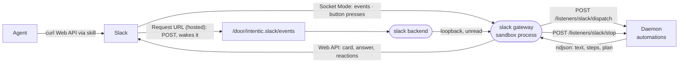

# slack

The Slack connection: a card and skill for the agent, plus a gateway process that turns a mention into a thread the agent works in, heard over Socket Mode or, on a hosted sandbox, at a Request URL that wakes it.



- Four pieces. The capability card takes a bot token (`xoxb-`) and how Slack reaches the sandbox: an app-level token
  (`xapp-`, Socket Mode) or the app's signing secret (Request URLs). Its guide link opens Slack's app creation with
  the Socket Mode app filled in ([app-manifest.json](app-manifest.json), Slack's `manifest_json` link; both are held
  equal to [src/app-manifest.ts](src/app-manifest.ts), which writes the app in both shapes, by
  `src/app-manifest.test.ts`), and its Test asks `auth.test`, whose answer is 200 either way, so the probe reads `ok`.
  The skill (`skills/slack/SKILL.md`) teaches the agent Slack's Web API with `curl`. The gateway is a `processes` entry
  the daemon runs while a Slack card or Slack automation exists, and the backend (`server`) hears the Request URL.
- The card declares what its Web API methods do (`broker.actions`: posting, editing and deleting a message, adding and
  removing a reaction, and the history reads), so the sandbox's credential gateway records each call in Activity with
  its channel and text, and holds it to the owner's action rules (`slack.message.send` and the rest) before the token
  is attached.
- The gateway holds one connection per Slack card, and only while an enabled Slack automation exists; the daemon holds
  no Slack connection. Socket Mode is an outbound WebSocket, so no public URL is needed, for events and for button
  presses alike. A revoked token is fatal and pauses reconnecting for a backoff period.
- (2026-11-27) A sandbox Intentic hosts sleeps when nobody uses it, and a socket sleeps with it, so a mention sent then
  was never heard. There the app sends events and button presses to a Request URL instead
  ([src/http.ts](src/http.ts)): the `events` public route's wake URL (`api.sleep.wakeUrl`, `wakes: true`), which
  wakes the sandbox when called while it sleeps; the edge answers 503 and Slack's retry, a minute or five later, is
  heard. Which way an app goes is [src/mode.ts](src/mode.ts): a hosted sandbox (`SANDBOX_VM=1`) takes Request URLs
  once the card holds the signing secret and keeps Socket Mode until then, so an app set up before keeps answering
  while the sandbox is awake; any other sandbox keeps Socket Mode while it has an app-level token.
- Only a backend hears a public route, so the backend ([src/server.ts](src/server.ts)) hands each call, unread, to
  the gateway's loopback (published like a CLI's), and answers 503 with `Retry-After` while there is none. The
  gateway checks `X-Slack-Signature` against every card's signing secret (an HMAC over the timestamp and the body,
  refused when the timestamp is five minutes off), answers within two seconds, and hands the call to the listener as
  the envelope Socket Mode would have delivered, so everything below is the same. Slack's `url_verification` is
  answered with its challenge before any check, since it comes while the app is created, before the card holds its
  secret; a retry of an event already taken (its `event_id`) is acked and not dispatched twice; a call a card
  signed while nothing listens is acked, so Slack never reads the silence as a broken URL; and one that arrives while
  the card's connection is still opening, as right after a wake, is answered 503, so Slack sends it again.
- On a hosted sandbox the backend writes the Request URL and a link that creates an app already pointed at it into its
  state directory (`app-setup.json`), and the skill hands that link out in place of the card's. An app still on
  Socket Mode there is told once, as a failure on the Slack automations ([src/socket-notice.ts](src/socket-notice.ts)),
  that it only answers while the sandbox is awake, with the one switch in Slack's app settings and that link.
- An event envelope is acked once what it carries is kept (connector-runtime's dispatch spool, or the daemon's inbox),
  or after 2.5 s whatever happens, since Slack redelivers what is not acked within three; a gateway that dies before
  then is sent it again. Every other envelope is acked at once.
- A message is for the app when it mentions it, is a direct message, or is written in a thread the app answers in:
  this process's memory first, then the app's own earlier posts in the thread, so a restart forgets nothing that
  matters. Each Slack thread is one conversation; a top-level mention's conversation lives in the thread its answer
  opens under it.
- The answer ([src/reply.ts](src/reply.ts)) is the same shared reply Discord's is (connector-runtime's chat reply):
  👀 at once, then a status card ([src/card.ts](src/card.ts)) in the thread once the work outlasts a quick answer,
  edited in place with the current step, the checklist, the elapsed time, **Stop** and **Open in Intentic**. The
  answer itself is posted as `markdown` blocks, which Slack renders as standard Markdown (headings, code with its
  language, tables), never streamed by edits. The message ends ✅, ❌, ⏹️, or ✋ while a hold waits for the owner.
- The card states the one-message limit a reply is split at (`channel.messageLimit`, 4,000, Slack's own advice) and
  where people's data goes for the Data protection page (`processors`: Slack Technologies (Salesforce), US).
- Slack's own thread status ("is working on it…", `assistant.threads.setStatus`, which only needs `chat:write`)
  stands in for "typing…". An app Slack refuses it for is not asked again.
- The card's "How the work shows" setting offers Slack's own streaming instead ([src/stream.ts](src/stream.ts)): one
  message started with `chat.startStream` in Slack's plan display: one block titled with where the work stands
  (the checklist item in progress, then how it ended) holding each step as one of Slack's tasks, the answer appended
  below it, and the link added when it stops. A stream can carry no button that goes away when
  the work ends, so there **⏹️ on the request** is the Stop, as is Slack's own stop on the stream. A request held or
  queued still shows the card, since a stream left open while it waits reads as stuck, and an app Slack refuses
  streams falls back to the card for good.
- A reply in the thread while the turn runs goes into that turn (the daemon's steering) and takes its reactions from
  it. **Stop** arrives as an `interactive` envelope, or as a ⏹️ reaction on the request; the daemon lets the person
  stop the turn only if the automation's sender rules answer them without the owner's approval, and only they are
  told how it went.
- Status cards are left out of the thread history the model reads (their first block carries a fixed id), but still
  count as the app having spoken there.
- The manifest offers a **Team assistant on Slack** automation template, and the app says hello in a channel it is
  invited to. Posts from its own apps never wake it, and nothing it posts can ping `@channel`.
- The manifest is baked into every sandbox image, so the card always exists. The runnable gateway ships only in the
  messaging image pack.

## Key files

- [intentic-extension.json](intentic-extension.json) — the card, its setup guide, the listener events, the template, the gateway process and the Request URL's route.
- [src/listener.ts](src/listener.ts) — Slack envelopes to dispatched events, whether a message is for us, Stop, the hello.
- [src/http.ts](src/http.ts) — calls to the Request URL checked and made into envelopes: signatures, the URL check, retries.
- [src/reply.ts](src/reply.ts) — what the shared reply looks like in Slack: reactions, thread status, Markdown answers; the card ([src/card.ts](src/card.ts)) and the streamed alternative ([src/stream.ts](src/stream.ts)) draw it.
- [src/client.ts](src/client.ts) — the connection pool, Socket Mode or Request URLs, and which Slack errors are fatal.
- [skills/slack/SKILL.md](skills/slack/SKILL.md) — what the agent learns about using and setting up Slack.

## Commands

```sh
pnpm --filter @intentic/ext-slack build   # dist/gateway.js, dist/server.js
pnpm --filter @intentic/ext-slack test
```
