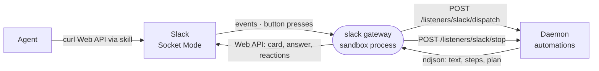

# slack

The Slack connection: a two-token card and skill for the agent, plus a gateway process that turns a mention into a thread the agent works in.



- Three pieces. The capability card takes a bot token (`xoxb-`) and an app-level token (`xapp-`). The skill
  (`skills/slack/SKILL.md`) teaches the agent Slack's Web API with `curl`, and writes the app manifest for the owner.
  The gateway is a `processes` entry the daemon runs while a Slack card or Slack automation exists.
- The gateway holds one Socket Mode socket per Slack app, and only while an enabled Slack automation exists; the
  daemon holds no Slack connection. Socket Mode is an outbound WebSocket, so no public URL is needed, for events and
  for button presses alike. A revoked token is fatal and pauses reconnecting for a backoff period.
- A message is for the app when it mentions it, is a direct message, or is written in a thread the app answers in:
  this process's memory first, then the app's own earlier posts in the thread, so a restart forgets nothing that
  matters. Each Slack thread is one conversation; a top-level mention's conversation lives in the thread its answer
  opens under it.
- The answer ([src/reply.ts](src/reply.ts)) is the same shared reply Discord's is (connector-runtime's chat reply):
  👀 at once, then a status card ([src/card.ts](src/card.ts)) in the thread once the work outlasts a quick answer,
  edited in place with the current step, the checklist, the elapsed time, **Stop** and **Open in Intentic**. The
  answer itself is posted as `markdown` blocks, which Slack renders as standard Markdown (headings, code with its
  language, tables), never streamed by edits. The message ends ✅, ❌, ⏹️, or ✋ while a hold waits for the owner.
- Slack's own thread status ("is working on it…", `assistant.threads.setStatus`, which only needs `chat:write`)
  stands in for "typing…". An app Slack refuses it for is not asked again.
- The card's "How the work shows" setting offers Slack's own streaming instead ([src/stream.ts](src/stream.ts)): one
  message started with `chat.startStream` in Slack's plan display: one block titled with where the work stands
  (the checklist item in progress, then how it ended) holding each step as one of Slack's tasks, the answer appended
  below it, and the link added when it stops. A stream can carry no button that goes away when
  the work ends, so there **⏹️ on the request** is the Stop, as is Slack's own stop on the stream. A request held or
  queued still shows the card, since a stream left open while it waits reads as stuck, and an app Slack refuses
  streams falls back to the card for good.
- A reply in the thread while the turn runs goes into that turn (the daemon's steering) and takes its reactions from
  it. **Stop** arrives as an `interactive` envelope, or as a ⏹️ reaction on the request; the daemon lets the person
  stop the turn only if the automation's sender rules answer them without the owner's approval, and only they are
  told how it went.
- Status cards are left out of the thread history the model reads (their first block carries a fixed id), but still
  count as the app having spoken there.
- The manifest offers a **Team assistant on Slack** automation template, and the app says hello in a channel it is
  invited to. Posts from its own apps never wake it, and nothing it posts can ping `@channel`.
- The manifest is baked into every sandbox image, so the card always exists. The runnable gateway ships only in the
  messaging image pack.

## Key files

- [intentic-extension.json](intentic-extension.json) — the card, its setup guide, the listener events, the template and the gateway process.
- [src/listener.ts](src/listener.ts) — Slack envelopes to dispatched events, whether a message is for us, Stop, the hello.
- [src/reply.ts](src/reply.ts) — what the shared reply looks like in Slack: reactions, thread status, Markdown answers.
- [src/card.ts](src/card.ts) — the status card drawn as Block Kit.
- [src/stream.ts](src/stream.ts) — the opt-in alternative: the work as Slack's own streamed task list.
- [src/client.ts](src/client.ts) — the socket and Web API pool, and which Slack errors are fatal.
- [skills/slack/SKILL.md](skills/slack/SKILL.md) — what the agent learns about using Slack, including the app manifest.

## Commands

```sh
pnpm --filter @intentic/ext-slack build   # dist/gateway.js
pnpm --filter @intentic/ext-slack test
```
