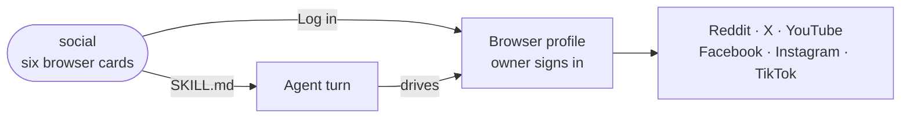

# social

A data-only extension that adds Reddit, X, YouTube, Facebook, Instagram and TikTok as browser capabilities, so the agent can act on each site as the owner through a signed-in browser.

- Holds no code. The manifest declares six `kind: browser` capabilities, each with a login URL, a home URL and a
  skill, and the facts about its site below. The directory is copied into the sandbox image whole; the browser machinery that acts on the cards is core.
- The signed-in browser profile is the credential, so the cards have no fields. One site can be connected more than
  once, and each skill is rendered with every connected account on one roster (`${accounts}`).
- YouTube signs in at Google, which refuses automated logins, and TikTok puts a puzzle in front of them, so on those
  two the owner signs in by hand in the live window.
- Automating an account may break the site's terms; each card's hint says so.
- Each card states its site's one-message limit (`channel.messageLimit`: X 280, YouTube 5,000, Facebook 63,206,
  Instagram 2,200, TikTok 4,000), which the approvals inbox counts a drafted post against; Reddit's is past anything
  written, so it declares none. Reddit's card adds what a turn publishing an approved post there must know
  (`channel.posting`): a comment's permalink nests the reply under that comment. None publishes posts itself, so every
  approved post on these sites goes to an agent turn driving the signed-in browser.

## Key files

- [intentic-extension.json](intentic-extension.json) — the six cards: names, hints, login and home URLs.
- [skills/reddit/SKILL.md](skills/reddit/SKILL.md) — reading, posting, commenting and voting on Reddit.
- [skills/x/SKILL.md](skills/x/SKILL.md) — posting, replying and following on X.
- [skills/youtube/SKILL.md](skills/youtube/SKILL.md) — watching, commenting and subscribing on YouTube.
- [skills/facebook/SKILL.md](skills/facebook/SKILL.md) — posting, commenting, reacting and joining groups on Facebook.
- [skills/instagram/SKILL.md](skills/instagram/SKILL.md) — commenting, following and publishing posts on Instagram.
- [skills/tiktok/SKILL.md](skills/tiktok/SKILL.md) — commenting, following and uploading videos on TikTok.
