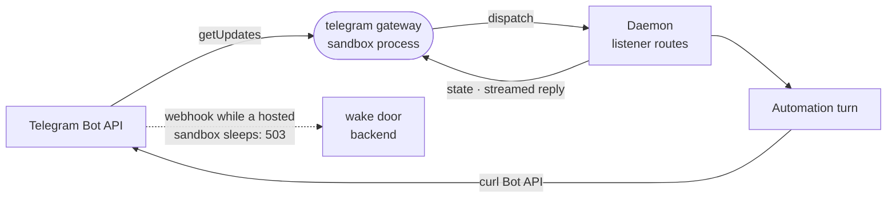

# telegram

Connects a Telegram bot to the sandbox: a capability card and skill for the agent, and a long-polling gateway process that turns a mention into a request the agent works on in the chat.



- Four pieces. The capability card takes one token from `@BotFather`, which its Test checks with `getMe`. The skill (`skills/telegram/SKILL.md`)
  teaches the agent to call the Bot API with `curl` and `$TELEGRAM_BOT_TOKEN`. The gateway is a `processes` entry
  the daemon runs while a Telegram card or Telegram automation exists. The backend ([src/server.ts](src/server.ts))
  answers only the wake door below.
- The card declares what its Bot API methods do (`broker.actions`: the sends, the edits, deleting a message, a reaction,
  and `getFile`, a read), so the sandbox's credential gateway records each call in Activity with its chat and text, and
  holds it to the owner's action rules (`telegram.message.send` and the rest) before the token is attached to the path.
- The gateway long-polls once per bot, and only while an enabled Telegram automation exists. It uses no SDK, since
  the Bot API is HTTPS and JSON, and needs no public URL while the sandbox is awake. It is built on
  [connector-runtime](../../_shared/connector-runtime).
- Telegram allows one reader per bot. A webhook or a second poller answers 409, which the gateway treats as fatal. It
  never clears a webhook it did not set; the only one it clears is its own, from a hosted sleep (below).
- A sandbox the platform hosts sleeps when nobody uses it, and the polls stop with it ([src/wake.ts](src/wake.ts),
  2026-11-27). Right before it sleeps (the extension api's `beforeSleep`), the gateway stops every poll and points
  each bot it polled at the sandbox's wake door: `setWebhook` with the URL `api.sleep.wakeUrl("wake")` hands out, a
  `secret_token`, and the update kinds the poll asks for. It writes down which bots it pointed there first, by bot id,
  with the door's address but not the wake secret in its query. Telegram's next delivery to the door wakes the machine
  and is answered 503, so Telegram keeps the update and tries again. Before a bot's first poll after that, the gateway
  reads `getWebhookInfo` and calls `deleteWebhook`, pending updates kept, only when the webhook is still at this
  sandbox's door; anyone else's stays, and the poll's 409 is fatal as ever. It then polls from Telegram's queue
  instead of skipping it, since that queue is what arrived while the sandbox slept. A 409 at start from a webhook at
  this sandbox's door is cleared the same way even when nothing was written down.
- The door ([src/server.ts](src/server.ts), the public route `wake`, `wakes: true`) dispatches nothing; polling stays
  the one way in. The `secret_token` is the bot's id and an HMAC keyed by its token, so the door tells which bot a
  delivery is for without storing anything. A delivery from a bot of this sandbox is refused 503 until the gateway
  has deleted the webhook. One under a secret the bot's token did not make (a guess, or a webhook set under a token
  since replaced) is refused 403, which Telegram also keeps, and a call with no secret 401. A delivery for a bot no
  card here holds any more is answered with `{"method":"deleteWebhook"}`,
  which Telegram runs for that bot, so it stops waking the sandbox; that one update is let go.
- If the hook fails or runs out of time (it shares about ten seconds with every extension), a bot it wrote down but
  did not point at the door is not heard while the sandbox sleeps, and what was sent to it meanwhile is polled from
  the queue at the next start; a bot it never wrote down starts from now, as before. A sleep that
  has not come two minutes past the hook's deadline is taken as one that never will: the gateway polls again, which
  clears its webhook. A sandbox that never sleeps (one on somebody's own computer) is never told, and nothing changes
  there. The record is the gateway's own rather than `api.sleep.boot()`'s answer, since it also covers a gateway that
  restarted after the hook and needs no wait for the platform's word.
- Bots cannot read a chat's past. The context handed to the agent is the recent messages this process saw go by,
  and a restart empties it.
- A message is for the bot when it is private, @mentions the bot, replies to it, or replies to anything in a reply
  chain the bot answers in. A private chat is one conversation. In a group each request is its own: its reply chain,
  rooted at the message that asked ([src/threads.ts](src/threads.ts)). A message names only the message it replies
  to, never the chain's root, so the gateway remembers which chain each message belongs to in a small file in its
  state directory, which survives a restart. In a forum the chain stays in its topic.
- The answer ([src/reply.ts](src/reply.ts)) is the same shared reply Discord's and Slack's are (connector-runtime's
  chat reply): 👀 at once and "typing…", a status card ([src/card.ts](src/card.ts)) once the work outlasts a quick
  answer, edited in place, with **Stop** and **Open in Intentic** buttons, and the answer below it as ordinary
  messages, its Markdown rendered as Telegram's HTML ([src/format.ts](src/format.ts)), or as plain text if Telegram
  refuses the markup. The message ends 👌, 😢, 🫡 (stopped), or 🙏 while a hold waits for the owner: Telegram lets a
  bot react with only a fixed set of emoji, one at a time, and ✅ and ❌ are not among them.
- The card states the one-message limit a reply is split at (`channel.messageLimit`, 4,096, past which `sendMessage`
  refuses) and where people's data goes for the Data protection page (`processors`: Telegram, outside the EEA).
- A button's data is capped at 64 bytes, too short for a conversation id, so Stop carries a short token the gateway
  maps back. A reply in the chain while the turn runs goes into that turn. The bot says hello when it is added to a
  group.
- In a group the bot hears only @mentions and replies until privacy mode is turned off in BotFather.

## Key files

- [intentic-extension.json](intentic-extension.json) — the card, its setup guide, the listener event, the template, the wake route and the gateway process.
- [src/gateway.ts](src/gateway.ts) — the process: one bot token is one connection, reconciled by `runConnectorGateway`.
- [src/client.ts](src/client.ts) — the poll loop, where it starts, Bot API calls and which errors are fatal.
- [src/wake.ts](src/wake.ts) — a hosted sleep: bots pointed at the wake door, their webhooks cleared at start, the door's secret.
- [src/listener.ts](src/listener.ts) — updates to dispatched messages, history rings, Stop and the hello.
- [src/threads.ts](src/threads.ts) — which reply chain a message belongs to, and the memory of it.
- [skills/telegram/SKILL.md](skills/telegram/SKILL.md) — what the agent learns about using Telegram.

## Commands

```sh
pnpm --filter @intentic/ext-telegram build   # dist/gateway.js
pnpm --filter @intentic/ext-telegram test
```
