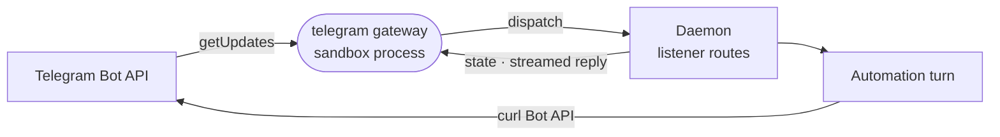

# telegram

Connects a Telegram bot to the sandbox: a capability card and skill for the agent, and a long-polling gateway process that turns a mention into a request the agent works on in the chat.



- Three pieces. The capability card takes one token from `@BotFather`. The skill (`skills/telegram/SKILL.md`)
  teaches the agent to call the Bot API with `curl` and `$TELEGRAM_BOT_TOKEN`. The gateway is a `processes` entry
  the daemon runs while a Telegram card or Telegram automation exists.
- The gateway long-polls once per bot, and only while an enabled Telegram automation exists. It uses no SDK, since
  the Bot API is HTTPS and JSON, and needs no public URL. It is built on
  [connector-runtime](../../_shared/connector-runtime).
- Telegram allows one reader per bot. A webhook or a second poller answers 409, which the gateway treats as fatal;
  it never clears a webhook itself.
- Bots cannot read a chat's past. The context handed to the agent is the recent messages this process saw go by,
  and a restart empties it.
- A message is for the bot when it is private, @mentions the bot, replies to it, or replies to anything in a reply
  chain the bot answers in. A private chat is one conversation. In a group each request is its own: its reply chain,
  rooted at the message that asked ([src/threads.ts](src/threads.ts)). A message names only the message it replies
  to, never the chain's root, so the gateway remembers which chain each message belongs to in a small file in its
  state directory, which survives a restart. In a forum the chain stays in its topic.
- The answer ([src/reply.ts](src/reply.ts)) is the same shared reply Discord's and Slack's are (connector-runtime's
  chat reply): 👀 at once and "typing…", a status card ([src/card.ts](src/card.ts)) once the work outlasts a quick
  answer, edited in place, with **Stop** and **Open in Intentic** buttons, and the answer below it as ordinary
  messages, its Markdown rendered as Telegram's HTML ([src/format.ts](src/format.ts)), or as plain text if Telegram
  refuses the markup. The message ends 👌, 😢, 🫡 (stopped), or 🙏 while a hold waits for the owner: Telegram lets a
  bot react with only a fixed set of emoji, one at a time, and ✅ and ❌ are not among them.
- A button's data is capped at 64 bytes, too short for a conversation id, so Stop carries a short token the gateway
  maps back. A reply in the chain while the turn runs goes into that turn. The bot says hello when it is added to a
  group.
- In a group the bot hears only @mentions and replies until privacy mode is turned off in BotFather.

## Key files

- [intentic-extension.json](intentic-extension.json) — the card, its setup guide, the listener event, the template and the gateway process.
- [src/gateway.ts](src/gateway.ts) — the process: one bot token is one connection, reconciled by `runConnectorGateway`.
- [src/client.ts](src/client.ts) — the poll loop, Bot API calls and which errors are fatal.
- [src/listener.ts](src/listener.ts) — updates to dispatched messages, history rings, Stop and the hello.
- [src/threads.ts](src/threads.ts) — which reply chain a message belongs to, and the memory of it.
- [src/reply.ts](src/reply.ts) — what the shared reply looks like in Telegram: reactions, the card, HTML answers.
- [skills/telegram/SKILL.md](skills/telegram/SKILL.md) — what the agent learns about using Telegram.

## Commands

```sh
pnpm --filter @intentic/ext-telegram build   # dist/gateway.js
pnpm --filter @intentic/ext-telegram test
```
