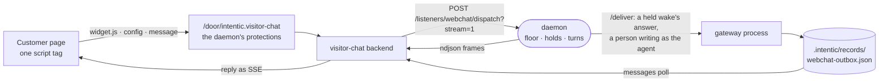

# visitor-chat

Visitor chat: the chat widget a customer embeds on their own site, whose visitors wake an agent that answers them, as a built-in extension.



- The widget is served at `/door/intentic.visitor-chat/widget.js`, one of the public routes the manifest declares (`contributes.publicRoutes`). Its source is the [`@intentic/webchat-widget`](../../_sandbox/webchat-widget) package, which shares its embed helpers with the bug reporter through the wire contract's `embed` module; `scripts/widget.mjs` copies its build into `dist/` after the backend's, and turbo builds it first. A snippet pasted before 2026-11-26 names `/webchat/widget.js`, which the daemon forwards here (its `moved-doors.routes.ts`), as it forwards the old widget's other calls.
- The daemon's door checks what it can on its own before the backend hears of a call: the chat exists, listens on `webchat` and is on; a message's or a poll's browser Origin is on the chat's allowed sites; the caller's minute and the body's size; and on `*/proven` a solved proof of work signed to the visitor's thread. The backend holds the chat's own policy (`src/server/door.ts`): its sign-in, its Turnstile check with the site's own secret, its per-thread and per-day ceilings, and the widget's settings with their defaults.
- A message wakes the chat's automation through this extension's own listener, which declares `strangers: "visitor"`: the daemon's listener door holds it to the owner's floor for a website visitor, the automation's own approval, the day's wake ceiling, held wakes and the fire journal, as any chat extension's message is held (`src/server/wake.ts`). The message names its automation, so it wakes that chat alone. The answer streams back as ndjson frames and goes on to the visitor as the widget's SSE.
- A visitor's thread is the widget's conversation id. The backend keeps a record per thread under its state directory (`src/server/threads.ts`): when it last spoke, how many messages it sent, and which generation it is on. A thread quiet past the chat's `sessionTtlMinutes` (24 hours unset, at most the listener's own seven days) starts a fresh conversation with the widget's transcript as its `history`, and spends a new bot check.
- Whatever reaches a visitor after their stream closed (a held wake's answer once a person lets it, a person writing as the agent) is delivered to the listener's gateway like any channel's reply. The gateway (`src/gateway/gateway.ts`, the manifest's `gateway` process) writes it into the reply outbox the daemon kept until 2026-11-26, `.intentic/records/webchat-outbox.json`, in the same shape, and the widget's poll (`*/messages`) reads it. The install probes stay at `.intentic/records/webchat-installs.json`.
- Who a signed-in visitor is comes from the daemon's `POST /listeners/webchat/identity`: it verifies a Google ID token against the site's own client id and says whether the address is the owner's or a member's, which the backend passes to the agent as a claim. The roster never reaches the extension.
- The install panel (a side view, `src/InstallPanel.vue`) shows a chat's embed snippet and which sites loaded it, with one click to allow a refused site. The Automations view opens it with the `visitor-chat.install` command.
- It is built in and on. Switched off, it answers nothing and its gateway stops; the daemon records an error run on each of its chats' automations saying which extension is off, and the widget's old path says so in the site's console.
- A late reply to a conversation the daemon opened before the move names no thread; the gateway finds its chat by the replies already waiting for that visitor, else the sandbox's only Visitor chat, and refuses it with a sentence when neither says (`src/gateway/deliver.ts`).

## Key files

- [intentic-extension.json](intentic-extension.json) — the listener, the public routes, the gateway, the template.
- [src/server/door.ts](src/server/door.ts) — the public routes' handler: the chat's own gates and the widget's settings.
- [src/server/wake.ts](src/server/wake.ts) — a message dispatched on the listener, its frames as the widget's SSE.
- [src/server/threads.ts](src/server/threads.ts) — a visitor's thread: generations, its ceiling, its bot check.
- [src/gateway/gateway.ts](src/gateway/gateway.ts) — the gateway that takes a late reply into the outbox.

## Commands

```sh
pnpm --filter @intentic/ext-visitor-chat build
pnpm --filter @intentic/ext-visitor-chat test
```
