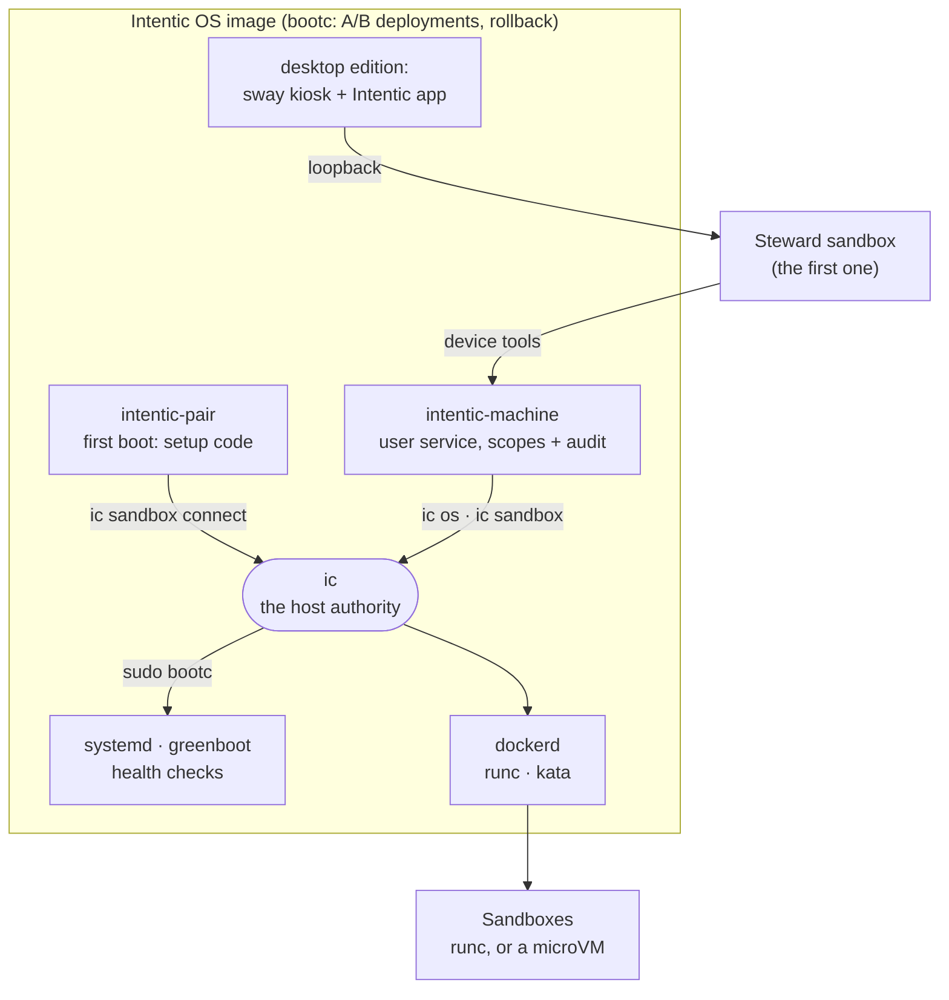

# Intentic OS

An immutable Linux that boots straight into Intentic: Docker, `ic`, the machine agent and a first sandbox that manages the box, with nothing else to install or keep up to date by hand.



On a Windows PC a sandbox sits on Windows, WSL's VM and Intentic's engine distro. On Intentic OS the same parts
run on the metal: dockerd is a plain systemd unit, `ic` is in `/usr/bin`, and the machine agent runs as a user
service of the `intentic` user, started at boot (linger), not at a login. The agent in the first sandbox manages the
box through the machine agent's device tools, which are thin callers of `ic`. It never gets the Docker socket. The
deterministic layer (systemd restarts, `ic sandbox watch`, greenboot's rollback) keeps the box converging when the
agent gets something wrong.

| Package | Role |
| --- | --- |
| [os-image](os-image) | The bootc images (`ghcr.io/intentic/os`, `ghcr.io/intentic/os-desktop`), their files, build and boot test |

## Editions and channels

- **server** (`ghcr.io/intentic/os`): headless. Reached from app.intentic.dev and the phone apps, paired from a
  page on the local network or the console.
- **desktop** (`ghcr.io/intentic/os-desktop`): the server image plus a sway kiosk session that opens the Intentic
  desktop app tiled below a system bar, sandbox Spaces, notifications, an optional screen PIN, and Chromium for the owner's own browsing.
- A channel is the image tag: `stable` or `beta`. `ic os channel beta` switches, keeping the edition.

## The host interface

Everything that changes the OS goes through `ic os`, and everything that calls it (the machine agent's tools, the
desktop app, greenboot, the systemd units) reads its JSON rather than bootc's. `ic os` refuses with exit code 3 on a
machine that is not Intentic OS (no `/usr/lib/intentic-os/release.json`).

| Verb | What it does | Needs root |
| --- | --- | --- |
| `ic os bar` | Desktop system bar: an i3bar JSON stream with navigation-only click actions | no |
| `ic os lock status --json` | Desktop screen lock: `{ "enabled": bool, "idleMinutes": number }` | no |
| `ic os lock set-pin` | Set or change the screen PIN (4–12 digits on stdin, kept as a salted hash); turns the lock on | no |
| `ic os lock off` | Turn the lock off, forget the PIN, and open a lock screen that is up | no |
| `ic os lock check` | Exit 0 when stdin is the screen PIN: what `/etc/pam.d/swaylock` asks, with a lockout after five misses | no |
| `ic os lock idle <minutes>` | Set the idle delay, 1–240 minutes; does not enable a lock without a PIN | no |
| `ic os status --json` | One line of JSON, the shape below | no (bootc status through `sudo -n`) |
| `ic os update --check --json` | Asks the registry whether a newer image is out: `{"available", "version", "digest"}` | sudo |
| `ic os update` | Downloads and stages the newer image for the next boot; nothing restarts | sudo |
| `ic os update --apply` | Stages it, then reboots into it (see Reboots); no reboot when nothing new was staged | sudo |
| `ic os update --scheduled` | What the daily timer runs: `ic os update`, or nothing when the policy says `updates: off` | root |
| `ic os rollback [--apply]` | Queues the previous deployment for the next boot; `--apply` reboots into it | sudo |
| `ic os channel <stable\|beta>` | Stages the same edition from another channel (`bootc switch`) | sudo |
| `ic os reboot` | Reboots, the orderly way (see Reboots) | sudo |
| `ic os record` | Writes which sandboxes run now to `/var/lib/intentic-os/expected-running.json` | docker |
| `ic os health [--wait <s>]` | The boot's health verdict; exit 0 when healthy (greenboot calls it) | docker |
| `ic os pair` | First boot: waits for a setup code on the console and on a LAN page, then `ic sandbox connect` | docker |
| `ic os screen serve` | Desktop sway session: serves restricted, labelled Wayland sockets for the running sandboxes the owner allowed, and holds their windows to the rules | intentic + docker |
| `ic os screen status --json` | `{"available":bool,"reason":string\|null,"sandboxes":[{"slug","allowed":bool,"socket":bool}]}`; exit 4 on the server edition | no |
| `ic os screen allow <slug>` / `deny <slug>` | Let a sandbox show windows on the screen, or stop it (closing any it has open); none may until allowed | no |
| `ic os network status --json` | How the machine is online: `{"connected", "kind": "wifi"\|"ethernet"\|"none", "name", "signal"}` | no |
| `ic os network wifi list --json` | Scans, then the networks in reach: `{"adapter", "enabled", "networks": [{"ssid", "signal", "secured", "known", "active"}]}` | polkit rule |
| `ic os network wifi connect [--password-stdin] -- <ssid>` | Joins a network; a password only on stdin. Exit 5 when it needs one, or refused the one given | polkit rule |
| `ic os network wifi forget -- <ssid>`, `wifi on\|off` | Forgets a network's saved profile; turns Wi-Fi on or off | polkit rule |
| `ic os sound status --json` | `{"volume": 0-100, "muted", "output"}` of what plays now | no |
| `ic os sound set [--volume N] [--mute\|--unmute] [--json]`, `sound outputs --json`, `sound output <id>` | The volume and mute; every speaker and headphone, and which one plays | no |
| `ic os display list --json`, `display set <output> [--mode WxH@Hz] [--scale N]` | The screens, their modes and scale; a change kept in `/etc/intentic/sway.d/50-display.conf` and shown at once. Exit 4 on the server edition | no |
| `ic os keyboard status\|layouts --json`, `keyboard set <layout> [--variant v]` | The keyboard layout, xkb's list of them; a change kept in `/etc/intentic/sway.d/40-keyboard.conf` and applied at once. Exit 4 on the server edition | no |
| `ic os drives list --json` | The USB drives and memory cards plugged in, never the machine's own disks | no |
| `ic os drives import <device> --to <slug> [--path <folder>] [--json]` | Copies a drive into a sandbox's `/work/Imports/<label>-<YYYY-MM-DD>/`. Exit 6, nothing copied, when it would not fit | docker, polkit rule |
| `ic os drives eject <device>` | Closes every part of the drive and powers it off | polkit rule |

### `ic os status --json`

```json
{
    "os": "intentic-os",
    "edition": "server",
    "version": "2026.10.13.0",
    "channel": "stable",
    "image": "ghcr.io/intentic/os:stable",
    "booted": { "image": "ghcr.io/intentic/os:stable", "version": "2026.10.13.0", "digest": "sha256:…", "timestamp": "2026-10-13T09:12:00Z" },
    "staged": null,
    "rollback": { "image": "ghcr.io/intentic/os:stable", "version": "2026.10.06.0", "digest": "sha256:…", "timestamp": null },
    "rollbackQueued": false,
    "rebootRequired": false,
    "health": { "verdict": "green", "failed": [] },
    "isolation": "container",
    "vmRuntime": true
}
```

- `edition`, `version` and the default `channel` come from `/usr/lib/intentic-os/release.json`, which the image
  build writes. `channel` is read from the booted image's tag when it has one. `image` is the image the machine
  follows (bootc's `spec.image`), so right after `ic os channel beta` it names `:beta` while `channel` still says
  what is booted.
- `booted`, `staged` and `rollback` come from `bootc status --json` (`status.booted|staged|rollback`), each
  `{image, version, digest, timestamp}` with `null` for what bootc does not say. `staged` and `rollback` are `null`
  when there is none.
- `rebootRequired` is `staged != null || rollbackQueued`.
- `health` is the last verdict `ic os health` wrote for this boot (`/run/intentic-os/health.json`), `unknown` before
  it ran. `failed` says each failed check in words (`sandbox <slug> is not running`).
- `isolation` is the host policy below, `vmRuntime` whether dockerd has the `kata` runtime.

### Reboots

`ic os update --apply`, `ic os rollback --apply` and `ic os reboot` first leave every running sandbox the daemon's
resume ask (`/history/restart-resume.json`, as every other restart `ic` makes does), then `ic os record`, then
`systemctl reboot`. The `intentic-os-record` unit also runs `ic os record` at every orderly shutdown, so a reboot
from anywhere else is covered too.

### Health and rollback

greenboot runs `ic os health --wait 600` as a required check on every boot: dockerd answers, and every sandbox in
`expected-running.json` is running again with its daemon answering within the wait. A failed required check
makes greenboot reboot, and after three failed boots it rolls back to the previous deployment. The verdict is also
written to `/run/intentic-os/health.json` for `ic os status`.

### Pairing

`ic os pair` runs only while this machine has no sandbox (`intentic-pair.service`, as the `intentic` user). It
prints, on the console, where to get a setup code (app.intentic.dev, New sandbox, On my own machine) and the local
page's address, `http://intentic.local` or the IP. It takes a code typed on the console, or pasted on that page (the
whole setup command is accepted; the code is read out of it), and runs `ic sandbox connect <code> -y`, which starts
the sandbox and connects this machine as its device, so the new sandbox can manage it. The page is served only until
pairing succeeds, and `pairOnLan: false` turns it off. It answers only to this machine's own names and addresses and
refuses a form posted from another site, so a page elsewhere cannot pair the box to someone else's account; anyone on
the same network who reaches it first still can, which is why the console is the place to pair a box on a shared
network. When port 80 cannot be opened the page moves to 8080 and says so.

### Settings

What a person changes in the desktop app's This computer cards, the agent in the machine's own sandbox changes through
the machine agent's tools, and both go through these verbs, as the `intentic` user and without sudo: the network
(NetworkManager, through `nmcli`), the sound (WirePlumber, through `wpctl`), the screens and the keyboard (the desktop
edition's sway session, through `swaymsg`), and removable drives (udisks, through `udisksctl`, and `lsblk`). Nothing
that calls `ic os` speaks to those tools itself; the shapes are the contract's (`intentic-os.ts`), with an example of
each in `golden/intentic-os.json`.

- **Who may.** The machine agent starts at boot with no session on a seat, which polkit treats as an inactive caller
  that needs an administrator. `/usr/share/polkit-1/rules.d/50-intentic.rules` lets the `intentic` user turn Wi-Fi on
  and off, scan, join and leave networks and add or delete the machine's connection profiles, and mount, unmount and
  power off removable drives (udisks' `drive.removable`), and nothing else. A Wi-Fi profile is the machine's, so it
  rejoins at boot before anyone signs in. The user is in the `audio` group, so its sound server opens the sound card
  with nobody at the screen.
- **A password never rides on a command line**, which anyone on the machine can read: `wifi connect --password-stdin`
  takes it on stdin and hands it to NetworkManager the same way (a `passwd-file` on nmcli's stdin). A new profile is
  added without it and deleted again when the network refuses it, so a wrong password is not retried at every boot.
- **The screen's session** is found without help: the machine agent starts before sway and has no `SWAYSOCK`, so ic
  takes the newest `sway-ipc.<uid>.<pid>.sock` in `/run/user/1990` whose sway still runs. A screen or keyboard setting
  is written under `/etc/intentic/sway.d` (group-writable by `intentic`), which the session's config includes, so it
  holds at the next start.
- **An import** opens the drive read-only when it is not open already, measures it, and stops with exit 6 before
  copying a byte when the sandbox would be left with less than 256 MB. It copies with `docker cp`, gives the files to
  whoever owns the sandbox's `/work`, and closes the drive again if it opened it. `--json` prints
  `{"progress": {"bytes", "total"}}` every few seconds, then the result `{"device", "sandbox", "path", "bytes", "files"}`
  last.

| Exit | Means |
| --- | --- |
| 3 | Not Intentic OS (every verb) |
| 4 | A screen verb on the server edition, which has no screen |
| 5 | `wifi connect`: the network needs a password it was not given, or refused the one given |
| 6 | `drives import`: it would not fit in the sandbox; nothing was copied |

### Host policy: `/etc/intentic/os.json`

Defaults ship in `/usr/lib/intentic-os/os.json`; the owner's own values in `/etc/intentic/os.json` win, key by key.

```json
{ "isolation": "container", "pairOnLan": true, "updates": "stage" }
```

- `isolation`: how sandbox containers run. `container` is runc. `vm` runs every sandbox container in a Kata microVM
  (`--runtime=kata`). `auto` uses a microVM for sandboxes started privileged (the Docker capability), where runc would
  hand the sandbox the host's root, and runc for the rest. Without the `kata` runtime, or for a run command a microVM
  cannot honour (the host's network, PID or IPC namespace, the Docker socket, GPUs), `ic` warns and uses runc. Only
  sandbox and runner containers change; the tunnel sidecar stays on runc. The image ships `container` until a sandbox
  has been seen running under Kata on real hardware (2026-10-13: the only test machine was a nested VM, where Kata's
  guest does not boot); an owner opts in with `{"isolation": "auto"}` in `/etc/intentic/os.json`. A value `ic` does
  not understand reads as `auto`, the stricter choice.
- `updates`: `stage` downloads a new OS image daily and waits for an approval to reboot into it (`ic os update
  --apply`, from the agent's card or the desktop app); `off` checks nothing.

### Sandbox windows

On the desktop edition, the sway session keeps `ic os screen serve` running. No sandbox may draw until the owner
allows it, in This computer's Sandbox windows card or with `ic os screen allow <slug>`; the list is
`/var/lib/intentic-os/screen-allowed.json`. Each running runc sandbox the owner allowed gets its own
security-context-v1 listener at `/run/user/1990/intentic/screen/<slug>/wayland-0`, under directories owned by
`intentic` with mode 0700. The host policy mounts every sandbox's **directory** read-only at `/run/intentic/screen`
when Docker starts the container: empty until its sandbox is allowed, so allowing or denying one takes effect within
seconds without a recreate, a sway restart can replace the socket without replacing the container, and a sandbox can
never write into the session's runtime folder. Server editions and other operating systems receive no mount. Kata
containers receive no mount (and a warning, if their owner allowed them): Unix sockets cannot cross their VM
boundary; waypipe over vsock is future work.

The service holds every sandbox window to its rules itself, rather than leaving them to the app on screen: it watches
sway's window events and takes back fullscreen at once, closes the windows of a sandbox whose owner has stopped letting
it draw, closes every socket while it cannot watch sway, and refuses to serve on a sway older than 1.11, which could not
mark the windows.

Inside the sandbox, `on-screen <command>` runs a native Wayland app on the owner's screen. Its amber titlebar names
the sandbox using compositor-supplied metadata, and it starts tiled. The sandbox's desktop tools can still see only
its own virtual desktop, so agents are told to check the app there first. Missing security-context-v1 support is an
error, never a reason to expose the unrestricted display. The [image README](os-image/README.md#sandbox-window-boundary)
lists the protocols sway withholds and the remaining limits.

### Files

| Path | What |
| --- | --- |
| `/usr/lib/intentic-os/release.json` | `{ "name": "Intentic OS", "edition", "version", "channel", "repository" }`, written at build |
| `/usr/lib/intentic-os/os.json` | The policy defaults |
| `/etc/intentic/os.json` | The owner's policy |
| `/var/lib/intentic-os/expected-running.json` | `{ "recordedAt": <ms>, "slugs": [...] }` |
| `/run/intentic-os/health.json` | `{ "verdict": "green"\|"red", "failed": [...], "at": <ms> }` |
| `/run/user/1990/intentic/screen/<slug>/wayland-0` | The sandbox's security-context Wayland listener; its directory is bind-mounted |
| `/etc/sudoers.d/intentic-os` | The `intentic` user may run `bootc` and `systemctl reboot` without a password |
| `/etc/intentic/sway.d/60-lock.conf` | Desktop only: screen-lock enabled state, idle minutes and the user-service reload command; no PIN |
| `/etc/ssh/sshd_config.d/40-intentic.conf` | The `intentic` user signs in over SSH with a key only, never a password or keyboard-interactive login |
| `/var/lib/intentic-os/screen-lock/` | Desktop only, the `intentic` user's alone (0700): the screen PIN's salted hash (`pin`) and its misses (`attempts.json`) |
| `/etc/pam.d/swaylock` | Desktop only: the lock screen takes the screen PIN through `ic os lock check`, never an account password |
| `/usr/share/polkit-1/rules.d/50-intentic.rules` | The `intentic` user may change Wi-Fi and open, close and power off removable drives without a password |
| `/etc/intentic/sway.d/40-keyboard.conf`, `50-display.conf` | The keyboard layout and each screen's mode and scale, written by `ic os keyboard\|display set` |
