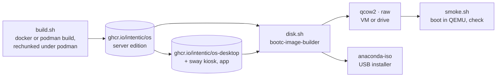

# os-image

The Intentic OS images: a bootc container image of Fedora that boots straight into Docker, `ic` and a first sandbox that manages the machine, plus the scripts that build it, turn it into a disk or an installer, and boot it in a VM.

- **The image is the OS.** bootc boots the image's `/usr` read-only and keeps `/etc` and `/var`. An update is a newer
  image pulled into a second deployment that boots next, with the old one kept for rollback. So the OS is built like
  any container image (`Containerfile`), versioned by tag, and released by pushing a tag: a machine on `:stable`
  stages what `:stable` points at.
- **Everything comes from Fedora's own repositories.** `moby-engine` is Fedora's own Docker build, which Fedora's
  updates keep current (it need not match the version the sandbox image pins for its nested engine), `kata-containers`
  can run a privileged sandbox as a microVM (the `auto` isolation policy in [../README.md](../README.md), off by
  default until verified on bare metal), and `greenboot` runs `ic os health` on every boot and rolls back a deployment
  that fails it three boots running. `greenboot-default-health-checks` is left out because its DNS and repository
  checks would roll back a box that is merely offline.
- **An update downloads what changed.** A fresh `dnf install` rewrites its whole layer, so a plain build made
  every update fetch the server's 818 MB package layer even when only `ic` had changed. Under rootful podman (CI),
  `build.sh` rechunks each edition with `rpm-ostree compose build-chunked-oci`: the finished filesystem is re-packed
  into 96 layers by package, and Intentic's own files (`ic`, `rootfs/`, `release.json`) go into one small
  `intentic-os` layer with the few files a build rewrites every time (the desktop's font caches), marked by the
  `user.component` attribute in the Containerfiles. The layout follows the published image of the same channel, so
  packages keep their layer from release to release. An update that changed only `ic` came to 18 MB for the server
  edition and 22 MB for the desktop, against 282 MB and about 950 MB before. CI pushes the OCI layout rpm-ostree
  wrote, not podman's store, whose push drops the layer annotations the next build reads the layout from. A docker
  build skips rechunking and boots the same.
- **Nothing reboots by itself.** bootc's own update timer (which pulls and reboots) is masked;
  `intentic-os-update.timer` only stages. Rebooting into an update is `ic os update --apply`, from the steward agent
  with the owner's yes or from the desktop app.
- **The `intentic` user (uid 1990) is who Intentic runs as.** It is in the `docker` group, has sudo for `bootc`, reboot and the narrow screen-PIN helper, and its user manager starts at boot (linger), so the machine agent that `ic sandbox connect` installs
  as a systemd user unit runs without anyone logging in. The uid is fixed because a system unit has no way to name
  the runtime directory of its own `User=`.
- **The machine's settings need no administrator.** `NetworkManager-wifi` and `wpa_supplicant` (which fedora-bootc
  leaves out) and `udisks2` are installed, and a polkit rule
  ([rootfs/usr/share/polkit-1/rules.d/50-intentic.rules](rootfs/usr/share/polkit-1/rules.d/50-intentic.rules)) lets
  the `intentic` user change Wi-Fi and mount, unmount and power off removable drives, nothing broader, since the
  machine agent calling `ic os network|drives` has no seat session for the stock policies to trust. The user is in the
  `audio` group, so PipeWire, which its user manager socket-activates, opens the sound card with nobody at the screen.
  On the desktop edition `/etc/intentic/sway.d` belongs to the `intentic` group, where `ic os keyboard|display set`
  keep what a person chose.
- **First boot pairs.** `intentic-pair.service` runs `ic os pair` until a sandbox exists: on tty1 (server edition) and
  on a page on port 80 (both), it takes the setup code from app.intentic.dev and runs `ic sandbox connect`, which
  also connects this machine as that sandbox's device.
- **Kata's initrd is built on the machine.** The package's own `%post` would build it from the build host's kernel,
  so it is installed without scripts and `kata-osbuilder-generate.service` runs before Docker on each boot, building
  only when the booted kernel has none yet.
- **The desktop edition is the server edition plus a screen.** greetd logs `intentic` into a sway session
  (`desktop/rootfs/usr/share/intentic-os/sway/config`) that tiles the Intentic desktop app below a system bar
  (`INTENTIC_KIOSK=1`, restarted if it exits). Super+1–9 opens the account’s sandboxes in roster order, Super+0
  opens This computer, Super+B or Super+W opens Chromium in the Web Space, Super+Tab goes back and forth, and
  Super+Space opens a new chat with its message box focused. Sandbox windows join their sandbox’s Space by the
  compositor’s security context; fullscreen is undone so the system bar and Space label remain visible. The app
  follows binding and window events over sway IPC, without starting a process for each sandbox shortcut.
  Pairing happens in the app or on the LAN page, so the console drop-in is removed.
- **The bar and notifications belong to the session.** swaybar reads `ic os bar`, an i3bar JSON stream: needs-you
  and working counts (hidden at zero), network, sound, a staged update, and the clock. Missing or failing readers
  quietly lose their block. Clicks open This computer or the first sandbox needing attention on its Agents board
  through a navigation-only `intentic://shell` link. Mako displays the app’s existing notifications and their default
  click action, at the top right below the bar.
- **Screen locking is optional until a PIN is set.** This computer’s Security card calls `ic os lock`. A PIN of
  4–12 digits goes on stdin and is kept as a salted PBKDF2 hash in `/var/lib/intentic-os/screen-lock/`, which only
  the `intentic` user can read; it is never an account password and never in the settings file. The lock screen
  checks it through `/etc/pam.d/swaylock`, whose one line runs `ic os lock check` with pam_exec: four misses in a row
  are free, and the fifth and each one after start a wait (30 s, doubling up to an hour) during which no PIN is checked. The
  `intentic` password stays locked, so the PIN opens no console login, no agreety prompt and no SSH session.
  `60-lock.conf` in the owner’s sway directory records only the enabled state and idle minutes (1–240, initially 5).
  Its `exec_always` restarts one systemd user service, so reloads cannot stack swayidle processes, and while a PIN is
  set its `exec` locks the screen as the session starts: restarting the machine is no way past the PIN.
  `screen-lock` locks only while a PIN is stored, so a missing PIN can never lock the screen shut; swayidle runs it
  before sleep and after the idle delay. Turning locking off forgets the PIN and opens a lock screen that is up.
  greetd’s initial automatic login stays the same. If that session ends, its agreety fallback has no password that
  works, and restarting the machine starts a session that is locked again.

## Sandbox window boundary

The desktop sway include `desktop/rootfs/usr/share/intentic-os/sway/config.d/50-sandbox-windows.conf` starts
`/usr/libexec/intentic-os/screen-serve`. Its restart loop inherits the session's display and stops when that sway
IPC socket no longer answers, including a stale file left after a crash. This avoids a user unit importing a stale
display environment; `ic` also holds a file lock so duplicate starts cannot replace a live server's sockets.
The service serves only the sandboxes the owner allowed (`/var/lib/intentic-os/screen-allowed.json`, empty on a new
machine). It polls Docker every three seconds, identifies
each running primary container by its full container id, and commits a security context with engine
`dev.intentic.sandbox`, app id `<slug>` and instance id `<container id>`. Container replacement, disappearance of a
socket file, and a restarted compositor all create a new listener. Docker listing failures revoke listeners until
Docker answers again. A close socketpair held by the service revokes **new connections** when dropped; Wayland's
protocol deliberately leaves clients already connected alive. Stopping their container ends those clients.
The listener binds through a short `/proc/self/fd/<directory fd>` path so even the longest valid sandbox slug fits
Linux's Unix socket address limit; the socket file still lives in the sandbox's own directory.

Before it serves, the service subscribes to sway's window events (through `_sandbox/ic/sway-ipc`, the IPC client the
desktop app's shell shares). Every sandbox window that goes fullscreen is taken out of it at once, every window of a
sandbox the owner has not allowed (or no longer allows) is closed, and each poll squares the whole tree with the same
rules. If that subscription falls, every socket closes in the same moment and none opens until it stands again. The
service also refuses to start on a sway older than 1.11, which cannot mark sandbox windows.

As checked on 2026-10-16, [Fedora 44 ships sway 1.11-3.fc44](https://packages.fedoraproject.org/pkgs/sway/sway/fedora-44.html).
Its [package spec](https://src.fedoraproject.org/rpms/sway/raw/f44/f/sway.spec) uses the upstream 1.11 source with no
protocol-filter patch. In that version, [`is_privileged` and `filter_global` in sway/server.c](https://github.com/swaywm/sway/blob/1.11/sway/server.c)
withhold these globals from security-context clients:

| Protocol globals | Power withheld |
| --- | --- |
| `wp_drm_lease_device_v1` (when the DRM backend is built) | DRM leases |
| `zwlr_output_manager_v1`, `zwlr_output_power_manager_v1`, `zxdg_output_manager_v1` | Output management, power and extended output descriptions |
| `zwp_input_method_manager_v2` | Input methods |
| `ext_foreign_toplevel_list_v1`, `zwlr_foreign_toplevel_manager_v1` | Listing and controlling other windows |
| `zwlr_data_control_manager_v1`, `ext_data_control_manager_v1` | Unfocused clipboard control |
| `zwlr_screencopy_manager_v1`, `ext_image_copy_capture_manager_v1`, `zwlr_export_dmabuf_manager_v1` | Screen capture |
| `wp_security_context_manager_v1` | Creating nested security contexts |
| `zwlr_gamma_control_manager_v1` | Output gamma |
| `zwlr_layer_shell_v1` | Desktop layers and panels |
| `ext_session_lock_manager_v1` | Locking the session |
| `zwp_keyboard_shortcuts_inhibit_manager_v1` | Inhibiting compositor shortcuts |
| `zwp_virtual_keyboard_manager_v1`, `zwlr_virtual_pointer_manager_v1`, `ext_transient_seat_manager_v1` | Synthetic input and transient seats |

Sway separately exposes `xwayland_shell_v1` only to its own Xwayland server. Normal focused keyboard, pointer and
clipboard interactions remain available to sandbox windows. Security-context metadata does not make a privileged
runc container safe from the host: that container already has the host powers described in the OS isolation policy.
The title is a compositor decoration using `%sandbox_app_id`, with Pango markup enabled and an amber frame; clients
cannot supply that identity through their own app id or title. The palette applies to visible server decorations,
and the kiosk config gives no other window one (`default_border none`, `default_floating_border none`), so amber is
a sandbox's alone. `no_focus` keeps a new sandbox window from taking the keyboard from what someone is typing into.

No extra desktop package is needed beyond sway 1.11 or later. The `ic` client uses Wayland's Rust backend, without a
runtime dependency on libwayland. The sandbox image's Debian trixie repositories have
[no xwayland-satellite package](https://packages.debian.org/search?keywords=xwayland-satellite&searchon=names&suite=trixie&section=all),
so `on-screen --x11` reports that limit; X11-only apps use the sandbox's virtual desktop. Apps must supply their own
native Wayland toolkit support. Screen sockets are offered only to runc containers whose owner allowed them. A full
desktop image boot must still check physical GPU rendering, Fedora SELinux access to the bind-mounted socket, and
the shell's workspace/fullscreen handling together.

## Installing

`disk.sh --type anaconda-iso` makes an unattended installer ([installer/bib-config.toml](installer/bib-config.toml)). It
erases the first internal disk only, never the stick it booted from. Where the machine has a TPM2, the root is LUKS2
with a random one-time passphrase, bound to the TPM's PCR 7 (the Secure Boot state) during the install, so the first
boot unlocks by itself. `intentic-tpm-enroll` then adds a recovery key, shows it once on the console, and removes the
one-time passphrase. Without a TPM nothing could unlock an unattended disk, so the root is left unencrypted.

Secure Boot works with the stock keys: Fedora's shim and kernel are signed by Microsoft's UEFI CA. A kernel module
built outside Fedora (NVIDIA's) would need a machine owner key, which this image does not do yet.

`disk.sh --type raw` is a disk image to write straight onto a drive; `qcow2` is a VM disk.

## Hardware

| Machine | Edition | Result |
| --- | --- | --- |
| QEMU/KVM, 2 vCPU, 4 GiB, virtio, nested under WSL2 (smoke.sh) | server | boots to `running`; Docker, the Kata runtime and its initrd, the pairing page, `ic os status` and a green `ic os health` under greenboot (2026-10-13). Not paired: that needs a real setup code. Kata's guest does not boot under nested virtualization |
| QEMU/KVM, 4 vCPU, 6 GiB, std VGA, nested under WSL2 | desktop | greetd logs in, sway starts, the Intentic app (1.334.0) fills the screen (2026-10-13) |
| QEMU/KVM, q35, OVMF with Secure Boot on, swtpm TPM2, blank 40 GiB disk (install-test.sh) | server, from the installer ISO | unattended install; first boot unlocks the LUKS2 root through the TPM with nobody typing, shows the recovery key, serves the pairing page; the disk ends with only the TPM and recovery-key slots (2026-10-13) |

Physical machines are added here as they are tried. The base is Fedora 44's kernel, so anything Fedora supports is
expected to boot. Wi-Fi is joined from the desktop app's network card, or with `ic os network wifi connect` on the
console.

## Key files

- [Containerfile](Containerfile) — the server edition: packages, `ic`, units, policy, sudo rules.
- [Containerfile.desktop](Containerfile.desktop) — the desktop edition on top of it.
- [rootfs/usr/lib/systemd/system/intentic-pair.service](rootfs/usr/lib/systemd/system/intentic-pair.service) — first-boot pairing.
- [rootfs/usr/libexec/intentic-os/tpm-enroll](rootfs/usr/libexec/intentic-os/tpm-enroll) — the disk bound to the TPM, the recovery key.
- [rootfs/usr/share/polkit-1/rules.d/50-intentic.rules](rootfs/usr/share/polkit-1/rules.d/50-intentic.rules) — what the `intentic` user may change without an administrator: Wi-Fi, removable drives.
- [build.sh](build.sh), [disk.sh](disk.sh), [smoke.sh](smoke.sh) — build an image, make a disk or installer, boot and check it.
- [install-test.sh](install-test.sh) — the installer end to end, with a software TPM and Secure Boot.
