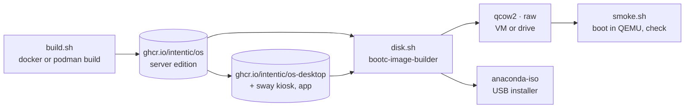

# os-image

The Intentic OS images: a bootc container image of Fedora that boots straight into Docker, `ic` and a first sandbox that manages the machine, plus the scripts that build it, turn it into a disk or an installer, and boot it in a VM.

- **The image is the OS.** bootc boots the image's `/usr` read-only and keeps `/etc` and `/var`. An update is a newer
  image pulled into a second deployment that boots next, with the old one kept for rollback. So the OS is built like
  any container image (`Containerfile`), versioned by tag, and released by pushing a tag: a machine on `:stable`
  stages what `:stable` points at.
- **Everything comes from Fedora's own repositories.** `moby-engine` is Fedora's own Docker build, which Fedora's
  updates keep current (it need not match the version the sandbox image pins for its nested engine), `kata-containers`
  can run a privileged sandbox as a microVM (the `auto` isolation policy in [../README.md](../README.md), off by
  default until verified on bare metal), and `greenboot` runs `ic os health` on every boot and rolls back a deployment
  that fails it three boots running. `greenboot-default-health-checks` is left out because its DNS and repository
  checks would roll back a box that is merely offline.
- **Nothing reboots by itself.** bootc's own update timer (which pulls and reboots) is masked;
  `intentic-os-update.timer` only stages. Rebooting into an update is `ic os update --apply`, from the steward agent
  with the owner's yes or from the desktop app.
- **The `intentic` user (uid 1990) is who Intentic runs as.** It is in the `docker` group, has sudo for `bootc` and
  reboot only, and its user manager starts at boot (linger), so the machine agent that `ic sandbox connect` installs
  as a systemd user unit runs without anyone logging in. The uid is fixed because a system unit has no way to name
  the runtime directory of its own `User=`.
- **First boot pairs.** `intentic-pair.service` runs `ic os pair` until a sandbox exists: on tty1 (server edition) and
  on a page on port 80 (both), it takes the setup code from app.intentic.dev and runs `ic sandbox connect`, which
  also connects this machine as that sandbox's device.
- **Kata's initrd is built on the machine.** The package's own `%post` would build it from the build host's kernel,
  so it is installed without scripts and `kata-osbuilder-generate.service` runs before Docker on each boot, building
  only when the booted kernel has none yet.
- **The desktop edition is the server edition plus a screen.** greetd logs `intentic` into a sway session
  (`desktop/rootfs/usr/share/intentic-os/sway/config`) that keeps the Intentic desktop app full screen
  (`INTENTIC_KIOSK=1`, restarted if it exits) with Chromium on a second workspace (Super+B, Super+Tab to switch).
  Pairing happens in the app or on the LAN page, so the console drop-in is removed.

## Installing

`disk.sh --type anaconda-iso` makes an unattended installer ([installer/bib-config.toml](installer/bib-config.toml)). It
erases the first internal disk only, never the stick it booted from. Where the machine has a TPM2, the root is LUKS2
with a random one-time passphrase, bound to the TPM's PCR 7 (the Secure Boot state) during the install, so the first
boot unlocks by itself. `intentic-tpm-enroll` then adds a recovery key, shows it once on the console, and removes the
one-time passphrase. Without a TPM nothing could unlock an unattended disk, so the root is left unencrypted.

Secure Boot works with the stock keys: Fedora's shim and kernel are signed by Microsoft's UEFI CA. A kernel module
built outside Fedora (NVIDIA's) would need a machine owner key, which this image does not do yet.

`disk.sh --type raw` is a disk image to write straight onto a drive; `qcow2` is a VM disk.

## Hardware

| Machine | Edition | Result |
| --- | --- | --- |
| QEMU/KVM, 2 vCPU, 4 GiB, virtio, nested under WSL2 (smoke.sh) | server | boots to `running`; Docker, the Kata runtime and its initrd, the pairing page, `ic os status` and a green `ic os health` under greenboot (2026-10-13). Not paired: that needs a real setup code. Kata's guest does not boot under nested virtualization |
| QEMU/KVM, 4 vCPU, 6 GiB, std VGA, nested under WSL2 | desktop | greetd logs in, sway starts, the Intentic app (1.334.0) fills the screen (2026-10-13) |
| QEMU/KVM, q35, OVMF with Secure Boot on, swtpm TPM2, blank 40 GiB disk (install-test.sh) | server, from the installer ISO | unattended install; first boot unlocks the LUKS2 root through the TPM with nobody typing, shows the recovery key, serves the pairing page; the disk ends with only the TPM and recovery-key slots (2026-10-13) |

Physical machines are added here as they are tried. The base is Fedora 44's kernel, so anything Fedora supports is
expected to boot; Wi-Fi is configured with `nmcli` until the desktop app's network card exists.

## Key files

- [Containerfile](Containerfile) — the server edition: packages, `ic`, units, policy, sudo rules.
- [Containerfile.desktop](Containerfile.desktop) — the desktop edition on top of it.
- [rootfs/usr/lib/systemd/system/intentic-pair.service](rootfs/usr/lib/systemd/system/intentic-pair.service) — first-boot pairing.
- [rootfs/usr/libexec/intentic-os/tpm-enroll](rootfs/usr/libexec/intentic-os/tpm-enroll) — the disk bound to the TPM, the recovery key.
- [build.sh](build.sh), [disk.sh](disk.sh), [smoke.sh](smoke.sh) — build an image, make a disk or installer, boot and check it.
- [install-test.sh](install-test.sh) — the installer end to end, with a software TPM and Secure Boot.
