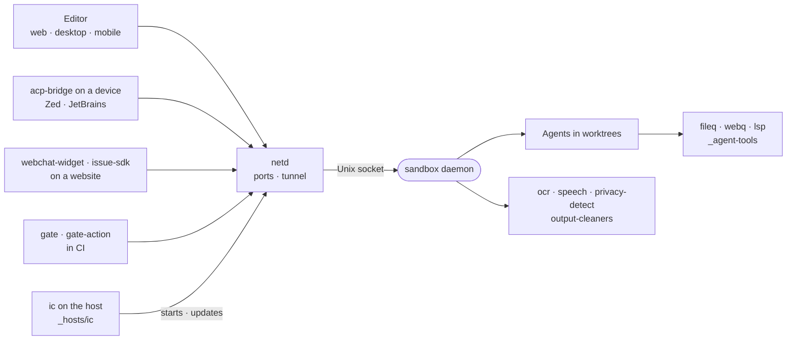

# The sandbox

One private box per project where the code and its coding agents live, owned by the `sandbox` daemon and reached from the editor, CI, websites and the user's devices.

The acp-bridge in the diagram runs on the user's device, so it lives in [_devices/acp-bridge](../_devices/acp-bridge). `ic` runs on the machine under the sandbox, so it lives in [_hosts/ic](../_hosts/ic), and the CLIs an agent runs inside the sandbox (fileq, webq, lsp) are in [_agent-tools](../_agent-tools). The install recipe the daemon shares with the browser's folder upload is [_shared/workspace-setup](../_shared/workspace-setup). The packages here:

| Package | Role |
| --- | --- |
| [agent-context](agent-context) | What an agent is told as a session opens (the project map) and the readings that measure it |
| [cli](cli) | `intentic`, baked into the image: the sandbox's canonical `docker run` and monorepo scaffolding |
| [netd](netd) | Rust network daemon: owns every port and the tunnel, supervises the daemon |
| [gate](gate) | `intentic-gate`: a CI pipeline waits on a release gate's verdict |
| [gate-action](gate-action) | GitHub Action: wait on a release gate or wake an automation |
| [issue-sdk](issue-sdk) | Bug reporter a site embeds to send crashes to a sandbox agent |
| [ocr](ocr) | `ocr`: the text on an image read on this machine (PP-OCRv6), the privacy shield's reader |
| [output-cleaners](output-cleaners) | Trims agent Bash output, keeps the raw text retrievable, and ledgers each cleaner's saving |
| [sandbox](sandbox) | The daemon: runs agents in worktrees, serves the workspace, lands their work |
| [scaffold](scaffold) | App monorepo scaffolding from a template source, for the CLI and the daemon |
| [webchat-widget](webchat-widget) | Visitor chat widget a site embeds to talk to a sandbox agent |
