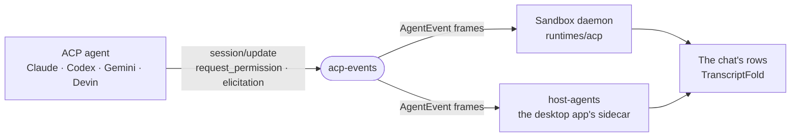

# acp-events

Reads what an Agent Client Protocol agent says into the frames a chat draws, once, for the sandbox daemon's ACP runtime and the agents the desktop app runs on a user's own computer.



- **What is read here.** A session update as one `AgentEvent` (text, thinking, a tool card and its updates, a checklist,
  context use, the agent's own slash commands), a session's modes and which of them a turn's posture maps onto, its
  model and reasoning-depth options, what a prompt's answer says the turn cost, a refusal that means the session is
  gone, a person's yes or no as one of the options the agent offered, and a form the agent asks for as the question
  card. Every function is pure: it holds no process, no socket and no conversation.
- **What is not.** Starting the agent, pooling its process, the turn's loop, who answers a permission (a rulebook, a
  card, a person) and where a question card parks stay with each caller: the daemon's
  [`runtimes/acp`](../sandbox/src/runtimes/acp) and [`host-agents`](../../_devices/host-agents).
- **Paths are read against the turn's folder.** `pathUnder` makes a path the agent names relative to where the turn
  runs, with forward slashes, and answers nothing for one outside it. Which separators it reads follows the folder, not
  the machine this code runs on: a Windows folder (`C:\…`, `\\server\…`) is read as Windows reads it, and every other
  as POSIX, so a harness running inside a WSL distro is read correctly by a sidecar on the Windows side. A caller with
  places of its own passes its own reading (`pathOf`): the daemon's knows the Claude state folders linked into the
  workspace.
- **A tool card is built one way** (`toolCard`): shown under the shared display name, categorized by the canonical one,
  with its target, the files it names and, where no one-line target says what it does, its own arguments. The daemon's
  other runtimes (Codex, Cursor, Pi, Muse, OpenCode) build their cards through the same function.
- (2026-11-24) **Moved out of the daemon** when agents came to run on a user's own computer, outside every sandbox
  ([host-agents](../../_devices/host-agents)): one reading, so a chat on a computer and a chat in a sandbox draw an
  agent's updates the same way. A copy of these modules in the host package was rejected: the two would have drifted
  with the first agent quirk fixed in one of them.

## Key files

- [src/events.ts](src/events.ts) — one `session/update` to at most one `AgentEvent`.
- [src/tool-cards.ts](src/tool-cards.ts) — the tool card every runtime builds, its bounded input, diffs, and `pathUnder`.
- [src/modes.ts](src/modes.ts) — an agent's modes by id or name, and the mode a turn's posture maps onto.
- [src/model.ts](src/model.ts) — the model and reasoning-depth options an agent offers, and the choice a turn names.
- [src/answers.ts](src/answers.ts) — a person's decision, or a refusal, as one of the options the agent offered.
- [src/elicitation.ts](src/elicitation.ts) — a requested form as question-card questions, and the reply read back.

## Commands

```sh
pnpm --filter @intentic/acp-events test
pnpm --filter @intentic/acp-events typecheck
```
