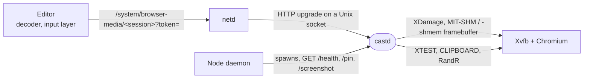

# castd

One browser window's media daemon: a Rust process per X display that captures the screen with XDamage and MIT-SHM, encodes it with x264, and serves picture, sound, pointer, keys and clipboard on a Unix socket in browser-wire's media protocol.

## Key files

- [src/main.rs](src/main.rs) — the binary: cast-core's pipeline and server wired to cast-x11's display.
- [crates/cast-core/src/media.rs](crates/cast-core/src/media.rs) — one viewer's media socket: the protocol's messages in
  and out.
- [crates/cast-core/src/video.rs](crates/cast-core/src/video.rs) — damage-driven capture, the encoders, paint-over,
  the per-viewer send and skip.
- [crates/cast-core/src/capture.rs](crates/cast-core/src/capture.rs) — what a platform implements for the picture.
- [crates/cast-x11/src/input.rs](crates/cast-x11/src/input.rs) — XTEST keys, text, buttons and scrolling, per viewer.
- [build.Dockerfile](build.Dockerfile) — the image recipe: patched x264, patched Xvfb, castd, under /opt/castd.

## Where it sits

The Node daemon starts one castd per browser window (or per window region of a shared desktop, `--crop`), after the
window's Xvfb. netd relays `GET /system/browser-media/<session>` from the editor to castd's socket,
`/run/intentic/cast/<session>.sock`, and the daemon's control socket hands the editor that path and a token
(`BrowserViewServerMessage::Media`). Node never touches a frame. What drives the browser as a program (tabs,
navigation, dialogs) stays on the daemon's own `/system/browser-view` socket.



## The workspace

castd's workspace is four crates, so a device daemon (`_devices/remoted`) can stream a person's own screen with the same
engine on Windows and Linux:

- **[cast-core](crates/cast-core)**, the engine with no platform: the media socket and the control endpoints (served
  on any byte stream, not only a Unix socket), the hub every viewer shares one encoder through, the rate controller,
  paint-over, tokens, peer connections, recording and `/wait`, x264 and NVENC behind features, and the traits a
  platform implements: a screen source (frames and damage), an input sink and a sound source. It builds for Windows
  (`x86_64-pc-windows-msvc`) and links nothing GPL unless asked for.
- **[cast-x11](crates/cast-x11)**, the X11 platform: XDamage and MIT-SHM capture, RandR with window fitting, XTEST
  input with DOM keys mapped to keysyms, the cursor and the clipboard. It reads Xvfb's `-shmem` framebuffer in place
  and a real X server (a person's `:0`) with MIT-SHM GetImage.
- **[cast-win](crates/cast-win)**, the Windows platform: DXGI Desktop Duplication kept on the GPU, NVENC and Media
  Foundation's hardware encoders reading the captured textures in place, openh264 in software, SendInput, the
  clipboard, the pointer's shape and WASAPI loopback; why a desktop cannot be captured, and the SYSTEM helper that
  sees the secure desktop for remoted's Windows service. Empty on any other target; remoted's Windows build links it.
- **castd**, this package: the command line ([src/config.rs](src/config.rs)), the binary that wires the two together,
  and `castd-bench`. Same flags, same socket, same image tree as before the split (2026-11-20).

## The media socket

Exactly browser-wire's protocol (`_sandbox/netd/crates/browser-wire/src/lib.rs`): JSON text messages
(`BrowserMediaClientMessage` in, `BrowserMediaServerMessage` out) and binary video and audio behind the 16-byte header
(`MEDIA_HEADER_LEN`, `MEDIA_KINDS`, `MEDIA_FLAGS`). A message castd cannot parse is ignored; the socket stays open.

- **`hello` first**, then a keyframe; again whenever the picture changes shape or scale. A header's capture time
  counts in milliseconds from the `hello` that viewer received last, so the editor (or `castd-bench`) reads
  capture-to-arrival latency off every frame.
- **Several viewers share one encoder.** The bitrate follows the viewer driving the window (the latest to send input),
  else the one delivering the most, never the slowest: voxl took the minimum over every viewer, so one phone on a train
  blurred the picture for the person typing. A viewer that falls behind the steering one has frames skipped until what
  it has drains, then gets a keyframe (no sooner than a second after the last, since each is a burst for everyone).
- **New content gets room.** A keyframe, and the first paints of new content over a third of the picture or more
  after 300 ms without such a change (a page that loaded, a route that changed, a panel that opened; at most three
  frames within 250 ms of the first), are encoded with a VBV buffer of eight frames at four times the cap, full,
  instead of the steady 1.25 frames. Squeezed into the steady buffer, a new page came out at QP 40 and more, the old
  page's text showing through it, until the paint-over 150 ms later. A scroll or a drag starts the same way and costs
  nothing extra (CRF keeps its motion vectors cheap); a video or an animation gets the room only at its start.
- **`resize`** from the driving viewer (or any read-write viewer while nobody drives) RandR-resizes the screen to
  round(width × scale) × round(height × scale), even, clamped to `--max-size` and what RandR allows, then fits every
  toplevel that covered the old screen to the new one, as a window manager would for a fullscreen window (Chromium does
  not follow RandR by itself). Each viewer's last box is remembered: the next viewer to take over driving brings its
  own. Read-only viewers' resizes are ignored.
- **Keys** are DOM `key` names, the layout already applied (`ą`, `€`, `@`, `Enter`, `F5`), with `code` settling
  left/right modifiers and the keypad's Enter. A character the X keymap lacks is typed through a spare keycode mapped
  on the fly (voxl's scheme). `ctrl`/`shift`/`alt` flags hold that modifier around the key and let it go after, and a
  flag saying `false` releases one this viewer left stranded. A non-alphanumeric character sent with both `ctrl` and
  `alt` is AltGr as Windows reports it, and is typed with this viewer's Ctrl and Alt lifted.
- **`text`** types each character with no pause between them: the characters the keymap lacks are mapped up front, as
  many as there are spare keycodes, with one 8 ms wait per batch for clients to read the new keymap.
- **`clipboard`** takes CLIPBOARD (text, HTML, PNG) and PRIMARY (text) and returns once the X server has registered the
  ownership, in order with the keys around it, so `clipboard` then Ctrl+V pastes any length at once. A copy made in the
  window comes back as `clipboard` to every read-write viewer, never echoing what a viewer just set.
- **`scroll`** moves by picture pixels with their fractions. On an Xvfb with the scroll-axes patch, castd injects
  smooth XI2 scroll motion, pixel for pixel; on a stock Xvfb it sends wheel clicks (Chromium on X11 scrolls 120 CSS px
  a click, `--scroll-px-per-notch`) and carries what a click could not express to the next event, never dropping it.
- **`cursor`** carries the X cursor as a PNG with its hotspot, and a CSS keyword where the X name is a standard one.
- **`pointer`** says where the pointer is on the picture as it moves (XInput 2 raw motion on the display, then a
  `QueryPointer`, at most every 8 ms), so a viewer can draw the computer's own pointer when something other than its
  own hand moved it: an app warping it, or the person at a connected computer (cast-core's README).
- **`stats`** about once a second: the round trip (WebSocket pings castd sends), the bitrate aimed for, frames sent in
  the last second, and how long acks queue beyond their minimum.

## A viewer on this computer

A sandbox on the owner's own machine is watched over that machine's loopback, where the network's limits are not there
to work around (2026-11-20: 0.39 ms round trip and 1.1-1.4 GB/s from Windows into a container on WSL2, against a
30 Mbit/s ceiling). netd marks a media upgrade that arrived on the sandbox's loopback port (browser-wire's
`MEDIA_LISTENER_HEADER`, which it strips from everything else), its `hello` says `local: true`, and castd does three
things for it that no remote viewer gets ([exact.rs](crates/cast-core/src/exact.rs)).

- **The local profile.** While a local viewer drives (`rate::steering`), motion is encoded at `--local-crf` (18, not 24)
  under `--local-max-kbps` (200 Mbit/s, not 30), and the rate starts at that ceiling instead of climbing from 8 Mbit/s;
  it still falls back on congestion, since a loopback port can be forwarded somewhere slow. Measured scrolling
  [tests/fixtures/page.html](tests/fixtures/page.html) at 1280x880: 3.0 Mbit/s against 2.4, the same 0.15 cores and
  2.8 ms capture to arrival.
- **Exact pictures**, for a viewer that also asked (`lossless=1`, browser-wire's `MEDIA_LOSSLESS_QUERY`): H.264 is 4:2:0
  and lossy even at the paint-over's CRF, so a still page never matched the screen pixel for pixel. castd keeps, per
  such viewer, the box its picture is lossy in. Every frame goes to it `clip`ped to that box joined with what the frame
  changed (the first, a keyframe, whole), so video never draws over an exact pixel; once the screen has been still for
  `--lossless-delay-ms` (100) the capture thread reads that box off the framebuffer and the encode thread sends it
  as a `lossless` message, raw BGRX, after the frames queued before it, and the box is empty again. A keystroke costs
  the glyph's few blocks. Only while the viewer's round trip is under 20 ms: the copy is raw pixels, which a slower
  link would queue every frame behind. A copy the screen moves under before it has held as long as it waited (an
  animation that pauses between steps) doubles the next wait, up to 2 s (`CopyPace`): on a page of 60 animated cards
  at 16-18 fps a whole-screen copy went out every 250 ms or so, 29 MB/s at 2560x1600, each drawn over at once, and
  none does now. The integration test holds a local viewer's copy of a still screen against `/screenshot`: equal in
  every pixel.
- **The frame rate may follow its display.** A `resize` says the viewer's display rate (`hz`), and while a local
  viewer drives castd captures at that rate up to `--local-fps` (default `--fps`, so nothing changes unless asked).
  Chromium on Xvfb draws on its own 60 Hz clock whatever RandR's refresh rate says (measured: a mode at 120 Hz, set
  before or after Chromium started, left it at 60), and only `--disable-frame-rate-limit` lifts it, by drawing as
  fast as it can: at 2560x1600, compositing on the CPU, 156 fps of scrolling for 1.92 cores of Chromium and 1.97 of
  castd, against 0.22 and 0.43 at 60. So the daemon starts no window that way.

## Peer connections

A viewer on the sandbox's own network can reach castd without the edge: a public https page cannot open the plain
`ws://` a LAN address needs, and no public certificate names one, so castd also answers a WebRTC peer connection
([rtc](crates/cast-core/src/rtc/mod.rs), str0m) beside the media socket, which signals it and stays open as control and fallback.

- **One UDP port, ICE-lite.** `--rtc-udp ADDR` binds one port for every viewer of this castd, and `--rtc-candidates`
  names where a viewer reaches it (the host's LAN addresses and the port as published; a bare IP takes the bound port,
  and port 0 the one bound). castd answers with those host candidates only and never sends to an address that did not
  check it first, so it needs no STUN server. A datagram goes to the peer whose ICE ufrag its binding request names
  ([stun.rs](crates/cast-core/src/rtc/stun.rs)), later ones from that address follow. Behind a port publish castd sees its own
  address, not the one the viewer sent to, so str0m is told the first candidate of the source's family. With the
  flags, `hello` says `rtc: true`.
- **Signalling on the media socket**: the viewer's `rtcOffer` (its SDP, with browser-wire's `RTC_CHANNELS` and,
  where it asks for the pictures on a track, one receive-only video section), castd's `rtcAnswer`, and `rtcClosed` when castd cannot take one or lets one go. `rtcCandidate` is accepted
  and ignored, and `rtcClose` from the viewer hands the stream back. The socket's token is the authentication: the
  answer carries castd's DTLS fingerprint and ICE password, so only the viewer holding the socket can finish the
  handshake, and str0m checks every check's integrity.
- **The stream moves with a hello.** Once the peer's `media` and `input` channels are open, castd says `hello` on
  `media`, restarts the viewer's video with a keyframe, and sends there what the socket carried: JSON on `media` in
  order with the pictures, video on `media` (chunked past browser-wire's `RTC_MESSAGE_MAX`, byte 14 the index and 15
  the count) or on the video track, sound on `audio`. The socket keeps WebSocket pings and any JSON longer than a message. When the peer
  fails (no channels within 20 s, nothing heard for 15 s, ICE disconnected for 5 s, a channel closed, `rtcClose`),
  castd says `rtcClosed` and `hello` on the socket and the stream is back there. While the peer carries it, castd times
  the round trip by its acks (send to ack, less the decode time the ack reports), not by the socket's pings.
- **Reliability per channel** (browser-wire's `RTC_CHANNELS`): `media` ordered and reliable, since castd's H.264 has
  no intra refresh, so a lost delta spoils the picture until a keyframe ten to fifty times its size, where a LAN
  retransmit costs a few milliseconds and castd's ack window already bounds what can queue; `audio` unordered with no
  retransmits; `input` ordered and reliable (a long paste arrives as binary chunks joined in order); `pointer`
  unordered with no retransmits, only the newest position counting (a viewer that does not open it hears `pointer` on
  `media`).
- **The pictures on a video track** (2026-11-21): a viewer whose offer carries a receive-only H.264 video section gets
  the pictures as RTP there instead of on `media`, its hello on the peer saying `track` (cast-core's README has the
  design and the measurements across an impaired link). A connected computer's screen asks for it; the editor's own
  browser windows do not, so castd's LAN path is the one measured above. An older viewer offers no section and an older
  castd leaves it silent; either way the pictures stay on `media`.
- (2026-11-20) str0m with its `rust-crypto` provider, not the default aws-lc-rs: no cmake or C toolchain, nothing new in
  the image, so it is always built rather than a feature to leave out. Rejected: full ICE with STUN-learned candidates, which a container behind its host's NAT cannot use for a
  viewer on the same network anyway, and which castd's published host candidates make unnecessary; unordered video
  with a keyframe on loss, which turns every lost packet into a keyframe burst. Measured on this sandbox's host with
  castbench `--peer` over loopback UDP: keystroke to glyph 4.6-5.1 ms at p50 against 4.5-5.5 on the socket, drawn to
  decoded the same; through a UDP relay in another container standing in for a port publish, 5.1 ms.
- (2026-11-20) Full ICE is in cast-core for a device daemon on a computer behind a NAT ([rtc](crates/cast-core/src/rtc/mod.rs),
  `Ice::Full`: STUN-learned server-reflexive candidates, the viewer's trickled candidates, checks sent both ways).
  castd stays ICE-lite, its default, for the reasons above.

## The token

`?token=` on the upgrade:

```
token   = base64url(payload) + "." + base64url(HMAC-SHA256(key, payload))     (base64url without padding)
payload = {"s":"<session>","exp":<ms since the epoch>,"ro":<bool>,"iat":<ms>}  (UTF-8 JSON, the bytes as signed)
key     = the --key-file's bytes, exactly as stored
```

castd checks the MAC over the payload's bytes as received, then parses it: `s` must be its `--session`, `exp` later
than now, `iat` (when it was minted; 0 when absent) no earlier than the last drop that covers it (below), and
`ro: true` makes a read-only viewer (it watches; its input, clipboard and resizes are ignored). A bad MAC, another
session, an expired token or one minted before a drop is refused with 403, a missing one with 401.

An open socket outlives its token, by browser-wire's `MEDIA_TOKEN_GRACE_SECONDS` (ten minutes) at most: the viewer sends
each fresh token the browser view socket hands it as `token` on the open socket (or its peer's `input` channel), and
castd counts from the newest that holds and opens the same access. A socket whose newest token expired longer ago than
that is closed with browser-wire's `expired` close code (4002). `POST /viewers/drop` ends every viewer's socket, its
peer connection with it, with the `dropped` code (4001), and refuses from then on every token minted before it
(`?read_write=1`: only the read-write viewers and tokens); `--not-before` carries such a drop over a restart. Either code
means the token the viewer holds is dead: it asks the view socket for a fresh one before dialling again. Test vector: key = the 14 bytes
`castd-test-key`, payload `{"s":"browser-own","exp":1893456000000,"ro":false}`, token
`eyJzIjoiYnJvd3Nlci1vd24iLCJleHAiOjE4OTM0NTYwMDAwMDAsInJvIjpmYWxzZX0.YKTUvxiTZMF1qntsiKCawvxUDDzjYqLIgo9u7ovM2yU`.

## Control endpoints

On the same socket, with no token: the socket file's permissions (`--socket-mode`, default 600) are their guard.
`GET /health` (200 once castd serves: it connects to X and starts capturing before it binds), `GET /geometry` (picture
and screen size, scale, codec, crop, resize limits, pin), `GET /screenshot` (PNG of the picture, crop included),
`GET /wait?quiet_ms=&timeout_ms=` (answers once nothing changed for `quiet_ms`), `POST /record/start` and
`POST /record/stop?id=` (an MP4 of the encoded stream, not re-encoded; with `?file=<name>` on the start it is written to
`<--record-dir>/<name>` as it is recorded, mdat first and moov at the stop, which then answers `{"file","bytes"}`, so no
recording is held in memory; the name is a plain `[A-Za-z0-9._-]` file name ending `.mp4`, never written over),
`POST /pin?width=&height=&scale=` and `POST /unpin` (hold the screen at a box whatever viewers ask, for an emulated
phone), `POST /crop?x=&y=&w=&h=` (move a `--crop` castd's region without a restart), `POST /viewers/drop` (above), and
`GET /stats`. `castd --help` lists the flags.

## Building

castd is a Cargo workspace of its own, so netd builds without x264. It needs
`libx264-dev libyuv-dev libopus-dev libpulse-dev libffmpeg-nvenc-dev pkg-config clang libclang-dev` to build and
[image/runtime-packages.txt](image/runtime-packages.txt) to run; `--no-default-features` leaves out the `audio`
feature (Opus and PulseAudio) and the `nvenc` feature (NVENC's headers; nothing NVIDIA's is ever linked). castd's
[build.rs](build.rs) only sets the binaries' rpath; cast-core's links the libraries its features name. cast-core alone
builds for Windows with `cargo xwin build -p cast-core --target x86_64-pc-windows-msvc --no-default-features`.

Patches to x264 and Xvfb make castd faster and sharper, and castd works without them:

- [patches/x264](patches/x264) (pixelflux's, plus voxl's two): x264 skips the macroblocks castd's damage map marks
  unchanged instead of analysing and copying them, about 40% less encode time on small damage, the stream bit for bit
  the same. castd's own 0007 lets a reconfigure set the VBV buffer's fill, which the room new content gets (above)
  needs: stock x264 keeps the fill the steady buffer held, so a larger buffer gives the frame nothing. On a test page
  that took a new text page's first frame from 24 dB luma PSNR against the settled picture (QP 43) to 38 dB (QP 30), at
  about 110 KB against 32 KB, and the joining viewer's keyframe from QP 39 to QP 21.
  [image/build-x264.sh](image/build-x264.sh) builds it at the commit Debian trixie's libx264-164 is cut from,
  so the soname matches; castd built with its prefix first on `PKG_CONFIG_PATH` gets an rpath to it and otherwise runs
  on Debian's library.
- [patches/xorg-server-xtest-scroll.patch](patches/xorg-server-xtest-scroll.patch): Xvfb's XTEST pointer gets a
  vertical and a horizontal scroll axis, which is what smooth, pixel-precise scrolling needs.
  [image/build-xvfb.sh](image/build-xvfb.sh) builds only the Xvfb target, from Debian's source package when deb-src is
  enabled, else the same upstream release. On a stock Xvfb castd falls back to wheel clicks.

The Xvfb is built with GLX (the `xvfb` package's own build has it), so Chromium's GPU process starts on it: a person's
window draws on the GPU where the sandbox has one, and without GLX it had no WebGL.

[build.Dockerfile](build.Dockerfile) runs both on the image's Debian release and exports `/opt/castd` (`bin/castd`,
`bin/castd-bench`, `bin/Xvfb`, `lib/libx264.so.164`); its header has the `docker buildx` line. Start the display's
Xvfb with `-shmem` (castd then reads its framebuffer in place, no copy at all) at the largest size a viewer may ask
for, since RandR can only shrink it.

## Tests and the bench

`cargo test --workspace` runs the unit tests (token test vector, key names, header layout, the steering policy, scroll
carry, crop clipping, MP4, STUN routing, chunking, a local viewer's clips and copy pacing), cast-core's tests that need
no X ([rtc.rs](crates/cast-core/tests/rtc.rs): a str0m viewer against castd's peer port, ICE, DTLS, SCTP and the three
channels over loopback UDP, and [rtc_track.rs](crates/cast-core/tests/rtc_track.rs) the pictures on a video track and
the ends that do not ask for one; the pipeline on a painted in-memory screen; the router on an in-memory stream), cast-x11's
capture against an Xvfb of its own in each of its three read paths (and its pointer messages), and [tests/integration.rs](tests/integration.rs),
which also moves a viewer's stream onto a peer connection and back and holds a local viewer's exact copy against the
screen: Xvfb `-shmem`, Chromium in kiosk mode on
[tests/fixtures/page.html](tests/fixtures/page.html), and castd, driven as a viewer over the Unix socket. It stands
down with its reason when Xvfb or Chromium is missing (`CASTD_TEST_XVFB`, `CASTD_TEST_CHROME`).

`cargo run --release -p cast-core --example wanbench --features x264,openh264` with
[examples/wanbench/run.sh](crates/cast-core/examples/wanbench/run.sh) measures what a person sees across an impaired
link: cast-core serving a stamped synthetic picture to a headless Chrome in a network namespace of its own, the link
between them shaped with netem and tbf (cast-core's README).

`castd-bench --socket … --session … --key-file …` connects as one viewer, acks every frame, and prints JSON: frames per
second, kbps, and capture-to-arrival latency percentiles off the headers; `--resize WxH@S` and `--scroll-px N` drive the
window while it measures, and `--local` and `--lossless` dial as a viewer on this computer that asks for exact pictures
(it counts clipped frames, copies and their bytes).

Measured 2026-11-19 on this sandbox's host (16 cores, load around 18), 1280×880 screen = window, stock Debian x264,
castd's own CPU over 12 s with one castd-bench viewer, Chromium software-rendering
[tests/fixtures/page.html](tests/fixtures/page.html) (`#scroll`: the page scrolls 8 px every frame by script; `#anim`:
a 320 px square spins):

| Xvfb | page | 30 fps cap | 60 fps cap |
| --- | --- | --- | --- |
| `-shmem` | still | 0.009 cores | 0.002 cores |
| `-shmem` | scroll | 0.14 cores, 34 fps, 1.9 Mbit/s | 0.20 cores, 56 fps, 2.6 Mbit/s |
| `-shmem` | animation | 0.12 cores, 34 fps | 0.16 cores, 60 fps, 2.2 Mbit/s |
| no `-shmem` | scroll | 0.12 cores | 0.19 cores, 60 fps |
| no `-shmem` | animation | 0.09 cores | 0.15 cores, 60 fps |

With the patched x264, one 2560×1600 frame where a 640×360 area changed encoded in 2.1–2.6 ms of CPU against
4.2–4.7 ms with Debian's, on one thread (`cargo test --release encode_cost -- --ignored`, with `LD_LIBRARY_PATH` at the
patched build for the second; the output the same 997 bytes either way). End to end at 60 fps the two did not separate
beyond the machine's noise: a scroll changes every macroblock, which the patches cannot skip.

A still page's figure includes the joining viewer's keyframe and its sharpening passes; once those are sent, castd
waits on X with nothing to do (the integration test reads 0.000–0.003 cores over 4 s). Capture to arrival on the socket
was 3–5 ms at the median under the 60 fps cap; under the 30 fps cap frames wait for their slot, 25–29 ms.

## The GPU

`--encoder x264|nvenc|vaapi|auto` picks the H.264 encoder; x264 is the default, so a window takes the owner's GPU only when
the daemon asks. `auto` takes NVENC when the driver is there and passes castd's self-test (an IDR with SPS and PPS,
deltas that come straight back, a rate change that adds no keyframe, an IDR on demand), else x264, and says why in the
log; `nvenc` must pass or castd refuses to start. `/geometry` and `/stats` name the encoder in use. A size NVENC will
not open at (or a session it cannot get: a GeForce allows a few at once) falls back to x264 for that picture.
[nvenc.rs](crates/cast-core/src/nvenc.rs) drives the NVENC API directly, the driver's libraries opened at runtime, because FFmpeg's
`h264_nvenc` resets the encoder and forces an IDR on every bitrate change, and castd's controller changes it several
times a second on a short link. Rate control is a quality floor under the cap: VBR aiming at the controller's cap,
the QP held at or above castd's CRF, inside the same 1.25-frame VBV x264 gets; paint-over is that floor lowered to
the paint-over CRF for the sharpening frames, the same `set_rate` call x264 gets, so no fallback to x264 is needed.
On WSL2 the driver's libraries are in /usr/lib/wsl/lib, and castd puts that on its own `LD_LIBRARY_PATH` by starting
itself again (libnvcuvid needs libdxcore.so, which has no soname, so loading by path is not enough).

`--encoder vaapi` is VA-API's encoder (cast-core's README, "VA-API"; the `vaapi` feature, on by default, links
nothing), which `auto` tries after NVENC. On these machines VA-API is reachable only through Mesa's d3d12 driver on
WSL2. In a container with libdrm 2.4.124 (Debian 13) it does not start (`MESA-LOADER: failed to retrieve device
information`: WSL 6.18's render node is vgem on the faux bus, with no PCI identity); with libdrm 2.4.134 (rog's Arch)
it does, and it encodes on the NVIDIA GPU and not on the Intel one (2026-11-21).

Measured 2026-11-20 on `rog` (RTX 5080 Laptop, Intel iGPU, 16 cores) in a Debian trixie container started with
`--gpus all --device /dev/dri`, Chromium 156 from Debian. The encoder alone (`cargo run --release --example encbench`,
synthetic text pages, CPU per frame, one x264 thread):

| size | scene | x264 CPU | NVENC CPU | NVENC wall |
| --- | --- | --- | --- | --- |
| 1280×880 | scroll | 1.77 ms | 0.61 ms | 1.68 ms |
| 1280×880 | animation | 1.16 ms | 0.59 ms | 1.66 ms |
| 2560×1600 | scroll | 7.83 ms | 1.22 ms | 4.74 ms |
| 2560×1600 | animation | 6.48 ms | 1.27 ms | 4.75 ms |

What NVENC still costs the CPU is the I420 copy into the driver's buffer. At the same CRF number its quality matched
x264's (PSNR Y 38.0 against 37.9 on the scroll, 38.3 against 38.8 on the animation, ffmpeg's psnr over frames 20–69)
with 40–45% of x264's bits. End to end (castd with one castd-bench viewer, Xvfb `-shmem`, 60 fps cap), castd's own
CPU:

| size | page | x264 | NVENC |
| --- | --- | --- | --- |
| 1280×880 | scroll | 0.14 cores | 0.08 cores |
| 1280×880 | animation | 0.14 cores | 0.10 cores |
| 2560×1600 | scroll, GPU-rendered | 0.39 cores | 0.14 cores |
| 2560×1600 | animation, GPU-rendered | 0.34 cores | not run |

Chromium's own rendering is the larger cost for the agents' browsers. On SwiftShader (their `--use-angle=swiftshader`)
it took about 2.1 cores to hold 60 fps at 1280×880 and fell to 23–25 fps at 2560×1600 (2.4 cores); a page of 60
blurred, shadowed cards ran at 2 fps on 8.7–10 cores, and a full-screen WebGL shader at 42 fps (1280×880) and 12 fps
(2560×1600). With `--use-gl=angle --use-angle=gl --enable-gpu-rasterization` on Mesa's d3d12 driver
(`LD_LIBRARY_PATH=/usr/lib/wsl/lib GALLIUM_DRIVER=d3d12`), scroll and animation held 60 fps on 0.21 cores (0.31 at
2560×1600), WebGL held 60 fps at both sizes on 0.23–0.34 cores, and the card page reached 24–25 fps on 1.0–1.2 cores.
The Intel iGPU (`MESA_D3D12_DEFAULT_ADAPTER_NAME=Intel`) did as well, except that its WebGL frames never reached the X
screen (the page counted 60 fps, castd saw no damage). Debian's Mesa has no Dozen Vulkan driver, so Vulkan on WSL2 was
not measured. software-rendering.ts keeps the agents' browsers off the GPU on purpose.

A person's own window is not on SwiftShader (2026-11-20, rog, the sandbox image's Chromium 1248): it is started
without the agents' switches, and on castd's Xvfb, built without GLX until then, its GPU process exited at start and
Chromium composited on the CPU. That is cheap (scrolling at 60 fps on 0.14 cores at 1280×880, 0.22 at 2560×1600) but
left the window with no WebGL at all. castd's Xvfb now has GLX, and where the sandbox has WSL2's GPU and NVIDIA's
driver the daemon starts a person's window on it (`browser/sessions/rendering/window-gpu.ts`, adapter named NVIDIA for the iGPU's
WebGL above): WebGL then runs on the GPU, 60 fps at 2560×1600 on 0.31 cores, scrolling costs about what it did (0.29 cores),
and the card page goes from 16 to 18 fps. Without a GPU the GLX build changes nothing measurable (0.20 cores). NVENC
for such a window was measured too and not taken: it cut castd from 0.43 to 0.18 cores at 2560×1600 but doubled capture
to arrival on the loopback (7.3 to 14.9 ms), and a local viewer's latency is what the window is for.

## Credits and license

castd's capture, conversion, encoder, paint-over, flow control, RandR, input, cursor and clipboard, sound, MP4 and
wait code is [voxl](https://github.com/tembo/voxl)'s (Tembo, MIT, v0.4.0 at commit 21f194f; [LICENSE](LICENSE)), cut
to Linux; cast-core and cast-x11 carry it, under the same licence. Left out: the macOS and Windows backends, voxl's web client and its esbuild step, HTTP login, TLS and basic
auth, the files panel, the microphone, and rounded corners. castd's own: the Unix socket and browser-wire's protocol,
tokens, DOM key names, per-viewer input, the steering bitrate policy and lag skipping, `--crop`, window fitting, pins,
HTML and PRIMARY on the clipboard, peer connections ([str0m](https://github.com/algesten/str0m), MIT or
Apache-2.0), and the platform traits. castd links x264, which is GPL-2.0, so a castd binary is distributed under the
GPL; cast-core links it only with its `x264` feature.
