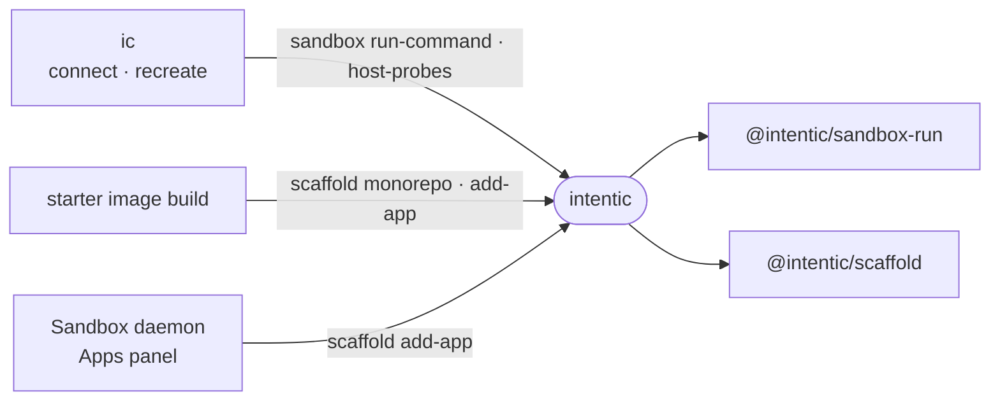

# cli

`@intentic/cli`, the `intentic` command baked into the sandbox image: it prints the sandbox container's canonical `docker run` and scaffolds app monorepos.



- Two route groups in `src/app.ts`. `sandbox` prints the canonical `docker run` (or a Compose folder) for a sandbox container, from the old container's env on stdin, and lists the host probes an overlay's optional runtime directives need. `scaffold` lays down an empty pnpm + turbo monorepo and adds app instances into one.
- The run contract itself lives in `@intentic/sandbox-run`; this package is its command-line face, so `ic` can ask the image for its own run command instead of hand-copying it.
- `INTENTIC_OUTPUT` picks how a command renders: prose (default), one JSON document, or NDJSON.

## Key files

- [src/app.ts](src/app.ts) — the command tree and the one-line error format.
- [src/sandbox-run/sandbox-run.command.ts](src/sandbox-run/sandbox-run.command.ts) — `sandbox run-command`.
- [src/monorepo/monorepo.command.ts](src/monorepo/monorepo.command.ts) and [src/add-app/add-app.command.ts](src/add-app/add-app.command.ts) — the scaffold commands.

## Commands

```sh
pnpm --filter @intentic/cli test
```
