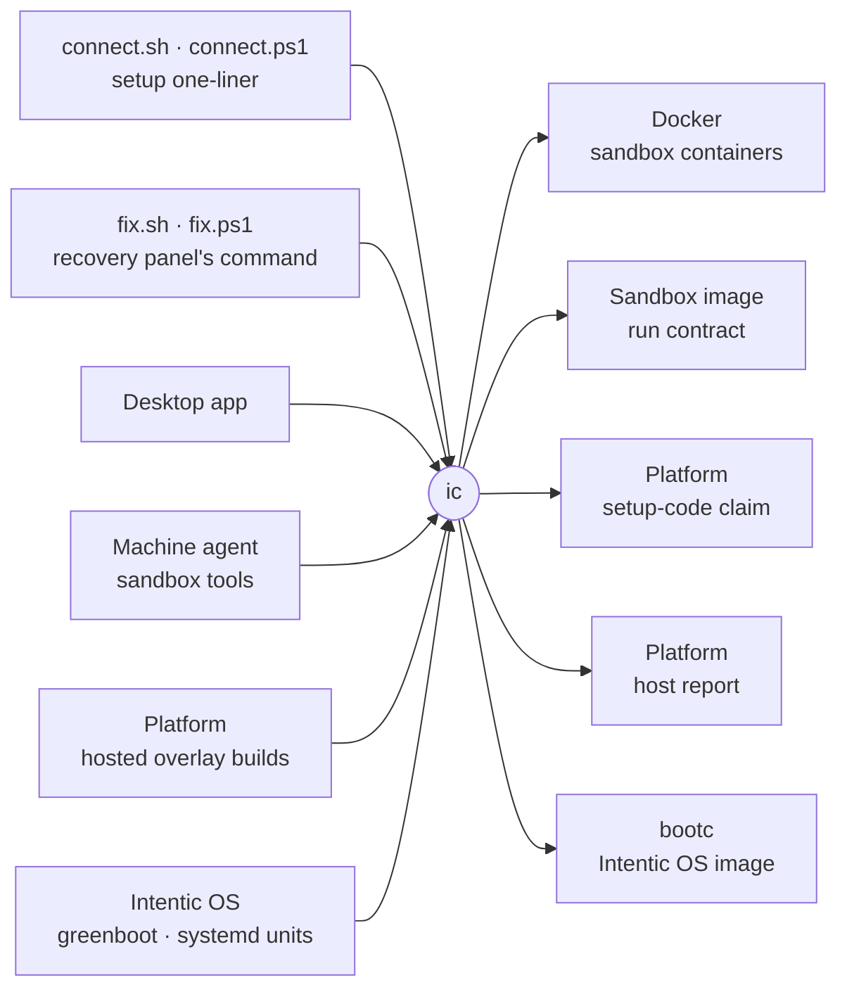

# ic

The host-side CLI that starts, updates, diagnoses and removes intentic sandbox containers on the machine that runs them, and gets Docker there first.



- Runs on the host: a laptop, a server or a hosted machine, never inside a sandbox, which cannot see its siblings.
  The bootstrap shims download a fresh static binary on every run, except one pinned to the release already installed
  (`IC_VERSION` beside `IC_URL`, which the desktop app sets to its own); the desktop app and the machine agent call the
  installed one. An agent reaches it through a connected device's sandbox tools. A download replaces nothing until it
  matches the release's `SHA256SUMS` (the shims, by `sha256sum`, `shasum` or `Get-FileHash`), and the machine agent
  also checks the release key's signature over those sums before it puts its own release's ic in place.
- `ic sandbox connect <code>` redeems the setup code from the platform and brings a sandbox up. The claim names this
  machine and its side (`host`, `os`: `windows`, `linux/archlinux`), and a code already redeemed on another machine, or
  on the other side of this one, is refused with the platform's own sentence instead of starting a second copy
  (2026-10-05). It pulls the published image even when it is cached, so the moving `stable` tag runs the newest
  release, unless its caller would rather start now on the image the machine already holds (`INTENTIC_REUSE_IMAGE=1`,
  the desktop app's setups; never with `SELF_HOST`). A pull, or a load of the image fetched ahead, whose engine went
  away (Docker Desktop quit, Intentic's engine stopped) stops at once rather than retrying against nothing, and the
  setup report says which engine stopped and how to start it again in its `remedy`; a transfer that broke on the
  network is still tried three times, and its report now carries a fix too (2026-10-12).
  On Windows its preflight takes the shim's word for the facts
  `ic docker prepare` passed on a moment before (`INTENTIC_PREPARED=1`, connect.ps1) rather than probing the PC a second
  time. Connect refuses a sandbox this machine already has, running, stopped or parked, even with `-y`, and points to
  `fix`, `rollback` and `rebuild` instead (2026-10-07). With `--replace` it reinstalls it under the sandbox's lock,
  keeping what it was set up as: its image, logins volume, dev mounts, web origin, machine name and side, and the
  device it connected (no second pairing). The claim's own values still win. The old container is parked, and put back
  if the new one does not answer and become ready. The machine agent's Reconnect passes `--replace`. `update`, `prepare`,
  `rollback`, `rebuild` and `reshape` swap or restart the container while keeping `/work` and `/history`; `remove`
  moves the data to a trash that `restore` brings back and `purge` empties early. Before any restart or recreate of a
  running sandbox ic writes the daemon's resume ask (`/history/restart-resume.json`, `{"askedAt": <ms>}` on the
  container's clock, `resume.rs`), so the agent turns it cuts run again after it; `--no-resume` on `update`, `rollback`,
  `rebuild`, `dev`, `reshape`, `shape`, `start` and `restart` leaves them for a person (2026-10-05). Before it stops,
  restarts or recreates a sandbox (a power verb, a swap, a sleep, a connect `--replace`, the probation going back, a
  fix's repair, a repair that restarts the engine) ic also says why on its volume, within three seconds and never at the
  act's expense: `/history/logs/restart-intent.json` (`intent.rs`: `at` as ISO-8601 UTC, `by` `ic` or `keeper`, `host`,
  `side` `windows|wsl|linux|mac`, `action`, `reason` with the failed check and its finding, `checks`). `ic sandbox doctor
  --json` puts the last one beside the container's last exit (code, OOM kill, times) as `lastDown`. `remove` takes the
  sandbox's lock, sends the platform its removal notice a few times within 20 seconds, and retires its folder-sync
  pairings through `intentic-machine sync forget <slug>` when the agent is installed; it no longer deletes
  `~/.intentic/machine`, which holds restore points and the audit log (2026-10-05). A purge keeps the trash entry until
  every volume of the sandbox is gone, and a failed first setup removes the volumes it made.
- **Stored credentials are encrypted at rest by default** (`at_rest.rs`, 2026-10-16). The daemon encrypts the files
  that hold credentials (pasted secrets, the capability and extension vaults, the privacy vault, AI-provider accounts)
  whenever it is given a 32-byte key, and every sandbox ic sets up, replaces or starts as a runner gets one, as does
  any older sandbox on its next recreate (an update, rollback, rebuild or reshape), whose daemon then encrypts the plain
  files as it boots. The key is mounted read-only at `/run/secrets/intentic-at-rest-key`, and
  `INTENTIC_AT_REST_KEY_FILE` tells the daemon where it is.
  - Unless you bring your own, ic makes the key once, from the operating system's random source, at
    `~/.intentic/keys/at-rest-<slug>.key` (`%USERPROFILE%\.intentic\keys` on Windows). On Linux and macOS only you
    can read it; on Windows it has your profile folder's permissions. That folder is never mounted into a sandbox, so
    the sandbox can read its key but not change it, and a copy of its volume or one of ic's backups does not contain
    it. A key that exists is never made again: every later update, rollback and reinstall reuses it. Dev sandboxes
    that share a logins volume (`INTENTIC_AGENT_AUTH_VOLUME`) keep their credentials in that volume, so they share
    one key for it, `~/.intentic/keys/at-rest-shared/<volume>.key`; when ic makes it, it names the sibling sandboxes
    that cannot read those credentials until their own next update gives them the same key.
  - **Losing the key loses the stored credentials.** The files stay on the volume, but nothing can open them, and the
    sandbox's connections, secrets and AI sign-ins have to be set up again. Keep a copy of the key wherever you keep
    copies of this machine.
  - To use your own key, set `INTENTIC_AT_REST_KEY_HOST_FILE` to the absolute path of a file outside every sandbox
    volume holding 32 random bytes (or 64 hex digits, or base64 of 32 bytes), when you set the sandbox up, or on the
    next update of a sandbox that has no key yet. It wins over ic's. A sandbox that has a key keeps it: changing it is
    a rotation, `ic sandbox connect --replace` with the new key in `INTENTIC_AT_REST_KEY_HOST_FILE` and the old one in
    `INTENTIC_AT_REST_PREVIOUS_KEY_HOST_FILE`, then once more with `INTENTIC_AT_REST_DROP_PREVIOUS_KEY=1` after it has
    restarted and been backed up ([the self-host guide](../../_tools/selfhost/platform/README.md) has the details).
  - To opt out, for example because the disk is already encrypted, set `INTENTIC_AT_REST=off` when the sandbox is set
    up, or on the update that would give it its first key. The container remembers the choice, so later updates keep
    it, and `INTENTIC_AT_REST=on` on an update turns encryption on. Turning it off never takes away a key a sandbox
    already has, since its credentials may be encrypted with it.
  - A removed sandbox's key stays while its data is in the trash, and is deleted with the data when that is deleted
    for good. If this machine still holds backups of the sandbox, the key stays until tidy deletes them (30 days after
    the sandbox went). A shared key goes when its logins volume is removed. Your own key file is never deleted.
  - Going back to a version from before encryption at rest (2026-10-13) is allowed, with a warning: that version
    cannot read the encrypted credentials until the sandbox is updated again. `backup-restore` of one sandbox's backup
    into another leaves out the first one's credentials (`/work/.intentic/secrets/auth`), which are encrypted with its
    key, and the target keeps its own. A container that was given a key it no longer mounts, and not one of ic's, is
    left as it is, with a stop that asks for the key file in `INTENTIC_AT_REST_KEY_HOST_FILE`.
- A sandbox for one folder of the owner's (`SYNC_REMOTE_DIR=/work/<name>` with `SYNC_PROJECT=1`, beside `SYNC_DIR`)
  is checked before anything starts (`project_dir.rs`, the contract's name rule), hands the sync installer both, and
  tells the container `SANDBOX_PROJECT_DIR`, which the run contract replays across every later swap.
- The desktop app's one sandbox per computer, which folders attach to later, is asked for with `SYNC_PROJECTS_HOST=1`
  and no folder at all: any of `SYNC_DIR`, `SYNC_REMOTE_DIR` or `SYNC_PROJECT` beside it is refused before anything
  starts. The container is told `SANDBOX_PROJECTS_HOST=1` (replayed like the folder above), and desktop sync still runs,
  with the installer handed `SYNC_PROJECTS_HOST=1` instead of a folder, so the machine agent holds the sync token the
  attached folders will sync under. If that step fails, the sandbox stays up and the warning says no folder can attach
  until it is set up again. The step names and phases are the same as any setup's.
- **ic is the one host authority for what runs and what should run.** Every door onto a sandbox's container (the
  machine agent, the desktop app, the web's pasted fallback lines) calls ic's verbs rather than docker: `start`,
  `stop` and `restart` power the tunnel sidecar with its sandbox, and `ic sandbox list --json` answers each
  sandbox's state, its share as docker enforces it, the shape it runs with, the shape saved for its next restart and
  the update staged for it, in the sandbox contract's `DeviceSandbox` shape.
- **Held and asleep.** `ic sandbox stop` marks the sandbox `held` in its channel record: stopped on purpose, so
  `ic sandbox fix` only starts it again after a yes. `ic sandbox sleep [<slug>]` stops it the same way but marks it
  `asleep` instead, never both; `--idle <minutes>` (the machine agent's keeper) sleeps only the sandboxes this side
  keeps whose daemon confirms through the private `/run/intentic/sleep.sock` that it has been quiet for that long,
  with nothing working, no `keepAwake` (settings or an enabled, unexpired webhook/listener automation) and no `nextWakeAt` due within the alarm's
  lead and five minutes, and never one mid-update, parked, held or locked by another ic run. A sandbox the alarm woke
  that no person has used since (the signal's `personAt`) needs five minutes of quiet rather than the whole limit. A dev sandbox (one whose container carries `SANDBOX_DEV_ROOT`) first asks that checkout's
  `_sandbox/sandbox/scripts/dev-before-sleep.mjs <slug>` through a login shell, with a one-minute limit. Exit 75 keeps
  it awake, with the script's last line as the reason, while the script rebuilds an image that lacks a dependency the
  checkout's daemon needs. Any other answer lets it sleep after a second fresh confirmation. A failed confirmation
  leaves it awake, including for an explicit sleep. (2026-10-18: the minute-old `work.json` heartbeat alone was rejected
  because a booking saved after it could lose its alarm.) Each sleep posts a host report with `asleep: true`. `ic sandbox wakes` (polled by the agent while anything
  sleeps, run by the desktop app the moment its page asks, and asking docker nothing when nothing does) sends the asleep sandboxes' report keys to the platform's
  `POST /host-report/wakes` and starts each one somebody has opened, as a person's start, reporting `fixing` then
  `done` around it; `--json` ends on `{"asleep": n}`. **The alarm** (2026-10-18): a sleep stores the signal's
  `nextWakeAt` (the soonest moment the daemon promised, crons included) as the record's `wake_at`, and `wakes`, before
  asking the platform anything, starts each sleeper whose `wake_at` is within its lead (`"for":"alarm"` on its line):
  twice the record's `wake_cost` (what its plain starts from sleep took, the slower of the newest and three quarters
  of the last) plus a minute, between two and ten minutes, and all ten for a start that will apply a saved shape. Such
  a start is stamped `alarm_woke_at`. Every other start, stop or sleep clears both marks. `start`, `restart` and every recreate clear both marks, and so
  does the fix engine when it finds the container running. The keeper's `fix --auto` reads a sandbox asleep as
  healthy and skips its daemon, registration and tunnel checks; an attended `fix` starts it. `ic sandbox list` says
  `asleep` (`"asleep": true` in `--json`).
- Before a swap touches the running container, it pre-flights the target image's state conversions against
  read-only mounts of the container's data (`/work`, `/history`, and `/agent-auth` where the container has it: the run
  contract's `DATA_MOUNTS`, held to it by a golden test) (`preflight.rs`) and refuses if one would fail;
  `--skip-preflight` overrides. A planner that ran and could not answer (it crashed, printed nothing, or printed what
  is not a plan) refuses a move onto that image too, as the hosted gate does: the planner is the daemon's own code, and
  an image that cannot load it will not boot. A rollback only warns, since it is the way off a failing version, and
  so does whatever the image cannot be blamed for: a probe docker would not run, a hang, a kill, an image from before
  the planner, a plan format only a newer ic reads. (2026-10-06: a daemon importing a package its image never
  installed crashed the planner, which then read as "no plan", and the swap went ahead onto a daemon that crashed on
  every start.) `prepare` records the staged image's plan in the marker it leaves the sandbox, the planner's line
  verbatim (a refusal naming the planner for an image that could not run it, which auto-update never takes), so the
  update card says what an update converts before anyone accepts it. While it runs it
  also keeps `update-preparing.json` there (`preparing.rs`): its step and how far the pull has got, rewritten every
  few seconds and removed when it ends, so the card draws the download in progress instead of a button for it. It also refuses a
  run line that would put the sandbox on other storage than it has (`storage.rs`: a renamed or dropped volume would
  otherwise boot a healthy-looking sandbox on empty volumes).
- **Nothing old is let go until the new version has proved itself.** A swap parks the old container, and a new version
  that never answers, never commits its state journal, reports its conversion failed, or keeps crashing is undone at
  once. Crashing is netd's word (`health.rs`): three restarts of the daemon in ten minutes with it down again, read off
  netd's vitals on its address, else off the file netd keeps them in (`/run/intentic/vitals.json`), else off netd's
  own log for a netd from before the file, with the error the daemon last died on where that log holds it; docker's
  restart count never sees them, since netd and the container stay up while netd restarts the daemon inside it. The
  container put back is then waited for the same way, and the flow ends on where the sandbox stands: a dev sandbox's previous container runs the same compiled checkout as the new one, so when
  neither comes up, the message names that code and the two commands that fix it. (2026-10-06: a swap onto a daemon
  that could not load a package said "Your previous sandbox was restored" over a restored container that crashed the
  same way.) After that
  first check the old container stays parked for a 24-hour probation (`probation.rs`): `ic sandbox watch`, which the
  machine agent runs every minute while a probation is on, puts it back by itself (a rename and a start, nothing
  downloaded or built) when the new version keeps crashing, never becomes ready, or loses the tunnel the old one had.
  A sandbox its owner stopped is waited for rather than judged, and a start or restart made through ic (noted in the
  ledger before it is made) is not counted as a crash (2026-10-06). The same look finishes or undoes a swap that died halfway (Ctrl-C, a dropped SSH session, an agent restart, a
  reboot): the channel record names the swap in flight before anything stops. What happened is written to the
  sandbox's `/history/update-outcome.json` (`outcome.rs`), which its daemon shows the owner. The dogfood `dev` loop
  keeps no probation. `IC_PROBATION_SECONDS` and `IC_WATCH_GRACE_SECONDS` shorten both windows for the nightly drill.
  The probation's numbers and rule are the contract's `update-probation.ts`, which the platform's watch over hosted
  sandboxes also uses; `golden/update-probation.json` pins ic to it. `ic sandbox swaps --json` (`swaps.rs`) answers,
  without Docker, whether each swap's cutover is being done right now (its heartbeat is fresh). The machine agent
  defers its own restarts and the keeper on that answer rather than reading the records itself.
- **The ways back.** `rollback` returns to `previous` (pressing it twice goes forward again); up to two older builds
  are kept behind it when the disk allows (on Windows too since 2026-10-05: the free space of the drive Docker Desktop
  keeps its data on is read directly, where the check used to skip), and `ic sandbox versions` lists them for
  `rollback --to <version>`. A release nothing kept is downloaded by its version tag, and so is a pin whose image was
  pruned outside ic; a pin with neither its image nor a version is no longer offered (`versions.rs`, 2026-10-05). A
  rollback remembers the version it left (`rolled_back_from`), as the watch's own going back does, so the background
  download never stages it again, even once a rollback onto a release tag follows the registry (2026-10-06). Every
  build a swap leaves is pinned under a tag no other flow writes, chosen by image identity (`identity.rs`): an
  environment overlay is labelled with the base it was built on, since its base tag moves whenever anything on the
  machine pulls it. The environment build the sandbox ran on that base is pinned beside it
  (`intentic-sandbox-rollback-<slug>:env-<id>`, with its hash in the record), and a rollback runs that build as it is.
  It rebuilds today's approved recipe on the old base only when that build is gone, so a recipe that no longer builds
  does not block the way back (2026-10-07).
- **One record, one run at a time.** The channel record is fsynced, and copied onto the sandbox's own `/history`
  volume so every `ic` that drives the same Docker engine (the Windows side and a WSL distro, `sudo`) reads the same one
  (`mirror.rs`). A per-sandbox lock (`lock.rs`) orders ic runs from a terminal, the desktop app and the machine agent;
  a background run skips a busy sandbox instead of waiting. Swaps, power, backups, `remove`, `restore`, `purge`, the
  trash sweep, a saved shape (read, changed and written under the lock, then mirrored) and tidy's deletions all take it
  (2026-10-05: tidy, remove, restore, purge and the shape save took none). A record names the side that keeps its
  sandbox (`side=`), so a run with Docker down only counts this side's own (`fix/mod.rs`).
- **Each side keeps its own sandboxes** (`side.rs`). On a Windows PC, ic on Windows and ic in each WSL distro drive one
  engine; a container carries the side that created it, as `HOST_PLATFORM` (`windows`/`linux`) and `HOST_ENV`
  (`windows`, the distro's name, `linux`, `macos`), and only that side's unattended verbs act on it. (2026-10-05)
  `HOST_ENV` is put on the run line by ic itself, since the published run contract replays only the names it lists; a
  container stamped with the platform alone is compared on the platform alone, and one with no stamp is stamped by the
  side that next recreates it. Ownership is a lease: the keeper's `ic sandbox fix --auto` (and its backup and prepare
  rounds) writes `/history/.ic/keeper.json` (`{side, env, machineId, at}`, the container's clock), and when it is
  missing or 30 minutes old, `fix --auto`, `prepare --auto`, `backup --auto`, the watch sweep, tidy and `list --json`
  treat the sandbox as this side's for that run and say `adopted: …` (in `--json`: `adopted`, or `adoptedFrom` and
  `keeperSilentSince` in the listing, which then leaves out `keptElsewhere`). Everything ic creates carries Docker labels
  (`labels.rs`): `dev.intentic.sandbox`, `dev.intentic.kind`, `dev.intentic.side` (`linux/archlinux`) and
  `dev.intentic.ic`; objects made before keep working by name.
- **Backups outside Docker.** `ic sandbox backup` copies `/work` and `/history` into an encrypted, incremental restic
  repository in `~/.intentic/backups/<slug>/`, keyed by `~/.intentic/keys/backup-<slug>.key` (`backup.rs`), so a Docker
  reset or a lost WSL disk does not take the sandbox with it. The machine agent runs it daily (`--auto`); every swap
  takes a quick one of the state an update converts first. `backups` lists them, and `backup-restore` puts one into a
  folder or back into a sandbox's volumes. Each backup says so on the sandbox's volume (`/history/.ic/backup.json`,
  `{side, env, at, snapshot, scope}`), and its worker container is named per side (`intentic-backup-<slug>-<side>`)
  (2026-10-05: one shared name let each side's `rm -f` kill the other's backup mid-run).
- `ic sandbox tidy` removes what updates leave behind (images and records of sandboxes that are gone, superseded
  environment builds and the ones a rebuild left dangling, the trash past its window) and names volumes and networks
  that belong to no sandbox (all four families, `intentic-{workspace,history,docker,dind-docker}-<slug>`, and the
  network; never a runner's). Unattended (`--auto`, or no terminal: the machine agent's daily round) it moves a set
  nothing claims (no container, no record here, no trash entry, not labelled by another side) into the trash, which
  starts the same seven-day window a removal does: it never deletes a volume itself. Records of gone sandboxes, and
  report-only records of another side's, move to `records-archive/`, kept 90 days. It removes this side's backups of a
  sandbox gone 30 days (counted from the later of its record's archiving and the last backup), or of one another side
  keeps whose `/history/.ic/backup.json` is newer than this side's copy; never the only copy of a live sandbox, and
  every decision is in the tidy log. (2026-10-05: none of these had a retention rule; rog held a 40.9 GB duplicate.)
  `ic sandbox reset-owner <slug>` moves an unreadable owner file aside, the one way back in for an owner the daemon
  locks out because it cannot read who owns it.
- **This machine's sandboxes with no network** (2026-10-16, [`loopback.rs`](src/sandbox/loopback.rs)).
  `ic sandbox list --json` rows also carry `sandboxId` (the 12-hex id of the connect token, null without one),
  `localPort` (the host port the loopback listener is published on, from the binding docker holds, null when it
  publishes none) and `platformId` (the platform's id for the row, read off the sandbox's `/history/platform-row.json`,
  null before an announce named one). `ic sandbox session <slug> --json` ([`session.rs`](src/sandbox/session.rs))
  prints one line `{"slug","sandboxId","platformId","localPort","email","token","expiresAt"}`: a daemon session for
  the bound owner, minted by `docker exec`ing the image's `host-session-cli.js` (the daemon's README says why the machine is
  a proof). It refuses a sandbox nobody has signed in to yet, and one too old to have the script (update it). The token
  goes to stdout and to `~/.intentic/sessions/<slug>.json` (folder 0700, file 0600), never to a log.
  `ic sandbox attention --json` ([`attention.rs`](src/sandbox/attention.rs)) asks every running sandbox's
  `GET /agents/attention` on `http://127.0.0.1:<localPort>` at once (1 s to connect, 3 s in all), with the cached
  session, minted again when missing, near its end or refused, and prints
  `{"needsYou","working","sandboxes":[{"slug","name","sandboxId","platformId","needsYou","working","reachable"}]}`; a
  sandbox asleep, stopped or silent is `reachable: false` with zeros.
- A sandbox's **shape** is the owner's own ask for memory, CPUs, privileged and GPU, always whole
  ([`shape.rs`](src/shape.rs)). `ic sandbox shape <slug> … --when now` restarts onto it; `--when next-restart` checks
  it against the image's run contract (a bad value is refused here, not by the next update) and saves it as the
  channel record's `desired_*` keys, next to what `prepare` staged. The next restart through ic applies it and drops
  it in the same record write that names the new image: `start`, `restart`, an update, a rollback, a rebuild or a
  `reshape`. Docker restarting the container by itself (`--restart unless-stopped`) does not. `--forget` drops it.
  Programs pass the shape as the sandbox contract's own object, one `--set FIELD=JSON` per field (`--set
  memoryGib=12 --set cpus=null`), and `--when` takes the contract's `nextRestart` too, so no caller spells a flag per
  field and a field ic does not know is refused. `--memory`/`--cpus`/`--privileged`/`--gpus` on `shape`, and the
  `reshape` verb with `--later`/`--forget`, are the older spellings, kept for machine agents released before
  `--set`: a shim fetches a fresh ic on every run, so an older agent can be driving this one. They can go once no
  agent older than the release carrying `--set` is left; a `sandbox-<slug>.shape` delta an older ic saved is
  converted into the record the first time it is read, then deleted.
- `ic sandbox logs [<slug>] [--tail N]` prints the tail of a sandbox's own log, both streams: what the machine
  agent's Logs button and `sandbox_logs` tool read.
- `ic sandbox fix [<slug>]` ([src/sandbox/fix/mod.rs](src/sandbox/fix/mod.rs)) checks every layer between this
  machine and a sandbox in order, each with a deadline: Windows prerequisites, Docker Desktop, the engine, WSL, disk,
  the container, its daemon, its registration, the network, the tunnel and the machine agent. It applies the fixes that
  are safe unasked (starting Docker Desktop, tidying, starting a sandbox nobody stopped, finishing a cut-off swap,
  restarting one whose registration gave up), asks on the terminal before the rest, and re-checks after each. Docker
  Desktop is looked for by the one discovery `ic docker prepare`'s probe, its start and the desktop app all run
  (`docker-host/src/desktop_app.rs`: the registry, the uninstall entry, the CLI on PATH, the Start-menu shortcuts);
  from inside WSL it is asked through interop and the Windows path it answers translated to this distro's mount,
  rather than assumed at `/mnt/c/Program Files` (2026-10-06). Every
  automatic restart is busy-aware (agents mid-turn mean a yes first), and the repairs made through ic are counted on
  the sandbox's volume (`/history/.ic/repairs.json`, `ledger.rs`, reported as `repairs` in `--json`): after three
  automatic restarts in two hours the keeper stops and asks instead. A daemon netd keeps restarting (`health.rs`'s
  crash loop) is never restarted with its container, which would put the same code back: the daemon check names the
  crash and the error it last died on, and offers the version before the last update, or the log when there is none;
  connect's postflight (`doctor.rs`) settles on the same finding instead of waiting it out. A container a person stopped outside ic (Docker
  Desktop's Stop button: Exited, `unless-stopped`, exit 0 or 143, the stop in the engine's event log) is recorded as
  held and left for a yes, and a stopped tunnel container from an older setup is removed rather than started. An
  unattended run on a side that keeps no sandbox names the machine's trouble and repairs none of it (2026-10-05: a
  device-only PC had the Docker Desktop its owner quit started every sweep). Docker Desktop's start at sign-in counts
  as on when its settings or the HKCU Run key say so, and a source that cannot be read leaves it unknown, never a
  finding (2026-10-05: the verdict flapped every few minutes). Its reports name this side's environment (`env`). Exit 0
  is healthy or fixed, 1 something is left, 3 a fix needed a yes nobody could give, 4 Windows has to restart or sign
  out first. `--auto` is the machine agent's run (safe fixes only, nothing asked), `--yes` and `--accept <ids>` give
  consent in advance, and `--json` prints machine lines for the desktop app. Given the code the browser's recovery
  panel minted (`--code`, or `FIX_CODE` through the `/fix` shim), or holding a sandbox's report key, it posts its
  progress to the platform's host report, which the page mirrors. The platform never sends it anything. A finished
  report also carries the machine agent's last upkeep pass (`~/.intentic/machine/upkeep.json`, summed, with the agent's
  version), so the platform can tell whether a release brought machines to the current shape (2026-10-05).
  `ic sandbox doctor` is the same engine, read-only.
- The image owns its `docker run` flags. `ic` asks the image for its run command (`contract.rs`) instead of
  writing one, so a flag change ships with the image.
- **Sandbox windows on Intentic OS desktop.** No sandbox may draw until the owner allows it (`ic os screen allow|deny
  <slug>`, or This computer's card; `/var/lib/intentic-os/screen-allowed.json`). `ic os screen serve` runs inside
  sway's session and registers one security-context-v1 listener per running runc sandbox the owner allowed
  (`os/screen.rs`). It watches sway's window events through the shared [sway-ipc](sway-ipc) crate and holds every
  sandbox window to its rules itself: fullscreen is taken back, the windows of a sandbox no longer allowed are
  closed, and no socket is served while the watch is down or on a sway older than 1.11. It uses engine `dev.intentic.sandbox`,
  the slug as app id and the full container id as instance id, never an unrestricted Wayland socket. A held close
  endpoint revokes new connections when the container stops or the service dies. Missing sockets and replacement
  containers get fresh listeners. `ic os screen status --json` returns `{available, reason, sandboxes: [{slug,
  allowed, socket}]}` and checks the service's live file lock, so stale files do not claim availability. On desktop
  edition only, `os/policy.rs` creates `/run/user/1990/intentic/screen/<slug>` (0700, intentic) before Docker and
  mounts the directory read-only at `/run/intentic/screen` in connect, recreate and runner run lines, so allowing a
  sandbox later needs no recreate. Kata skips it (with a warning when the owner allowed it) because a Unix socket
  cannot cross the VM boundary; `screen::shares_sockets` is the one answer the policy and the service both use. Windows
  and macOS compile without the Linux-only Wayland dependencies. See the [OS image's protocol restrictions](../../_os/os-image/README.md#sandbox-window-boundary).
- **Intentic OS (2026-10-13).** On a machine whose image carries `/usr/lib/intentic-os/release.json`
  ([_os/README.md](../../_os/README.md)), `ic os` is the one door through which the OS changes, and its callers read
  its JSON rather than bootc's. Anywhere else every verb stops with exit 3 and one sentence. `status --json` maps
  `bootc status --json`, release.json, the boot's health verdict and the policy into the contract's
  `IntenticOsStatusSchema` (a test rebuilds each of `golden/intentic-os.json`'s examples field for field); a bootc
  that does not answer leaves the three deployments null and says why on stderr. `update`
  stages the newest image of the channel for the next boot: `--check --json` only asks (`{available, version,
  digest}`), and `--scheduled`, the daily timer's run, checks nothing under `updates: off`. `rollback` queues the
  other deployment, and `channel <name>` switches to `<repository>:<name>`. bootc and `systemctl reboot` go through
  `sudo -n` when ic is not root. `update --apply`, `rollback --apply` and `reboot` reboot the orderly way: each
  running sandbox gets the resume ask and the restart intent (`--no-resume` as elsewhere), `ic os record` writes
  which sandboxes run to `/var/lib/intentic-os/expected-running.json`, then systemd reboots. `health [--wait 600]`,
  greenboot's required check, waits for docker and every recorded sandbox's daemon, writes
  `/run/intentic-os/health.json`, and exits 0 green or 1 red with each failed check named. `pair` is first boot:
  while the machine has no sandbox it takes a setup code typed on the console or pasted on a page it serves on the
  network (port 80, else 8080; it answers only to the machine's own names and refuses a form posted from another
  site), reads the code out of a whole setup command, runs `ic sandbox connect <code> -y` as its own process with
  the output on both, and leaves `/var/lib/intentic-os/paired` once that succeeds. `INTENTIC_OS_ROOT` puts every
  one of these paths under another folder, for tests.
  On the desktop edition, `ic os bar` streams i3bar JSON with optional attention, network, sound and update
  readers; clicks only navigate through `intentic://shell`. `ic os lock status --json`, `set-pin`, `off` and
  `idle <minutes>` control the optional screen lock. A PIN of 4–12 digits arrives on stdin and is kept as a salted
  PBKDF2 hash in `/var/lib/intentic-os/screen-lock/` (the `intentic` user's alone), never as an account password
  and never in the settings. `ic os lock check` is what the lock screen asks, through pam_exec in
  `/etc/pam.d/swaylock`: four misses in a row are free, and the fifth and each one after start a wait (30 s, doubling to an
  hour) during which no PIN is checked. A session that starts with a PIN set begins locked. Turning it off forgets
  the PIN and opens a lock screen that is up. The idle delay is 1–240 minutes, initially 5.
- **Isolation on Intentic OS.** The policy is `/usr/lib/intentic-os/os.json` with `/etc/intentic/os.json` over it,
  key by key: `isolation` (`auto`, `vm`, `container`; a word nobody knows is `auto`, said), `pairOnLan`, `updates`
  (`stage`, `off`). Connect, every recreate and `runner up` pass the sandbox's run line through `os/policy.rs`. Off
  Intentic OS it is unchanged. On it, `--runtime=kata` goes in right after `run` when the policy asks for a microVM
  (`auto`: a sandbox started `--privileged`; `vm`: every one) and dockerd has the `kata` runtime. The line stays on
  runc, with one line saying why, when dockerd has no `kata` or the line asks for what a microVM cannot give: the
  host's network, PID, IPC or UTS namespace, the Docker socket, a GPU, another runtime. The tunnel sidecar is never
  changed, and a policy change reaches a sandbox at its next recreate.
- `ic docker prepare` checks and, with consent, installs what Docker needs; `ic machine enroll` makes the host a deploy
  target; `ic runner up` starts a runner container for a parent sandbox.
- On Windows, `ic docker prepare` ends every piped run with one `intentic-prepare-summary: {json}` line (ready,
  needsSetup, or cantRun; engine choice; download size and time estimates; machine facts; what is already fine in
  `met`). Each `intentic-requirement:` row carries `"admin"` and `"ours"`. New checks: physical memory (under 7 GiB is
  blocked), Windows S mode, and on PCs without Docker Desktop the Intentic engine rows (`engine`, `engine-start`) instead
  of Docker Desktop's. With consent, every step that needs administrator runs in one elevated PowerShell pass (one UAC
  prompt). A restart is never forced on a pre-consented caller: everything that can finish first does (including engine
  prefetch), then exit 4 with `restart: true` in the summary; in a terminal, restart is offered with `shutdown /r /t 0`
  only after the reader confirms and is warned to save work elsewhere. PCs that already have Docker Desktop keep the
  per-user install path, the 600 MB download beside WSL2 setup, and the docker-users rules from before (2026-10-09).
- `ic image prefetch` downloads the sandbox image's layers over HTTPS into `~/.intentic/image-cache/` before Docker
  exists, resumable and locked against a second fetcher, printing `intentic-prefetch: {json}` readings. The desktop app
  starts it while Docker is being set up. `ic sandbox connect`, at its pull, finishes that cache (waiting for a prefetch
  still running) and loads it with `docker load`, then deletes it; with no cache, or one it cannot use, it pulls as
  before (2026-10-08). A PC that already has Docker Desktop skips the prefetch (Docker pulls it there), a cache is
  dropped once Docker has the image by any route, and one untouched for two weeks is swept. Measured on a fresh
  Windows 11 VM at about 50 MB/s: the 1.8 GB finished before the restart; loading it took 237 s where a pull took 192 s,
  since `docker load` takes the archive in before it unpacks while a pull overlaps the two, so the prefetch pays off on
  links slow enough that the download outlasts the unpacking. See [src/image_cache.rs](src/image_cache.rs).
- **Our engine on Windows without Docker Desktop.** `ic engine fetch` downloads the WSL rootfs tarball and the Windows
  static `docker.exe` into `~/.intentic/engine-cache/` (same `intentic-prefetch:` readings as `ic image prefetch`).
  `ic engine install` imports the `intentic-engine` WSL2 distro under `%LOCALAPPDATA%\Intentic\engine`, generates TLS
  inside the distro, copies client material to `%USERPROFILE%\.intentic\engine\tls\`, installs `docker.exe` under
  `%USERPROFILE%\.intentic\engine\bin\`, writes `%USERPROFILE%\.intentic\engine\engine.json`, registers
  `HKCU\…\Run\IntenticEngine` to run `ic engine start --quiet` at sign-in, and starts a hidden keeper
  (`wsl.exe -d intentic-engine --exec /usr/local/bin/intentic-engine <port>`). Nothing of either is a window
  (2026-10-13): the keeper gets a console of its own with no window rather than none, since the Store WSL's `wsl.exe`
  that System32's hands it to was given a new console by Windows, which Windows Terminal showed as a tab running the
  engine; and the Run value starts ic under `conhost.exe --headless`, since a console program Explorer starts at sign-in
  gets a window for as long as it runs. Not the machine agent's `intentic-launch.exe`, which a PC with ic alone does
  not have. Every start rewrites a Run value an older ic registered. Every `ic` run calls `engine::adopt()`
  first so `DOCKER_HOST`, `DOCKER_TLS_VERIFY`, `DOCKER_CERT_PATH`, and the bundled `docker.exe` apply to this process
  only — nothing is added to the user's PATH. `ic engine status --json` answers for the desktop app; `ic sandbox fix`
  can start a stopped intentic engine automatically. Build: [engine/](engine/); implementation: [src/engine/](src/engine/).
  - **Installed is not in use (2026-10-09).** `engine.json` has an `active` switch: only an active record points
    `docker` at our engine (ic, the desktop app, the machine agent alike). A PC's setup installs it active; on a PC
    whose sandboxes are still on Docker Desktop, it installs it inactive and switches nothing, since those sandboxes
    would otherwise vanish from every `docker` this account runs: the setup's next step moves them, and the move switches.
  - **Moving between engines.** `ic engine move --to intentic|docker-desktop` carries every sandbox this side of the
    PC keeps: stopped and set aside as `<name>.moved`, its exact image across by `docker save | docker load`, each
    volume by a tar stream checked against a list of every file and its size, then made again by the ordinary reshape
    (run contract, health waits). The PC switches only once all are across; any failure puts every sandbox back as it
    was. The old copies stay for 7 days in `~/.intentic/engine/moves.json` and `ic engine cleanup` (also run by tidy)
    removes them; no listing names one as a sandbox (`ic sandbox list` skips `<name>.moved`), and a `docker system
    prune` on that engine can take one sooner, since it is a stopped container. Sandboxes kept by a WSL-side `ic` stay
    on Docker Desktop. Measured on omen: 1.47 GB of volumes
    with checksums matching in 61 s once the image was there (about 70 MB/s onto our engine, 26 MB/s back); the
    8.75 GB image crossed as its 2.36 GB export at about 45 MB/s. See [src/engine/moves.rs](src/engine/moves.rs).
  - **Which engine.** [src/engine/choice.rs](src/engine/choice.rs): ours, on every Windows PC, since 2026-10-13.
    Only `IC_ENGINE=docker-desktop` (a test or CI run) puts a setup on Docker Desktop. Nothing the PC holds keeps it
    there: sandboxes still on Docker Desktop are carried across by the setup's `engine-move` step
    ([src/prepare/plan.rs](src/prepare/plan.rs)), and `ic engine prefer docker-desktop` (the desktop app's "Not now")
    only stops the move being offered. Until a PC's sandboxes are moved, the Docker Desktop (or Rancher Desktop) they
    run on is the person's own: checked, never installed, started or repaired (bring your own Docker). A GPU sandbox
    cannot move yet, so a setup that meets one stops and says so.
  - **Staying up, and held.** `ic engine stop` holds the engine down (`~/.intentic/engine/held`); the sign-in start,
    the desktop app's keeper and `ic sandbox fix` leave a held engine alone, and `ic engine start` ends the hold. A
    `wsl --shutdown` repair restarts our engine, not Docker Desktop, when the PC runs on ours.
  - **A network of its own.** WSL's distros share one network namespace, and Docker Desktop keeps its engine in its
    own; since rootfs 1.1.0 ours does too. The keeper (written into the distro by every start, from
    [engine/rootfs/](engine/rootfs/)) runs dockerd in the namespace `intentic`, with pasta for the way out, a
    loopback-only forward from the distro's 127.0.0.1 for each port listening inside (the API and every port a sandbox
    publishes), and `host.docker.internal` reaching the host. Nothing of the engine's shows in another distro's network,
    and a person's own Docker Engine in WSL no longer clashes with it. Where the namespace cannot be made, the keeper
    falls back to the shared network as before (and there refuses to start beside another engine owning `docker0`);
    `ic engine status` names the mode (`network`). One keeper per distro, by a lock.
  - **A named pipe, as Docker Desktop has.** docker.exe reads a TCP endpoint at a fraction of the speed it reads a
    pipe (36–40 against 284 MB/s on omen), so `ic engine start` keeps a relay running (`ic engine relay`,
    [src/engine/relay.rs](src/engine/relay.rs)) that serves the engine on `\\.\pipe\<distro>.<user>` and carries
    each connection to the TLS endpoint. `engine.json` names it (`pipe`), and ic, the desktop app and the machine agent
    use it while it is there and TLS on TCP otherwise. See [engine/README.md](engine/README.md#its-named-pipe).
  - **WSL distros, and what they keep.** `ic engine wsl enable <distro>` makes the engine a WSL distro's Docker as
    Docker Desktop's integration does (its socket, its `/home` paths for bind mounts, `docker` with compose and
    buildx, a systemd unit that redoes it at every start; beside Docker Desktop's integration, a docker context instead
    of the socket); `ic engine copy` carries what a move leaves alone (a distro's
    own volumes, images and stopped containers), also from inside WSL between the two sockets. See
    [engine/README.md](engine/README.md#wsl-distros).
  - **Tests and CI.** `IC_ENGINE_DISTRO` names another distro (its own disk folder and Run key value),
    `IC_ENGINE_AUTOSTART=0` registers no sign-in start, and `INTENTIC_ENGINE_TARBALL` hands in a rootfs built from the
    checkout. The Windows smoke's tier 4 (`_tools/desktop-smoke-windows`) runs it on the CI machine.

## Key files

- [src/main.rs](src/main.rs) — every command and flag, with its help text.
- [src/sandbox/connect.rs](src/sandbox/connect.rs) — the setup one-liner's flow after Docker: claim, launch, reachability.
- [src/sandbox/recreate.rs](src/sandbox/recreate.rs) — every image swap (update, prepare, rollback, rebuild, reshape) as one flow.
- [src/sandbox/probation.rs](src/sandbox/probation.rs) — the watch that finishes interrupted swaps and rolls a failing new version back.
- [src/sandbox/side.rs](src/sandbox/side.rs) — which side of the computer keeps a sandbox, and the keeper's lease;
  [src/sandbox/inside.rs](src/sandbox/inside.rs) reads and writes the files every side shares under `/history/.ic/`.
- [src/contract.rs](src/contract.rs) — asks the image for its `docker run` command.
- [src/os/](src/os/) — `ic os`: Intentic OS's status, updates, orderly reboots, boot health and first-boot pairing;
  [src/os/policy.rs](src/os/policy.rs) is the isolation policy every sandbox run line passes through.
- [src/sandbox/host_files.rs](src/sandbox/host_files.rs) — holds every file ic and the daemon share inside the
  container (the restart ask, the update markers, the boot failure, the boot marker, the work signal) to the daemon's
  own path and shape: its `golden/host-files.json` and the contract's `golden/update-*.json`.
- [src/prepare/mod.rs](src/prepare/mod.rs) — `ic docker prepare`: facts, plan, fixes.
- [src/image_cache.rs](src/image_cache.rs) — `ic image prefetch` and the cache `connect` loads; [src/fetch.rs](src/fetch.rs)
  is the resumable download both it and the Docker Desktop installer use.

## Commands

```sh
cargo test --manifest-path _sandbox/ic/Cargo.toml --workspace   # ic, and the two crates the desktop app shares (bounded, docker-host)
bash _tools/scripts/build/build-ic.sh linux-x64   # release binaries into _sandbox/ic/dist-bin/
```
