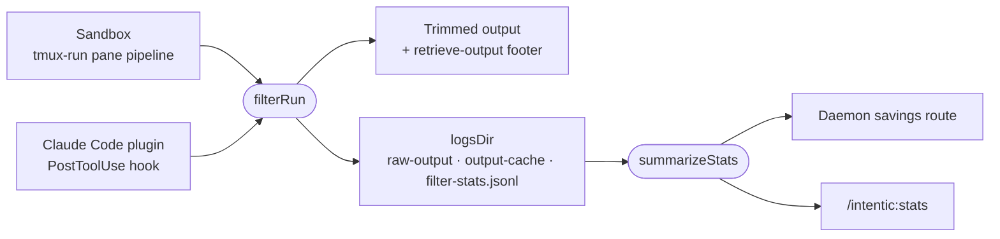

# output-cleaners

Trims a coding agent's Bash output before the model reads it, keeps the raw text retrievable, and ledgers what each cleaner saved.



- Plain node-builtin `.mjs` with hand-written `.d.mts` beside each, so the sandbox image copies the files as written
  (`/usr/local/bin/agent-output-filter`, `cleaners.mjs`, `text-shaping.mjs`, `retrieve-output`) while TypeScript consumers import them
  typed.
- `filterRun` is one command's whole pass with its inputs resolved. The sandbox's adapter is `main` in
  `agent-output-filter.mjs` (argv, `INTENTIC_OUTPUT_CLEANERS`, `INTENTIC_OUTPUT_HOLDOUT`, the pane log);
  the Claude Code plugin's is its PostToolUse hook. Both keep the same three things under `logsDir`.
- Success runs the matching command cleaners, shape folds and the generic cap. A failure keeps its detail up to a
  generous tail. Caps give errors, warnings, stack frames and summaries priority, then at most one neighbouring line
  on each side; priority lines still share the line and byte budget. Repeated diagnostics stay verbatim until a cap
  needs the space. Every path redacts, and a filter error answers with the raw text.
- `templates` folds four or more consecutive log events whose numbers, hex, UUIDs, timestamps, durations, IPs or quoted
  values vary. The first event stays, followed by a count and first/last values. Two constant words must agree, the
  summary must be smaller, and errors, warnings, stack frames and credential assignments break a run. Reads and
  searches skip this stage.
  Four observations avoid folding incidental pairs; `bench` probes the three/four-line boundary.
- `csv-schema` compacts a whole JSON output's arrays of at least five objects. Each row must have at least 80% of the
  shared keys, with consistent non-null column types. A table starts with `[N]{key1,key2,...}`, then exactly N CSV
  records and a newline. Every present cell contains compact JSON inside RFC-4180 CSV quoting; an empty cell means a
  missing key. This distinguishes null, empty strings, numbers and nested values without guessing types. Surrounding
  objects stay compact JSON. [The round-trip tests](src/structured-cleaners.test.mjs) include an independent decoder.
  Mixed arrays, unusual keys, more than 40 columns, cells over 2000 characters, unsafe numbers and credential-bearing
  JSON stay in their original shape. A rewrite must be strictly smaller. Other shape folds skip the resulting table.
- `search` shares an oversized grep/rg/git-grep result's budget across files, one hit per file per pass, then context.
  Each shown file gets its hit count and number shown; a compact summary names files with no shown lines and groups
  them by hit count. Heading mode, line numbers, columns and `-C` context are recognised. Diagnostic lines get priority.
  Wide runs shrink before sampling, and hit-prefix folding runs after it. Unrecognised output, or file names alone
  exceeding the byte budget, falls back to the ordinary cap.
- Each stage has its own ledger name and settings switch. Template folds and search sampling request the same raw
  retrieval footer as a cut inside a wide line, including folds below the usual 20-dropped-line threshold. If a raw
  handle cannot be kept, or the complete footer would grow the output, those summaries are skipped. A cap after
  JSON compaction also requests retrieval, even when the original JSON occupied only one line.
- `filter-stats.mjs` is the only reading of the ledger: the daemon's savings route and the plugin's stats command
  both call `summarizeStats`, so the two reports cannot disagree.
- Secret values come from the sandbox's own stores (`secretValues`), the ones `SECRET_STORES` lists: the desired-state
  `.env` (read with `util.parseEnv`) and `.secrets.json`, and the auth root's `sandbox-secrets.json`, capability
  vault, `keyring-copies.json` (entries a keyring on the owner's computer shares in `copy` mode) and
  `keyring-released.json` (values a keyring released for one use, which the daemon writes only so they mask here and
  empties when it starts). Outside a sandbox that list is empty and only the credential-shaped patterns redact. The daemon's tool-result
  masking imports `SECRET_STORES`, `surfaceForms`, `secretReference` and `SECRET_VALUE_MIN` from here, so the two lanes
  read the same stores and mask the same forms of a value to the same reference.
- Being builtins-only, it keeps its own copies of two contract tables: `SECRET_REFERENCE` (the `{{secret:name}}`
  pattern) and `CREDENTIAL_ISSUERS` (issuer prefixes and token bodies). The daemon's
  `src/secrets/terminal-masking-parity.test.ts` fails when either copy parts from the contract's. Beside a
  credential-shaped name an issuer prefix alone marks a value; elsewhere only the whole token shape does.

## MCP output

The daemon also uses the generic dedup, wide-line and head/tail stages for new MCP text results.
It starts above 16,384 characters, with a 12,000-character body budget. Browser snapshots get a
49,152-character trigger and a 32,000-character budget so more of their indented tree and clickable
refs survive. The footer names `retrieve-output` and, for snapshots, `browser_find`. A bounded sample
of errors from the omitted middle remains visible. Images and other content blocks stay untouched.

The daemon keeps originals in the same `logs/raw-output/` directory and uses the same retention helper
as Bash: the newest 30 files, subject to the daemon’s normal log retention. MCP keeps the whole
original at save time; Bash retains its two-million-character per-file ceiling. A save failure leaves the result whole. Savings, including the footer cost, enter `filter-stats.jsonl` under `mcp`, grouped by tool.
The master `outputCleaners` off switch disables MCP cleaning; `outputHoldout` leaves a stable share of
MCP conversations raw and records them as the control. The dedup, wide and cap selections apply to MCP too; it does not use command-specific cleaners or the repeat cache.

## Key files

- [src/cleaners.mjs](src/cleaners.mjs) — the cleaner registry, the spec parser, redaction and the repeat cache.
- [src/log-templates.mjs](src/log-templates.mjs), [src/json-arrays.mjs](src/json-arrays.mjs) and
  [src/search-fairness.mjs](src/search-fairness.mjs) — the new shape stages.
- [src/output-cap.mjs](src/output-cap.mjs), [src/repeated-output.mjs](src/repeated-output.mjs) and
  [src/cleaner-shapes.mjs](src/cleaner-shapes.mjs) — budgets, repeated-output filters and shared text shapes.
- [src/text-shaping.mjs](src/text-shaping.mjs) — `cleanToolText`, the same generic stages applied to an MCP tool's text, which
  has no command to classify.
- [src/agent-output-filter.mjs](src/agent-output-filter.mjs) — `filterOutput`, `filterRun` and the sandbox's adapter.
- [src/filter-stats.mjs](src/filter-stats.mjs) — the savings summary every report shares.
- [src/retrieve-output.mjs](src/retrieve-output.mjs) — reads back what a footer said was elided.
- [bench/cleaner-bench.mjs](bench/cleaner-bench.mjs) — replays fixtures or real transcripts through cleaner configs.

## Commands

```sh
pnpm --filter @intentic/output-cleaners test
pnpm --filter @intentic/output-cleaners bench corpus ~/.claude/projects
pnpm --filter @intentic/output-cleaners bench corpus ~/.claude/projects --all-only # raw/all and stage totals
# Compare against a saved prior filter on exactly the same corpus snapshot:
pnpm --filter @intentic/output-cleaners bench corpus ~/.claude/projects --all-only --baseline-filter /tmp/prior/src/agent-output-filter.mjs
```
