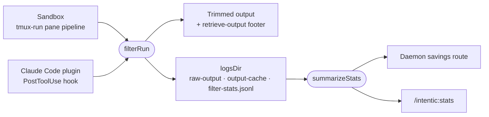

# output-cleaners

Trims a coding agent's Bash output before the model reads it, keeps the raw text retrievable, and ledgers what each cleaner saved.



- Plain node-builtin `.mjs` with hand-written `.d.mts` beside each, so the sandbox image copies the files as written
  (`/usr/local/bin/agent-output-filter`, `cleaners.mjs` and every module it imports, `retrieve-output`) while TypeScript
  consumers import them typed. A new module needs a place on the Dockerfile's COPY line: one missing there kills the filter
  at load, and every command falls back to raw output without a sound. A test in `src/tests/agent-output-filter.test.mjs` holds the line to the
  import graph.
- `filterRun` is one command's whole pass with its inputs resolved. The sandbox's adapter is `main` in
  `agent-output-filter.mjs` (argv, `INTENTIC_OUTPUT_CLEANERS`, `INTENTIC_OUTPUT_HOLDOUT`, the pane log);
  the Claude Code plugin's is its PostToolUse hook. Both keep the same three things under `logsDir`.
- Success runs the matching command cleaners, shape folds and the generic cap. A failure keeps its detail up to a
  generous tail. Caps give errors, warnings, stack frames and summaries priority, then at most one neighbouring line
  on each side; priority lines still share the line and byte budget. Repeated diagnostics stay verbatim until a cap
  needs the space. Every path redacts, and a filter error answers with the raw text.
- `templates` folds four or more consecutive log events whose numbers, hex, UUIDs, timestamps, durations, IPs or quoted
  values vary. The first event stays, followed by a count and first/last values. Two constant words must agree, the
  summary must be smaller, and errors, warnings, stack frames and credential assignments break a run. Reads and
  searches skip this stage.
  Four observations avoid folding incidental pairs; `bench` probes the three/four-line boundary.
- `csv-schema` compacts a whole JSON output's arrays of at least five objects. Each row must have at least 80% of the
  shared keys, with consistent non-null column types. A table starts with `[N]{key1,key2,...}`, then exactly N CSV
  records and a newline. Every present cell contains compact JSON inside RFC-4180 CSV quoting; an empty cell means a
  missing key. This distinguishes null, empty strings, numbers and nested values without guessing types. Surrounding
  objects stay compact JSON. [The round-trip tests](src/tests/structured-cleaners.test.mjs) include an independent decoder.
  Mixed arrays, unusual keys, more than 40 columns, cells over 2000 characters, unsafe numbers and credential-bearing
  JSON stay in their original shape. A rewrite must be strictly smaller. Other shape folds skip the resulting table.
- `search` shares an oversized grep/rg/git-grep result's budget across files, one hit per file per pass, then context.
  Each shown file gets its hit count and number shown; a compact summary names files with no shown lines and groups
  them by hit count. Heading mode, line numbers, columns and `-C` context are recognised. Diagnostic lines get priority.
  Wide runs shrink before sampling, and hit-prefix folding runs after it. Unrecognised output, or file names alone
  exceeding the byte budget, falls back to the ordinary cap.
- Each stage has its own ledger name and settings switch. Template folds and search sampling request the same raw
  retrieval footer as a cut inside a wide line, including folds below the usual 20-dropped-line threshold. If a raw
  handle cannot be kept, or the complete footer would grow the output, those summaries are skipped. A cap after
  JSON compaction also requests retrieval, even when the original JSON occupied only one line.
- `filter-stats.mjs` is the only reading of the ledger: the daemon's savings route and the plugin's stats command
  both call `summarizeStats`, so the two reports cannot disagree.
- Secret values come from the sandbox's own stores (`secretValues`), the ones `SECRET_STORES` lists, all in the auth
  root: `sandbox-secrets.json`, the capability vault, `keyring-copies.json` (entries a keyring on the owner's computer shares in `copy` mode) and
  `keyring-released.json` (values a keyring released for one use, which the daemon writes only so they mask here and
  empties when it starts). Outside a sandbox that list is empty and only the credential-shaped patterns redact. The daemon's tool-result
  masking imports `SECRET_STORES`, `surfaceForms`, `secretReference` and `SECRET_VALUE_MIN` from here, so the two lanes
  read the same stores and mask the same forms of a value to the same reference.
- A value shorter than `SECRET_VALUE_MIN` (12) masks only where its context names a secret
  ([src/short-secrets.mjs](src/short-secrets.mjs)): after a key naming a secret or the secret itself (`password=v`,
  `"api_key": "v"`, `NAME=v`, a vault field such as `password: v` for `netdisk/password`), as a flag's argument
  (`--password v`, `mysql -pv`, `sshpass -p v`), or as a URL's userinfo password. Masked bare, a 6-character value would
  blank every coincidence in ordinary output. The daemon's tool-result masking runs the same function; the stream
  wrapper Codex and ACP shells run under masks exact values only, since a chunked stream has no whole lines to read.
- Being builtins-only, it keeps its own copies of two contract tables: `SECRET_REFERENCE` (the `{{secret:name}}`
  pattern) and `CREDENTIAL_ISSUERS` (issuer prefixes and token bodies). The daemon's
  `src/secrets/terminal-masking-parity.test.ts` fails when either copy parts from the contract's. Beside a
  credential-shaped name an issuer prefix alone marks a value; elsewhere only the whole token shape does.

## Test runs and compiler output

- `rustc` ([src/rust-diagnostics.mjs](src/rust-diagnostics.mjs)) runs before every other stage, on success and failure
  alike, on output with a cargo/rustc diagnostic that points at code (`--> file:line:col`). Errors with their spans move
  first. A warning printed more than once (a lint at many call sites, a workspace-wide manifest warning) becomes one
  line with its count and up to three places; one printed once stays whole. A note line at the top says what moved.
- A test command's run is read as tests ([src/test-runs.mjs](src/test-runs.mjs)): cargo test and nextest by crate and
  test, bun test by file and name, and vitest, jest, pytest and go test from their default reporters, best-effort. The
  command must name a runner (`cargo test`, `bun test`, `suites`, `pnpm test`, …) and the output must be one a parser
  recognises. Then [src/test-digest.mjs](src/test-digest.mjs) finds the test command in the line, split as the shell
  splits it (`&&`, `||`, `;`, newlines, quotes), and reads git where it ran (every `cd` before it followed): HEAD,
  whether the tree is clean, the main line (`intentic.mainBranch`, else `main`, `master`, `origin/HEAD`) and the fork
  point from it. A line it cannot split safely (a heredoc, a subshell, a compound command) is read by its leading `cd`s
  alone.
- Every such run is recorded under `logsDir/test-outcomes/` ([src/test-outcomes.mjs](src/test-outcomes.mjs)): one JSON
  file per run, named by its commit, holding its failures with their first line, its passes as short hashes, and the
  machine's load as it ended (the 1-minute load average over the host's cores; runs recorded before 2026-11-22 have
  none). A run on a clean tree at a commit on the main line is that commit's **baseline**, and so is a test command run
  under `base run`, at the fork point (or the main-line commit its `--at` names). The record keeps at most 1000 files, 32 MiB and 21 days, dropping work runs before baselines. The daemon's
  log pruner counts the directory on its own.
- A run with a failing test ends with a digest after the footer, ledgered as `tests`: the counts, then one line per
  failure with its first panic, assert or error line. A cargo failure gets only a reason that names it (its thread's
  panic, or its own `---- name stdout ----` section); parallel tests interleave their panics, so one whose message is
  not surely its own gets only its place, and one with nothing of its own gets no reason rather than a neighbour's.
- Each failure is labelled against the baseline at the fork point, or the nearest recorded main commit within 50
  commits, in this order: `new: passes at main@X` (only a baseline run that passed the test makes its failure new),
  `not run at main@X: no recorded run there includes it`, and `also fails at main@X (seen 2h ago)`. Past 15 lines the
  rest are counted by label. A new failure on a loaded machine names the load: when this run's load per core is at
  least 0.75 and at least twice that of the baseline run that passed the test at the highest load, the label says both
  (`new: passed at main@X at load 2.1/16; this run at 14.3/16, …`) and suggests `base run` to compare at the same load.
  A run that is itself a baseline says its failures are main's.
- With no baseline, or with failures no baseline run included, the digest names the command that records one: the
  line's test command alone, its env assignments and `timeout` kept and its pipes and redirections dropped, as
  `cd <dir> && base run <cmd>` (the `cd` only where the tests ran elsewhere) when `base` is on `PATH`, else in a clean
  checkout of the fork point. Where the line holds no single test command it can split out (a heredoc, two test
  commands), it says to run the test command alone through `base run`, never a line that would edit files there.
- `agents ci` (`GET /ci/main`, the daemon's `ci/known/main-known.ts`) lists each repository's newest baselined main
  commit and what failed there, beside CI's failures, through `mainBaselines` (`@intentic/output-cleaners/outcomes`).
- The sandbox adapter records under the logs directory and names the run's conversation (`INTENTIC_TURN_OWNER`).
  A turn with no logs directory (an agent domain) gets the digest without the record. `INTENTIC_TEST_OUTCOMES=0` turns
  both off. The plugin's hook passes no `outcomes`, so it makes neither.

## MCP output

The daemon also uses the generic dedup, wide-line and head/tail stages for new MCP text results.
It starts above 16,384 characters, with a 12,000-character body budget. Browser snapshots get a
49,152-character trigger and a 32,000-character budget so more of their indented tree and clickable
refs survive. The footer names `retrieve-output` and, for snapshots, `browser_find`. A bounded sample
of errors from the omitted middle remains visible. Images and other content blocks stay untouched.

The daemon keeps originals in the same `logs/raw-output/` directory and uses the same retention helper
as Bash: the newest 500 files within 200 MB, subject to the daemon’s normal log retention. MCP keeps the whole
original at save time; Bash retains its two-million-character per-file ceiling. A save failure leaves the result whole. Savings, including the footer cost, enter `filter-stats.jsonl` under `mcp`, grouped by tool.
The master `outputCleaners` off switch disables MCP cleaning; `outputHoldout` leaves a stable share of
MCP conversations raw and records them as the control. The dedup, wide and cap selections apply to MCP too; it does not use command-specific cleaners or the repeat cache.

## Key files

- [src/cleaners.mjs](src/cleaners.mjs) — the cleaner registry, the spec parser, redaction and the repeat cache.
- [src/log-templates.mjs](src/log-templates.mjs), [src/json-arrays.mjs](src/json-arrays.mjs) and
  [src/search-fairness.mjs](src/search-fairness.mjs) — the new shape stages.
- [src/output-cap.mjs](src/output-cap.mjs), [src/repeated-output.mjs](src/repeated-output.mjs) and
  [src/cleaner-shapes.mjs](src/cleaner-shapes.mjs) — budgets, repeated-output filters and shared text shapes, among them
  what of a multi-line secret masks on its own.
- [src/text-shaping.mjs](src/text-shaping.mjs) — `cleanToolText`, the same generic stages applied to an MCP tool's text, which
  has no command to classify.
- [src/agent-output-filter.mjs](src/agent-output-filter.mjs) — `filterOutput`, `filterRun` and the sandbox's adapter.
- [src/stats/filter-stats.mjs](src/stats/filter-stats.mjs) — the savings summary every report shares.
- [src/test-runs.mjs](src/test-runs.mjs), [src/test-outcomes.mjs](src/test-outcomes.mjs), [src/test-digest.mjs](src/test-digest.mjs) and
  [src/rust-diagnostics.mjs](src/rust-diagnostics.mjs) — test runs read as tests, their record and digest, and folded rustc diagnostics.
- [src/retrieve-output.mjs](src/retrieve-output.mjs) — reads back what a footer said was elided.
- [bench/cleaner-bench.mjs](bench/cleaner-bench.mjs) — replays fixtures or real transcripts through cleaner configs.

## Commands

```sh
pnpm --filter @intentic/output-cleaners test
pnpm --filter @intentic/output-cleaners bench corpus ~/.claude/projects
pnpm --filter @intentic/output-cleaners bench corpus ~/.claude/projects --all-only # raw/all and stage totals
# Compare against a saved prior filter on exactly the same corpus snapshot:
pnpm --filter @intentic/output-cleaners bench corpus ~/.claude/projects --all-only --baseline-filter /tmp/prior/src/agent-output-filter.mjs
```
