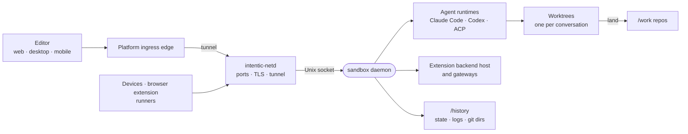

# sandbox

The Node daemon at the center of every sandbox: it runs coding agents in git worktrees, serves the workspace to the editor, and lands their work.

## Key files

- [src/main.ts](src/main.ts) — boot phases in the order the daemon needs.
- [src/composition.ts](src/composition.ts) — service slices, dependency order and reaction wiring.
- [src/app.ts](src/app.ts) — HTTP middleware and the raw and contract route doors.
- [src/router.ts](src/router.ts) — domain route factories assembled into the contract's shape.
- [src/agent/run/stream-agent.ts](src/agent/run/stream-agent.ts) — one turn, from placement to settlement.
- [src/runtimes/runtime-table.ts](src/runtimes/runtime-table.ts) — provider and harness adapter selection.

## Find the implementation

Start with the behavior, then follow the owning module's imports. `agent/` prepares and runs turns; `runtimes/`
adapts providers and harnesses to that engine. `conversations/` owns durable conversation identity, live actors,
fleet cards, worktrees and landing. `sessions/` stores and reads provider sessions and transcript frames; a
conversation can continue across several provider sessions. These boundaries follow ownership rather than the
word “agent” in the UI.

| Behavior | Start here | Follow for |
| --- | --- | --- |
| Start, continue or recover a turn | [agent/run/stream-agent.ts](src/agent/run/stream-agent.ts) | [turn admission](src/agent/run/turn/turn-admission.ts), [resume and recovery](src/agent/run/turn/turn-resume.ts), [provider/session routing](src/conversations/registry/routing.ts) |
| Run the Claude Code loop | [harness/claude-code-runner.ts](src/agent/run/harness/claude-code-runner.ts) | [SDK stream frames](src/agent/run/harness/claude-code-stream.ts), [harness planning](src/agent/run/harness/harness-plan.ts); this harness also serves other providers |
| Add or repair a runtime | [runtimes/runtime-table.ts](src/runtimes/runtime-table.ts) | The selected provider adapter and its execution module; [Claude's adapter](src/runtimes/claude/claude-provider.ts) connects to the shared harness. Adding a provider is a row in the contract's `PROVIDER_SPECS` (`models/provider-specs.ts`) and one in its trait table `PROVIDER_TRAITS` (`models/providers/provider-traits.ts`: hub travel, compliance hosts, effort scale, sign-in shape, placement…), which the compiler makes complete; surfaces read a trait, never `provider === "x"` |
| Change conversation state or cards | [registry/agents-registry.ts](src/conversations/registry/agents-registry.ts) | [actor decisions](src/conversations/actor/conversation-decide.ts), [title policy](src/conversations/registry/naming/title-policy.ts), [summary projection](src/conversations/registry/projection/agent-summary.ts) |
| Page or reconstruct a transcript | [conversations/transcript-page-answer.ts](src/conversations/transcript-page-answer.ts) | [session storage](src/sessions/session-store.ts), [session readers](src/sessions/sessions.ts) |
| Change a turn's prompt | [agent/prompt/system-prompt.ts](src/agent/prompt/system-prompt.ts) | [guidance assembly](src/agent/prompt/guidance.ts) and the selected runtime's prompt adapter |
| Create a worktree or land work | [worktrees/worktrees.ts](src/conversations/worktrees/worktrees.ts) | [landing](src/conversations/land/land.ts) and [turn placement](src/agent/run/placement/turn-placement.ts) |
| Know who else changes a file, or held work the main line moved under | [files-in-flight.ts](src/conversations/files-in-flight.ts) | [drift](src/conversations/overlap/branch-drift.ts), [who is told](src/conversations/overlap/branch-drift-news.ts), [the fleet's view](src/conversations/recall/fleet-overlap.ts) |
| Carry a conversation on by itself: a loop's rounds, or a turn stopped on a large context | [loops/loop-runner.ts](src/loops/loop-runner.ts) | [context stops](src/loops/context-continue.ts), [`agents loop` and `agents continue`](src/loops/fleet-loop.routes.ts), [what a round is told](src/loops/loop-brief.ts) |
| Schedule or fire an automation | [automations/scheduler.ts](src/automations/scheduler.ts) | [admission and concurrency](src/automations/fire/automation-fire.ts), [wake execution](src/automations/fire/run-fire.ts), [fire options](src/automations/fire/fire-options.ts) |

From the repository root, locate source first and then read the tests beside the owning seam:

```sh
rg -n 'provider session' _sandbox/sandbox/src -g '!*.test.ts' -g '!*.testing.ts'
rg -n 'routingFor' _sandbox/sandbox/src -g '!*.test.ts' -g '!*.testing.ts'
rg -n 'routingFor' _sandbox/sandbox/src -g '*.test.ts'
```

Source filtering reduces fixture matches while locating the implementation; the covering tests explain the
behavior to preserve. Keep those tests beside their seams. Generated entry lists are
[slice-registry.ts](src/bootstrap/slices/slice-registry.ts) and [app-raw-routes.ts](src/app-raw-routes.ts);
[scripts/write-indexes.mjs](scripts/write-indexes.mjs) owns both. Environment settings start at
[env.config.ts](src/env.config.ts).

## Layout

The directories under `src/` are layered, lowest first, and a value import may only reach its own layer or a lower
one ([layers.json](layers.json), checked by `daemon-boundaries`). Above every layer sits the surface: the root files
(`app.ts`, `composition.ts`, `router.ts`, `main.ts`), every `*.routes.ts` and every `*.testing.ts`. Inside each unit
`subunits` lists (`agent/`, `conversations/`), each immediate subdirectory and the unit's root files are subunits, and a new
value import closing a cycle between two of them fails too (standing ones: `_tools/checks/baselines/daemon-subunits.json`).

<!-- >>> generated from layers.json: edit it there, then run node _tools/checks/layer-tables.mjs --fix -->
| Layer | Holds | Directories |
| --- | --- | --- |
| foundation | storage, ports and primitives every other layer stands on; they know no subsystem | `store/` `seams/` `http/` `offload/` `netd/` `fences/` `speech/` `areas/` `workload/` `safety/` `tunnel/` `image/` `retry/` |
| host | what the box itself offers: identity, secrets, files, git, processes, engines, the OS and its network | `auth/` `access/` `roles/` `secrets/` `guard/` `git/` `workspace/` `derived/` `hashline/` `engines/` `terminal/` `processes/` `privacy/` `environment/` `peers/` `push/` `ports/` `exit/` `vpn/` `netdisk/` `usage/` `logs/` `rules/` `endpoints/` `trial/` `system/` `activity/` `audit/` `org/` |
| connections | what the owner connected: capabilities, browsers, devices, extensions, channels and published files | `capabilities/` `browser/` `desktop/` `webext/` `phones/` `hosts/` `wallet/` `sandboxes/` `runners/` `scaffold/` `extensions/` `panels/` `public/` `share/` `webchat/` `issues/` `definition/` |
| agent | the turn engine, its runtimes, conversations, transcripts and the code a turn runs | `agent/` `runtimes/` `conversations/` `sessions/` `execution/` |
| orchestration | what starts and steers turns on its own: automations, loops, workflows, CI repair, chores, needs, settings, and what reconciles the connections hub | `automations/` `compliance/` `loops/` `workflows/` `ci/` `chores/` `links/` `needs/` `approvals/` `settings/` `portability/` `migrations/` `history/` `retention/` `hub/` |
| composition | boot wiring and whole-daemon self-checks, which import every layer and are imported by none | `bootstrap/` `invariants/` `harness/` |
| (none) | in no layer: the boundary check places no module here | `e2e/` |
<!-- <<< end of generated layers.json -->

Beside `src/`, the image copies a few directories as they are: `bin/` (the command runners and asking CLIs),
`seed-skills/` (the skills baked into `/root/.claude/skills`), and `claude-policy/`, Claude Code's managed settings
and the policy mod they run first (`/etc/claude-code`, `/opt/intentic-claude-policy`). `starter/` is the baked starter
site's own build (`starter.Dockerfile`, run by `_tools/scripts/image/prepare-image-trees.sh`), with
`normalize-starter.mjs`, which takes pnpm's clocks out of it so its image layer is the same bytes until the template
changes. Each build resolves dependencies with a fresh registry metadata cache, so cached version lists cannot
disagree with newly resolved transitive dependencies. `starter-site/` is intentic's own first page, laid over the
template's there. The starter pins the canonical template revision used by CI's scaffold integration tests: upstream
`main` no longer includes its Astro landing template. `STARTER_TEMPLATE_REF` explicitly overrides the image build's
pin. `src/` itself is not shipped: the image runs `dist/`.
`golden/host-files.json` is not copied: it names every file the daemon and `ic` both touch across the container
boundary, with an example of each body the daemon defines, written by `src/system/host-files.test.ts` and read by
ic's own tests, so a rename on either side fails a test instead of a rollback.

The image sets `SHELL=/bin/bash` and `CLAUDE_CODE_SHELL=/bin/bash` for agent commands. tmux also parses command
strings with Bash, while `default-command zsh` keeps the person's interactive terminals in zsh. (2026-10-27: an agent
passed a file list as one argument under zsh because it expected Bash's field splitting. Setting a few zsh options
was rejected because it cannot make zsh implement Bash.) The image smoke probe checks both ordinary and login
shells, nested shell calls, and the interactive terminal's configuration before release tags move.

A slice's test fake sits beside its slice as `<slice>.testing.ts` (for example `auth/auth-slice.testing.ts`), along with the in-memory stores it holds. `harness/route-services.testing.ts` spreads those fakes into one `Services`, so a new service gets its fake in the slice it joins.

The asking CLIs (`capabilities`, `secrets`, `environment`, `grants`, `needs`) write errors to stdout.
A need verdict exits 0 when met, 1 when refused, or 3 while open; misuse, HTTP/transport failures,
unreadable answers and crashes exit 2 because no verdict was reached.



- It runs as the child of `intentic-netd` ([../netd](../netd)), which owns every port, the TLS certificate and
  the platform tunnel, and relays HTTP over a Unix socket. The daemon decides, netd binds.
- AI literacy confirmations live per member and notice version in `/history/member-ai-literacy.json`; member confirmation and maintainer listing use the settings routes. Visitor chat public config includes the AI disclosure flag and optional wording.
- Two roots: `/work` is what agents edit; `/history` is the daemon's own (git dirs, worktrees, the conversation
  database, snapshots, logs) and sits outside `/work`.
  It is not out of an agent's reach: an unfenced agent runs as root in the default agent domain and can write it.
- The auth-root JSON stores for sandbox secrets, capability credentials, extension credentials, and privacy tokens are
  encrypted at rest when `INTENTIC_AT_REST_KEY_FILE` names a mounted key file, which `ic` mounts for every sandbox it
  sets up or recreates (one key per sandbox, kept in `~/.intentic/keys/` on the host; `INTENTIC_AT_REST=off` opts out).
  `/health.atRestEncryption` reports whether this is active and names those four stores and provider account files.
  Existing plain files are encrypted at boot; every write uses a fresh AES-256-GCM nonce. With no key configured, these
  files keep their original plain format.
- A secret can live in a keyring on the owner's own computer (`intentic-keyring`, [../../_devices/keyring](../../_devices/keyring))
  instead: the sandbox holds a pointer to each entry shared with it (`secrets/device/`), resolves a `{{secret:NAME}}`
  reference to it like any stored name, and asks that computer for a value one use at a time, after the gates and the
  host guard, with a grant signed by its own keyring keys (public halves served at `GET /keyring/keys`). A released
  value is kept only to mask, so every use asks again; an entry shared in `copy` mode is kept here as an ordinary secret.
- An agent can ask by need instead of by name (`secrets/device/keyring-needs.ts`, `POST /secrets/want`, the `secrets
  want` CLI, `type_secret` with `for`): the need goes over the device link's `keyringNeed` to each online computer
  whose keyring is set up, most recently answered first. The first yes wins and that computer's shares are read at
  once, so the name resolves on the next use; an answer the person has not given yet (`pending`) ends the round and
  waits in Passwords on that computer; when nothing fits anywhere, the computer used last is asked again with its
  type-once box. Every need is kept in `keyring-needs.json` under the auth root, and a pending one turns allowed by
  itself when a later read of that computer lists an entry serving its place. `GET /secrets/wants`
  (`secrets/device/wants.routes.ts`) lists the ones still waiting, which the Secrets view draws under "Needs attention".
- Terminal capture (`secrets/device/terminal-capture.ts`, `secrets/device/prompt-capture.ts`): netd watches the sessions the person
  types into (`web-…`, never an agent's). When a password prompt is left without a newline and the pane's tty then has
  echo off, netd edits the next line as the tty does and tells this daemon `ToNode::HiddenLine` once, then drops it
  ([netd's term/hidden.rs](../netd/crates/netd/src/term/hidden.rs)). Here the prompt is judged again, so one-time
  codes are skipped. The value is then sealed to the inbox key of the most recently active computer whose keyring has
  remembering from sandboxes on, and sent with `keyringCapture`. The pane gets one dim "Saved … to Passwords on …" line.
- Phone passwords (`phones/phone-passwords.routes.ts`, `/system/phones/passwords/*`): the Intentic Device app, as
  Android's autofill service, lists the owner's keyrings (online, locked, inbox key, whether remembering from the phone
  is on there, whether this phone is paired), pairs with one, sends what the person signed in with already sealed to
  that keyring's inbox key, and asks for a fill signed by its biometric-gated key. Each request carries the phone's own
  enrollment token, the one its socket presents, is held to 30 a minute per phone (fills to 10), and is relayed to the
  named computer over its device link; a keyring's refusal comes back as the body. Pairings the keyring said yes to are
  kept in `phone-pairings.json` on the history volume, only to answer `paired`.
- `mcp__secrets__type_secret` (`browser/tools/secrets-tools.ts`, `secret-typing.ts`) types a secret without the agent
  seeing it into whichever of these the turn mounted: a sandbox browser's page, the sandbox's desktop (xdotool reading
  the value on stdin, only into a program on the secret's list), the focused window on one of the owner's computers or
  an app on a phone attached to one (typed by that computer's keyring, which checks the window), and a page in the
  owner's own browser (a one-time ticket the extension redeems at `POST /system/webext/secret`).
- Files cross between the owner's own browser and the artifacts shelf through two doors on the extension's token
  (`browser/cast/media-shelf.ts`, `webext/file-tickets.ts`): `POST /system/webext/media` stores what the agent saved from a page
  (`save_media`, or a download its click started) under `.intentic/records/artifacts/chrome/` with a sanitized name, at
  most 50 MB; `POST /system/webext/file` hands one shelf file to the browser for `upload_file`, only for a one-time
  ticket the daemon adds to that call on its way to the browser, after checking the file's real path is on the shelf.
- `chatgpt_image` on the owner's own browser does not hold the turn (`agent/tools/jobs/daemon/chatgpt-image-jobs.ts`,
  2026-11-17): the MCP door makes the extension's call itself and files it as a background job the daemon runs in its
  own process (`daemon-jobs.ts`), so the agent is answered within seconds with a job id that `wait` collects (the saved
  path, or why no image came), the card lists, `stop` ends and a turn ended on it is woken by. A refusal that comes back
  within 5 s is the call's own answer, with no job. Calls queue per browser (`job-lanes.ts`): two at once, one at a time
  until one image has been made since boot (so two first calls do not both make the sandbox's ChatGPT project), and one
  chat's calls one after another. The door also rewrites the tool's description in the listing, since the extension's
  own describes one blocking call. A turn with no conversation has nobody to wake, so its call still waits for the
  picture; a restart mid-image ends the job as lost, and the image may still land on the shelf.
- The audit trail (`audit/`, `/history/audit/`): who changed a setting, a member, an area, a secret's gate or a policy,
  who signed in, what was exported or deleted, and with `settings.audit.recordReads` who opened what. One middleware
  records by contract route name (`audit/audit-http.ts`); another module calls `services.audit.record({ actor, action,
  target?, details? })`, which never waits and never throws. Records are hash-chained in monthly files, pruned by
  `settings.audit.retentionDays` behind a checkpoint, and forwarded to `settings.audit.forwardUrl` from a persisted
  cursor. The chain shows tampering; only the forwarded copy is out of the agent's reach.
- The machine that runs a sandbox is a sign-in of its own (`auth/host/host-session.ts`, 2026-10-16), so the desktop
  app and Intentic OS open their own sandboxes with no network. `ic sandbox session <slug>` runs
  `node /opt/sandbox/dist/auth/host/host-session-cli.js` through `docker exec`, as root: it reads the 0600 session secret and the
  owner file and prints an ordinary daemon session for the BOUND owner, proven by `host`. The trust model: whoever can
  `docker exec` into the container is root over it already, so the session adds nothing they lack; there is no HTTP
  route that mints one, and an agent in the unprivileged domain cannot read either file; a sandbox nobody has bound
  refuses (the first binding still takes a real sign-in with the connect token); every request is still authorized
  against the owner file and roster, so a new owner or "sign out everywhere" (which re-keys the secret) ends it; a
  `host` proof meets the require-passkey policy, as root over the box would anyway, but stands only on a request
  netd marked as arriving on the loopback port (`auth/proofs/listener.ts`; `BOUND_TO_LISTENER` in `auth/proofs/proof-methods.ts`),
  never over the tunnel, and lasts a week rather than a month, since its token is kept on the machine's disk. Each
  mint is an `auth.sign_in` record with `methods: ["host"]`: the trail has one writer, so the script leaves a note in `/history/audit/inbox/`
  that the audit tick records and deletes. The platform's own id for the sandbox's row, which its announce answers,
  is kept in `/history/platform-row.json` for the same reader (`store/platform-row.ts`), and so is the sandbox's name
  and logo in `/history/presentation.json` (below).
- On the loopback port, and only there, CORS also admits the desktop app's bundled page (`tauri://localhost`,
  `http://tauri.localhost`): netd marks a request that arrived on that port (`x-intentic-listener: loopback`, stripped
  from anything arriving from outside), so no sandbox needs recreating with a wider `WEB_ORIGIN`
  (`auth/browser-origins.ts`). CORS decides which page may read an answer; the bearer is still the boundary.
  `GET /agents/attention` (the owner's only) counts what needs the owner and what is working by the board's own rules
  (sandbox-contract `models/agent-lanes.ts`), for the desktop app's status bar and `ic sandbox attention`.
- Routes that hand out a conversation's words by id (`/activity`, `/fleet`, `/loops`, `/share`, `/privacy/log`, held
  wakes, `/sessions`, `/children`, `/needs/mine`) answer someone below maintainer only for conversations the roster
  shows them (`auth/scope/conversation-reader.ts`). _(2026-10-13) They answered every member alike._
- A history snapshot leaves out any file over 32 MiB (`history/large-files.ts`). A restore neither brings such a file
  back nor deletes it. _(2026-10-09) Snapshots had no size limit: a 30 GB folder of films dropped into `/work` was
  hashed and stored a second time on `/history`._
- Routes are declared in `@intentic/sandbox-contract`, implemented in `*.routes.ts` and assembled in `src/router.ts`.
  `/events` pushes file, git and fleet changes to the browser. The shared tree's watcher covers `/work` alone; a
  conversation's own checkout is watched one folder at a time, for as long as a reader with a file of it open renews a
  60-second lease (`workspace.followCheckout`, `workspace/watch/checkout-follow.ts`, at most 64 folders), and its
  changes go out as `checkoutChanged` to readers who may see that conversation.
- It registers with the platform at boot (`system/boot/announce.ts`), then announces again about once an hour
  (jittered by a tenth) as its heartbeat, naming which copy it is: `instance` (netd's `INTENTIC_INSTANCE`, else an
  id minted once per process), `host` (`HOST_LABEL`) and `os` (`HOST_ENV`, else `HOST_PLATFORM`). (2026-10-05) It
  went quiet once accepted, so the platform's last-seen time was its registration. A refusal or an
  unreachable platform is retried for as long as the daemon runs, every few seconds for ten minutes and every five
  minutes after; only a deletion record (410) ends it. `/health`'s `announce` says which no it got (`reason`: `unknown`
  or `deleted`) and which database took it (`identity`). The owner's Reconnect (`POST /platform/relink`,
  `system/boot/relink.routes.ts`) registers at once, first having a platform with no record of the sandbox adopt it
  with the ticket the owner's browser got and the grant the daemon holds. A browser opening the sandbox's own address
  is sent to the app's `/open` on it (`GET /`, `system/boot/open-in-app.ts`). (2026-10-02) It used to give up after
  ten minutes and wait for a restart, which nobody knew to do while the platform said the sandbox did not exist.
- (2026-11-09) The sandbox keeps a copy of the name and logo the platform holds for it, so a client that reaches it
  while the platform is down still shows them (`system/presentation/presentation-mirror.ts`). It lives in
  `/history/presentation.json` as `{ name, image?, digest?, at }` (`system/presentation/presentation-store.ts`, a plain file `ic` reads like
  `platform-row.json`). An accepted announce carries `presentationDigest`, and the daemon asks the platform's
  `presentation` route again only when that differs from its copy's digest. It also keeps what an export's ask hears
  and what an adoption the platform took sent. Only the platform's own 200 changes the copy; an unreachable or refusing
  platform never removes it. `GET /system/presentation` reads it (any member, not a guest; never on `/info`, which is
  read often while a logo is up to 150 KB), and `POST /system/presentation/refresh` asks the platform now, answering
  the copy held with `refreshed: false` when it cannot. The newest identity key an announce taught is kept in
  `/history/platform-identity-key.pem` and read at boot when `PLATFORM_IDENTITY_KEY` is unset, so a daemon restarted
  during an outage still verifies email-code sign-ins (`auth/platform/platform-identity-key.ts`).
- (2026-11-03) A run on one of the owner's computers (`bin/devices run`, the Run dialog's Run on <device>) builds
  in the owner's own tree, the tree every land writes into, so while its build runs it holds that repository's lands
  (`hosts/runs/run-builds.ts`): a land into it waits (`conversations/land/turn-landing.ts` and `land-by-hand.ts` call
  `waitForRunBuilds`, and the conversation's activity says which run it waits for) and goes ahead when the build ends.
  The command renews the hold every 20 s; one not renewed for a minute, or held for 30 minutes, lapses, so a hung or
  killed build never holds lands for good. An isolated conversation's build is in its own checkout and holds nothing.
  The command reads the tree before and after its build and says when it moved anyway (a land already writing, the
  owner's own edits). Each run keeps the commit and uncommitted-path count it was built from (`builtFrom`), who started
  it and the lands since, which the Run dialog shows as "Built from abc1234 · 3 lands since". (2026-11-02, in the
  owner's shinobi workspace: a build read half-old, half-new source while agents landed, 13 failed calls in 11
  minutes.) A stop says who made it (the dialog's Stop, Run again, Ctrl+C, `devices stop` or `app_stop` from a named
  conversation, stamped on an agent's app_stop in `hosts/host-call-route.ts`), and from an agent's shell `devices run`
  refuses to replace a run of the target that its conversation did not start unless it is passed `--replace`. The
  ports list names the conversation and job behind every agent's port (`agent/tools/jobs/port-owners.ts`), which
  `devices ports` prints and the desktop mirror reads to leave an agent's own server off the owner's localhost.
- (2026-11-17) `devices copy <from> <to>` (`bin/devices`) copies a file or a folder between an agent's shell and a path
  on one of the owner's computers, either way; one side is written `<device>:<path>`. The CLI reads and writes the
  bytes in the shell's own view of `/work`, and `hosts/device-files.routes.ts` (`POST` and `GET
  /devices/{name}/files`) relays them over the device link in 2 MiB `copyFile` chunks, so nothing passes through the
  model. Like `devices push` it is held to the computers the conversation's turn mounts, and the computer holds each
  chunk to its folders and, for a copy onto it, its "Create and change files" switch. A copy onto a computer probes
  first, so a refusal arrives before any bytes are sent. A copy off one streams to the CLI, and the daemon checks it
  against the computer's sha256 before it passes on the last piece. Each chunk waits up to two minutes, and packing or
  unpacking a folder up to ten. (In the shinobi-society audit, agents moved a 12 MB tarball with `docker cp` through
  rog's `run_command`.)
- (2026-11-19) `devices exec <device> [--in wsl] [--fetch <path>] -- <command>` (`bin/devices-exec.mjs`, also `gpu-run --on
  <device>`) runs a command on one of the owner's computers in a mirror of the shell's checkout kept there. It mirrors
  what git tracks plus untracked files it does not ignore, sends only the files whose sha256 changed since its last run
  (a manifest per mirror under `~/.cache/intentic/device-mirrors`), and the computer unpacks them with fresh
  modification times, so an incremental build rebuilds them. It deletes there what was deleted here. It carries a
  stage folder over `/devices/{name}/files` and starts the computer's own script (`bin/devices-exec-scripts.mjs`:
  PowerShell on Windows, a login `sh` on Linux, macOS or through `wsl.exe` in a distro) with the command on its
  command line, where the computer's switches judge it. It streams the output over `/devices/{name}/apps/{id}/output`
  and copies `--fetch` paths home. `GET /devices/{name}/facts` (`hosts/device-door.routes.ts`) tells it the OS, home,
  allowed folders and WSL distros. The mirror keeps a generation mark: a mirror changed or lost there, or a manifest
  lost here, shows as a mismatch, and the run sends everything again. Runs on one computer go one at a time (a lock per
  device here, and the computer's own run list), and a program the command needs that is missing there is named before
  anything runs. (In the shinobi-society audit, one agent copied 208 MB to a laptop and built for 9 minutes by hand, and
  another spent 25 calls and 17 minutes of `app_status` on 5 rounds, touching LastWriteTime so cargo would rebuild.)
- (2026-11-19) The Deployments board reads, drives and deploys Docker compose stacks on the owner's computers with no
  Komodo in between (`hosts/stacks/device-stacks.ts`, `/system/devices/{id}/stacks…`). The daemon only relays to the
  machine's own stack tools, which check its switches, so a refusal arrives in the machine's words. A deploy carries a
  repository's last commit, never its uncommitted edits: `git archive` packs it to disk (`hosts/stacks/device-stack-bundle.ts`,
  512 MiB at most), it travels into the machine's staging the way `devices push` does (`hosts/runs/device-staging.ts`), and
  the machine brings it up with `--build`. These handlers hold no bearer gate, since the board's backend calls with its
  extension token, admitted by the routes its manifest declares; a person still meets their maintainer floor.
- (2026-11-24) The Pipelines view reads and drives the self-hosted GitHub Actions runners on the owner's computers
  (`hosts/ci-fleet/device-ci-fleet.ts`, `/system/devices/{id}/ci-runners…`, routes in the contract's
  `device-ci-runners.contract.ts`): list, start, stop, drain, restart, logs, register and remove, relayed to the
  machine's `ci_runner*` tools as the stack routes are (`hosts/devices/device-tool-relay.ts` is both relays' one way to
  a machine), gated the same way. Registering and removing take a token GitHub mints for the repository; the daemon mints
  it through the workspace's GitHub connection for that one call and never keeps or logs it (`ci/fleet/runner-registration.ts`, `ci/forge/runner-tokens.ts`),
  so a connection without admin on the repository is refused saying so. When main's CI fails on the fleet, the notice
  names the computer that has the runner and its unit's state there (`hosts/ci-fleet/runner-whereabouts.ts`), asked of the
  connected computers that read their runners, a few seconds at most and remembered for three minutes; one that does
  not answer leaves the hostname the job's log named.
- (2026-11-20) A person's remote screen and terminals on the owner's computers (`hosts/remote/`, the `remote.*`
  procedures under `/system/devices/{device}/remote…`). The computer's `intentic-remoted` serves both and dials the
  sandbox's netd itself, so no picture or keystroke crosses this daemon: it decides who may (Full access only, the owner
  or a maintainer; a member below it is refused, since a live screen shows whatever the owner has open), starts remoted
  through the machine agent on the first open (`remoteStart`, in `remote-device.ts`, the one module that speaks to the
  agent about it), registers the uplink's
  token digest with netd (`netd-uplinks.ts`), asks remoted's control routes on the socket netd serves per device
  (`remoted-control.ts`), and mints castd-format tokens naming `media/<session>` or `terminal/<session>` under a key
  per device. The uplink token and that key live in `/run/intentic/remote/<device>.json` (0600), so a restarted daemon
  keeps the uplink netd held across the restart and the tokens it handed out. Every open and close is in the audit log
  (`device.remote.*`), a revocation drops every remoted's viewers as it drops castd's, and a computer that goes away
  has its uplink withdrawn within 30 s. The STUN servers a screen's peer connection uses are the setting
  `remoteIceServers` (Cloudflare's public STUN by default). Each connection is served by its own agent's remoted
  (`remote-environments.ts`): a WSL distro with an agent of its own opens native Linux shells through its own Linux
  remoted and shows no screen, the screen being the Windows side's; remoted's own `native` reads as the PC's name for the
  environment (`wsl:<distro>` there), and the Windows side leaves out and refuses a distro that has its own connection.
  A Windows computer's lock screen and administrator prompts need remoted's own Windows service there:
  `remote.service` reads whether it is set up and current, for any member (it shows nothing of the screen), and
  `remote.changeService` sets it up, updates or removes it for Full access alone, through the agent's `remoteService`
  on an agent advertising `remote-service`; the call waits on the UAC prompt the person at the computer answers, and
  each change is audited (`device.remote.service.*`) however it ended.
  `remote-terminal-netd.integration.test.ts` runs a terminal end to end on the real netd and remoted.
- A device or desktop sync joins with a command that carries a short code, never a token
  (`peers/redeem-codes.ts`). The code is 8 characters, single-use and expires in 10 minutes. The device's script spends
  it at the public `POST /system/redeem/<code>`, which is rate-limited, and gets back what the command used to carry. Codes live
  in memory only, so a restart voids them and the person copies a new command.
- A device's enrollment is written with the machine id its agent sends when it redeems the pairing
  (`POST /system/hosts/enroll`, `PeerEnrollmentRequestSchema`), so the computer joins its sync row as one machine card
  from that moment, and older keys of the same computer and environment go at once (`hosts/host-dedupe.ts`). One rule
  decides what is learned, there and at connect (`machineIdLearned` in `hosts/host-peer.ts`): a real id only, never a
  stand-in `card:<name>` one, and only for the environment the pairing is for. An agent that sends nothing is recorded
  under the card's stand-in id and says its own at connect. (2026-10-20: the id used to be learned only at connect,
  which drew a freshly paired computer as two machine cards until its agent came up.)
- A sandbox's network fence (2026-10-27, `schemas/egress.ts`) is `ic`'s on the host: the daemon only shows it and
  relays `set-egress`, gated on the agent's `egress` feature and maintainer-floored like every device op. The daemon
  sits inside the fence, so it can never loosen one by itself: a loosening carries the owner's passkey over the exact
  change, signed in the editor, and the machine agent checks it against the owner keys it pinned. Those keys are filled
  here on every `set-egress`, whatever the caller sent (`hosts/egress/owner-keys.ts`: the owner's passkeys for the
  rpId the request's origin implies, the exact origins admitted for it, the Android app's included), and
  `GET /system/egress/owner-keys` hands the editor the same object to hash, with the exceptions this sandbox's cards
  suggest (an SSH host, a network disk or a VPN gateway on a private network, `hosts/egress/suggestions.ts`). The
  Devices read marks this sandbox's own row `egress.hostShell` when one of its device cards runs commands on the
  machine it runs on (`hosts/egress/host-shell.ts`), which reaches past any fence there. While
  `/run/intentic/egress.json` says the fence is enforced, every turn's guidance says so in one line
  (`agent/prompt/guidance/egress-fence.ts`), so an agent asks for an exception instead of debugging a refused connection.
- (2026-11-10) A network disk can be reached through one of the owner's computers (its card's "Reach it through",
  `via`). The sandbox's own packets leave through Docker's NAT and its names resolve on public DNS, so a share the PC
  opens through its own VPN client, or by a name only the PC's resolvers know, does not answer from here. With `via`,
  mounting opens a `devices reach` tunnel to the server's port 445 that the computer dials itself
  (`hosts/device-tunnels.ts`), and the kernel mounts `//server/share` with `ip=127.0.0.1` and the tunnel's port, so the
  server still sees its own name (`netdisk/netdisk-relay.ts`). The tunnel's port is written beside the disk for as long as
  the kernel can hold the mount, so a daemon that restarts under it reopens the same port, standing, before the
  computer has reconnected. At boot an auto-mount disk waits up to three minutes for its computer. A failed mount says
  what the computer said, and `devices reach --list` shows each tunnel and its last refusal. `devices reach <device>
  <host>:<port>` opens the same kind of tunnel to anything else that computer reaches.
- One turn: `agent/run/turn/turn-admission.ts` admits it, `turn-plan.ts` picks a runtime, it runs in the
  conversation's worktree (or the main tree, or a remote runner), and `conversations/land/land.ts` lands the result as
  uncommitted changes. When an isolated Claude Code turn is about to stop, each repository's own `turn` checks run
  once on what it changed, and what they find is said back to the model, which fixes it or says why not
  (`agent/run/turn-checks.ts`); nothing holds the turn or its land. Nothing checks the work after it lands: the
  dependency reconciler (`workspace/deps/reconcile-deps.ts`) installs when a land moved a manifest or brought a new
  project, and CI checks what the owner pushes. An agent may install inside its turn: an isolated one into its own
  copy, a main-tree one in the install lane. The command gate every runtime consults decides it (`guard/command-guard.ts`,
  `agent/providers/project-installs.ts`), from what `agent/run/turn/turn-safety.ts` set on the turn. Its judge reads
  the owner's own `.intentic/config/safety.md` and then the lines a person allowed with a card's Always
  (`roles/owner-grants.ts`). Those lines live on the auth root, which a turn cannot write. They are listed under
  Sandbox-wide permissions on Access ▸ Allowed and are never shipped in a definition export.
  For a command holding a secret reference, `secrets/secret-judge-facts.ts` tells the judge what the text cannot:
  that the reference is replaced by its value before the command runs, and for each named secret whether it exists,
  its host guard and hosts, and whether it needs a named approver, never the value or who approves. A verdict is
  reused within a turn only while those facts are unchanged (`safety/command-judge-cache.ts`).
  When main's CI fails, `ci/main-fixer.ts` gives the failing streak one fix agent and sends it every later failure.
  Each failed job is judged first (`ci/fleet/fleet-verdict.ts`, from its steps, the forge's reason, its log end and, on GitHub,
  its check run annotations, where a self-hosted runner that lost its connection or was shut down is said): a job the
  CI fleet failed is no agent's (`ci/fleet/main-fleet.ts`). A run only the fleet failed has its failed jobs re-run once
  (`rerun-failed-jobs`, kept in the CI store's `fleetReruns` so a restart does not re-run it twice) with an activity
  notice naming each job's runner, its machine (the job log's `Machine name:` line) and what happened; failing on the
  fleet again is a notice and nobody is sent. A timeout with no step of its own failing is re-run once the same way and
  is the agent's when the re-run fails it again; in a run some code failed it goes to the agent at once, and the
  agent's prompt names the fleet's jobs it left out. A token that may not re-run is logged once per repository and
  told in the notice.
  A manual Fix can start before the run finishes. Its start shares the automatic handover's branch lock and records
  the job IDs in its evidence, so completion and restart replay deliver only additional failures; a refused or busy
  start leaves the pending failures untouched. Continued attempts and retries that were turned away before running
  receive the current evidence too, rather than replaying an older prompt.
  What the fixer read of each failed job (the run, its commit, when, and the error lines of its log excerpt) stays on
  the job's finding, and `GET /ci/main` (`ci/known/main-known.ts`, printed by `agents ci`) serves it to agents from the CI
  store alone, so an agent tells whether a failing test is main's without re-running main or asking the forge. A main
  line nothing is known of reads `unread`, and a workspace wired to no CI says so. Beside CI's it lists what the
  sandbox's own test runs on clean trees at main commits saw fail (`local`, read from the output filter's record under
  `logs/test-outcomes/`, output-cleaners' README), which covers suites CI does not run.
- The Pi capability uses its own RPC probe (`runtimes/pi/pi-probe.ts`), shared by the card's status and runtime
  health. A missing CLI stays pending so adding the card can save its image fragment before the install rebuild;
  an installed Pi with no configured models asks for sign-in. The probe sends no model prompt and creates no session.
- A conversation's results, the documents its calls recorded writing (Word, OpenDocument, RTF, PDF, decks, sheets, web
  pages), are listed at `GET /agents/{id}/documents` and served as bytes at `GET /agents/{id}/documents/raw?path=`
  (`conversations/produced-files.ts`, 2026-10-13). Both are on a guest's list, which has no Files: a guest takes the
  files of a conversation it owns and nothing else, and a member takes them wherever it may see the conversation. Only
  a recorded path is served, never one with `..`, an absolute one, or one with a link on the way. The bytes come from
  the conversation's checkout until a land into the main tree carried the file, and from the main tree after that,
  which keeps them downloadable once the checkout is removed. A land pressed with `includeDocuments` (the editor sends
  it in plain words) first stages each recorded document by force, so one git ignores, or one the land would set aside
  as scratch, goes with it; any other ignored file stays where it was.
- Session titles describe the requested work and its specific problem or goal, rather than a bare project or filename
  (`agent/models/title-namer.ts`). The visible title keeps its action; a separate category supplies the board's tint
  and glyph. The naming pass rejects bare labels and oversized replies through the helper's fallback chain. On a
  later turn it can repair an old bare automatic title from the opening request; useful model and plan titles keep
  their rank, and a person's explicit rename is never changed automatically.
- A helper job (a session title, a land's commit subject, the safety judge's verdict, the chat router's pick) is a
  sealed request on the same seam (`agent/run/sealed/sealed-request.ts`): the runtime's own arm plans it and its own loop
  runs it, with `policy.sealed` (`agent/providers/agent-request.ts`) withholding every tool, server, instruction file
  and saved session, so its prompt is everything the model reads. Its failures go through the turn's classifier into
  the records the next request's account choice reads, and a spent allowance is planned once more onto a sibling
  account. No conversation or board row is made for it; `agent/models/role-model.ts` walks the job's chain of models
  over it. A runtime serves helpers by declaring `sealed` on its adapter (Claude Code, Cursor, OpenCode's Gemini).
  (2026-10-07) Before, each runtime had a one-shot path of its own beside its turn, and each had drifted: the privacy
  shield refused Cursor's for its runtime, a conversation's grant never reached it, and Cursor kept its own account loop.
  The walk keeps a ten-minute memo in memory of a rung that just failed (a throttle, an outage, a refused sign-in), as
  a health signal; a rung's spent allowance comes only from the ledger and the readings (`role-model-quota.ts`
  `spentRung`). (2026-11-19) The memo also held a rung two hours for any refusal worded as a spent allowance, a second
  copy of the ledger with a horizon of its own; timing that half off the ledger instead was rejected, since the ledger
  already is the timing.
- Whether an account, or a provider's accounts together, can serve a model now, and until when, is one rule over one
  set of facts (2026-10-20). The facts are the account rows (a revoked sign-in, a seat mark, a translator bench, the
  polled reading, the models the translator routes to the credential, `agent/providers/translator-models.ts`) and every
  refusal on file in one ledger (`usage/provider-refusals.ts`), each the latest of its kind for
  the account and model it names. Each usage reader states a window's length where the provider's answer says it
  (`periodSeconds`: Codex's `limit_window_seconds` and the app-server's minutes in `usage/translator-usage.ts`, Kimi's
  throttle windows, Claude's `session`, `five_hour`, `weekly_*` and `seven_day*` keys in
  `agent/providers/claude/claude-usage.ts`, a Google bucket's `window` or the period its id and name spell in
  `usage/google/model-pools.ts`), and the rule reads that before the pool's words (2026-11-19). The rule is the
  contract's (`models/plan-pools.ts`: `serviceStates` per account, `fleetCapacity` per model), which lays every
  standing refusal on the reading it covers (`judgedReading`). The daemon reads it through
  `usage/serviceability/serviceability.ts` for placement, holds, the role ladder, the spawn listing and
  gate, and Auto. Which account a turn then runs on is decided in one module, `agent/providers/accounts/placement.ts`:
  a turn naming none, a move off an account that cannot serve, a cold conversation's re-placement and the gateway's pin
  order, the fan-out planner's load counted where it carries the provider (Claude). `usage.placement` answers it for the
  turn its asker would send, on their loop and among the AI accounts they may run on. 2026-11-19: each subsystem used to
  pick for itself and the browser predicted the pick from its own rows; both were rejected, as one picker's fix never
  reached the others. The editor runs the same rule on the same rows and the whole ledger (`/agent/refusals`, then each
  change pushed whole), for the rail, the picker's rows and accounts, the composer's offers, and the model a job's
  button names: the first rung of its ladder no account is spent on, as the run opens on it (the contract's
  `openingRung`, read by `agent/models/run-role-model.ts` and the editor's `roleModel.ts`). Both judge at the
  sandbox's clock, every reading taken as it stands then, so a window past its reset is lapsed on both sides alike
  (2026-11-19). The daemon also publishes each provider's picture whole, judged (`usage/serviceability/capacity-feed.ts`:
  every fact, each account's verdict, where an unnamed turn runs by `agent/providers/accounts/placement.ts`, whether the
  provider is failing or throttling by `agent/providers/provider-health.ts`, and the next instant the clock alone changes it):
  `capacity-watch.ts` judges a provider again on every reading, refusal or outage change and at that instant, re-reads
  its accounts at a reopen, and sends the result to every window that asked (`/events` `capacity`). Before it a window
  assembled the picture from four reads that arrived apart and could not see the daemon's load-aware pick. Before, one refusal was filed three times (the provider's last refusal, a routed model's bench in
  `model-cooldowns.json`, a Cursor account's run-out in `observed-limits.json`), each with its own horizon and settle
  rule, and every surface judged by a different subset. So the picker greyed a model the spawn listing offered, the rail
  showed an account the daemon called spent, and Sol children were spawned onto a Codex every account had refused.
- What a refusal leaves on record is read as narrowly as it was given (`agent/run/frames/classify-failure.ts`). An
  account its provider refuses outright, like Cursor's `[role_forbidden]` (code `account-not-entitled`), is filed against
  that account as an entitlement refusal, which blocks it for every model for a day. Placement, the spawn gate and a
  conversation remembering that account all move off it. An answer settles a spent allowance only for the model it came
  on, or a model whose pools that one's cover (`usage/provider-refusals.ts` `settledBy`), and a running turn's later
  fresh answers count as well as its first. An answer settles only what was filed before its request went out, since a request already in flight proves
  nothing about a refusal that came after it (`agent/run/frames/frame-reducers.ts`). The reset is the vendor's own word
  where it gives one (`usage/reset-sentences.ts`: "Resets in 166h40m39s", "try
  again at 5:46 PM"). A loop's retry and the translator's bench only set the earliest re-run, and a pool the sentence
  names by length ("your 5-hour usage limit") reopens when the reading says that pool does. A refusal that names no
  instant takes the sandbox's standing word on the same pool: the refusals on file for the model
  (`agent/models/limit-reset.ts` `standingReopensAt`). The ledger files such a refusal with the reset of the pool it was
  refused in, read off the account's reading as it files it (`poolResetsAt`, the contract's `refusedPoolReset`), and the
  verdict ends it there, in the daemon and every open window at the same instant. (2026-10-20) Before, it stood past
  that reset until the next reading landed, up to the 15-minute idle sweep, while the picker already said "back at".
  That reset is the sandbox's guess, not the provider's word, so a reading taken after it still outranks it: a weekly
  pool read at a rounded 100 once the five-hour one reopened keeps the refusal standing until the weekly reset
  (2026-10-21). A refusal that names its instant is filed with the pool that instant is the reset of (`pool`), or, where
  every pool its model spends is current and publishes its reset and length and none resets then, as a pool of its own
  that holds that model alone (`poolUnpublished`), read off the refused account's reading as the ledger files it (the
  contract's `refusedPoolOf`). The verdict pins exactly that pool, and answers the refusal early only once that pool has
  renewed with room. (2026-11-19) Before, every judgement matched the instant again against whatever reading it held,
  within half an hour, in the daemon and every open window, and a Codex refusal on one model was pinned on the weekly
  pool for four days (2026-11-14); re-inferring it on each judgement was rejected, since the reading that can say is the
  one beside the refusal. A refusal filed before, one naming no account over several, and one whose reading could not
  say (no reading, a pool with no reset or length, a window closed since it was read) are still judged that way. A
  spent allowance in a
  routed refusal envelope stays a spent allowance, not a model off the plan. An admin-granted credit ("send a request to
  your admin") is filed `unmetered`, so no usage reading answers it.
- A rate limit is filed only where something shows an allowance spent (`agent/run/frames/limits/limit-cause.ts`, one decision
  for every loop): the provider's words, a reset it names past a retry's horizon, a typed signal, the records reading
  every account spent, or the translator gateway's verdict, which outranks all but the words. Anything else is a
  throttle, coded `provider-outage` and marked `throttle`: nothing is filed, the turn waits on the provider's backoff,
  and the backoff says it was a throttle that opened it, in memory like the breaker it rides (`provider-health.ts`,
  published as the capacity's `degraded.cause`). `rate_limit` keeps meaning a spent allowance. (2026-11-19) Only routed
  turns told the two apart, through the gateway; a native Claude account, a Codex or a Cursor one was held spent by a
  throttle until a reading or a turn answered it. Recognising each throttle's wording was rejected: an unforeseen one
  would be filed again.
- What carries a conversation on with nobody pressing anything is one derived value on its card, `next`
  (`conversations/actor/conversation-next.ts`): a held turn's re-run or move, a memory hold's send once memory frees, or
  messages booked for a time or another conversation's land. The registry derives it every time it projects the card,
  from what the conversation holds and its answers to the walls (the sandbox's followed as Settings changes them,
  `conversations/actor/wall-answers.ts`), by the same rules the movers act by: the resume pass fires a held turn by
  `conversations/actor/limit-booking.ts`, the room release and the booked release send by theirs. The lane, the card's
  corner, the chat's bar and the phone read only `next`. (2026-10-20) Before, the booking was copied onto the stored
  ending and re-synced every beat, a memory hold's send was never on the card, and each surface rebuilt "does it go by
  itself" from its own subset of fields, so a card said "sends when memory frees" in its corner while waiting in
  Attention. The pass still withdraws a "resuming" whose answer is now to wait (`agent/run/turn/holds/held-standing.ts`).
- When and where a spent allowance's held turn goes is derived, never kept (`agent/run/turn/holds/held-verdict.ts`
  `heldVerdict`). The hold stores only its intent: the provider, model and account it was refused on, the owner's
  booked move and whether it carries the session, a person's pick, and the refusal's own reopen as evidence. Every
  pass reads the records against that intent: the allowance wall in front of the route it would take, whether the
  provider's accounts can serve its model, and, for a booked move, an account with room. The one rule over that reading
  (`conversations/actor/limit-booking.ts` `limitBooking`) is what the pass fires by and what the card's `next`, its
  `limitResetsAt`, the admission's shut window and the sleep wake state, from the reading the pass leaves on the hold
  (`held-read`, its only writer, memory only; a pick reads one through the same module as it re-points the hold). So a
  hold whose account reopens before the instant it was refused with goes at the pass that reads it open, a booked move
  whose account has been spent since goes onto another with room, and waits on its own account where none has, and a
  pick waits on the picked account's wall as the records say it at each pass. The reset's grace, a child's 15-45 s
  spread and its horizon, and the answer to the limit apply as before; a reading inside the grace after a reopen it
  read keeps that instant once the records stop calling the account spent. (2026-11-19) The hold used to carry copies of
  these answers that paced passes reconciled: a re-time once a minute for an untimed hold and for a timed one whose model
  could be served again, the wall written onto it every beat, a pick's reopen frozen at the pick, and a move's account
  judged once at the failure and then waited behind. Each reconciled after the fact, and the card said what the pass
  would no longer do until the next one ran. Keeping the stored instants and adding one more reconciliation was rejected.
- A person's unsent message is a draft the sandbox holds, one per person and conversation, in
  `/history/composer-drafts.json` (`conversations/drafts/composer-drafts.ts`). `agents.drafts` lists only the caller's
  own. A write names the revision it was edited from, and is answered with the newer draft instead of overwriting it
  when another window or device wrote since. `agent.run` carrying `draft` clears exactly that revision as it takes the
  message. Every change pushes the `drafts` domain to the writer's own `/events` connections only (it carries no
  words, and nobody else's windows read that person's drafts back), and sets the card's `unsentAt`, so the idle
  archive leaves a conversation somebody is still writing to. 2026-10-27: until then the push went to every window,
  so each member's typing made every member's every window re-read drafts that had not moved. Each change is also
  counted per person for the daemon's run (`generation`): a write or a clear answers with the count it made, a list with
  the count it was read at, and the push with the count as it went out, so a window that made every move since its last
  read reads nothing back. 2026-11-06: until then the typist's own window re-read the list after every pause in typing.
  A draft never goes by itself
  (`next` never names one), and no model reads it until it is sent, when the privacy shield judges it as the message.
- A conversation no turn has started has no registry entry for `agents.react` to mark, so `agents.reactDraft` keeps
  the caller's marks on it in the same file, beside the words but never in them (`conversations/drafts/draft-marks.ts`):
  no write or clear of the words moves them, the empty-words clear included, since an open new chat has no draft at
  all. They are per person like the draft, capped at the registry's kinds, listed by `agents.drafts` (`reactions`), and
  pushed as the same `drafts` domain. `agent.run` moves the sender's marks onto the entry its send opened, by name and
  at the instant each was pressed, and drops them from the file. The route refuses a registered conversation. A
  discard is the client's to say (one `on: false` per mark): the daemon cannot tell it from a composer emptied by hand.
- Nothing the resume pass sends goes into an allowance the records call spent. Before it fires any hold, it asks the
  allowance wall in front of the account the turn would go on (`agent/run/turn/holds/allowance-gate.ts` `wallAhead`, over
  `allowanceWall` in `usage/serviceability/`, the one reading the allowance gate and an account pick read too). A spent
  allowance's hold is judged with that wall at every pass (`heldVerdict`, above), so the card's `next` states the
  instant it actually goes. (2026-10-19) A pick between two spent Claude accounts read the second off its rounded
  reading, which never proves a Claude account spent, stored "now" on the hold, and the next beat sent two turns to be
  refused within seconds.
- Codex sends steering after `turn/started` acknowledges the active turn. A refused message becomes a follow-up
  on the same thread once that turn settles; this preserves accepted input even when completion wins the race
  (2026-10-01). Final completion closes steering admission before yielding terminal frames, while planning keeps
  the queue for execution. Stop sends `turn/interrupt`, with a process kill after three seconds if it does not settle.
- A Claude SDK exit that repeats an already reported refusal keeps that refusal's classification and recovery hold
  (`agent/run/harness/sdk-failure-stream.ts`). A rotated OAuth token is renewed and the interrupted turn resumes
  automatically; a different failure still surfaces, and a credential that cannot be renewed asks for reconnection.
- What a runtime's in-process extensions put on screen reaches the chat through the contract's agent UI lane (a
  status entry, a notice). Pi's extension UI (`runtimes/pi/pi-extension-ui.ts`): `notify` is a notice, `setStatus` and
  `setWidget` are status entries, and `select`, `confirm` and `input` park on the same question card Codex's questions
  use, with the clock held while a person answers, and the pick goes back as Pi's `extension_ui_response`. An `editor`
  dialog is still cancelled (no card fits a multi-line editor). `setTitle` and `set_editor_text` are dropped: the title
  and the composer are the person's. The Claude Code loop's `informational` lines (`agent/run/informational.ts`) are
  notices by level, `info` dropped as the CLI shows it only in transcript mode. A line tied to a tool call is that call's
  status entry until its result. Hook lifecycle messages are not requested.
- Pages in chat (`agent/pages/`, 2026-10-07): the Claude Code loop's `ui` server carries `show_page` and `ask_page`
  beside `ask`, unless settings `chatPages` is off. A page is one HTML document, written inline or named by path.
  The files it names on disk, and libraries on the CDNs in `page-assets.ts`, are carried into it as data. Video and
  audio on disk are too large for that, so they stream (`page-media.ts`, 2026-11-12): a file a `<video>`, `<audio>`
  or `<source>` names (or a script names by absolute path) must sit inside the workspace or the turn's own checkout
  (never `/tmp`, which under the jail is the turn's own) with bytes of the format its name says. It is recorded in a
  manifest inside the stored page with its real path, size and modification time, signed under a daemon key
  (`<historyRoot>/page-media.key`) over the page's stored path and those files, its reference becoming
  `intentic-media:<n>`. The chat mints `POST /pages/media-ticket` for that page through the reader's session (refused to
  anyone who may not see the conversation that showed it; audited as a read) and plays
  `GET /pages/media/{ticket}/{n}` in byte ranges (`page-media.routes.ts`). That route serves only files a verified
  manifest names, only from the workspace or the showing conversation's checkout, and only while each is unchanged:
  a file rewritten since is refused (409), so a page never shows a different take than the one it was shown with, and
  every other refusal is one identical 404. With
  `check`, the sandbox's headless Chromium lays it out the way the chat draws it (a sandboxed frame at the column
  width, written in through the same `sizedFirst` shell, sized by the height its bridge reports) and the agent gets a
  picture and its console (`page-check.ts`). What its scripts throw later in a reader's chat comes back over the
  bridge: `POST /pages/errors` says it into the turn that drew the page while that turn runs (`page-errors.ts`), and
  otherwise the page's caption offers the reader an ask that fills the composer. It is filed under `.intentic/records/artifacts/pages/<conversation>/` and never
  rewritten (`page-store.ts`); a `replaces` redraw is a new file, and the earlier row folds. `page` frames draw it
  inline. `page_ask` parks the turn until the page's `intentic.submit` answers it. `page_draft` turn facts stream the
  markup while the model writes it (`page-draft.ts` reads `input_json_delta`). `file_draft` facts do the same for a
  Write's or Edit's text (`agent/pages/file-draft.ts`, Claude Code only, capped at 256 KiB), which a viewer open on the
  file draws as a draft until the call lands. The editor draws pages sealed: scripts
  run, no network, no reach into the editor, and `media-src` open only to the page's own media addresses. A page speaks the MCP Apps bridge (`sandbox-contract` `text/pages.ts`),
  so a connected MCP server's own `ui://` app is drawn the same way after a call to its tool (`mcp-apps.ts`). What
  that app later asks of its server goes through `POST /pages/app-call`, which calls only tools the server lets its
  app call. Without the reader's press, it calls only read-only ones.
- Code reviews in chat (2026-10-17): a harness's own reviewer, typed as a slash command or asked from a Review press,
  ends in one typed `review` event (`sandbox-contract/events/review.ts`) the chat draws as a card. Claude Code's
  `/code-review` runs with `CLAUDE_CODE_REPORT_FINDINGS` pinned on (`agent/run/harness/pinned-env.ts`), so it reports through
  its ReportFindings tool, read whole by a PostToolUse hook (`agent/run/harness/review-findings.ts`). Codex's `/review` is
  published beside the thread's skills and sent as `review/start`; its exitedReviewMode text is split into the prose
  the bubble shows and the findings the card draws (`runtimes/codex/commands/codex-commands.ts`). OpenCode's `/review` is its own
  command and answers in prose. A turn whose words open with a published command sends them first, its notes riding
  the prompt hook (Claude Code), the text after the skill (Codex) or a block of their own (ACP) (`agent/run/command-turn.ts`).
  The settle counts the turn's last review onto the conversation's card as `review` (how many findings, how many still
  open), kept until a later review replaces it (`conversations/actor/conversation-decide.ts`).
- Fresh sessions (2026-10-19): a person can open a conversation on another conversation's work with none of its
  messages, for a code review, a test pass or an ask of their own (`freshOf` on the first turn). It is that
  conversation's child in every way the daemon keeps (cut from its current work, landing back into it, folded under its
  card) but it stays the person's chat, never woken for its origin. A review or a test pass reports every turn's ending
  to its origin as a child reports to its parent (`agent/subagents/child-report.ts reportsTo`), whoever started the
  turn: the person opened it so the work could land, so the origin is asked to fix what it left open, and its own edits
  have already landed into that work. A person's own ask reports to nobody. Its opening turn is told the work as exact `git diff <from>...HEAD` ranges per
  changed repo, and a bare `/review` on Codex reviews those ranges (`agent/context/fresh-session.ts`). An agent can
  open one too, on the work of a subagent it spawned (spawn with `freshOf`): the session still hangs under that work,
  but it reports to the agent that opened it (`FreshSession.by`, `auth/principal.ts supervisorOf`).
- Home conversations (2026-10-21): every member has one long-running conversation per sandbox, the one the editor's
  master view opens (`GET /agents/home`; the id is `homeConversationId(email)`). It is an orchestrator: its subagents'
  work is held on their branches until it merges what it accepts (`conversations/land/land-target.ts holdsChildren`),
  it judges that work with review and test sessions, and it lands and commits by itself when its owner may land,
  else it asks a maintainer (`turn-landing.ts askToLandHome`). Only its owner speaks into it; only they and the
  sandbox's owner see it; it never ages out; its family's pushes go to its owner alone (`push/push-audience.ts`). It
  works by `.intentic/config/home.md`, or the default policy, carried as a note (`conversations/home/`).
  Its title is derived as `Home · <owner name>` (email when no name is available, `Home` for the loopback owner),
  without a naming-model call. Older automatic titles follow the same rule when loaded; a person's rename stands,
  and neither a model nor a plan heading replaces it (`withHomeTitle` in `conversations/registry/agents-registry.ts`).
  `GET /agents/attention/mine` is every member's own attention count, which each sandbox's icon wears there.
- A home stays as cheap as an ordinary chat (2026-10-27, `conversations/home/home-rollover.ts`): once its context
  reaches the sandbox's `homeFreshOver` (150k tokens by default), or half of it with the prompt cache already cold, its
  next turn opens a fresh session instead of resuming the old one. That session gets a summary (where a model is set for
  hand-off summaries), the latest messages, its subagents and where each one's work stands, and the home policy again.
  The chat keeps every row, and a `fresh_start` row marks where the model's memory starts over. Its owner can also
  start it fresh (`POST /agents/home/fresh`) or clear its history (`POST /agents/home/clear`: every row and saved
  point goes, nothing landed or committed moves). The subagent reports a home waits on come back shorter
  (`HOME_REPORT_BOUND`, with the retrieval handle). Each of its lands is named on its `landed` row, and the commit it
  became is filed on its card (`AgentSummary.commits`), so the chat can say what was committed. `pnpm --filter
  @intentic/sandbox bench:home` compares a home's turns with everyone else's off the spend ledger.
- Home-only members (2026-10-22): a grant of `agents: "home"` (tier `guest`, areas optional) makes a person's home
  conversation their only way in. Every write that names a conversation refuses any other
  (`conversations/home/home-conversation.ts refuseUnlessHome`), so they start nothing of their own. They see their
  home and the sessions it started or opened to judge, and nothing else (`auth/fleet-scope.ts visibleTo`). The grant's
  `lands` is one answer to two questions, whether their home lands by itself and whether they may press Land on it
  (`landsHere` in the contract's `schemas/members.ts`; `POST /agents/{id}/land` carries `home: "land"`, read by
  `sandbox-contract` `protocol/member-reach.ts`). For every home, that answer is read from its owner's grant at the land, not latched when the
  home opened, so a re-grade holds the next land (`turn-landing.ts decideLanding`).
- Who a turn acts for decides what it reaches (2026-10-26, [access.md](../../docs/architecture/access.md)). A
  conversation latches `people` and `services` (`conversations/actor/identity-latch.ts`); `access/principal-chain.ts`
  turns each into limits (a roster row; a service's steward held to its access profile; every access profile listing
  the role the turn wears; a bound organisation's ceiling), and credentials, AI accounts and the tool ceiling are
  the intersection of them all (`secrets/credential-reach.ts`, capped onto the turn in
  `agent/run/decide/turn-premise.ts`). A role card itself decides only the signed-in accounts it speaks through
  (2026-11-18: its shelves and folders moved into profiles, `roles/role-access-step.ts`). Automations, sender rules, inbound links and control tokens name a service in `runAs`; a fire or a link
  task whose service can no longer act is skipped with the reason (`access/service-standing.ts`). Profiles and
  services live on the history volume beside the roster, and a person holding a profile carries its answers written on
  their row, rewritten whenever the profile is saved (`access/access-profiles.routes.ts`).
- Archive is sticky: only a person's message un-archives a conversation. A turn the daemon starts itself (a retry,
  a nudge, an automation's thread) is refused on an archived one (`conversations/actor/conversation-decide.ts`), and a
  thread whose conversation was archived opens a fresh one instead.
- An isolated turn's runtime runs in the conversation's mount namespace, where `/work` is its worktree
  (`conversations/worktrees/isolation.ts`). Cursor's SDK agent, which ran inside the daemon, moves for such a turn into
  a runtime process born there (`runtimes/cursor/cursor-host.ts`, `cursor-agent-runtime.ts`); its custom tools, hook
  gate and frames stay in the daemon, reached over the process's IPC channel.
- The data protection page's routes (`compliance/`, contract `compliance.contract.ts`, maintainer and up) read the live
  configuration into plain facts (`facts.ts`) and map them, without I/O, to every outbound data path and the
  technical and organisational measures (`report.ts`), and to the record of processing, the impact assessment draft and
  the measures list in Polish or English (`drafts.ts`, `compliance-text.ts`; `.docx` built by `docx.ts` with
  node:zlib, no library). The public-office preset (`preset.ts`) is a list of items applied only when named, owner
  only; none ever loosens a setting already stricter, and no default changed for it. Applying it and downloading a
  document go through `recordComplianceEvent` (`compliance.routes.ts`), which writes the daemon log until the audit
  trail takes it.
- The unprivileged agent domain (`agentDomain`, `workload/domain/agent-domain-policy.ts`) is a setting kept in the auth root,
  not in the workspace settings, and only the owner may change it. It defaults to `root`, and this build still refuses
  `unprivileged` everywhere it is read (`workload/domain/agent-domain-rollout.ts` lists what is missing). When it is on, each
  turn runs inside a domain the daemon builds (`conversations/worktrees/domain-anchor.ts`): a user namespace whose root
  is uid 1500 on disk, with no capability outside it, plus mount and PID namespaces the daemon owns. The workspace is
  shown to it through idmapped binds, so files it writes stay root-owned on disk. Secrets, `/root`, the daemon's
  sockets and every repository's git metadata are hidden or read-only (`workload/domain/agent-domain-view.ts`). The agent's
  HOME is `/home/agent`, kept on the history volume and refreshed by the daemon before each domain starts
  (`workload/domain/agent-home.ts`). Only Claude Code runs there so far, and a fenced conversation is refused.
- A domain's Bash panes cannot use the root tmux server, so `bin/tmux-run` asks the domain's own pane door instead
  (`terminal/pane-door.ts`), and the daemon opens the window. The pane enters the domain in two steps, so its command
  still leads its own session and the session-based process lookups keep working (`workload/namespace-entry.ts`
  `agentPaneLine`). Each conversation's domain also has a run directory (`agent-run/c-<id>` under the history root),
  bound at the same path inside and out. It is the domain's `/tmp` and the place the daemon hands the turn its command
  files and background job directories.
- Every local turn carries a daemon-issued execution context (`workload/agent-execution.ts`). It ties the request to
  the admitted mode, working directory and namespace, and a runtime refuses a request whose placement does not match.
  Helpers and runtimes that cannot run in a domain yet refuse unprivileged execution rather than run as root. A
  refusal at admission (`agent-domain-refused`) keeps the queued message, since nothing ran. The domain, its view, the
  agent's HOME and a pane opened through the door were run in a throwaway container on omen (2026-10-08): the agent
  writes the workspace as root-owned files, cannot read the masked secrets, `/root` or the daemon's `/proc`, and its
  pane leads its own session on a real terminal. Inside the domain the repositories' git metadata is read-only, so
  `git status` and `git log` work and `git commit` does not. A full turn on a runtime has not been run there yet, and
  never belongs in this running sandbox.
- A fenced conversation (started by a member who holds areas) runs in a bubblewrap sandbox instead
  (`conversations/worktrees/turn-sandbox.ts`): an unprivileged user with no capabilities, its own pid namespace, and a
  filesystem holding only the system, its own checkout with every `.git` pointer masked, its own session store and a
  private home. Its processes join through the same `nsenter` helpers as everyone else's
  (`workload/namespace-entry.ts`), and its Bash panes run on a tmux server inside the sandbox. It shares the container's
  network for now. A fenced turn on a runtime other than Claude Code, on a runner, or in a container where the sandbox
  cannot be built, is refused.
- While conversations can be private (`conversations/seal/seal-jail.ts`: the house rule is not `everyone`, or one is
  still sealed), every other root-mode turn runs in that sandbox too, fenced to the whole workspace
  (`agent/run/placement/jail-placement.ts`, `turn-sandbox.ts` `WholeJail`): every folder writable, git whole, the agent
  token and its own ssh agent, but no `/history` beyond the engines and the git directories, no workspace secrets or
  identity files, and a session store of the conversation's own (`sessions/jail-store.ts` moves its session in and out).
  A shell a person opens from the editor starts in a sandbox of its own then (`terminal/shell-jail.ts`). Otherwise
  nothing about a turn or a shell changes.
- Extension code never runs in the daemon process; it runs in a supervised backend host and in declared processes.
  Both reach the daemon on one token per extension, held to its manifest's `permissions.daemon` (`auth/grants.ts`).
  The panel token that repo operator panels hold reaches no route that returns a stored secret. A listener provider
  belongs to one extension (`extensions/listener/listener-state.ts`: the declarer owning the provider's card, else the first
  installed); a second declaration is refused at load and named on its Extensions row, and the listener routes answer
  the owner alone.
- Claude Code hooks the owner has not approved in their exact form never run (`guard/settings-hooks.ts`,
  `guard/hook-approvals.ts`, applied by `agent/run/harness/settings-hook-gate.ts`): a turn hashes the hooks in the
  user and project settings, in skill, subagent and command frontmatter, and in every plugin it loads that the image
  does not ship (plugin connections, git-installed and workspace extensions, role kits, plugin folders among the
  skills, plugins the settings enable), with the bytes of every script a hook names and of all of a hooks module's
  code (`guard/plugin-hooks.ts`); the settings' `enabledPlugins` and `extraKnownMarketplaces` are in the digest too.
  A digest not in the approvals ledger runs the turn with `disableAllHooks`, which also keeps every plugin's hooks
  module from loading, and files a request whose card says what each module does, read once per digest by the pinned
  CLI's `claude plugin validate --json` (`guard/plugin-modules.ts`; a failed read says so on the card and holds
  nothing up). A plugin with no hooks and no module adds nothing, and a set with no plugin in it hashes as it did before
  plugins counted. Only image-baked plugins are exempt (2026-10-04: a git-installed extension's or plugin's pinned
  commit says what was cloned, but its checkout sits under `/work/.intentic`, which every turn can write, and an
  extension's install review covers its declared powers, not its hooks module).
- An approval queue item runs only on a yes the owner gave to exactly what it holds (`approvals/approval-decisions.ts`):
  approving through the route records `{digest, approvedAt, approver}` in `/history/approval-decisions.json`, the
  digest covering every field the executor acts on and the bytes of each media file. The queue itself sits in
  `.intentic/config/approvals/`, which agents write, so an item an agent marked approved, or changed after the owner's
  yes, is failed with the reason instead of run, and a yes is spent by the run it allowed. Spending is a compare-and-
  remove in one serialized ledger change (`spendApprovals`), so two passes racing for one item cannot both act on it.
  Only a signed-in maintainer or the owner may approve; the panel and control tokens may propose.
- An action naming a `performer` (e-urzad's office acts) never reaches a turn: once its yes is spent, the executor hands
  it to that extension's backend through the backend host's `POST /approvals/<id>` door, which no `/x` route, panel or
  agent token reaches (`approvals/approval-performers.ts`), with the yes, the item as approved and the action rules as
  the daemon reads them. The extension recomputes the digest over what it is about to send and answers done, refused or
  uncertain; an uncertain one is failed and never retried by itself, and each hand-over is an `approvals.performed`
  audit record (2026-10-15: until then a turn ran the extension's command, which could only read the agent-written
  item to decide whether it was approved). Agents still run as root, so this holds against a turn that cannot reach
  `/history` or the host process, not against one that tampers with them.
- A plugin connection is pinned like an extension: its install resolves the branch or tag it names to a full commit,
  stored as `commit` (`CapabilityHandler.installed`), and re-applying the stored entry checks that commit out again.
  Adding it anew is the update.
- The agents' browsers (`browser/tools/`) are Microsoft's @playwright/mcp behind two routers in the daemon: `web`,
  credential-free (`--isolated`, no profile), and `browser`, one backend per signed-in profile owner. Each backend is
  headed on an X display of its own (`browser/cast/display.ts`) and holds it for its whole life, not its Chromium's: a
  `browser_close` ends Chromium, and the backend launches the next one on that same display, so the release the closed
  session sets off waits until the backend exits (`holdDisplay`); a backend whose display died anyway is replaced on its
  next call. Every one renders in software, on purpose: the GPU-selecting environment a `--gpus` sandbox carries
  (`LD_LIBRARY_PATH`, `MESA_*`, `VK_*`, …) is dropped, WebGL runs on ANGLE/SwiftShader and Vulkan may open only
  Chromium's own SwiftShader driver (`browser/sessions/rendering/software-rendering.ts`). `web` also offers WebGPU, on a SwiftShader
  fallback adapter, and carries no stealth script: it reports the SwiftShader it renders on. The signed-in profiles keep
  their per-owner disguise (`fingerprint.ts`, `stealth.ts`) and no WebGPU, as desktop Linux Chrome has none. An action
  waits 30 s and a navigation 60 s, since a software-rendered game frame takes seconds; one call is cut off at 5 minutes.
  The router adds what upstream's tool descriptions cannot know (`tool-notes.ts`): frame times measured here are the
  container's CPU, never the owner's GPU; `browser_run_code_unsafe` is a Playwright `async (page) => …` function with no
  Node in reach; and a `file://` navigation is refused before any browser starts, with the way to serve the files over
  http instead. (2026-11-03: `web` used to carry the stealth script, and agents read its seeded GPU name as the hardware
  a game ran on. `file://` stays off rather than turning on @playwright/mcp's `allowUnrestrictedFileAccess`, which has no
  `/work` scope and lifts its limits on uploads and written files too; WASM and WebGPU need an http origin anyway.)
- Every browser window the daemon lists, an agent's or the person's own, is one record (`browser/state/`), and each
  change to it raises its `seq` and goes two ways: to the browsers list on the runtime feed's beat, and at once, whole,
  to that window's view sockets as `state` (browser-wire), so the tabs a viewer draws and the picture it shows agree.
  Which tab is in front is asked of Chromium itself (`front-tab.ts`'s DevTools list), by one reader per window
  (`front-reader.ts`): when a tab opens or closes, when an agent's browser call returns, and every 2 s while someone
  watches. A person's pick is brought in front for every viewer and told at once. (2026-11-18: before, each viewer
  polled Chromium once a second on its own, and the list called the tab that last navigated the active one, so a tab
  loading behind the others took the strip while the picture stayed put. A page cannot say whether it is in front:
  Playwright's focus emulation keeps every tab "visible".)
- A window's tabs are drawn by the editor, so what a browser's own strip knows is the daemon's to say
  (`browser/tabs/browser-tabs.ts`). The tab order is the daemon's (`tab-order.ts`): Chromium's own strip is never
  seen, so a drag moves a tab in the window's record and every viewer, and the restore, agree. Each tab carries its
  site's icon as a data: URL of at most 4 KB (`favicons.ts`, `page-favicon.ts`): the address Chromium settled on
  (`faviconUrl` on its DevTools list), fetched through the tab's own network stack (`Network.loadNetworkResource`),
  so the person's browser never asks a third-party origin for anything; a multi-size .ico gives up its 32-pixel
  picture, and icons are cached by address. A running window keeps the tabs it closed, newest first
  (`closed-tabs.ts`), and Reopen closed tab brings one back at the place it had. The person's own window loads a tiny
  extension (`tab-helper.ts`) the daemon drives over CDP, for what CDP cannot say or do: whether a tab plays sound,
  muting it, a copy and a reopen that keep the tab's back and forward (Chromium's own `chrome.sessions`, which
  records tabs the daemon closes over CDP like any other). Without it (a Chromium that refuses `--load-extension`)
  there is no sound indicator, and a reopen or a copy opens the address fresh.
- The person's own window comes back as it stood after an end nobody asked for (a daemon restart, a sandbox update,
  Chromium crashing): its tabs, in order, with the same one in front, kept in `.intentic/local/browser/_own.tabs.json`
  (`own-tabs.ts`) as they change. Only the tab in front loads; the rest stand as where they were and load when first
  picked. Closing the window on purpose forgets them. Chromium's own restore stays off (`forgetTabs` clears its
  Sessions directory on every start): it reopened every tab unasked beside the one asked for, with the picture on a
  tab the strip had not selected (2026-10-08). Agents' windows are never restored.
- What a window does besides its pages is drawn by the editor, since Chromium's own chrome for it is never in the
  picture, and answered by the `browser` routes (`browser/window-tools.routes.ts`); a window's state carries what is
  pending. Downloads (`browser/downloads/`): the person's own window saves every file into its profile's folder
  (`.intentic/local/browser/<profile>.downloads/`, a week, 2 GiB and 100 files) through `Browser.setDownloadBehavior`,
  and each is fetched onto their computer behind a five-minute ticket (`GET /browser/downloads/file`) or copied into a
  workspace folder, never `.intentic/` or a `.git`. An agent's window keeps @playwright/mcp's own download handling,
  which its tools read. Uploads (`browser/uploads/`): a file input's chooser is intercepted and held for the person's own
  picker; what they pick or drop on the page goes up to a temp folder (`POST /browser/uploads`, 2 GiB a file, 8 GiB in
  all, kept a day) and is set on the input, or dropped at the point with `Input.dispatchDragEvent`. Permissions
  (`browser/permissions/`): a script every page runs first wraps the asks (notifications, location, clipboard,
  camera and microphone) and reports them through a DevTools binding; the person answers in the editor, the answer is
  kept per site (`.intentic/local/browser/<profile>.permissions.json`) and set on Chromium with `Browser.setPermission`
  each time a window starts, since a DevTools override lasts only as long as the session that set it. There is no
  camera or microphone, so a page asking is told none is there. DevTools (`browser/devtools/`): Chromium's own frontend
  and the page's socket are proxied from the window's debugging port behind a ticket in the path, which the editor frames.
- Where each browser profile has been is an index of its own (`browser/history/`): `_own` for the person's window,
  `web` for the agents' credential-free browser, an account's id for its signed-in one, never mixed. The daemon feeds it
  from every navigation it watches (`browsing-feed.ts`, called as a window's record re-reads a tab): an address change
  is a visit, typed or followed as Chromium's own navigation list says (an address sent from the editor's address bar
  arrives as `Page.navigate`, which Chromium records as typed), and a results page of one of the address bar's engines
  is also a search term. A persistent profile is seeded once from Chromium's own `Default/History`, read from a copy
  taken with its write-ahead log (Chromium holds the file open, and its newest writes sit in the log), never written.
  Each page keeps its counts and its newest ten visits, from which frecency is computed; one file per profile under
  `.intentic/local/browser/_history/` (`browsingHistoryDocument`), saved two seconds after a change and at once after a
  forget. `GET /system/browsing/history` answers the best 5,000 whole, then, given the cursor of an earlier answer, only
  what changed since: forgotten addresses as tombstones, and a forgotten stretch of time or everything as a new
  generation that older cursors miss. `GET /system/browsing/suggest` asks the chosen engine (Brave, Google,
  DuckDuckGo, Bing, Kagi; the `searchEngine` setting is the editor's to pass) from the sandbox's own address with the
  person's browser's languages, cut off at 1.5 s and answered as nothing rather than an error, and cached ten minutes.
  The address bar's ranking is the editor's, on every keystroke.
- Bookmarks are a tree per profile too (`browser/bookmarks/`): the bar and the other bookmarks as two fixed roots, folders
  and pages in the order the person put them, each page's icon as the tab carried it when it was kept. A persistent
  profile is seeded once from Chromium's own `Default/Bookmarks` (read, never written; the bar's to the bar, the rest to
  the other bookmarks, Chromium's own pages left behind). One file per profile under `.intentic/local/browser/_bookmarks/`
  (`bookmarksDocument`), saved whole after every change before it is answered, changes queued one at a time per profile.
  The `bookmarks.*` group lists the whole tree and adds, edits, moves and removes; a folder cannot go inside itself and
  the roots stay put. Every change is pushed as the `bookmarks` runtime domain, so every star, bar and manager moves at
  once. Like the profiles around them they do not travel in a bundle.
- The routers also answer tools of their own, sent to a backend as its own tools: `browser_webmcp_call`
  (`webmcp-call.ts`) and, on `browser`, the ChatGPT kit of [site-kits](../../_shared/site-kits) (`chatgpt_send`,
  `chatgpt_read`, `chatgpt_image`; `chatgpt-kit.ts`), listed only when one of the turn's accounts signs in on
  chatgpt.com (the turn's `accountSites`, from `account-hosts.ts`) and refused, before any browser starts, for an
  `account` whose browser holds none. `chatgpt-host.ts` is the kit's second host, after the person's own Chrome: each
  page step is ONE `browser_evaluate` that installs the step's helpers, calls it, and takes them off ChatGPT's window as
  soon as the step has them; files are artifacts-shelf paths `browser_run_code_unsafe` puts into the file input with
  `setInputFiles`; pictures and long answers land in `.intentic/records/artifacts/chatgpt/`; what the kit remembers (its
  project, its chats) is a cache, `.intentic/local/browser/<owner>.chatgpt.json`. One kit call at a time per browser,
  and a router listing the kit is waited on 11 minutes a call, not 5; a client with a shorter ceiling gets the same
  shortened `wait` as through the extension (`browser/webext-client-ceiling.ts`).
- The sandbox has a desktop of its own (`desktop/`): one more virtual X display beside the browsers', 1280×800 with
  openbox on it, for programs with a window and no other way in. A turn whose role may drive a browser and run programs
  (its `browser` and `shell` powers: `open` starts any program) mounts it as the `desktop` server beside the browser
  routers (`browserServersOf`), and drives it through
  [desktop-automation](../../_devices/desktop-automation)'s frames, the same code a connected machine's screenshots go
  through. The owner watches and drives it at `GET /system/desktop-view` (video and XTEST, as the browser view, or
  castd's media socket for a viewer that asks with `media=1`, docs/architecture/sandbox.md's media plane);
  driving it holds it, and the agent's input is refused until they hand it back or stop for 20 s. `GET /system/desktop`
  says whether it is up and how many windows are open on it, counted off openbox's client list by one `xprop -spy` and
  pushed as the `desktop` runtime domain: the editor tiles it while a window is open, and says an empty desktop is empty
  rather than showing a black screen that looks like a broken stream.
- On Intentic OS desktop edition, `on-screen <command>` can also show native Wayland apps on the owner's physical
  screen through `/run/intentic/screen/wayland-0`, once the owner has allowed this sandbox to (This computer's Sandbox
  windows card). The host mounts its per-sandbox security-context directory read-only when creating or recreating a
  runc container, and its screen service puts a socket there only while the owner allows it; Kata VMs cannot use
  the socket. The launcher unsets `DISPLAY` and `WAYLAND_SOCKET`, selects Wayland for GTK, Qt, SDL, Firefox and
  Electron, and gives the app a private writable `XDG_RUNTIME_DIR`. Missing sockets produce a plain explanation;
  it never falls back to another display. Desktop tool descriptions and responses offer this command only while a socket exists,
  and tell the agent to check the app on its own desktop first: the tools cannot see or screenshot the owner's
  screen. Sway labels each window with the sandbox slug in an amber titlebar. Debian trixie does not package
  `xwayland-satellite`, so `--x11` explains the limit and X11-only apps stay on the sandbox's virtual desktop.
- Every MCP server the daemon hosts for a turn (its browser routers, the machines and browsers it was granted, its
  extension cards' endpoints, the desktop) is a mount at one door, `ALL /mcp/<name>` (`agent/tools/turn-mounts.ts`). Each
  turn holds a bearer of its own, leased the names it mounted and forgotten when the turn ends, and the door refuses
  any name that turn's lease does not hold, so two turns of one conversation running at once never reach each other's
  mounts. An ACP agent's warm session keeps the MCP config it was opened with, so its turns share the conversation's
  bearer, one live turn at a time, and between turns it reaches nothing. OpenCode (Grok, Gemini) keeps MCP servers per
  directory, not per session, on the one `opencode serve` every conversation shares, so a turn mounts its servers there
  under its conversation's own names and its session's own permission rules show it those and deny it every other
  conversation's (`runtimes/opencode/opencode-mcp.ts`). (2026-09-29: rejected the spawn config, which is fixed at boot and cannot carry
  a turn's bearer, and per-turn names, which change the tool list every turn and throw away the provider's prompt
  cache.) An extension's card-less tool server and its
  agent plugin reach a turn only when the role's `extensions` list grants that extension (absent: every one). `agent/tools/turn-tools.ts` composes these mounts
  with the mcp-kind cards into one `remote` list, which every runtime projects the same way. An extension's tools are
  answered by the backend host from `api.tools.serve` on a route of its own (`extensions/backend/backend-tools.ts`),
  handed the card's settings by the door; `/x/*` refuses a backend's own MCP path, so tools are reached only through
  the door. The contribution inventory is built once and kept until an extension, the enablement file or the
  capability manifest changes (`capabilities/contributions.ts`).
- OpenCode (version 2, `@opencode/cli`) runs as one `opencode serve` the daemon spawns itself, on loopback with a
  per-boot password, never OpenCode's own shared background server, which would not read the daemon's environment
  (`runtimes/opencode/opencode-serve.ts`). Its one event stream is opened at boot and read once: it answers every
  session's permission asks and hands each turn its own session family's events (`opencode-events.ts`). A stream that
  drops while the server runs is opened again, and each turn reads back what it missed. Every shell command is asked
  about, so it reaches the owner's rulebook, and a `default`-mode turn puts edits, fetches and commands on per-tool
  cards (`opencode-permissions.ts`). OpenCode's `question` forms become question cards (`opencode-forms.ts`), steered
  messages go in as OpenCode steers, the turn's effort is the session's model variant, and a `/name` prompt runs as
  OpenCode's command. A turn whose system text replaces the base runs on the daemon's twin agents, whose own base is
  blank (`opencode-config.ts`). Failures are coded from OpenCode's own failure types, and a provider retry the turn
  would not outlive, or would wait minutes for, is handed to the daemon's hold and resume (`opencode-failures.ts`).
  A foreground command holds the silence limit while it runs, and a shell left in the background is waited on for 10
  minutes at most (`opencode-turn.ts`). Grok's
  sign-in lives in OpenCode's database, read from disk so asking whether Grok is connected never boots the server
  (`opencode-credentials.ts`). The engine store refuses an OpenCode 1 copy an older daemon installed, and the blessed
  list carries OpenCode 2 under `opencode-v2`, so daemons still on OpenCode 1 never read a 2.x number
  (`engines/engine-descriptors.ts`).
- OpenCode fixes its provider config at spawn, so a Google turn compares the translator's catalog (ids, input
  modalities and reasoning tiers) with what the running server registered, and restarts the server onto the new list only when it is idle
  (`runtimes/opencode/opencode.ts`). A turn holds the server from setup through cleanup, helpers and Grok sign-in
  included; while it is busy, registered models keep working and a newly listed one asks for a retry. Grok turns
  never read Google's catalog. A failed, empty or stalled read keeps the working registration. The providers OpenCode
  hosts from a route (a ChatGPT plan, Kimi, each Z.ai key, each model endpoint) are written into the same config and
  compared the same way at each hosted turn (`runtimes/opencode/opencode-routes.ts`).
- Where a model is reached is separate from which loop drives it: `agent/providers/routes/model-routes.ts` answers
  (provider, account, model, loop) with the wire, the URL and bearer, the model id, whose account and allowance the
  turn spends, and which provider the privacy shield keys on. The Claude Code harness's routed credentials, Codex's
  hosted providers (each selected and defined at app-server startup as well as per thread) and OpenCode's hosted entries all come from it; Grok's own
  xAI sign-in and Google's fixed entry on OpenCode keep their own planners. Where providers on one runtime can differ in
  readiness, the health sweep files each pair under `pairHealthKey(runtime, provider)` beside the runtime's answer.
- The translator lists Google models from its built-in catalog, not per account, so it can list a model Google does
  not offer these accounts. Google then answers 404 "Requested entity was not found."; the turn codes that
  `model-unavailable` naming the model (`runtimes/opencode/opencode-agent.ts`), which hides it from the picker for a
  day (`usage/model-refusals.ts`). Nothing predicts this from Google's own model metadata: its ids differ from the
  translator's (`gemini-3.8-flash-tiered` there, `gemini-3.8-flash-high` here, and the latter runs).
- A process the daemon starts is put in a workload class by whoever starts it (`workload/workload-class.ts`,
  `spawnAs`): its niceness, IO class and rank for the kernel's OOM killer, inherited by everything it forks. Builds
  go first, agent runtimes last, children before their parents. Nothing ranks a process by its command line.
- Everything but netd and the daemon runs in the `workload` cgroup leaf, bounded from inside the container since
  2026-11-05 (`system/resources/daemon-cgroup.ts`, the entrypoint, and the formulas in
  `system/resources/memory-records.ts`): a wall below the cap that leaves the daemon its heap, and a swap bound short
  enough that a runaway meets the leaf's own OOM in under a minute instead of paging the machine for hours. The daemon
  names each kill there (`system/resources/cgroup-oom.ts`, from the kernel's log as `kernel-oom-lines.ts` reads it)
  with the owner and job its process scan knew, writes it to `/history/logs/memory-kills.jsonl` beside the kills of netd's
  memory guard, and tells the conversation whose process it was (`agent/tools/jobs/memory-kills.ts`). A turn memory
  killed comes back by `memoryKillPolicy`, one conversation at a time once memory has stayed free, and never by itself
  for the conversation whose process it was (`agent/run/turn/holds/memory-kill.ts`). [When memory runs
  out](../../docs/architecture/sandbox.md) has the bounds, the guard's rules and the reasons.
- A heavy program (a build, a test run, a typecheck) is recognised by what it is as it starts, not by the words of
  the line that started it: the daemon hands every agent command the table (`workload/heavy-commands.ts`,
  the shared rules in `@intentic/constants/heavy-rules`), and the program queues itself through `bin/queue-run`.
  Agent commands reach their pane by file (`bin/tmux-run -f`), so no command line carries their words, and run with
  stdin from `/dev/null` (`agentScript` in `agent/tools/agent-terminals.ts`): a program that reads stdin ends at once
  instead of waiting on the pane, and one a person must type into is run with `</dev/tty`. A rule may
  name its memory price (`size`, which `queue-run --size` hands the gate by name), and the editor's typecheck has a lane
  of its own, one at a time at 7 GiB, taken even under a `pnpm -r typecheck` that already holds a heavy slot.
  Supported `cargo run` invocations build under the queue at the `cargo-build` price (7 GiB), then start the original
  run with the build slot released. This prebuild stays local to warm its artifacts; unknown options keep the original invocation.
  `queue-run` records wait intervals in the terminal capture directory; `tmux-run` excludes their union from the
  foreground window and names the queue position and holders if it returns while still queued. The Bash hook gives
  queue waits room under the SDK's ten-minute ceiling and returns at 590 wall seconds; explicit short deadlines stay. Process metrics
  classify Rust tools and native compilers and linkers beneath them as toolchain.
- (2026-11-19) A repository declares its own heavy commands in `.intentic/heavy.json` (`workspace/deps/heavy-classes.ts`
  reads every repository's, under the owner's `heavy-commands.json`): scripts matched by path through wrappers for
  python3, bash, sh, uv and make (`bin/heavy-shims/interpreters`, put on PATH only while a class is declared) or
  commands by their first words, each with a pool, limit, memory price, and `exclusive` or `quiet`. `queue-run
  --exclusive` holds a gate every queued command takes the other side of (a turnstile, then a shared lock it keeps), so
  nothing else heavy runs beside such a command; `bin/quiet` is that lane for timing runs, waiting for calm and
  printing the conditions beside the result. Cargo starts through `heavy-launch.cjs`, which picks its jobs and test
  threads from the room it was given. `memory-room` never starts a command below a person's turn's room: it holds it to
  its ceiling and then exits 75. (2026-11-22) The room socket prices a queued command at least at what the same command
  (`@intentic/constants` `heavy/command-peaks.mjs`) took at its peak lately, plus 15%, capped at the sandbox's limit:
  `system/resources/queue/peak-watch.ts` measures the process tree queue-run's pid leads from its exec to its exit, and
  `system/resources/queue/command-peaks.ts` keeps each command's last five peaks within two weeks, 300 commands at most,
  in `/history/command-peaks.json`. `memory-room` names the price and the peak behind it on its wait line. `offload-run` says how to keep an offloaded command here (`INTENTIC_OFFLOAD=0`). Agents'
  guide: `seed-skills/intentic/references/heavy-commands.md`.
- One `ResourceBudget` (`workload/resource-budget.ts`) decides whether there is room for more work: the turn door, a
  child waiting for room, heavy commands (over the local `room.sock`) and the editor's memory gauge all read its one
  snapshot, taken by the formula in `@intentic/constants/memory-room`. (2026-11-02) That reading is the sandbox's cgroup
  and the kernel under it, which on a Windows PC is Docker Desktop's WSL2 VM, not Windows: rog's VM read as roomy while
  Windows had 1.1 GB left and froze for 43 s. So the Windows side's machine agent answers the device heartbeat (`ping`,
  every 30 s) with Windows' available and total memory, the hub keeps the last answer, and `hosts/host-memory.ts` adds
  it to each reading when that connected machine is the one running this sandbox (found from device listings already
  held; with none known, one listing is asked for every 15 minutes). Work nobody waits on (the heavy-command queue,
  background children) then also waits while starting it would leave the host under 1.5 GiB or a tenth of its memory,
  whichever is more, and is told so by name ("rog, the machine this sandbox runs on, is low on memory: …"). A person's
  turn is never held for the host. No such machine, a distro whose Windows side is not connected, an agent older than
  the field, or an answer over two minutes old is no host constraint, never "no room".
- Stored files evolve under one engine (`store/`). Each is declared with `defineDocument` beside its store, carrying
  the conversions its shape has had, its path and its layout. A document on `/history` also says whether it travels in
  a bundle (`portability`, and the `note` the bundle report shows when it does not); a workspace or auth one is found by
  its path in the contract's state-file tables (`stateFile`). The bundle's `/history` table
  (`store/evolution/history-state.ts`) is those declarations plus a short list of the paths no document claims (git
  dirs, the database, logs, keys the image writes). (2026-10-20) Before, the documents were listed there too, by hand,
  in the contract, and a document added without its line broke CI twice; a store opens it with `store/open-document.ts` (`openDocument`, `openEntries`, `openIdList`,
  `openDirectory`), which parses with the document's own schema through the contract's one `readDocument`, runs its
  conversions on every read and keeps what this build does not know on writes, so a store's next save is what
  persists a converted shape. Families of files with one shape (the doors' enrollment and burn files, the two vaults,
  the two install ledgers) are one spec factory each. A runtime's regrowable cache is the only file opened without a
  document (`cacheFile`); `store/documents-coverage.test.ts` fails on any other. Before any store opens, `store/evolution/state-convergence.ts` does only what a read
  cannot (documents that moved, structural steps: a regroup, a database schema, an import) under a journal a
  rolled-back build undoes, committed once boot converges; it runs each document's conversions without writing, so one
  that would fail is named first. A step or write that throws partway is put back at once, `/health` reports the
  journal `failed` for the rest of that boot (a host takes it as the update not having taken), and the stores go on
  converting on read; nothing of that boot commits. `src/state-plan.ts` is the same plan, read-only, for `ic`'s pre-flight, and `src/environment/compose-overlay.ts` prints, read-only, the environment overlay this image's daemon composes for a sandbox, which `ic` builds on a swap onto it (`composedOverlay`, the same function the daemon materializes). Both
  take every document and structural step from `bootstrap/state-registry.ts` (`main.ts` hands it to the boot step),
  never from what a process loaded; it sits in the boot wiring, above every subsystem, because it imports them all.
  `scripts/write-indexes.mjs` (`pnpm indexes`, run before this package's typecheck, test, dev and build, and by the
  fixers in the tree a land writes into: `conversations/land/rederive.ts`) writes it from every
  `export const name = defineDocument(…)` (or `defineStep`) in the source, failing on a definition in any other form,
  and writes `store/evolution/history-documents.generated.ts` from what each `/history` document declares, failing on
  one that does not say whether it travels, as literals.
  `store/shapes/write-state-shapes.ts --freeze` (which the fixers run next, when the change reached a daemon or
  contract source) reads it and records each document's shape in `store/generated/state-shapes.json` by the release
  that first shipped it. These writers run in the background after landing. Staging landed work and committing wait
  for them before taking the repository lock, so generated outputs join the source changes in the same commit.
  Attribution caches source claims only and reads generated paths afresh, including release-stamp updates with the
  latest landed work. Explicit file selections and existing unrelated staging keep their normal Git behavior.
  `--checks` (this package's `pretypecheck`) derives the uncommitted `state-shapes.ts` from it: every released shape
  must still fit today's schema after its conversions and lose no key without a `drop` or `rename`
  (`store/evolution/conversion-types.ts`).
- A rollback is decided by release: `.intentic/local/newest-run.json` names the newest version that booted all the way
  here (a build stamps it when it commits, never before), and a build older than it reports a downgrade and keeps its
  hands off what it cannot read. A build whose boot failed leaves no stamp, so the version a host puts back is no
  downgrade. The digest of a build's
  conversions (every conversion's description, earlier address and step id) identifies its journal episode: only a
  build with the same digest resumes one, and any other open episode is put back. The conversion count earlier builds
  compared is still written for them, and decides nothing.
- A `rename` conversion moves a key and nothing more: there is no grace window writing both names. A build rolled back
  past a committed rename keeps the new name as a key it does not know, and reads its own default for the old one.
- A boot that fails before the readiness gate writes why to `/history/boot-failure.json` (`system/boot/boot-failure.ts`:
  when, this build's version, the error with the first lines of its stack, the step) and exits 1, so netd starts
  it again with backoff instead of a daemon that answers `/health` and never serves; `ic` reads the file, and the next
  boot that reaches the gate removes it. `INTENTIC_FAULT` is the nightly update drill's hook for exercising that and the
  host's rollback (`system/boot/fault.ts`): `crash-at-boot` fails the boot before convergence, `crash-after-ready` exits 1
  twenty seconds after the gate opens, `fail-conversion` makes convergence throw with an episode open. Production images
  never set it; any other value is ignored.
- A sandbox takes a downloaded update by itself (`system/updates/auto-update.ts`, started by
  `bootstrap/update-when-quiet.ts`), but only where a machine's `ic` swaps its container and only an update that machine
  already staged, so what it decides is the half-minute restart, never a download. It holds that restart while an agent
  is mid-turn or landing, a subagent or workflow runs, somebody has the editor on screen and in use (presence's `away`),
  a terminal printed in the last ten minutes (for the first day of waiting), something scheduled is due within ten
  minutes, the owner paused it, or the release has breaking notes (those always wait for a person). It never takes a
  version the machine already tried and went back from (`/history/update-outcome.json` says restored or rolled back):
  the staged marker outlives a swap that is undone, and taking it again would loop. Then it counts down
  where any connected page can stop it, and hands the machine the same `update` the button sends, asking the next boot
  to resume what the restart cuts. The owner's switch and pause live in `/history/update-policy.json`; `/info`'s
  `autoUpdate` says where it stands, and the `update` runtime domain tells every page when that moves.
- Whether the sandbox is busy is one answer asked for a purpose (`bootstrap/working-now.ts`, 2026-10-05). A restart (the
  automatic update, a device rebuild asked to wait, the host's keeper reading `/run/intentic/work.json`'s `liveTurns`)
  waits for turns, lands, running subagents and workflow steps; idle-stop waits for those and for parked subagents and
  armed watches, which only this daemon's clock moves on. The device rebuild used to wait for turns alone.
- Sleep keeps every promised clock in `bootstrap/promised-wakes.ts`: cron and one-time automations, scheduled
  messages, held countdowns and approved actions. On a hosted machine (`system/sleep/idle-stop.ts`):
  - A promise due within seven minutes (the platform's two-minute lead and five minutes asleep) keeps it awake. Before a
    later one can sleep, `system/sleep/hosted-sleep.ts` obtains the platform's durable alarm acknowledgement; with
    nothing due it sleeps whatever the platform answers.
  - The watchdog rechecks clocks, work and terminal activity after that write, retracting the alarm if sleep is refused.
  - It starts with the platform presence, before the boot chain, so a stalled boot still stops. The alarm the last
    sleep left stands until the schedulers and resumers have started, when the boot retracts it.
  - A boot that alarm made (the daemon's own marker on the history volume) sleeps after five quiet minutes rather than
    the whole window, once its turns, subagents, workflows and watches have ended. A person connecting, or a command a
    turn left running for them, gives it the whole window.
  - Webhook and listener automations do not hold it awake: an always-on receiver would spend its month's hours in days.

  Fleet initialization restores queued conversations before clocks are read, so a persisted booking is visible before
  any browser opens its chat. Locally, `ic` asks `/run/intentic/sleep.sock` for a fresh reading immediately before
  stopping, and a failed answer keeps the sandbox awake. Enabled, unexpired webhook and listener automations keep a
  local sandbox awake, where staying up costs only memory. (2026-10-18: sleeping through a distant booking or cron and
  catching up at the next visit was rejected; each promise needs an alarm outside the sleeping process. The minute
  heartbeat alone could miss a newly saved booking. Refreshing the heartbeat on every roster and workspace change was
  rejected: up to ten full readings a second during a turn, for an answer the socket already gives fresh.)
- `conversations.db` never keeps the daemon down (`store/conversations-db-recovery.ts`): after a run that died
  unannounced it is quick-checked before anything reads it, and a file that fails to open or to pass is moved aside with
  its sidecars as `conversations.db.corrupt-<ms>` (never deleted), what still reads of it is copied into a new file with
  `VACUUM INTO`, or an empty one is made, and the owner's settings-problems card names the whole file. One missing while
  conversation directories remain is made again empty the same way. A file the check calls sound but this build cannot
  bring to its schema is the build's fault, not the file's: it is left where it is and the boot fails, so the host puts
  an update on probation back.
- The boot's orphan sweep (`store/conversation-units.ts`) moves a conversation directory no database row owns to
  `/history/trash/conversations/` rather than deleting it, and removes it 14 days later; the blob sweep counts the
  records there as names still standing. It moves nothing on a boot whose database was made again, or while the
  database holds no conversation but directories remain: a lost database is not a fleet of orphans.
- What a daemon run leaves behind is somebody's to end (2026-10-05). Every process the daemon starts carries its run's
  generation (`INTENTIC_DAEMON_GEN`), and its detached children say what they are (`INTENTIC_DETACHED`: an isolation
  anchor, the sign-in Chromium, the extension backend host, and every command run to a deadline; `seams/workload-stamp.ts`). The boot ends a
  stamped process of an older run outside tmux unless it is meant to survive (X displays, openbox, VPN and exit
  clients, dockerd, model servers; `system/boot/generation-sweep.ts`), and the reaper's minute sweep ends a command past
  its deadline. A command the daemon waits on (an automation's guard, a loop's stop check, a chore probe, a watch check,
  an edit rule, a turn's JS run, a Python check) runs through `workload/run-check.ts`: its own process group, ended whole
  (SIGTERM, then SIGKILL) at its deadline or an abort, in a workload class, its output capped; `process-tiers` in
  `_tools/checks` ratchets the hand-rolled rest. Pi turns are stamped with their conversation, a `one-shot` helper is live while its
  parent is, a forced reap's SIGKILL follows even after a discard forgot the conversation, an armed watch no longer
  shields a finished turn's processes, and a tmux session an agent made by hand goes with its conversation
  (`system/boot/reaper.ts`). `opencode serve` stops after 30 idle minutes, and with the Cursor runtimes on shutdown.
- A conversation's managed dev preview (its demo server, `preview demo`; 2026-10-27) is started by the demo's dev
  script from the turn's own shell, so it runs in the turn's mount namespace and serves that conversation's tree, and
  leaves a record in `/tmp/intentic-previews` (`@intentic/constants/dev-previews`). The reaper is handed each live
  record's pid as if it were a pane's (`processes/dev-previews.ts`), so the server outlives the turn; the same keeper
  stops one its own idle stop missed and holds the cap of three. A server in an agent domain lives in the domain's pid
  namespace and still ends with its turn. The daemon does not start previews itself: between turns it has no way into
  a conversation's namespace.
- Idle resource policy (2026-10-25): listed workspace previews rest after fifteen minutes without a visit or an open
  connection, even while editors and agents remain active, and their preview route wakes them with their autostart
  recipe. Unknown socket state preserves the server. Arbitrary shell jobs have no safe replay recipe and retain
  their existing lifetime. Browser sessions normally rest after ten idle minutes, shortened to two while the
  shared memory budget reports sustained pressure; visible streams, in-flight browser tools, help requests and the
  person's own window are protected. Paused or closed streams release their hold. Child tools use four libuv workers
  by default; the daemon retains its own pool and explicit child environment settings still win.
  (2026-10-26) Explicitly restricted child environments keep their boundary; adding daemon variables to them was
  rejected. Browser calls hold their sessions until completion or failure; Codex stream teardown and aborted Claude
  hooks also release their holds, so an interrupted tool does not retain a browser indefinitely.
- The Workspace's Git routes accept an optional `view` naming a branch or session worktree. Scans and mutations
  resolve that checkout, including its own index, runs and push state. Paths outside the selected composition refuse;
  shared `/work` stays on its main line. Branch checkout refresh and idle cleanup preserve uncommitted work.
  Destructive Git actions checkpoint the selected checkout separately from shared workspace history.
- A conversation started from a branch defaults to that repository's folder. Its landing refuses changes in any
  repository without a branch destination before writing anything; those changes stay in its worktree. Work lands
  uncommitted in the branch checkout, where the owner stages and commits it through Changes.
- Review Git evidence is reused for matching checkout generations and placement/landing metadata, for at most ten
  seconds and a bounded set of conversations. Ignored outputs and files outside checkouts are read fresh. Chore
  evidence has the same ten-second generation bound, and each fresh pass shares one workspace-manifest reading.
  Missing change-feed coverage falls back to fresh readings. Landing expiry retains only the paths a landing can
  claim, with repository-wide head touches shared once; a path touched and then reverted stays expired.
- A job an agent kept running for the person survives a restart and never expires (`agent/tools/jobs/background-jobs.ts`
  `keptJobSessions`, adopted by the boot's session sweep), and archiving, purging or discarding a conversation cancels
  the subagents it spawned (`agent/subagents/family/family-cancel.ts`, carried out by `family/child-cancel.ts`, which
  also runs an agent's cancel down the subtree and halts what it stops, `conversations/actor/conversation-halt.ts`); a paused child's end is kept in
  `/history/paused-children.json` so a restart still tells its parent (2026-10-05).
- Spawned children keep their checkout warm for 20 minutes after a completed, failed or killed turn, then the periodic
  sweep commits any remainder onto `agent/<child>` and parks that branch. A quick follow-up `send` restores it through
  `ensure`; a held child remains reviewable, mergeable and landable from the branch refs. The sweep skips running or
  queued turns, pending questions, background jobs, active land leases and work whose standing is still ready. While
  disk is short, the pressure watch retires eligible child checkouts immediately, oldest idle first. An automated child
  start refused by checkout space remains pending in a FIFO line and retries composition every 30 seconds for up to six
  hours; cancellation removes it immediately. That same composition path runs when a workflow worker resumes after a
  restart. (2026-11-22) On marta, a fan-out left 81 finished worktrees of a 3.7 GB workspace checked out, filling the
  engine disk; the restart resumed the workflow and began making more. The previous policy had no finished-child
  retirement or disk admission wait. A child may pass `paths` to keep only those workspace folders and each repository's
  root-level files; excluded repositories and folders are never checked out, and admission prices the same sparse cone.
  The first significant local spawn also reports its per-child cost, disk room above the floor and largest folders; a
  workflow keeps that warning once in its run log.
- Git survives a host crash (2026-11-03). On 10-30 rog lost power under WSL2 and came back with 45 loose objects and
  `refs/stash` in `/history/gits/root` all NUL at their right size, and 22 files of one checkout the same; the next
  checkpoint committed the zeroed files and a land died 15 hours later on `inflate: data stream error`. Now every
  git the daemon starts, and every managed repo's own config (`repo-git-dirs.ts`, `root-repo.ts`), sets
  `core.fsync=all` with `core.fsyncMethod=batch` (`@intentic/base/git` `durability.ts`), so a write git reports done is
  on disk. After a boot whose previous run was `killed` or `unknown`, and whenever a git fails on damaged storage,
  `git/integrity/crash-check.ts` reads every repository through in the background (ten-minute budget): loose objects
  are inflated and hashed against their names and the bad ones moved to `<git dir>/intentic-quarantine/<time>/`,
  zeroed refs go back to their reflog's last sha, `fsck --connectivity-only` names what is missing, and each missing
  blob is written again from any checkout file that still hashes to it (each missing tree from an index that still
  describes it, `write-tree`). What is still lost is one row per repository on the settings-problems card, filed on
  `/history/gits`. A checkpoint leaves a tracked text file that became all NUL at HEAD's size, or empty, out of its
  commit and tells the conversation (`git/integrity/zeroed-files.ts`), and a land that fails on corruption is kept
  with code `repo_corrupt`, which the board words and offers to land again. Only the plain `fsck` was rejected: it
  passes a zeroed blob (it only checks that the file exists), which is why the bytes are read.
- A restart storm resumes nothing (2026-10-05): each boot is recorded in `/history/boot-history.json`
  (`system/boot/restarts/boot-history.ts`), and the third within 30 minutes honours neither a resume ask (which `ic` now writes
  before every restart) nor autoResumeOnRestart, says so in the log and on the settings-problems card, and leaves the
  cut turns interrupted. A parked turn whose cards cannot come back is given up after three boots.
- One restart policy for everything a restart cuts (2026-10-12). The boot works out once whether anything comes back
  (`agent/run/turn/restart-resume-policy.ts`: the owner's ask, autoResumeOnRestart, a restart storm) and hands the same
  answer to the turns, the automation fires and the loops and workflow runs. A loop or workflow run used to restart on
  every boot regardless; when the policy says no, it is now settled `stopped` with a detail saying the sandbox restarted
  while it ran. An automation fire's journal row also keeps the sender's lane, thread and provider session, so a
  restart's re-fire runs on the role the sender was given and settles the same thread.
- Every automation fire runs inside the automation's own `allowedTools`, whichever door it came through (2026-10-12):
  `runFire` reads it off the record, so schedules, webhooks, channel listeners, approved holds and restart re-fires
  are bound the same as the Visitor chat and bug intake. The list is a boundary, not a permission hint: on the Claude
  Code loop a PreToolUse hook refuses every call off it (`agent/tools/tool-allowlist.ts`), on Codex its per-thread
  PreToolUse hook does the same through the door's policy gate (`runtimes/codex/codex-hooks.ts`), and a runtime with no
  check before every call (`toolAllowlist: false`: OpenCode, Cursor, ACP agents, Pi) never runs a turn that carries
  one. The model ladder passes such rungs over, and with none left the run is recorded as refused, saying why. Channel listeners hold the same two ceilings as the other
  doors (`automations/door-admission.ts`: messages a minute per sender, wakes a day per automation), and every door
  caps its body while reading it (`http/bounded-body.ts`), so a chunked body with no length is still refused at the
  limit. Rejecting a held wake withdraws its approval push, records a skipped run and tells the channel or visitor it
  came from (`automations/held-wake-answers.ts`).
- A channel's thread is a conversation (2026-10-13). A listener message that names a thread (a Discord thread, a Slack
  thread) is keyed by it, kept a week of quiet rather than a channel's two hours, and its origin carries the thread so
  what is said between turns goes back into it (`automations/listeners.ts`). A message for a thread whose turn is
  running goes into that turn between tool calls when the runtime takes words and the sender needs nobody's release;
  otherwise it fires once the turn ends. A streamed dispatch tells the channel which conversation answers (with its
  link), each step and the checklist (`extensions/listener/listener-progress.ts`), and why nothing runs yet (held for the owner,
  queued behind another turn of the automation); a subagent's narration no longer reaches the channel. A person in the
  channel may stop the turn through `POST /listeners/<provider>/stop` when the automation's sender rules answer them
  unreleased (`stopChannelTurn` in `automations/listeners.ts`), and an approved hold's answer is posted where it was asked.
  Threads of one automation are worked on side by side (2026-10-13), up to the sandbox's `automationThreadsAtOnce`
  (default 3); one more waits, and its channel is told it is queued (`FireLanes` in `automations/scheduler.ts`). A fire
  on one thread still waits for the one running there, and a fire no provider thread owns (a schedule, a webhook, a
  channel-level message) still runs alone, waiting for every fire of its automation and holding up every one after it.
  The fire journal holds a fire per conversation (`fire_journal_by_conversation`), so a restart re-fires each thread
  that was in flight on its own conversation.
- A role's folder fence and its `sandbox` power are judged by path segment, by the contract's `fenceAllows` and
  `isSandboxPath`, and see every editing tool `rules/edit-tools.ts` lists, the hashline tools included
  (`roles/role-scope.ts`, 2026-10-12). The hashline tools check where a path really lands, through symlinks,
  before they read or write (`hashline/hashline-tools.ts`).
  `/run/intentic/work.json` adds `bootedAt`, `previousBootAt`, `bootsInWindow`, `restartStorm` and `lastRestartAt`
  beside `liveTurns` and `at`, so the host's keeper sees the storm too.
- Every restart says why (2026-10-11). Whoever is about to stop or restart the sandbox (the owner's Devices card,
  update-when-quiet, a rebuild, idle-stop, `ic`, the device keeper, the desktop app) first writes
  `/history/logs/restart-intent.json` (`{at, by, host?, side?, action, reason, checks?}`, `system/boot/restarts/restart-record.ts`).
  The stop logs its signal, that initiator, uptime and build, and stamps them on `daemon-exit.json`. The next boot logs
  one `daemon <build> starting; previous run ended: …` line (stopped, exited, crashed, killed or unknown, whether the
  container restarted and whether `/tmp` was emptied), appends it to `/history/logs/restarts.jsonl` (newest 500) and
  spends the intent. `/health` carries `build` (version, source commit from `build-info.json` or `INTENTIC_COMMIT`, and
  build time; `system/boot/build-info.ts`).
  (2026-11-05) After an unclean stop the boot also draws a post-mortem from what netd and the kernel left on file
  (`system/boot/restarts/post-mortem.ts`): the cause (`memory`, `oom-victim`, `netd-stuck` or `unknown`), what was
  killed and whose, and one sentence, filed on the restart record, whose ending `killed` becomes `netd-stuck` or
  `oom-victim` where the records name the hand. The resume pass reads it: the turns a restart memory caused cut come
  back by `memoryKillPolicy` instead of autoResumeOnRestart.
  (2026-11-03) A run killed without warning is explained by its host where the host can say: the Windows side's machine
  agent answers each device heartbeat with the GPU resets and crashes Windows logged in the last day (LiveKernelEvent
  141/117/116, Display 4101, a bugcheck, Kernel-Power 41; `DevicePingSchema.crashes`), `hosts/gpu/host-crashes.ts` keeps
  each one from the computer running this sandbox once in `/history/logs/host-crashes.jsonl` (newest 200), and the
  diagnostics `restarts` tool says "was killed when the computer it runs on went down after a GPU reset: Windows
  reported …" for a run whose life holds one (from its start to 15 minutes after the next boot).
- The host GPU is used on request (2026-11-03). With the GPU switch on, a sandbox on a Windows PC has the owner's display
  GPU through WSL (`/dev/dxg`, the driver's libraries in `/usr/lib/wsl/lib`). The engine used to put those libraries on
  the whole container's `LD_LIBRARY_PATH`, so the daemon, every agent shell and every browser rendered on that GPU
  unasked (65 conversations on rog); on 2026-11-02 a browser started with `--ignore-gpu-blocklist` hung it
  (LiveKernelEvent 0x141) and powered the PC off. Now the engine's CDI spec only names where the libraries are
  (`INTENTIC_GPU_LIBRARY_PATH`), the entrypoint and `bootstrap/daemon-env.ts` take them off any path an older engine
  still sets, and a command gets the GPU through `gpu-run <command…>` (`bin/gpu-run`): the same device and libraries,
  unthrottled, with no wall limit unless `--timeout` or settings `gpu.timeoutMinutes` sets one. Settings `gpu.shells:
  "all"` gives it to every agent command instead (`gpu-run --if-available` in front of each line,
  `agent/tools/agent-terminals.ts`; Claude Code turns only). The first fresh GPU reset the host reports pauses GPU work
  (`gpu.pausedFor`, written by `hosts/gpu/host-crashes.ts`): gpu-run refuses with the event's words, the Overview's Host
  GPU row and the attention list say so, and only the owner's resume clears it. gpu-run reads what it needs from
  `/run/intentic/gpu-state` (`hosts/gpu/gpu-state.ts`, rewritten on every settings write), and refuses browser flags
  that override the GPU safety list. A turn on such a sandbox is told all of this (`agent/prompt/guidance/host-gpu.ts`).
  (2026-11-19) Every other process renders on the CPU by name: the entrypoint exports `gpu-run --software-env`
  (`LIBGL_ALWAYS_SOFTWARE=1`, `GALLIUM_DRIVER=llvmpipe`, and `VK_DRIVER_FILES`/`VK_ICD_FILENAMES` on lavapipe where the
  image has it), leaving out any the image already sets. gpu-run takes back the ones the sandbox set, while each still
  holds the sandbox's value, for the command it runs, and `gpu-run --status` says what renders where. (shinobi-society
  wrapped 316 commands in its own soft.sh to do the same.)
- A turn parked on a person comes back after a restart as the same run (2026-10-06): while a card is up, the turn
  journal's `run` column holds the run's id and the rows it has drawn (`store/journals/turn-journal.ts`), and the boot
  carries that run on with its own id, start time and rows, raising each card again on the row it already had
  (`turn-resume.ts` `carriedRun`). Before this, the boot started a new run that sent the prompt again. A window still
  showing the old run drew the prompt and the card a second time, so the question could be answered twice, and the
  record lost the work done before the question. The answer's own turn gets a new message id. A card nothing will
  raise again is recorded as cancelled, never left pending.
- Housekeeping runs on one clock that remembers across restarts (`system/chore-clock.ts`, `/history/chore-clock.json`,
  wired in `bootstrap/boot-chores.ts`; 2026-10-05): git maintenance hourly (a stale `maintenance.lock` is now named
  and cleared instead of skipping silently; since 2026-10-21 it first undoes a shallow cut, such as one an agent's
  `git fetch --depth` writes into a full clone, whenever every object behind the cut is still on disk, under git's own
  `shallow.lock`, and leaves a cut with missing history alone, `git/ops/shallow-repair.ts`; the daily gc does the same
  before it prunes), stale git locks and temp packs at boot and hourly with no git running,
  `gc --prune=2.weeks.ago` daily while idle, parked `refs/agent/*` of conversations archived over 90 days ago daily, with their
  `refs/intentic/carried` and `refs/intentic/dropped` markers (`conversations/land/parked-ref-retention.ts`), `/history/trash` past 14 days hourly, checkouts and overlays no
  conversation owns daily (`conversations/worktrees/orphan-checkouts.ts`), every pnpm store the Storage card lists daily,
  never while pnpm runs (`system/resources/storage/package-stores-chore.ts`), and the agents' dockerd's stopped
  containers, dangling images and build cache past 5 GB daily when it already runs (`capabilities/handlers/docker-prune.ts`).
- Held conversations (`ready`, `error`, `interrupted`, `conflict`) release their checkout and overlay after
  `heldCheckoutDays` quiet days (7 by default, zero disables), on the hourly archive pass. Work is committed first;
  the branch and board card stay, review and land read the refs, and the next turn restores the checkout. Watches,
  running turns, queued messages and unsent drafts prevent reclaim.
- Build output leaves a settled checkout (`conversations/worktrees/build-outputs/build-outputs.ts`, `conversations/registry/build-output-sweep/build-output-reaper.ts`): a
  landed one's an hour after the land, any other's after the settings' `buildOutputIdleHours` (6 by default), swept
  every 15 minutes; Cargo's `incremental/` caches go after an hour (2026-11-03: 16 GB of one shinobi checkout's 32 GB
  target was `debug/incremental`, the part only the same session's next edit uses). Each checkout is
  judged by its own conversation alone: a live turn, a background command or a child still at work in it keeps it,
  and nothing waits for the whole sandbox to be idle (2026-11-03: shinobi's twenty conversations kept a turn running
  67% of the time, the old idle gate never opened, and 51 checkouts grew 424 GiB of Rust `target/`). Build output is
  cargo `target/` and any folder Cargo tagged with its `CACHEDIR.TAG` whatever its name, gradle and flutter `build/`,
  `.gradle/` and `.dart_tool/` beside the file that makes their tool build there; each only if git ignores it and
  tracks nothing in it. Removal runs `rm` in a child at the command class's niceness and best-effort IO 7
  (`workload/workload-class.ts`), paced between folders. The checkout itself stays; the next build regenerates what
  went, and the rust-cache pack's sccache makes that minutes rather than ten. `node_modules` and
  `dist` are never touched, since in an isolated checkout they are overlay mount points. `leanRustBuilds` (off by
  default) puts `CARGO_PROFILE_DEV_DEBUG` and `CARGO_PROFILE_TEST_DEBUG=line-tables-only` in every turn's shell
  (`agent/run/harness/turn-env.ts`), which overrides a repository's own debug-info profile. `rustIncrementalOff` (off
  by default) puts `CARGO_INCREMENTAL=0` there too (`rustIncrementalEnv`), which overrides a repository's own
  `[profile] incremental`. A disk I/O audit on rog (2026-11-24) found one sandbox's Rust builds wrote 173 GB of the
  engine's 197 GB in 4.3 h, each checkout's `target/debug/incremental/` (0.15–12 GB) rewritten on every compile, and
  sccache cannot cache a crate compiled incrementally. Off, it can cache the workspace's crates too; the cost is that a
  repeated edit and rebuild of one big crate in the same checkout recompiles it whole.
- Every checkout's Rust builds share one compiler cache (2026-11-17, the shinobi-society audit). Wherever the overlay
  installs a Rust toolchain and sets no `RUSTC_WRAPPER` of its own, the daemon composes the `rust-cache` pack in front of
  the custom section (`environment/packs/rust-cache-pack.ts`, `image-packs/rust-cache.Dockerfile`): sccache 0.10.0, a
  `rustc-cached` wrapper as `RUSTC_WRAPPER` (named through the link `/usr/local/lib/rust-cache/sccache`, since the cc
  crate reuses the wrapper for a build script's C and C++ only under a cache's own name, so a bundled C++ library such as
  `duckdb`'s is cached too), and `SCCACHE_DIR=/history/cache/sccache` capped at 30 GB, so it reaches
  agent shells, tmux panes and subagents alike, survives restarts, and is counted by Settings → Storage as a build cache.
  sccache keys a crate by sources, flags and toolchain rather than the target directory, so a new conversation's first
  build takes every library crate some checkout already compiled; proc-macros, build scripts, binaries and the
  workspace's incremental crates still compile. The wrapper starts one server per mount namespace, on
  `/tmp/sccache-<namespace inode>.sock`: the server runs rustc with the paths it sees, and over the old recipe's one
  TCP server a second isolated conversation's build failed ("extern location for itoa does not exist", its dependency
  written into the first conversation's `target/`). It closes fd 9, queue-run's slot lock, so a server outliving its
  build holds no build slot. Plain rustc where the cache is out of reach: no `/history` (an image build, a fenced turn)
  or no sccache. Runners keep caches of their own. Memory admission still prices every Cargo build at `cargo-build`,
  since a hit rate is unknown until the build runs.
- `sharedCargoTargets` (off by default; a prototype, 2026-11-04, `conversations/worktrees/cargo-warm.ts`) makes an
  isolated checkout's Cargo `target/` an overlay like the dependency mirrors: its lower a frozen copy of the main
  checkout's last finished build of that workspace (`/history/cargo-warm/<workspace>/<created>-<lock>-<toolchain>/`),
  its upper the checkout's own layer in `/history/overlays/<id>/`, so a checkout keeps only what it compiled itself. The
  copy is made behind a turn's plan when the main checkout's `Cargo.lock` or toolchain no longer matches the newest
  one, a profile at a time under Cargo's own `.cargo-lock` taken without waiting, by `cp -a --reflink=auto` and without
  `incremental/`; never by hard links, since Cargo rewrites its fingerprint and `.d` files in place. A layer stays on the
  snapshot it was first built over (`warm-lower` beside its upper) while it holds anything; an older snapshot goes once
  no mount table on the machine names it and no pin of it is under ten minutes old. Which units are reused is Cargo's
  own fingerprint call, so a snapshot only makes a build cheaper. Reuse is correct because every checkout is seen at
  `/work`, where the snapshot was built: a target copied to a checkout at its own path also measured fresh, but kept the
  other path baked into `env!("CARGO_MANIFEST_DIR")`. Measured on `_sandbox/netd` with `_shared/relay` (167 units,
  `-j2`, ext4): cold, 96 s and a 1,102 MB target; the snapshot, 5 s and 800 MB; a second checkout over it, 20 s,
  rebuilding only its 5 path crates, with a 486 MB upper of which 305 MB is `incremental/` (181 MB against 797 MB without
  it). Not measured: a large workspace such as integra's 32 GB target, a reflink filesystem, or many checkouts at once.
  Not covered: fenced conversations, the unprivileged agent domain, a target moved by `CARGO_TARGET_DIR` or
  `build.target-dir`, and turns with no namespace, all of which build their own `target/` as before. The build-output
  reaper frees a settled checkout's layers with the rest of its output (`releaseWarmLayers`: the incremental caches
  after an idle hour, the whole upper and its pin after the idle hours, never a layer a live overlay still mounts),
  leaves an empty `target/` alone since it is the overlay's mount point, and after any pass that freed something the
  sweep and the disk-pressure watch retire snapshots nothing reads any more (`retireAllWarmSnapshots`). The Storage scan
  counts a layer as its conversation's build output (`isWarmLayer`) and the snapshots once, with the checkouts, as
  protected as they are: a file clean of a snapshot a live overlay reads would corrupt every checkout reading it.
- A new checkout's Cargo targets start warm, without privilege (2026-11-19, the shinobi-society audit: 15 conversations
  rsynced a parent's `target/` by hand, 279 s for one copy). Behind a conversation's first turn
  (`agent/context/conversation-context.ts`), and for every base below, `conversations/worktrees/build-outputs/warm-checkout.ts`
  picks for each folder holding a `Cargo.toml` a lender: the spawned child's parent when it built there, else the main
  checkout or another conversation's checkout with the same `Cargo.lock`, one on the staging folder's mount (links)
  before one it must copy, the most recently built first.
  `build-outputs/warm-seed.ts` copies its target into a staging folder in `/history/warm-seeds/` and moves it into place
  by one rename only if the checkout has no `target/` by then. Every unit of a package a `Cargo.toml` in either checkout
  declares is left out, in cargo 1.100's `build/<package>/<hash>/` layout and the older `.fingerprint/`, `build/` and
  hashed `deps/` one, as are `incremental/`, uplifted files and `examples/`: Cargo judges a path crate by mtimes, and a
  copied record of a crate the lender built after the new checkout's files were written read as fresh (measured: a child
  ran its parent's uncommitted edit). `.rlib` and `.rmeta` are hard-linked (rustc and an sccache hit both replace them
  with a new inode, measured), everything else copied with `--reflink=auto`, all of it at the command class's priority
  under the lender profile's `.cargo-lock` with a 30-second wait (a build running there leaves the profile out). One
  seed at a time across the daemon, at most 8 GiB copied (links are free; a lender on another mount, like the main
  checkout where `/work` and `/history` are separate volumes, is copied whole), above the history volume's floor, within
  10 minutes. Not when `sharedCargoTargets` is on, not for a runner's mirror, and never where git would not ignore the
  target. Measured on a 20-unit serde workspace (`-j2`, ext4, no compiler cache): cold, 4.4 s; seeded in 61 ms (35 MB
  linked, 37 MB copied), then 0.23 s, its 3 workspace units compiled and the 17 registry ones reused.
- `base` (`bin/base`, `conversations/worktrees/bases/`) is "before" in one command: a read-only detached worktree of the
  repository the shell stands in, at the fork point (`git merge-base HEAD <main line>`), `--at main` or any commit, at
  `/history/bases/<repo>/<sha12>/`, made under the repository's lock and Cargo-seeded as above. `base run <cmd>` runs a
  command there in the folder matching the caller's, exiting with its code (125 when there is no base); `base path`,
  `base ls`, `base drop`. One base per commit, shared: a conversation asking holds it (a file in `<sha12>.holds/`), it is
  restored to its commit whenever handed out, and it goes when its last holder lets go, at the hourly sweep once no live
  conversation asked for a day and nothing runs inside it, or under disk pressure, unheld and least recently used first.
  Nothing is mirrored into a base: a JavaScript base runs its own install there.
- The disk-pressure watch (`system/resources/storage/disk-pressure.ts`, 2026-11-03) reads the history volume once a
  minute. Under the settings' `diskReapBelowPercent` free (15% by default) it removes settled checkouts' build output
  at once, landed ones first and then the longest idle, until the volume is back over it. Still short, it goes on to
  its reliefs (2026-11-12), in order and only while the disk stays short: the main checkout's
  Cargo `incremental/` caches (`build-outputs/main-incremental.ts`; none while any Cargo or rustc runs), then base
  checkouts nothing runs in (`bases/base-checkouts.ts`, made again by the next `base` that asks), then browser captures and artifacts untouched for a
  week, oldest first, by the Storage cleaner's own rules (`storage/pressure-reliefs.ts`). Both only where the workspace shares the history volume's
  filesystem, since freeing a separate disk gives the history volume nothing. Under 10% and under 5% it
  tells the sandbox's owner and maintainers once per level, whatever the threshold, with a push
  (`notifyIfAway` at 10%, `notify` at 5%) and a "disk is nearly full" row at the head of the sandbox's attention
  list, saying what is left, what it removed and what holds the most, with a Clean press; the Windows host disk hint
  (2026-11-22) also clamps this reading and names the limiting drive. It says so again only after
  the disk has been back over the threshold. `GET /system/disk-pressure` answers from its last reading, and the `disk` runtime
  domain says when that moved. Hourly, a Cargo-tagged folder in `/tmp` (an agent's `CARGO_TARGET_DIR`) that no build
  wrote to for a day and that no running process names (argv, cwd or `CARGO_TARGET_DIR`) is removed the same way
  (`conversations/worktrees/build-outputs/tmp-cargo-targets.ts`). Not on archive of the conversation that made it: every Claude
  Code turn writes the shared `/tmp` as the same user, so a folder there cannot be traced to its conversation.
- Claude Code's session store shared by every unfenced conversation (`.intentic/records/sessions/claude/projects/`) is
  kept compressed where it went cold (`sessions/cold-sessions.ts`, 2026-11-12): on shinobi 4.1 GB of its 6.6 GB was
  transcripts and `subagents/agent-*.jsonl` nothing had written for over a week. Hourly, a session whose files all sat
  unwritten for `COLD_SESSION_MS` (7 days) has each rewritten as `<file>.jsonl.zst` beside it, checked against the
  bytes read, mode and mtime kept, at most 2 GiB a pass; never one a conversation is running, queued, held or armed
  on, one the History list shows, one a reader asked for within the week, or a file any process holds open. Claude
  Code and the SDK read only plain `.jsonl`, so every daemon reader thaws a session by its id first
  (`sessions/session-freeze.ts`, `thawClaudeSession`): a turn before the CLI resumes it, the session probe before
  that, cold trim and the hand-off's copy, the history and interrupted-turn reads, a subagent's transcript, a handle
  lookup and the jail's move. Fenced and jail stores stay plain. `zstdcat` reads a compressed one by hand.
- Data retention (`retention/retention-sweep.ts`, 2026-10-13) makes `settings.retention` real, on the same clock:
  each positive `*Days` DELETES that kind of copy once it is older (nothing is archived or set aside first), and every
  value is 0 by default except restore points, which default to 30 days. Zero runs nothing.
  Transcripts (`conversations/registry/transcript-retention.ts`): a conversation whose last message is past the window goes the way the archive's Empty takes it, its checkout, rows,
  history unit, runtime session files, transcript backup, pages, uploads only it named and phrase-index rows, with no
  tombstone left; one running, queued, held, asking, holding unlanded work, or the parent of a child that stays is
  kept. Restore points (`history/restore-point-retention.ts`): cut with git's shallow boundary at the newest snapshot
  before the window, which stays hidden as the state later points restore to, then `gc --prune=now`; a deleted
  repo's scope with nothing newer goes whole. A live scope's newest snapshot always stays visible. Pruning's git work
  has a thirty-second budget; interrupted collection is retried on the next pass. Privacy vault: found values not matched since (`seen`, kept to the day)
  and the masked pictures beside them; taught lists stay until forgotten. Caches (fileq's `derived/`, `rendered/`,
  `derived-blobs/`, thumbnails) and raw output (`logs/raw-output`, `output-cache`, `terminals`, and each overlay's) by
  write time. Hourly, restore points daily, and everything within a tick of the settings changing; each run logs
  what it deleted per kind (`RetentionPass`), the seam an audit trail connects to (`record`).
- Document shadows (`derived/shadow-keeper.ts`, 2026-10-13): every pdf, docx, xlsx, pptx, odt, ods, odp, rtf and
  epub in the main tree keeps a current text shadow under `.intentic/local/cache/derived/`, so agents can search what
  documents say without anyone having opened them. A minute after boot one sweep walks the tree (skipping
  `node_modules` and the other ignored dirs, `.intentic`, `refs/`, agent worktrees and browser profiles, and files
  over 200 MB) and hands every document whose shadow is missing or stale to `fileq derive --ocr-pages 500`; then the
  workspace watcher's batches re-derive what changed and drop the shadows of what went. Stale is judged without
  hashing: the shadow's recorded source size and mtime, fileq's current deriver stamp (`fileq stamps`), and whether
  its OCR stopped short of 500 pages. It runs one fileq at a time under `nice`, in the same two slots interactive
  renders use (`derived/fileq.ts`): the keeper holds at most one and never takes one an interactive render is waiting
  for. Stopping the daemon, or switching the setting off, stops the fileq run in hand rather than letting its batch
  (hours of OCR, for long scans) finish; switching back on sweeps again. A file fileq refuses is not asked again until
  it changes; more than 20 000 documents is logged and not swept.
  The `documentSearch` setting (Sandbox ▸ Agent ▸ Tools, on by default) switches it off, and with it the
  `RIPGREP_CONFIG_PATH=/etc/fileq/ripgreprc` every turn's shell gets (`derived/search-env.ts`), which makes plain `rg`
  read documents through fileq's preprocessor. Claude Code's Grep tool runs its bundled ripgrep with `--no-config`
  (read off 0.3.296's binary), so it would skip documents; the same env sets `USE_BUILTIN_RIPGREP=0`, which makes it
  run the image's `rg` instead.
- netd's two sockets (`INTENTIC_NETD_SOCKET`, `INTENTIC_NODE_SOCKET`) leave the daemon's environment once its
  netd door has dialled them, and the tmux server's, so no agent-spawned child inherits them (2026-10-05).

- `agent/` runs one turn: its prompt, tools, provider seam and the pipeline in `agent/run/stream-agent.ts`.
  `conversations/` is what turns belong to: the actors, the registry, each conversation's worktree and its land.
  `system/` is this container and its link to the platform: boot, resources and memory admission, TLS, listeners and
  the platform client. `sandboxes/` creates other sandboxes on the owner's account, removes them, and (2026-11-11, `sandboxes move`,
  `move-gate.ts`) moves one between two of the owner's computers: resolved from the readings held, refused when either
  computer lacks `sandbox-move` or "Manage sandboxes", when they are one computer, or when it is this sandbox; then
  the source's read-only plan, the owner's card naming the size and the downtime, and the two machines' `ic` runs
  copying it to each other end to end encrypted, this daemon carrying only their public keys between the flows and, when
  they cannot dial each other, pumping their ciphertext through two `devices reach` tunnels (`move-relay.ts`); `links/` hands tasks to them and
  takes tasks from them over owner-made links (docs/architecture/links.md); `hosts/` holds the owner's own computers,
  desktop sync included.
- Each subsystem declares its part of `Services` beside its code (`auth/auth-slice.ts`,
  `conversations/conversations-slice.ts`, …) with the builder that makes it from typed dependencies
  (`createConversationsSlice`, `createGitSlice`, …); `composition.ts` calls the builders in dependency order, so a new
  service in a slice is written in that slice's file. Members that would close an import cycle there are built in
  composition, named by the builder's `Omit`.
- The privacy shield (`privacy/`, on for a sandbox that never wrote a policy, which since 2026-11-04 is a new one; a
  sandbox from before has an off policy written down at boot, `settings/earlier-defaults-step.ts`) keeps
  personal data from model providers the owner does not trust. Every runtime whose model requests go to a base URL the daemon names (the Claude Code loop for
  every provider, Codex, OpenCode's Grok and Gemini) is pointed at one gateway route, `ALL /privacy/gateway/<session>/*`,
  whose signed session names the provider and the only upstream it forwards to (`privacy/gateway/`). For an untrusted
  provider it replaces what the detectors ([`@intentic/privacy-detect`](../privacy-detect)), the vault of known values and, with the `privacy` image
  pack, a local name model find with tokens like `⟦PERSON_3⟧`, and restores them in the answer as it streams back, so
  the agent's tools run on real values while the provider reads tokens. What the model wrote itself (its replies and
  the calls it made, sent back with every request) gives nothing a new token: a name it made up goes back as it wrote
  it, and only what the vault already holds goes back as its token (`Masker.own`). An answer has only the tokens its own
  request carried read back; one the model made up stays as written, the Claude Code call that holds it is refused
  before it runs, and daemon.log names it (`privacy/gateway/coined-calls.ts`). An image still goes as an image: its text is
  read on this machine by PaddleOCR ([`@intentic/ocr`](../ocr), the pack's PP-OCRv6 models) and every stretch found to be personal data
  is painted over with its token (`privacy/image-mask.ts`); one that cannot be read is held back, and an animation goes
  as the one frame that was read. A PDF goes as its
  masked text, or is withheld. The vault (`privacy/privacy-vault.ts`) keeps one token per value for the whole workspace, beside the
  credentials, so a resumed or handed-off transcript masks to the same bytes. Forgetting a taught list deletes its
  values from the vault, raw value and all, and an older vault's forgotten entries leave with its next write
  (2026-10-13; before, forget only stopped the matching): their tokens no longer resolve. Cursor, whose wire is its own, is read
  through the hooks the daemon owns instead (`runtimes/cursor/cursor-shield.ts`): its prompt and instructions masked,
  a file read holding personal data refused for the shell, each shell command's output masked through the hook
  script, the tools that read past both withheld, MCP behind the masking proxy `ALL /privacy/mcp/<session>`, and its
  tokens restored in the transcript; only personal data in the rules it loads itself (AGENTS.md, `.cursor/rules`)
  refuses a turn (`privacy-instructions`). A runtime the shield cannot read at all (ACP agents, Pi) is refused on an
  untrusted provider (`privacy-unshielded`) before a word is read, which the refusal and the chat's strip above the
  composer both say; the owner can let a provider read one conversation as it is (the policy's `conversations`, read
  by the turn's door and the gateway alike) instead of trusting it everywhere. A helper job's sealed request is read whole instead (`privacyShield.seal`): on such a
  runtime what its prompt holds is masked here and the answer's tokens restored, and a prompt holding nothing goes as
  it is. Children stay off runners, and a native push or a public
  share carries the kind of data instead of the data: a share's pictures are painted over with it, or left out where
  they cannot be read, and published under numbers rather than their file names. The policy lives off the workspace and only the owner changes it; the agent's `privacy` CLI can only teach
  it a dataset's values.

- Push (`push/`) tells a member's registered devices when the agent wants them: a browser over web push, encrypted to
  it end to end, and a native app through the platform's relay. A web push channel is dropped on its push service's
  403, 404 or 410; a relay channel only on the relay's own marker that it is gone (sandbox-contract
  `RELAY_CHANNEL_GONE`, `push/senders/relay.ts`), since a proxy in front of a platform that is down answers 403s and
  404s too. Apple is handed the words, after the privacy shield's redaction. An Android app is handed only the tag, the in-app path and which sandbox, and reads the words back over its
  own session from `GET /push/notification?tag=`, which answers only a member the notification was sent to. They are
  kept in memory (`push/sent-notifications.ts`), the newest 200 tags for a day, so after a restart the route answers
  not found and the app draws its own words.
  Every send names who it is for (`push/push-audience.ts`), and nothing goes to the whole sandbox. A conversation's
  news goes to the people who took part in it: its owner, its starter, and everyone who sent it a message, answered
  one of its cards, asked to land it or was named in a message with `@` and their address
  (`conversations/people/`). Each person can choose how much reaches them: everything, only the cards waiting on them,
  or nothing (`agents.notify`). The rule lives in sandbox-contract `schemas/agent-people.ts`, which the editor's
  tab, chime and Agents badge read too. A card in a subagent waits on the people of the conversation at the top of its
  family. A card nobody took part in, or that everyone turned off, goes to the sandbox's operators (owner and
  maintainers). A credential card goes to the approvers it names. A finished subagent, and a conversation an outside
  message opened, push nothing. The sandbox's own news (disk, another copy of the sandbox holding its address, held
  wakes and link tasks) goes to the operators. A refused Back up goes to whoever pressed it. An automation's notices
  go to whoever made it (`createdBy`). Before sending, the sender checks each device's person against the roster as it
  stands, and against the conversation's visibility (`auth/fleet-scope.ts visibleTo`), so a guest, a fenced member, a
  reader a seal keeps out or someone taken off the roster hears nothing about it. A device registered before devices
  named their person hears only the sandbox's own news, until a signed-in editor that asks after it claims it.

- Speech runs on this machine in both directions ([`@intentic/speech`](../speech), its routes in `speech/`), each in a
  child process of its own over `sherpa-onnx-node`, so a model's memory goes back to the box when it idles and a native
  crash takes down only that process. Dictation (`transcribe.ts`) hears the composer's microphone and Discord's calls: Parakeet for 25
  European languages, baked into the standard image, and Whisper for the rest, fetched the first time one is spoken.
  The same live wire hears the editor's wake word (`settings.voice.wake`, "Leon" unless changed): a device that listens
  sends only each phrase's first seconds, asking for finals alone (`guesses=0`), and the whole phrase only when it opens
  with the name. Every device of one person hears the same call, so the first to claim it (`POST /speech/wake`, held in
  memory per member) acts on it and the rest stand down.
  Speaking (`voice/`, its routes in `speech/voice/`) reads replies aloud for the editor's player (`GET /speech/say`, a socket) and Discord's
  calls (`POST /speech/say`). The voice is picked from the text's own language: the owner's pick for that language
  (`settings.voice.voices`), else their own provider (ElevenLabs, Cartesia or Deepgram, its key a stored secret)
  where it speaks the language, else Kokoro for the eight languages it speaks and a Piper voice for 33 more, fetched
  from sherpa-onnx's release the first time a voice of them is asked for. A provider that fails part way through
  hands the rest of the text to the local voice and says so. Text is made speakable first (`voice-text.ts`): code
  and tables announced rather than spelled, paths and links said short. A hands-free reply is shortened to a few
  spoken sentences by the `spoken-reply` model job, or cut to its opening words and closing question when no
  model is set for it.

More: [subsystems](docs/subsystems.md) (how the parts connect), [environment](docs/env-contract.md) (what the daemon
reads at start), [debugging](docs/debugging.md) (logs, diagnostics, state on disk).

## Tool output

New MCP text is cleaned before entering model history, using
[output-cleaners](../output-cleaners/README.md). Claude composes masking, cleaning and outside-content
wrapping in its PostToolUse callback. Other runtimes use the MCP door; browser and device bridges use
the same rule. Claude's bridges defer cleaning to its callback so a result is measured once.
Earlier history is never rewritten. The `outputCleaners` off switch and `outputHoldout` control apply,
and the Savings view reads the `mcp` stage from the existing filter ledger.

Text above 16,384 characters gets deduplication and a head/tail cap. Snapshots use a higher
49,152-character trigger, preserve refs at both ends and point to `browser_find` for omitted nodes.
Each shortened result names its original under `/history/logs/raw-output/` with a `retrieve-output`
command. The normal raw-output retention applies. Images, non-text blocks, Bash and the structural
`ui`, `watch`, `code` and secrets servers bypass this pass. Extension endpoints that forward their
own HTTP transport are passed through; their stream is not rewritten. Direct external MCP URLs in
other runtimes also bypass the daemon door. Claude’s callback still covers these tools.

Subagent `wait` bounds each child's report separately at 12,000 characters before serializing its
answer, with a file handle for the full report. Its status, verification and landing fields stay
structured. It accepts Claude's `agentId` as well as the spawning call's id. A helper resumed with `SendMessage` runs
again under the same record, so `wait` blocks until the resumed run ends and returns its report. Explicit `targets` may mix
child ids and background command ids; the answer includes children in `agents` and commands in `jobs`, returning early
for trouble. Waits shorter than five seconds are clamped to five seconds. On one command, `until` may be a regular
expression: the wait returns `matched` at the first complete line of its output that matches (colours removed, `(?i)` to
ignore case), read from the output's start or just past the line the last pattern wait matched (`agent/subagents/waiting/output-lines.ts`). A
timeout answers `progress`, a few lines per target on what moved since the last answer about it: a command's new lines
and bytes, last lines and silence; a child's tool calls since, last words, what holds it and the files it changed
(`subagents/waiting/wait-progress.ts`). A question or pause a wait already handed over is not handed over again by a
named wait either: it parks until the child moves on (2026-11-19). This bound also applies when general output
cleaning is off. Device shell collection
keeps its existing limits; only the model-facing copy is cleaned in the daemon.

After a restart or allowance hand-off, continuation notes name in-process helpers that ended with the previous turn
and point to retained `.claude/worktrees/agent-*` edits, saved helper cards and output records. A container restart ends
background jobs and dev servers; a daemon-only restart can preserve kept jobs and terminal sessions. Container recreation
also clears `/tmp`, including scripts and screenshots. Keep evidence in `/work/.intentic/records/artifacts/`.

Plan approval carries optional execution instructions in the same decision. Claude receives them with the
`ExitPlanMode` result; emulated planning runtimes receive them in the execution prompt, and restored plan cards carry
them into the resumed turn. Rejection feedback still requests another plan.

Hand-off summaries skip the provider whose allowance ended the preceding turn. A failed summary's notice includes
the failure reason. The automatic Low model preset excludes explicitly slow models; written model pins keep their order.
A failed child's alternatives prefer its own model, then its capability tier. Merge refusals name the recorded conflict
cause for the affected paths.

The page checker ignores the browser's harmless ResizeObserver delivery warning while retaining application errors.
When a turn ends, open tool calls, including nested helper calls, become `interrupted`; restart recovery does the same
for cards recovered from the run log.

Cold Claude Code follow-ups can resume a trimmed session copy under the `coldTrim` experiment; both eligible arms
are measured on opening prompt size and failed calls. The cache clock includes keep-warm refreshes, and after a
daemon restart it is read back off the session file and the usage ledger; unknown clocks leave sessions whole. [The cache and hand-off rules](../../docs/architecture/sandbox.md) describe the boundaries.

New conversation checkouts reserve room on the history filesystem before any repository is written. The free-space
floor is 2% of that volume, clamped to 5–20 GiB; the estimated checkout must leave that floor free. Free space is what
the daemon's own writes can take, so a root daemon counts the filesystem's reserved blocks. The floor is said once per
conversation: its next try checks out past it (Send anyway), though never past a checkout the disk cannot hold at all;
a critically full volume under 5% free refuses checkouts until space returns. A reading with room again resets the warning.
On Windows-hosted engines (2026-11-22), `readHistorySpace` also reads the optional, 30-minute host disk hint at
`/run/intentic/host/disk-$HOST_ENGINE.json` (or `INTENTIC_HOST_DISK_DIR`), caps free space by the backing VHDX's room
to grow on its Windows drive, and names that drive in checkout and disk-pressure warnings. No hint means statfs alone,
as before. Existing checkouts and workspace conversations keep running. Storage reports current history space and each live repository's tracked
blob sizes at HEAD, cached per repository and commit, so a large repository's cost is visible before another copy.
A Cargo repository (a `Cargo.toml` at its top or one folder below) is priced at what its checkouts grow to as well
(`conversations/worktrees/build-outputs/build-output-estimate.ts`, 2026-11-03): main's own build output, measured in the background
and kept six hours, or 8 GiB, the median shinobi's checkouts reached, until main has a measured one. Its tracked files
were about 0.3 GB of a checkout that went on to hold 8-23 GB of `target/`. A measured main target counts up to
`BUILD_OUTPUT_PRICE_CAP` (24 GiB, 2026-11-12): main's piles up every build it ran (93 GB on shinobi), one checkout's
does not.
A runner's mirror is priced by its files alone (`composition-space.ts`, `buildsHere`): its builds run on the runner,
whose own daemon prices its checkout, build output included, against its own disk when the turn opens there. Memory
is the same: a runner turn's room is admitted by the runner's budget, never this sandbox's.
Storage calls what agents' tools keep in `.intentic/local/cache/<tool>/` (Python environments, model weights,
downloads) tool caches (`toolCaches`, 2026-11-12), one item per tool folder, cleaned only after the owner reads the cost
and never while a running program stands in or names it; the daemon's own folders there (fileq's shadows,
thumbnails, speech models, extension caches: `DAEMON_CACHES` in `storage-catalog.ts`) stay its indexes. The Python pack
points uv, pip, Hugging Face, torch and CUDA's caches into that folder, one per kind, so venvs there hardlink one copy
of each wheel instead of copying it (`image-packs/python.Dockerfile`).
Storage lists build output inside checkouts as its own category, `buildOutputs`, carved out of the protected
checkouts by the folders the sweep would remove; its Clean hands the press to the build-output reaper, which takes only
checkouts whose conversation has nothing running, and the checkouts themselves stay protected.
Every conversation directory is listed too (2026-11-03, `system/resources/storage/checkout-usage.ts`): the scan sums
each `worktrees/<id>`, its build output and `overlays/<id>` (`StorageScan.checkouts`), and the report joins those sizes
with where each conversation stands now (`conversations/registry/checkout-standing.ts`: working, idle, held, landed,
archived, or a leftover no conversation owns) and what may be done with it by the daemon's own rules.
`system.pressCheckout` does one of three: `cleanBuildOutput` (the reaper, for that conversation at any age),
`release` (the held-checkout reclaim at any age: work committed onto its branch, checkout and overlay removed, the next
turn brings them back; refused while anything runs or a watch, queued message or unsent draft needs the checkout) or
`trash` (a leftover into the trash now, rather than after the orphan pass's day; never while the registry cannot
answer, nor ten minutes after anything in it changed). A refusal answers `CONFLICT` with the reason. On 11-03 one
sandbox's 95 checkouts held 427 GB and the card could say only "checkouts" and its eight biggest folders.

## Commands

```sh
pnpm --filter @intentic/sandbox test         # unit and integration suites
pnpm --filter @intentic/sandbox test github.conformance.integration
pnpm e2e:capabilities                       # opt-in live capability contracts
pnpm dev:sandbox                             # repo root: watch loop that rebuilds or restarts a dev sandbox
sh _sandbox/sandbox/scripts/dev-restart.sh   # recompile and restart the daemon inside a dev container
```

Capability [conformance tests](src/capabilities/conformance/README.md) run the same scenarios against local vendor fakes on every push and dedicated accounts nightly. The separate `INTENTIC_E2E_CAPABILITIES` switch keeps the general nightly `e2e` sweep from running them twice. Missing live credentials stand down with their names in the test title.

`dev-restart.sh` runs the compiled daemon's state planner inside the running container before it restarts it, and
refuses when that cannot load: only compiled code is mounted, never `node_modules`, so a package the image lacks
crashes every start of the one container there is, and needs `pnpm rebuild:sandbox <slug>` instead.

A dev container also gets the whole checkout, read-only, at `/opt/sandbox/dev-checkout` (`scripts/dev-mounts.mjs`).
Before the daemon starts, `docker-entrypoint.sh` runs the checkout's `scripts/dev-heal-manifests.mjs`, and
`dev-restart.sh` runs it before its load check. It lays each baked package's resolution fields (`type`, `main`,
`exports`, `imports`) from the checkout over the image's manifest, and lays in a workspace package the image was built
without (its dist, plus `node_modules` pointing at pnpm's hoisted store). So a new export subpath or a new workspace
package no longer crashes the wake after a sleep. A dependency the image never installed still needs an image. When the
keeper is about to put the sandbox to sleep, `ic sandbox sleep --idle` asks `scripts/dev-before-sleep.mjs <slug>`
first. That script compares the daemon's production closure in the checkout's lockfile with the image's deploy
lockfile (`scripts/dev-image-drift.mjs`). If they differ, it starts `pnpm rebuild:sandbox` detached, into the log the
Sandbox page's rebuild reads, and keeps the sandbox awake until the rebuild ends. It tries once per drift, so a failing
build does not run on every sweep. `--dry-run` prints the verdict without starting anything.
(2026-10-18: rebuilding on every sleep was rejected. Most drift was a manifest the start can heal in milliseconds, and
a sleep is not the only way a container restarts.)
