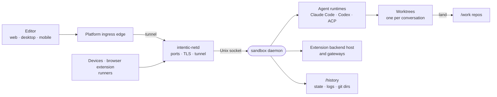

# sandbox

The Node daemon at the center of every sandbox: it runs coding agents in git worktrees, serves the workspace to the editor, and lands their work.



- It runs as the child of `intentic-netd` ([../netd](../netd)), which owns every port, the TLS certificate and
  the platform tunnel, and relays HTTP over a Unix socket. The daemon decides, netd binds.
- AI literacy confirmations live per member and notice version in `/history/member-ai-literacy.json`; member confirmation and maintainer listing use the settings routes. Visitor chat public config includes the AI disclosure flag and optional wording.
- Two roots: `/work` is what agents edit; `/history` is the daemon's own (git dirs, worktrees, the conversation
  database, snapshots, logs) and sits outside `/work`.
  It is not out of an agent's reach: an unfenced agent runs as root in the default agent domain and can write it.
- The auth-root JSON stores for sandbox secrets, capability credentials, extension credentials, and privacy tokens are
  encrypted at rest when `INTENTIC_AT_REST_KEY_FILE` names a mounted key file, which `ic` mounts for every sandbox it
  sets up or recreates (one key per sandbox, kept in `~/.intentic/keys/` on the host; `INTENTIC_AT_REST=off` opts out).
  `/health.atRestEncryption` reports whether this is active and names those four stores and provider account files.
  Existing plain files are encrypted at boot; every write uses a fresh AES-256-GCM nonce. With no key configured, these
  files keep their original plain format.
- A secret can live in a keyring on the owner's own computer (`intentic-keyring`, [../../_devices/keyring](../../_devices/keyring))
  instead: the sandbox holds a pointer to each entry shared with it (`secrets/device/`), resolves a `{{secret:NAME}}`
  reference to it like any stored name, and asks that computer for a value one use at a time, after the gates and the
  host guard, with a grant signed by its own keyring keys (public halves served at `GET /keyring/keys`). A released
  value is kept only to mask, so every use asks again; an entry shared in `copy` mode is kept here as an ordinary secret.
- `mcp__secrets__type_secret` (`browser/tools/secrets-tools.ts`, `secret-typing.ts`) types a secret without the agent
  seeing it into whichever of these the turn mounted: a sandbox browser's page, the sandbox's desktop (xdotool reading
  the value on stdin, only into a program on the secret's list), the focused window on one of the owner's computers or
  an app on a phone attached to one (typed by that computer's keyring, which checks the window), and a page in the
  owner's own browser (a one-time ticket the extension redeems at `POST /system/webext/secret`).
- The audit trail (`audit/`, `/history/audit/`): who changed a setting, a member, an area, a secret's gate or a policy,
  who signed in, what was exported or deleted, and with `settings.audit.recordReads` who opened what. One middleware
  records by contract route name (`audit/audit-http.ts`); another module calls `services.audit.record({ actor, action,
  target?, details? })`, which never waits and never throws. Records are hash-chained in monthly files, pruned by
  `settings.audit.retentionDays` behind a checkpoint, and forwarded to `settings.audit.forwardUrl` from a persisted
  cursor. The chain shows tampering; only the forwarded copy is out of the agent's reach.
- The machine that runs a sandbox is a sign-in of its own (`auth/host/host-session.ts`, 2026-10-16), so the desktop
  app and Intentic OS open their own sandboxes with no network. `ic sandbox session <slug>` runs
  `node /opt/sandbox/dist/auth/host/host-session-cli.js` through `docker exec`, as root: it reads the 0600 session secret and the
  owner file and prints an ordinary daemon session for the BOUND owner, proven by `host`. The trust model: whoever can
  `docker exec` into the container is root over it already, so the session adds nothing they lack; there is no HTTP
  route that mints one, and an agent in the unprivileged domain cannot read either file; a sandbox nobody has bound
  refuses (the first binding still takes a real sign-in with the connect token); every request is still authorized
  against the owner file and roster, so a new owner or "sign out everywhere" (which re-keys the secret) ends it; a
  `host` proof meets the require-passkey policy, as root over the box would anyway, but stands only on a request
  netd marked as arriving on the loopback port (`auth/proofs/listener.ts`; `BOUND_TO_LISTENER` in `auth/proofs/proof-methods.ts`),
  never over the tunnel, and lasts a week rather than a month, since its token is kept on the machine's disk. Each
  mint is an `auth.sign_in` record with `methods: ["host"]`: the trail has one writer, so the script leaves a note in `/history/audit/inbox/`
  that the audit tick records and deletes. The platform's own id for the sandbox's row, which its announce answers,
  is kept in `/history/platform-row.json` for the same reader (`store/platform-row.ts`).
- On the loopback port, and only there, CORS also admits the desktop app's bundled page (`tauri://localhost`,
  `http://tauri.localhost`): netd marks a request that arrived on that port (`x-intentic-listener: loopback`, stripped
  from anything arriving from outside), so no sandbox needs recreating with a wider `WEB_ORIGIN`
  (`auth/browser-origins.ts`). CORS decides which page may read an answer; the bearer is still the boundary.
  `GET /agents/attention` (the owner's only) counts what needs the owner and what is working by the board's own rules
  (sandbox-contract `models/agent-lanes.ts`), for the desktop app's status bar and `ic sandbox attention`.
- Routes that hand out a conversation's words by id (`/activity`, `/fleet`, `/loops`, `/share`, `/privacy/log`, held
  wakes, `/sessions`, `/children`, `/needs/mine`) answer someone below maintainer only for conversations the roster
  shows them (`auth/scope/conversation-reader.ts`). _(2026-10-13) They answered every member alike._
- A history snapshot leaves out any file over 32 MiB (`history/large-files.ts`). A restore neither brings such a file
  back nor deletes it. _(2026-10-09) Snapshots had no size limit: a 30 GB folder of films dropped into `/work` was
  hashed and stored a second time on `/history`._
- Routes are declared in `@intentic/sandbox-contract`, implemented in `*.routes.ts` and assembled in `src/router.ts`.
  `/events` pushes file, git and fleet changes to the browser.
- It registers with the platform at boot (`system/boot/announce.ts`), then announces again about once an hour
  (jittered by a tenth) as its heartbeat, naming which copy it is: `instance` (netd's `INTENTIC_INSTANCE`, else an
  id minted once per process), `host` (`HOST_LABEL`) and `os` (`HOST_ENV`, else `HOST_PLATFORM`). (2026-10-05) It
  went quiet once accepted, so the platform's last-seen time was its registration. A refusal or an
  unreachable platform is retried for as long as the daemon runs, every few seconds for ten minutes and every five
  minutes after; only a deletion record (410) ends it. `/health`'s `announce` says which no it got (`reason`: `unknown`
  or `deleted`) and which database took it (`identity`). The owner's Reconnect (`POST /platform/relink`,
  `system/boot/relink.routes.ts`) registers at once, first having a platform with no record of the sandbox adopt it
  with the ticket the owner's browser got and the grant the daemon holds. A browser opening the sandbox's own address
  is sent to the app's `/open` on it (`GET /`, `system/boot/open-in-app.ts`). (2026-10-02) It used to give up after
  ten minutes and wait for a restart, which nobody knew to do while the platform said the sandbox did not exist.
- A device, desktop sync or a server joins with a command that carries a short code, never a token
  (`peers/redeem-codes.ts`). The code is 8 characters, single-use and expires in 10 minutes. The device's script spends
  it at the public `POST /system/redeem/<code>`, which is rate-limited, and gets back what the command used to carry.
  A server's code stands for a single-use enroll token, so the sandbox's long-lived connect token stays here. Codes live
  in memory only, so a restart voids them and the person copies a new command.
- One turn: `agent/run/turn/turn-admission.ts` admits it, `turn-plan.ts` picks a runtime, it runs in the
  conversation's worktree (or the main tree, or a remote runner), and `conversations/land/land.ts` lands the result as
  uncommitted changes. When an isolated Claude Code turn is about to stop, each repository's own `turn` checks run
  once on what it changed, and what they find is said back to the model, which fixes it or says why not
  (`agent/run/turn-checks.ts`); nothing holds the turn or its land. Nothing checks the work after it lands: the
  dependency reconciler (`workspace/deps/reconcile-deps.ts`) installs when a land moved a manifest or brought a new
  project, and CI checks what the owner pushes. An agent may install inside its turn: an isolated one into its own
  copy, a main-tree one in the install lane. The command gate every runtime consults decides it (`guard/command-guard.ts`,
  `agent/providers/project-installs.ts`), from what `agent/run/turn/turn-safety.ts` set on the turn. Its judge reads
  the owner's own `.intentic/config/safety.md` and then the lines a person allowed with a card's Always
  (`personas/owner-grants.ts`). Those lines live on the auth root, which a turn cannot write. They are listed under
  Sandbox-wide permissions on the Access tab and are never shipped in a definition export.
  When main's CI fails, `ci/main-fixer.ts` gives the failing streak one fix agent and sends it every later failure.
- A conversation's results, the documents its calls recorded writing (Word, OpenDocument, RTF, PDF, decks, sheets, web
  pages), are listed at `GET /agents/{id}/documents` and served as bytes at `GET /agents/{id}/documents/raw?path=`
  (`conversations/produced-files.ts`, 2026-10-13). Both are on a guest's list, which has no Files: a guest takes the
  files of a conversation it owns and nothing else, and a member takes them wherever it may see the conversation. Only
  a recorded path is served, never one with `..`, an absolute one, or one with a link on the way. The bytes come from
  the conversation's checkout until a land into the main tree carried the file, and from the main tree after that,
  which keeps them downloadable once the checkout is removed. A land pressed with `includeDocuments` (the editor sends
  it in plain words) first stages each recorded document by force, so one git ignores, or one the land would set aside
  as scratch, goes with it; any other ignored file stays where it was.
- A helper job (a session title, a land's commit subject, the safety judge's verdict, the chat router's pick) is a
  sealed request on the same seam (`agent/run/sealed/sealed-request.ts`): the runtime's own arm plans it and its own loop
  runs it, with `policy.sealed` (`agent/providers/agent-request.ts`) withholding every tool, server, instruction file
  and saved session, so its prompt is everything the model reads. Its failures go through the turn's classifier into
  the records the next request's account choice reads, and a spent allowance is planned once more onto a sibling
  account. No conversation or board row is made for it; `agent/models/role-model.ts` walks the job's chain of models
  over it. A runtime serves helpers by declaring `sealed` on its adapter (Claude Code, Cursor, OpenCode's Gemini).
  (2026-10-07) Before, each runtime had a one-shot path of its own beside its turn, and each had drifted: the privacy
  shield refused Cursor's for its runtime, a conversation's grant never reached it, and Cursor kept its own account loop.
- What a refusal leaves on record is read as narrowly as it was given (`agent/run/frames/classify-failure.ts`). An
  account its provider refuses outright, like Cursor's `[role_forbidden]` (code `account-not-entitled`), is filed against
  that account for every model (`usage/observed-limits.ts` `ACCOUNT_WIDE`, believed for a day). Placement, the spawn gate
  and a conversation remembering that account all move off it. An answer settles a spent allowance only for the model it
  came on (`usage/provider-refusals.ts` `answeredBy`), and a running turn's later fresh answers count as well as its
  first. The reset is the vendor's own word where it gives one (`usage/reset-sentences.ts`: "Resets in 166h40m39s", "try
  again at 5:46 PM"). A loop's retry and the translator's bench only set the earliest re-run, and a pool the sentence
  names by length ("your 5-hour usage limit") reopens when the reading says that pool does. A spent allowance in a
  routed refusal envelope stays a spent allowance, not a model off the plan. An admin-granted credit ("send a request to
  your admin") is filed `unmetered`, so no usage reading answers it.
- Codex sends steering after `turn/started` acknowledges the active turn. A refused message becomes a follow-up
  on the same thread once that turn settles; this preserves accepted input even when completion wins the race
  (2026-10-01). Final completion closes steering admission before yielding terminal frames, while planning keeps
  the queue for execution. Stop sends `turn/interrupt`, with a process kill after three seconds if it does not settle.
- What a runtime's in-process extensions put on screen reaches the chat through the contract's agent UI lane (a
  status entry, a notice). Pi's extension UI (`runtimes/pi/pi-extension-ui.ts`): `notify` is a notice, `setStatus` and
  `setWidget` are status entries, and `select`, `confirm` and `input` park on the same question card Codex's questions
  use, with the clock held while a person answers, and the pick goes back as Pi's `extension_ui_response`. An `editor`
  dialog is still cancelled (no card fits a multi-line editor). `setTitle` and `set_editor_text` are dropped: the title
  and the composer are the person's. The Claude Code loop's `informational` lines (`agent/run/informational.ts`) are
  notices by level, `info` dropped as the CLI shows it only in transcript mode. A line tied to a tool call is that call's
  status entry until its result. Hook lifecycle messages are not requested.
- Pages in chat (`agent/pages/`, 2026-10-07): the Claude Code loop's `ui` server carries `show_page` and `ask_page`
  beside `ask`, unless settings `chatPages` is off. A page is one HTML document, written inline or named by path.
  The files it names on disk, and libraries on the CDNs in `page-assets.ts`, are carried into it as data. With
  `check`, the sandbox's headless Chromium lays it out the way the chat draws it (a sandboxed frame at the column
  width, written in through the same `sizedFirst` shell, sized by the height its bridge reports) and the agent gets a
  picture and its console (`page-check.ts`). What its scripts throw later in a reader's chat comes back over the
  bridge: `POST /pages/errors` says it into the turn that drew the page while that turn runs (`page-errors.ts`), and
  otherwise the page's caption offers the reader an ask that fills the composer. It is filed under `.intentic/records/artifacts/pages/<conversation>/` and never
  rewritten (`page-store.ts`); a `replaces` redraw is a new file, and the earlier row folds. `page` frames draw it
  inline. `page_ask` parks the turn until the page's `intentic.submit` answers it. `page_draft` turn facts stream the
  markup while the model writes it (`page-draft.ts` reads `input_json_delta`). The editor draws pages sealed: scripts
  run, no network, no reach into the editor. A page speaks the MCP Apps bridge (`sandbox-contract` `text/pages.ts`),
  so a connected MCP server's own `ui://` app is drawn the same way after a call to its tool (`mcp-apps.ts`). What
  that app later asks of its server goes through `POST /pages/app-call`, which calls only tools the server lets its
  app call. Without the reader's press, it calls only read-only ones.
- Code reviews in chat (2026-10-17): a harness's own reviewer, typed as a slash command or asked from a Review press,
  ends in one typed `review` event (`sandbox-contract/events/review.ts`) the chat draws as a card. Claude Code's
  `/code-review` runs with `CLAUDE_CODE_REPORT_FINDINGS` pinned on (`agent/run/harness/pinned-env.ts`), so it reports through
  its ReportFindings tool, read whole by a PostToolUse hook (`agent/run/harness/review-findings.ts`). Codex's `/review` is
  published beside the thread's skills and sent as `review/start`; its exitedReviewMode text is split into the prose
  the bubble shows and the findings the card draws (`runtimes/codex/commands/codex-commands.ts`). OpenCode's `/review` is its own
  command and answers in prose. A turn whose words open with a published command sends them first, its notes riding
  the prompt hook (Claude Code), the text after the skill (Codex) or a block of their own (ACP) (`agent/run/command-turn.ts`).
- Archive is sticky: only a person's message un-archives a conversation. A turn the daemon starts itself (a retry,
  a nudge, an automation's thread) is refused on an archived one (`conversations/actor/conversation-decide.ts`), and a
  thread whose conversation was archived opens a fresh one instead.
- An isolated turn's runtime runs in the conversation's mount namespace, where `/work` is its worktree
  (`conversations/worktrees/isolation.ts`). Cursor's SDK agent, which ran inside the daemon, moves for such a turn into
  a runtime process born there (`runtimes/cursor/cursor-host.ts`, `cursor-agent-runtime.ts`); its custom tools, hook
  gate and frames stay in the daemon, reached over the process's IPC channel.
- The data protection page's routes (`compliance/`, contract `compliance.contract.ts`, maintainer and up) read the live
  configuration into plain facts (`facts.ts`) and map them, without I/O, to every outbound data path and the
  technical and organisational measures (`report.ts`), and to the record of processing, the impact assessment draft and
  the measures list in Polish or English (`drafts.ts`, `compliance-text.ts`; `.docx` built by `docx.ts` with
  node:zlib, no library). The public-office preset (`preset.ts`) is a list of items applied only when named, owner
  only; none ever loosens a setting already stricter, and no default changed for it. Applying it and downloading a
  document go through `recordComplianceEvent` (`compliance.routes.ts`), which writes the daemon log until the audit
  trail takes it.
- The unprivileged agent domain (`agentDomain`, `workload/domain/agent-domain-policy.ts`) is a setting kept in the auth root,
  not in the workspace settings, and only the owner may change it. It defaults to `root`, and this build still refuses
  `unprivileged` everywhere it is read (`workload/domain/agent-domain-rollout.ts` lists what is missing). When it is on, each
  turn runs inside a domain the daemon builds (`conversations/worktrees/domain-anchor.ts`): a user namespace whose root
  is uid 1500 on disk, with no capability outside it, plus mount and PID namespaces the daemon owns. The workspace is
  shown to it through idmapped binds, so files it writes stay root-owned on disk. Secrets, `/root`, the daemon's
  sockets and every repository's git metadata are hidden or read-only (`workload/domain/agent-domain-view.ts`). The agent's
  HOME is `/home/agent`, kept on the history volume and refreshed by the daemon before each domain starts
  (`workload/domain/agent-home.ts`). Only Claude Code runs there so far, and a fenced conversation is refused.
- A domain's Bash panes cannot use the root tmux server, so `bin/tmux-run` asks the domain's own pane door instead
  (`terminal/pane-door.ts`), and the daemon opens the window. The pane enters the domain in two steps, so its command
  still leads its own session and the session-based process lookups keep working (`workload/namespace-entry.ts`
  `agentPaneLine`). Each conversation's domain also has a run directory (`agent-run/c-<id>` under the history root),
  bound at the same path inside and out. It is the domain's `/tmp` and the place the daemon hands the turn its command
  files and background job directories.
- Every local turn carries a daemon-issued execution context (`workload/agent-execution.ts`). It ties the request to
  the admitted mode, working directory and namespace, and a runtime refuses a request whose placement does not match.
  Helpers and runtimes that cannot run in a domain yet refuse unprivileged execution rather than run as root. A
  refusal at admission (`agent-domain-refused`) keeps the queued message, since nothing ran. The domain, its view, the
  agent's HOME and a pane opened through the door were run in a throwaway container on omen (2026-10-08): the agent
  writes the workspace as root-owned files, cannot read the masked secrets, `/root` or the daemon's `/proc`, and its
  pane leads its own session on a real terminal. Inside the domain the repositories' git metadata is read-only, so
  `git status` and `git log` work and `git commit` does not. A full turn on a runtime has not been run there yet, and
  never belongs in this running sandbox.
- A fenced conversation (started by a member who holds areas) runs in a bubblewrap sandbox instead
  (`conversations/worktrees/turn-sandbox.ts`): an unprivileged user with no capabilities, its own pid namespace, and a
  filesystem holding only the system, its own checkout with every `.git` pointer masked, its own session store and a
  private home. Its processes join through the same `nsenter` helpers as everyone else's
  (`workload/namespace-entry.ts`), and its Bash panes run on a tmux server inside the sandbox. It shares the container's
  network for now. A fenced turn on a runtime other than Claude Code, on a runner, or in a container where the sandbox
  cannot be built, is refused.
- Extension code never runs in the daemon process; it runs in a supervised backend host and in declared processes.
  Both reach the daemon on one token per extension, held to its manifest's `permissions.daemon` (`auth/grants.ts`).
  The panel token that repo operator panels hold reaches no route that returns a stored secret. A listener provider
  belongs to one extension (`extensions/listener/listener-state.ts`: the declarer owning the provider's card, else the first
  installed); a second declaration is refused at load and named on its Extensions row, and the listener routes answer
  the owner alone.
- Claude Code hooks the owner has not approved in their exact form never run (`guard/settings-hooks.ts`,
  `guard/hook-approvals.ts`, applied by `agent/run/harness/settings-hook-gate.ts`): a turn hashes the hooks in the
  user and project settings, in skill, subagent and command frontmatter, and in every plugin it loads that the image
  does not ship (plugin connections, git-installed and workspace extensions, persona kits, plugin folders among the
  skills, plugins the settings enable), with the bytes of every script a hook names and of all of a hooks module's
  code (`guard/plugin-hooks.ts`); the settings' `enabledPlugins` and `extraKnownMarketplaces` are in the digest too.
  A digest not in the approvals ledger runs the turn with `disableAllHooks`, which also keeps every plugin's hooks
  module from loading, and files a request whose card says what each module does, read once per digest by the pinned
  CLI's `claude plugin validate --json` (`guard/plugin-modules.ts`; a failed read says so on the card and holds
  nothing up). A plugin with no hooks and no module adds nothing, and a set with no plugin in it hashes as it did before
  plugins counted. Only image-baked plugins are exempt (2026-10-04: a git-installed extension's or plugin's pinned
  commit says what was cloned, but its checkout sits under `/work/.intentic`, which every turn can write, and an
  extension's install review covers its declared powers, not its hooks module).
- An approval queue item runs only on a yes the owner gave to exactly what it holds (`approvals/approval-decisions.ts`):
  approving through the route records `{digest, approvedAt, approver}` in `/history/approval-decisions.json`, the
  digest covering every field the executor acts on and the bytes of each media file. The queue itself sits in
  `.intentic/config/approvals/`, which agents write, so an item an agent marked approved, or changed after the owner's
  yes, is failed with the reason instead of run, and a yes is spent by the run it allowed. Spending is a compare-and-
  remove in one serialized ledger change (`spendApprovals`), so two passes racing for one item cannot both act on it.
  Only a signed-in maintainer or the owner may approve; the panel and control tokens may propose.
- An action naming a `performer` (e-urzad's office acts) never reaches a turn: once its yes is spent, the executor hands
  it to that extension's backend through the backend host's `POST /approvals/<id>` door, which no `/x` route, panel or
  agent token reaches (`approvals/approval-performers.ts`), with the yes, the item as approved and the action rules as
  the daemon reads them. The extension recomputes the digest over what it is about to send and answers done, refused or
  uncertain; an uncertain one is failed and never retried by itself, and each hand-over is an `approvals.performed`
  audit record (2026-10-15: until then a turn ran the extension's command, which could only read the agent-written
  item to decide whether it was approved). Agents still run as root, so this holds against a turn that cannot reach
  `/history` or the host process, not against one that tampers with them.
- A plugin connection is pinned like an extension: its install resolves the branch or tag it names to a full commit,
  stored as `commit` (`CapabilityHandler.installed`), and re-applying the stored entry checks that commit out again.
  Adding it anew is the update.
- The sandbox has a desktop of its own (`desktop/`): one more virtual X display beside the browsers', 1280×800 with
  openbox on it, for programs with a window and no other way in. A turn whose persona may drive a browser and run programs
  (its `browser` and `shell` powers: `open` starts any program) mounts it as the `desktop` server beside the browser
  routers (`browserServersOf`), and drives it through
  [desktop-automation](../../_devices/desktop-automation)'s frames, the same code a connected machine's screenshots go
  through. The owner watches and drives it at `GET /system/desktop-view` (video and XTEST, as the browser view);
  driving it holds it, and the agent's input is refused until they hand it back or stop for 20 s. `GET /system/desktop`
  says whether it is up and how many windows are open on it, counted off openbox's client list by one `xprop -spy` and
  pushed as the `desktop` runtime domain: the editor tiles it while a window is open, and says an empty desktop is empty
  rather than showing a black screen that looks like a broken stream.
- On Intentic OS desktop edition, `on-screen <command>` can also show native Wayland apps on the owner's physical
  screen through `/run/intentic/screen/wayland-0`, once the owner has allowed this sandbox to (This computer's Sandbox
  windows card). The host mounts its per-sandbox security-context directory read-only when creating or recreating a
  runc container, and its screen service puts a socket there only while the owner allows it; Kata VMs cannot use
  the socket. The launcher unsets `DISPLAY` and `WAYLAND_SOCKET`, selects Wayland for GTK, Qt, SDL, Firefox and
  Electron, and gives the app a private writable `XDG_RUNTIME_DIR`. Missing sockets produce a plain explanation;
  it never falls back to another display. Desktop tool descriptions and responses offer this command only while a socket exists,
  and tell the agent to check the app on its own desktop first: the tools cannot see or screenshot the owner's
  screen. Sway labels each window with the sandbox slug in an amber titlebar. Debian trixie does not package
  `xwayland-satellite`, so `--x11` explains the limit and X11-only apps stay on the sandbox's virtual desktop.
- Every MCP server the daemon hosts for a turn (its browser routers, the machines and browsers it was granted, its
  extension cards' endpoints, the desktop) is a mount at one door, `ALL /mcp/<name>` (`agent/tools/turn-mounts.ts`). Each
  turn holds a bearer of its own, leased the names it mounted and forgotten when the turn ends, and the door refuses
  any name that turn's lease does not hold, so two turns of one conversation running at once never reach each other's
  mounts. An ACP agent's warm session keeps the MCP config it was opened with, so its turns share the conversation's
  bearer, one live turn at a time, and between turns it reaches nothing. OpenCode (Grok, Gemini) keeps MCP servers per
  directory, not per session, on the one `opencode serve` every conversation shares, so a turn mounts its servers there
  under its conversation's own names and its session's own permission rules show it those and deny it every other
  conversation's (`runtimes/opencode/opencode-mcp.ts`). (2026-09-29: rejected the spawn config, which is fixed at boot and cannot carry
  a turn's bearer, and per-turn names, which change the tool list every turn and throw away the provider's prompt
  cache.) An extension's card-less tool server and its
  agent plugin reach a turn only when the persona's `extensions` list grants that extension (absent: every one). `agent/tools/turn-tools.ts` composes these mounts
  with the mcp-kind cards into one `remote` list, which every runtime projects the same way. An extension's tools are
  answered by the backend host from `api.tools.serve` on a route of its own (`extensions/backend/backend-tools.ts`),
  handed the card's settings by the door; `/x/*` refuses a backend's own MCP path, so tools are reached only through
  the door. The contribution inventory is built once and kept until an extension, the enablement file or the
  capability manifest changes (`capabilities/contributions.ts`).
- OpenCode (version 2, `@opencode/cli`) runs as one `opencode serve` the daemon spawns itself, on loopback with a
  per-boot password, never OpenCode's own shared background server, which would not read the daemon's environment
  (`runtimes/opencode/opencode-serve.ts`). Its one event stream is opened at boot and read once: it answers every
  session's permission asks and hands each turn its own session family's events (`opencode-events.ts`). A stream that
  drops while the server runs is opened again, and each turn reads back what it missed. Every shell command is asked
  about, so it reaches the owner's rulebook, and a `default`-mode turn puts edits, fetches and commands on per-tool
  cards (`opencode-permissions.ts`). OpenCode's `question` forms become question cards (`opencode-forms.ts`), steered
  messages go in as OpenCode steers, the turn's effort is the session's model variant, and a `/name` prompt runs as
  OpenCode's command. A turn whose system text replaces the base runs on the daemon's twin agents, whose own base is
  blank (`opencode-config.ts`). Failures are coded from OpenCode's own failure types, and a provider retry the turn
  would not outlive, or would wait minutes for, is handed to the daemon's hold and resume (`opencode-failures.ts`).
  A foreground command holds the silence limit while it runs, and a shell left in the background is waited on for 10
  minutes at most (`opencode-turn.ts`). Grok's
  sign-in lives in OpenCode's database, read from disk so asking whether Grok is connected never boots the server
  (`opencode-credentials.ts`). The engine store refuses an OpenCode 1 copy an older daemon installed, and the blessed
  list carries OpenCode 2 under `opencode-v2`, so daemons still on OpenCode 1 never read a 2.x number
  (`engines/engine-descriptors.ts`).
- OpenCode fixes its provider config at spawn, so a Google turn compares the translator's catalog (ids, input
  modalities and reasoning tiers) with what the running server registered, and restarts the server onto the new list only when it is idle
  (`runtimes/opencode/opencode.ts`). A turn holds the server from setup through cleanup, helpers and Grok sign-in
  included; while it is busy, registered models keep working and a newly listed one asks for a retry. Grok turns
  never read Google's catalog. A failed, empty or stalled read keeps the working registration. The providers OpenCode
  hosts from a route (a ChatGPT plan, Kimi, each Z.ai key, each model endpoint) are written into the same config and
  compared the same way at each hosted turn (`runtimes/opencode/opencode-routes.ts`).
- Where a model is reached is separate from which loop drives it: `agent/providers/routes/model-routes.ts` answers
  (provider, account, model, loop) with the wire, the URL and bearer, the model id, whose account and allowance the
  turn spends, and which provider the privacy shield keys on. The Claude Code harness's routed credentials, Codex's
  hosted providers (each its own per-thread provider block) and OpenCode's hosted entries all come from it; Grok's own
  xAI sign-in and Google's fixed entry on OpenCode keep their own planners. Where providers on one runtime can differ in
  readiness, the health sweep files each pair under `pairHealthKey(runtime, provider)` beside the runtime's answer.
- The translator lists Google models from its built-in catalog, not per account, so it can list a model Google does
  not offer these accounts. Google then answers 404 "Requested entity was not found."; the turn codes that
  `model-unavailable` naming the model (`runtimes/opencode/opencode-agent.ts`), which hides it from the picker for a
  day (`usage/model-refusals.ts`). Nothing predicts this from Google's own model metadata: its ids differ from the
  translator's (`gemini-3.8-flash-tiered` there, `gemini-3.8-flash-high` here, and the latter runs).
- A process the daemon starts is put in a workload class by whoever starts it (`workload/workload-class.ts`,
  `spawnAs`): its niceness, IO class and rank for the kernel's OOM killer, inherited by everything it forks. Builds
  go first, agent runtimes last, children before their parents. Nothing ranks a process by its command line.
- A heavy program (a build, a test run, a typecheck) is recognised by what it is as it starts, not by the words of
  the line that started it: the daemon hands every agent command the table (`workload/heavy-commands.ts`,
  the shared rules in `@intentic/constants/heavy-rules`), and the program queues itself through `bin/queue-run`.
  Agent commands reach their pane by file (`bin/tmux-run -f`), so no command line carries their words.
- One `ResourceBudget` (`workload/resource-budget.ts`) decides whether there is room for more work: the turn door, a
  child waiting for room, heavy commands (over the local `room.sock`) and the editor's memory gauge all read its one
  snapshot, taken by the formula in `@intentic/constants/memory-room`.
- Stored files evolve under one engine (`store/`). Each is declared with `defineDocument` beside its store, carrying
  the conversions its shape has had, its path (the contract's state-file tables are found from it, `stateFile`) and
  its layout; a store opens it with `store/open-document.ts` (`openDocument`, `openEntries`, `openIdList`,
  `openDirectory`), which parses with the document's own schema through the contract's one `readDocument`, runs its
  conversions on every read and keeps what this build does not know on writes, so a store's next save is what
  persists a converted shape. Families of files with one shape (the doors' enrollment and burn files, the two vaults,
  the two install ledgers) are one spec factory each. A runtime's regrowable cache is the only file opened without a
  document (`cacheFile`); `store/documents-coverage.test.ts` fails on any other. Before any store opens, `store/evolution/state-convergence.ts` does only what a read
  cannot (documents that moved, structural steps: a regroup, a database schema, an import) under a journal a
  rolled-back build undoes, committed once boot converges; it runs each document's conversions without writing, so one
  that would fail is named first. A step or write that throws partway is put back at once, `/health` reports the
  journal `failed` for the rest of that boot (a host takes it as the update not having taken), and the stores go on
  converting on read; nothing of that boot commits. `src/state-plan.ts` is the same plan, read-only, for `ic`'s pre-flight. Both
  take every document and structural step from `bootstrap/state-registry.ts` (`main.ts` hands it to the boot step),
  never from what a process loaded; it sits in the boot wiring, above every subsystem, because it imports them all.
  `scripts/write-indexes.mjs` (`pnpm indexes`, run before this package's typecheck, test, dev and build, and by the
  fixers in a worktree before its land: `conversations/land/worktree-fixers.ts`) writes it from every
  `export const name = defineDocument(…)` (or `defineStep`) in the source, failing on a definition in any other form.
  `store/shapes/write-state-shapes.ts --freeze` (which the fixers run next, when the change reached a daemon or
  contract source) reads it and records each document's shape in `store/generated/state-shapes.json` by the release
  that first shipped it.
  `--checks` (this package's `pretypecheck`) derives the uncommitted `state-shapes.ts` from it: every released shape
  must still fit today's schema after its conversions and lose no key without a `drop` or `rename`
  (`store/evolution/conversion-types.ts`).
- A rollback is decided by release: `.intentic/local/newest-run.json` names the newest version that booted all the way
  here (a build stamps it when it commits, never before), and a build older than it reports a downgrade and keeps its
  hands off what it cannot read. A build whose boot failed leaves no stamp, so the version a host puts back is no
  downgrade. The digest of a build's
  conversions (every conversion's description, earlier address and step id) identifies its journal episode: only a
  build with the same digest resumes one, and any other open episode is put back. The conversion count earlier builds
  compared is still written for them, and decides nothing.
- A `rename` conversion moves a key and nothing more: there is no grace window writing both names. A build rolled back
  past a committed rename keeps the new name as a key it does not know, and reads its own default for the old one.
- A boot that fails before the readiness gate writes why to `/history/boot-failure.json` (`system/boot/boot-failure.ts`:
  when, this build's version, the error with the first lines of its stack, the step) and exits 1, so netd starts
  it again with backoff instead of a daemon that answers `/health` and never serves; `ic` reads the file, and the next
  boot that reaches the gate removes it. `INTENTIC_FAULT` is the nightly update drill's hook for exercising that and the
  host's rollback (`system/boot/fault.ts`): `crash-at-boot` fails the boot before convergence, `crash-after-ready` exits 1
  twenty seconds after the gate opens, `fail-conversion` makes convergence throw with an episode open. Production images
  never set it; any other value is ignored.
- A sandbox takes a downloaded update by itself (`system/updates/auto-update.ts`, started by
  `bootstrap/update-when-quiet.ts`), but only where a machine's `ic` swaps its container and only an update that machine
  already staged, so what it decides is the half-minute restart, never a download. It holds that restart while an agent
  is mid-turn or landing, a subagent or workflow runs, somebody has the editor on screen and in use (presence's `away`),
  a terminal printed in the last ten minutes (for the first day of waiting), something scheduled is due within ten
  minutes, the owner paused it, or the release has breaking notes (those always wait for a person). It never takes a
  version the machine already tried and went back from (`/history/update-outcome.json` says restored or rolled back):
  the staged marker outlives a swap that is undone, and taking it again would loop. Then it counts down
  where any connected page can stop it, and hands the machine the same `update` the button sends, asking the next boot
  to resume what the restart cuts. The owner's switch and pause live in `/history/update-policy.json`; `/info`'s
  `autoUpdate` says where it stands, and the `update` runtime domain tells every page when that moves.
- Whether the sandbox is busy is one answer asked for a purpose (`bootstrap/working-now.ts`, 2026-10-05). A restart (the
  automatic update, a device rebuild asked to wait, the host's keeper reading `/run/intentic/work.json`'s `liveTurns`)
  waits for turns, lands, running subagents and workflow steps; idle-stop waits for those and for parked subagents and
  armed watches, which only this daemon's clock moves on. The device rebuild used to wait for turns alone.
- `conversations.db` never keeps the daemon down (`store/conversations-db-recovery.ts`): after a run that died
  unannounced it is quick-checked before anything reads it, and a file that fails to open or to pass is moved aside with
  its sidecars as `conversations.db.corrupt-<ms>` (never deleted), what still reads of it is copied into a new file with
  `VACUUM INTO`, or an empty one is made, and the owner's settings-problems card names the whole file. One missing while
  conversation directories remain is made again empty the same way. A file the check calls sound but this build cannot
  bring to its schema is the build's fault, not the file's: it is left where it is and the boot fails, so the host puts
  an update on probation back.
- The boot's orphan sweep (`store/conversation-units.ts`) moves a conversation directory no database row owns to
  `/history/trash/conversations/` rather than deleting it, and removes it 14 days later; the blob sweep counts the
  records there as names still standing. It moves nothing on a boot whose database was made again, or while the
  database holds no conversation but directories remain: a lost database is not a fleet of orphans.
- What a daemon run leaves behind is somebody's to end (2026-10-05). Every process the daemon starts carries its run's
  generation (`INTENTIC_DAEMON_GEN`), and its detached children say what they are (`INTENTIC_DETACHED`: an isolation
  anchor, the sign-in Chromium, the extension backend host, and every command run to a deadline; `seams/workload-stamp.ts`). The boot ends a
  stamped process of an older run outside tmux unless it is meant to survive (X displays, openbox, VPN and exit
  clients, dockerd, model servers; `system/boot/generation-sweep.ts`), and the reaper's minute sweep ends a command past
  its deadline. A command the daemon waits on (an automation's guard, a loop's stop check, a chore probe, a watch check,
  an edit rule, a turn's JS run, a Python check) runs through `workload/run-check.ts`: its own process group, ended whole
  (SIGTERM, then SIGKILL) at its deadline or an abort, in a workload class, its output capped; `process-tiers` in
  `_tools/checks` ratchets the hand-rolled rest. Pi turns are stamped with their conversation, a `one-shot` helper is live while its
  parent is, a forced reap's SIGKILL follows even after a discard forgot the conversation, an armed watch no longer
  shields a finished turn's processes, and a tmux session an agent made by hand goes with its conversation
  (`system/boot/reaper.ts`). `opencode serve` stops after 30 idle minutes, and with the Cursor runtimes on shutdown.
- A job an agent kept running for the person survives a restart and never expires (`agent/tools/jobs/background-jobs.ts`
  `keptJobSessions`, adopted by the boot's session sweep), and archiving, purging or discarding a conversation cancels
  the subagents it spawned (`agent/subagents/family-cancel.ts`); a paused child's end is kept in
  `/history/paused-children.json` so a restart still tells its parent (2026-10-05).
- A restart storm resumes nothing (2026-10-05): each boot is recorded in `/history/boot-history.json`
  (`system/boot/restarts/boot-history.ts`), and the third within 30 minutes honours neither a resume ask (which `ic` now writes
  before every restart) nor autoResumeOnRestart, says so in the log and on the settings-problems card, and leaves the
  cut turns interrupted. A parked turn whose cards cannot come back is given up after three boots.
- One restart policy for everything a restart cuts (2026-10-12). The boot works out once whether anything comes back
  (`agent/run/turn/restart-resume-policy.ts`: the owner's ask, autoResumeOnRestart, a restart storm) and hands the same
  answer to the turns, the automation fires and the loops and workflow runs. A loop or workflow run used to restart on
  every boot regardless; when the policy says no, it is now settled `stopped` with a detail saying the sandbox restarted
  while it ran. An automation fire's journal row also keeps the sender's lane, thread and provider session, so a
  restart's re-fire runs on the persona the sender was given and settles the same thread.
- Every automation fire runs inside the automation's own `allowedTools`, whichever door it came through (2026-10-12):
  `runFire` reads it off the record, so schedules, webhooks, channel listeners, approved holds and restart re-fires
  are bound the same as the Visitor chat and bug intake. The list is a boundary, not a permission hint: on the Claude
  Code loop a PreToolUse hook refuses every call off it (`agent/tools/tool-allowlist.ts`), on Codex its per-thread
  PreToolUse hook does the same through the door's policy gate (`runtimes/codex/codex-hooks.ts`), and a runtime with no
  check before every call (`toolAllowlist: false`: OpenCode, Cursor, ACP agents, Pi) never runs a turn that carries
  one. The model ladder passes such rungs over, and with none left the run is recorded as refused, saying why. Channel listeners hold the same two ceilings as the other
  doors (`automations/door-admission.ts`: messages a minute per sender, wakes a day per automation), and every door
  caps its body while reading it (`http/bounded-body.ts`), so a chunked body with no length is still refused at the
  limit. Rejecting a held wake withdraws its approval push, records a skipped run and tells the channel or visitor it
  came from (`automations/held-wake-answers.ts`).
- A channel's thread is a conversation (2026-10-13). A listener message that names a thread (a Discord thread, a Slack
  thread) is keyed by it, kept a week of quiet rather than a channel's two hours, and its origin carries the thread so
  what is said between turns goes back into it (`automations/listeners.ts`). A message for a thread whose turn is
  running goes into that turn between tool calls when the runtime takes words and the sender needs nobody's release;
  otherwise it fires once the turn ends. A streamed dispatch tells the channel which conversation answers (with its
  link), each step and the checklist (`extensions/listener/listener-progress.ts`), and why nothing runs yet (held for the owner,
  queued behind another turn of the automation); a subagent's narration no longer reaches the channel. A person in the
  channel may stop the turn through `POST /listeners/<provider>/stop` when the automation's sender rules answer them
  unreleased (`stopChannelTurn` in `automations/listeners.ts`), and an approved hold's answer is posted where it was asked.
  Threads of one automation are worked on side by side (2026-10-13), up to the sandbox's `automationThreadsAtOnce`
  (default 3); one more waits, and its channel is told it is queued (`FireLanes` in `automations/scheduler.ts`). A fire
  on one thread still waits for the one running there, and a fire no provider thread owns (a schedule, a webhook, a
  channel-level message) still runs alone, waiting for every fire of its automation and holding up every one after it.
  The fire journal holds a fire per conversation (`fire_journal_by_conversation`), so a restart re-fires each thread
  that was in flight on its own conversation.
- A persona's folder fence and its `sandbox` power are judged by path segment, by the contract's `fenceAllows` and
  `isSandboxPath`, and see every editing tool `rules/edit-tools.ts` lists, the hashline tools included
  (`personas/persona-scope.ts`, 2026-10-12). The hashline tools check where a path really lands, through symlinks,
  before they read or write (`hashline/hashline-tools.ts`).
  `/run/intentic/work.json` adds `bootedAt`, `previousBootAt`, `bootsInWindow`, `restartStorm` and `lastRestartAt`
  beside `liveTurns` and `at`, so the host's keeper sees the storm too.
- Every restart says why (2026-10-11). Whoever is about to stop or restart the sandbox (the owner's Devices card,
  update-when-quiet, a rebuild, idle-stop, `ic`, the device keeper, the desktop app) first writes
  `/history/logs/restart-intent.json` (`{at, by, host?, side?, action, reason, checks?}`, `system/boot/restarts/restart-record.ts`).
  The stop logs its signal, that initiator, uptime and build, and stamps them on `daemon-exit.json`. The next boot logs
  one `daemon <build> starting; previous run ended: …` line (stopped, exited, crashed, killed or unknown, whether the
  container restarted and whether `/tmp` was emptied), appends it to `/history/logs/restarts.jsonl` (newest 500) and
  spends the intent. `/health` carries `build` (version, source commit from `build-info.json` or `INTENTIC_COMMIT`, and
  build time; `system/boot/build-info.ts`).
- A turn parked on a person comes back after a restart as the same run (2026-10-06): while a card is up, the turn
  journal's `run` column holds the run's id and the rows it has drawn (`store/journals/turn-journal.ts`), and the boot
  carries that run on with its own id, start time and rows, raising each card again on the row it already had
  (`turn-resume.ts` `carriedRun`). Before this, the boot started a new run that sent the prompt again. A window still
  showing the old run drew the prompt and the card a second time, so the question could be answered twice, and the
  record lost the work done before the question. The answer's own turn gets a new message id. A card nothing will
  raise again is recorded as cancelled, never left pending.
- Housekeeping runs on one clock that remembers across restarts (`system/chore-clock.ts`, `/history/chore-clock.json`,
  wired in `bootstrap/boot-chores.ts`; 2026-10-05): git maintenance hourly (a stale `maintenance.lock` is now named
  and cleared instead of skipping silently), stale git locks and temp packs at boot and hourly with no git running,
  `gc --prune=2.weeks.ago` daily while idle, parked `refs/agent/*` of conversations archived over 90 days ago daily
  (`conversations/land/parked-ref-retention.ts`), `/history/trash` past 14 days hourly, checkouts and overlays no
  conversation owns daily (`conversations/worktrees/orphan-checkouts.ts`), and the agents' dockerd's stopped
  containers and dangling images daily when it already runs (`capabilities/handlers/docker-prune.ts`).
- Data retention (`retention/retention-sweep.ts`, 2026-10-13) makes `settings.retention` real, on the same clock:
  each positive `*Days` DELETES that kind of copy once it is older (nothing is archived or set aside first), and every
  value is 0 by default, which runs nothing. Transcripts (`conversations/registry/transcript-retention.ts`): a
  conversation whose last message is past the window goes the way the archive's Empty takes it, its checkout, rows,
  history unit, runtime session files, transcript backup, pages, uploads only it named and phrase-index rows, with no
  tombstone left; one running, queued, held, asking, holding unlanded work, or the parent of a child that stays is
  kept. Restore points (`history/restore-point-retention.ts`): cut with git's shallow boundary at the newest snapshot
  before the window, which stays hidden as the state later points restore to, then `gc --prune=now`; a deleted
  repo's scope with nothing newer goes whole. Privacy vault: found values not matched since (`seen`, kept to the day)
  and the masked pictures beside them; taught lists stay until forgotten. Caches (fileq's `derived/`, `rendered/`,
  `derived-blobs/`, thumbnails) and raw output (`logs/raw-output`, `output-cache`, `terminals`, and each overlay's) by
  write time. Hourly, restore points daily, and everything within a tick of the settings changing; each run logs
  what it deleted per kind (`RetentionPass`), the seam an audit trail connects to (`record`).
- Document shadows (`derived/shadow-keeper.ts`, 2026-10-13): every pdf, docx, xlsx, pptx, odt, ods, odp, rtf and
  epub in the main tree keeps a current text shadow under `.intentic/local/cache/derived/`, so agents can search what
  documents say without anyone having opened them. A minute after boot one sweep walks the tree (skipping
  `node_modules` and the other ignored dirs, `.intentic`, `refs/`, agent worktrees and browser profiles, and files
  over 200 MB) and hands every document whose shadow is missing or stale to `fileq derive --ocr-pages 500`; then the
  workspace watcher's batches re-derive what changed and drop the shadows of what went. Stale is judged without
  hashing: the shadow's recorded source size and mtime, fileq's current deriver stamp (`fileq stamps`), and whether
  its OCR stopped short of 500 pages. It runs one fileq at a time under `nice`, in the same two slots interactive
  renders use (`derived/fileq.ts`): the keeper holds at most one and never takes one an interactive render is waiting
  for. A file fileq refuses is not asked again until it changes; more than 20 000 documents is logged and not swept.
  Each batch that moved a shadow marks iq dirty, since the watcher does not look under `.intentic/local/cache`. The
  `documentSearch` setting (Sandbox ▸ Agent ▸ Tools, on by default) switches it off, and with it the
  `RIPGREP_CONFIG_PATH=/etc/fileq/ripgreprc` every turn's shell gets (`derived/search-env.ts`), which makes plain `rg`
  read documents through fileq's preprocessor. Claude Code's Grep tool runs its bundled ripgrep with `--no-config`
  (read off 0.3.296's binary), so it would skip documents; the same env sets `USE_BUILTIN_RIPGREP=0`, which makes it
  run the image's `rg` instead.
- netd's two sockets (`INTENTIC_NETD_SOCKET`, `INTENTIC_NODE_SOCKET`) leave the daemon's environment once its
  netd door has dialled them, and the tmux server's, so no agent-spawned child inherits them (2026-10-05).

- `agent/` runs one turn: its prompt, tools, provider seam and the pipeline in `agent/run/stream-agent.ts`.
  `conversations/` is what turns belong to: the actors, the registry, each conversation's worktree and its land.
  `system/` is this container and its link to the platform: boot, resources and memory admission, TLS, listeners and
  the platform client. `sandboxes/` creates other sandboxes on the owner's account; `links/` hands tasks to them and
  takes tasks from them over owner-made links (docs/architecture/links.md); `hosts/` holds the owner's own computers,
  desktop sync included.
- Each subsystem declares its part of `Services` beside its code (`auth/auth-slice.ts`,
  `conversations/conversations-slice.ts`, …) with the builder that makes it from typed dependencies
  (`createConversationsSlice`, `createGitSlice`, …); `composition.ts` calls the builders in dependency order, so a new
  service in a slice is written in that slice's file. Members that would close an import cycle there are built in
  composition, named by the builder's `Omit`.
- The privacy shield (`privacy/`, off unless the owner turns it on) keeps personal data from model providers the
  owner does not trust. Every runtime whose model requests go to a base URL the daemon names (the Claude Code loop for
  every provider, Codex, OpenCode's Grok and Gemini) is pointed at one gateway route, `ALL /privacy/gateway/<session>/*`,
  whose signed session names the provider and the only upstream it forwards to (`privacy/gateway/`). For an untrusted
  provider it replaces what the detectors ([`@intentic/privacy-detect`](../privacy-detect)), the vault of known values and, with the `privacy` image
  pack, a local name model find with tokens like `⟦PERSON_3⟧`, and restores them in the answer as it streams back, so
  the agent's tools run on real values while the provider reads tokens. An image still goes as an image: its text is
  read on this machine by PaddleOCR ([`@intentic/ocr`](../ocr), the pack's PP-OCRv6 models) and every stretch found to be personal data
  is painted over with its token (`privacy/image-mask.ts`); one that cannot be read is held back, and an animation goes
  as the one frame that was read. A PDF goes as its
  masked text, or is withheld. The vault (`privacy/privacy-vault.ts`) keeps one token per value for the whole workspace, beside the
  credentials, so a resumed or handed-off transcript masks to the same bytes. Forgetting a taught list deletes its
  values from the vault, raw value and all, and an older vault's forgotten entries leave with its next write
  (2026-10-13; before, forget only stopped the matching): their tokens no longer resolve. Cursor, whose wire is its own, is read
  through the hooks the daemon owns instead (`runtimes/cursor/cursor-shield.ts`): its prompt and instructions masked,
  a file read holding personal data refused for the shell, each shell command's output masked through the hook
  script, the tools that read past both withheld, MCP behind the masking proxy `ALL /privacy/mcp/<session>`, and its
  tokens restored in the transcript; only personal data in the rules it loads itself (AGENTS.md, `.cursor/rules`)
  refuses a turn (`privacy-instructions`). A runtime the shield cannot read at all (ACP agents, Pi) is refused on an
  untrusted provider (`privacy-unshielded`) before a word is read, which the refusal and the chat's strip above the
  composer both say; the owner can let a provider read one conversation as it is (the policy's `conversations`, read
  by the turn's door and the gateway alike) instead of trusting it everywhere. A helper job's sealed request is read whole instead (`privacyShield.seal`): on such a
  runtime what its prompt holds is masked here and the answer's tokens restored, and a prompt holding nothing goes as
  it is. Children stay off runners, and a native push or a public
  share carries the kind of data instead of the data: a share's pictures are painted over with it, or left out where
  they cannot be read, and published under numbers rather than their file names. The policy lives off the workspace and only the owner changes it; the agent's `privacy` CLI can only teach
  it a dataset's values.

- Speech runs on this machine in both directions ([`@intentic/speech`](../speech), its routes in `speech/`), each in a
  child process of its own over `sherpa-onnx-node`, so a model's memory goes back to the box when it idles and a native
  crash takes down only that process. Dictation (`transcribe.ts`) hears the composer's microphone and Discord's calls: Parakeet for 25
  European languages, baked into the standard image, and Whisper for the rest, fetched the first time one is spoken.
  The same live wire hears the editor's wake word (`settings.voice.wake`, "Leon" unless changed): a device that listens
  sends only each phrase's first seconds, asking for finals alone (`guesses=0`), and the whole phrase only when it opens
  with the name. Every device of one person hears the same call, so the first to claim it (`POST /speech/wake`, held in
  memory per member) acts on it and the rest stand down.
  Speaking (`voice/`, its routes in `speech/voice/`) reads replies aloud for the editor's player (`GET /speech/say`, a socket) and Discord's
  calls (`POST /speech/say`). The voice is picked from the text's own language: the owner's pick for that language
  (`settings.voice.voices`), else their own provider (ElevenLabs, Cartesia or Deepgram, its key a stored secret)
  where it speaks the language, else Kokoro for the eight languages it speaks and a Piper voice for 33 more, fetched
  from sherpa-onnx's release the first time a voice of them is asked for. A provider that fails part way through
  hands the rest of the text to the local voice and says so. Text is made speakable first (`voice-text.ts`): code
  and tables announced rather than spelled, paths and links said short. A hands-free reply is shortened to a few
  spoken sentences by the `spoken-reply` model job, or cut to its opening words and closing question when no
  model is set for it.

More: [subsystems](docs/subsystems.md) (how the parts connect), [environment](docs/env-contract.md) (what the daemon
reads at start), [debugging](docs/debugging.md) (logs, diagnostics, state on disk).

## Key files

- [src/main.ts](src/main.ts) — the entry point: boot phases in the one order that matters.
- [src/composition.ts](src/composition.ts) — `Services` extends each module's own slice; `createServices` builds the core in dependency order, then every leaf slice, and `wireReactions` subscribes them to each other.
- [src/bootstrap/slices/slice-registry.ts](src/bootstrap/slices/slice-registry.ts) — every leaf slice, built over the core and torn down with it, generated by `scripts/write-indexes.mjs`.
- [src/app.ts](src/app.ts) — the Hono app: security headers, boot gate, CORS, auth, raw routes, then the oRPC handler.
- [src/app-raw-routes.ts](src/app-raw-routes.ts) — every raw route table, generated by `scripts/write-indexes.mjs`.
- [src/router.ts](src/router.ts) — the per-domain route factories assembled into the contract's shape.
- [src/env.config.ts](src/env.config.ts) — the configuration schema read from the environment.
- [src/agent/run/stream-agent.ts](src/agent/run/stream-agent.ts) — `streamAgent`: one turn, from placement to settlement.

## Layout

The directories under `src/` are layered, lowest first, and a value import may only reach its own layer or a lower
one ([layers.json](layers.json), checked by `daemon-boundaries`). Above every layer sits the surface: the root files
(`app.ts`, `composition.ts`, `router.ts`, `main.ts`), every `*.routes.ts` and every `*.testing.ts`. Inside each unit
`subunits` lists (`agent/`, `conversations/`), each immediate subdirectory and the unit's root files are subunits, and a new
value import closing a cycle between two of them fails too (standing ones: `_tools/checks/baselines/daemon-subunits.json`).

<!-- >>> generated from layers.json: edit it there, then run node _tools/checks/layer-tables.mjs --fix -->
| Layer | Holds | Directories |
| --- | --- | --- |
| foundation | storage, ports and primitives every other layer stands on; they know no subsystem | `store/` `seams/` `http/` `offload/` `netd/` `fences/` `speech/` `areas/` `workload/` `safety/` `tunnel/` `image/` |
| host | what the box itself offers: identity, secrets, files, git, processes, engines, the OS and its network | `auth/` `personas/` `secrets/` `guard/` `git/` `workspace/` `derived/` `hashline/` `engines/` `terminal/` `processes/` `privacy/` `environment/` `peers/` `push/` `ports/` `exit/` `vpn/` `netdisk/` `usage/` `logs/` `rules/` `endpoints/` `trial/` `system/` `intentic/` `activity/` `audit/` `org/` |
| connections | what the owner connected: capabilities, browsers, devices, extensions, channels and published files | `capabilities/` `browser/` `desktop/` `webext/` `phones/` `hosts/` `wallet/` `sandboxes/` `runners/` `scaffold/` `extensions/` `panels/` `public/` `share/` `webchat/` `issues/` `definition/` |
| agent | the turn engine, its runtimes, conversations, transcripts and the code a turn runs | `agent/` `runtimes/` `conversations/` `sessions/` `execution/` |
| orchestration | what starts and steers turns on its own: automations, loops, workflows, CI repair, chores, needs, settings | `automations/` `compliance/` `loops/` `workflows/` `ci/` `chores/` `links/` `needs/` `approvals/` `settings/` `inventory/` `portability/` `migrations/` `history/` `retention/` |
| composition | boot wiring and whole-daemon self-checks, which import every layer and are imported by none | `bootstrap/` `invariants/` `harness/` |
| (none) | in no layer: the boundary check places no module here | `e2e/` |
<!-- <<< end of generated layers.json -->

Beside `src/`, the image copies a few directories as they are: `bin/` (the command runners and asking CLIs),
`seed-skills/` (the skills baked into `/root/.claude/skills`), `starter-site/`, and `claude-policy/`, Claude Code's
managed settings and the policy mod they run first (`/etc/claude-code`, `/opt/intentic-claude-policy`).
`golden/host-files.json` is not copied: it names every file the daemon and `ic` both touch across the container
boundary, with an example of each body the daemon defines, written by `src/system/host-files.test.ts` and read by
ic's own tests, so a rename on either side fails a test instead of a rollback.

A slice's test fake sits beside its slice as `<slice>.testing.ts` (for example `auth/auth-slice.testing.ts`), along with the in-memory stores it holds. `harness/route-services.testing.ts` spreads those fakes into one `Services`, so a new service gets its fake in the slice it joins.

The asking CLIs (`capabilities`, `secrets`, `environment`, `grants`, `needs`) write errors to stdout.
A need verdict exits 0 when met, 1 when refused, or 3 while open; misuse, HTTP/transport failures,
unreadable answers and crashes exit 2 because no verdict was reached.

## Commands

```sh
pnpm --filter @intentic/sandbox test         # unit and integration suites
pnpm dev:sandbox                             # repo root: watch loop that rebuilds or restarts a dev sandbox
sh _sandbox/sandbox/scripts/dev-restart.sh   # recompile and restart the daemon inside a dev container
```

`dev-restart.sh` runs the compiled daemon's state planner inside the running container before it restarts it, and
refuses when that cannot load: only compiled code is mounted, never `node_modules`, so a package the image lacks
crashes every start of the one container there is, and needs `pnpm rebuild:sandbox <slug>` instead.
