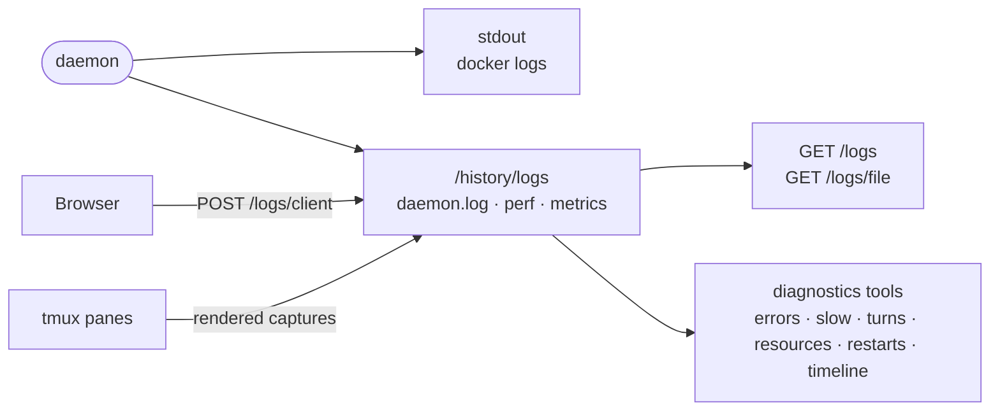

# Debugging the daemon

Where to look when a running daemon misbehaves: its health probe, the log files it keeps on `/history`, the diagnostics tools its agents get, and the state it leaves on disk.

## First checks

- Inside the container, `curl -s localhost:8787/health` answers even mid-boot. `boot` lists every boot step with its
  state and time, `announce` says whether the platform was reached, and `reach` / `reachedBy` say how the world gets in.
- On the host, `ic sandbox doctor` walks the sandbox's reachability chain and names the broken link.
- `docker logs` shows the daemon's JSON lines and `intentic-netd`'s own log (its level from `NETD_LOG`). A daemon
  that refuses its config says why on stderr and exits with code 78. One whose boot fails before it is ready writes
  why to `/history/boot-failure.json` and exits 1, and netd starts it again with backoff; the next boot that gets
  all the way removes the file.

## Log files

Everything lives under `/history/logs`, outside the agents' `/work`; [src/logs/log-files.ts](../src/logs/log-files.ts)
owns the layout and prunes by size, age and count.

| File | What it records | Keys to read | Tool that reads it |
| --- | --- | --- | --- |
| `daemon.log` (+ `daemon.log.1`) | The daemon's pino lines | `time`, `level` (a label), `message` (not `msg`), `ctx.conversationId`, `ctx.requestId`, `err` | `errors`, `timeline` |
| `perf.jsonl` (+ `.1`) | Only the spans slower than their budget, never every request; every 10 minutes, the ranked summary of every op since the daemon started | `perf` (the op), `ms`, `load1`, and the op's subject: `path`, `git`, `tool`; the summary line carries `perfSummary`, `since`, `everyMs` instead | `slow` (spans only) |
| `client.jsonl` (+ `.1`) | Errors, stalls and recoveries browsers reported | `event`, `message`, `report.route` | `errors` with `source: "browser"` |
| `resource-metrics.jsonl` | One sample a minute, about a week of them | `at`, `uptimeSeconds`, `system.*`, `window.*`, `daemon.*`, `processes.byRole`, `processes.top` | `resources` |
| `restarts.jsonl` | One line per boot: the boot, and how and why the run before it ended | `at`, `boot.version`, `previous.ended`, `previous.intent.by`, `previous.intent.reason` | `restarts` |
| `daemon-exit.json`, `restart-intent.json` | The running daemon's exit marker, and who asked for the next restart | | read at boot (`system/boot/`) |
| `filter-stats.jsonl` | One row per agent shell command through the output filter | `ts`, `command`, `exit`, `rawBytes`, `emittedBytes` | the editor's savings report |
| `raw-output/` | A filtered command's whole output | | `retrieve-output <file> [pattern]` |
| `terminals/`, `services/`, `intentic-runs/` | tmux pane captures, supervised service processes, `intentic` CLI runs | | `GET /logs/file` |
| `boot-*.cpuprofile` | The CPU profile of a start whose event loop stalled, the newest three (`system/resources/loop/boot-profile.ts`) | | `fileq` |

Outside the logs directory, `/history/activity.jsonl` holds the audit trail (turn started, completed and failed,
dependency checks, CI repairs, refused pushes; keys `at`, `type`, `conversationId`, `turnId`, `content`), read by
`timeline`, and `/history/usage.jsonl` holds one row per turn, read by `turns` and `timeline`.

Retention: a line log past 5 MB is cut to its newest megabyte, and `daemon.log`, `perf.jsonl` and `client.jsonl` keep
what the cut dropped as one older segment (`daemon.log.1`), which the tools read on into when a window reaches back that
far. A file that is one JSON document (a CPU profile, a fatal-error report) is never cut. `terminals/`, `raw-output/`
and `output-cache/` each hold their own newest files, so pane captures never push out the files beside them; the restart
record's files are never pruned.

Node's fatal-error reports (`report.*.json`) land in the same directory. `LOG_LEVEL` sets the level; `LOG_PRETTY=1`
pretty-prints to stdout instead of writing `daemon.log`.

## Reading them

- `GET /logs` lists the files and `GET /logs/file?name=…` returns a line-aligned tail window; both need the maintainer
  role.
- Agents get a read-only `diagnostics` MCP server ([src/logs/diagnostics-tools.ts](../src/logs/diagnostics-tools.ts))
  over the same files and the spend ledger: `errors`, `slow`, `turns`, `resources`, `restarts` (each boot and why the
  run before it ended) and `timeline` (one conversation's log lines, activity and turns in time order). Each answer says
  which file and window it searched and how far back the file reaches.
- Invariant violations and event-loop stalls (`system/resources/loop-watchdog.ts`) are written to `daemon.log`.

## State on disk

- `/history`: `conversations.db` (the conversation registry), `conversations/` (one directory per conversation),
  `worktrees/`, `gits/` (every repository's git dir), `scopes/` (workspace history snapshots), `engines/`.
- A `conversations.db.corrupt-<ms>` beside the registry is one a boot found damaged and set aside, never deleted; the
  live file is what could be copied out of it, or a new one. `trash/conversations/` holds the directories no registry
  row owned, moved there by the boot's sweep and removed 14 days later.
- `update-staged.json`, `update-preparing.json` (a download running now, rewritten every few seconds and read only
  while fresh), `update-outcome.json` (what the host last did about the version) and `boot-failure.json` are
  written by `ic` and a failed boot for each other; `update-skipped.json` is the release the owner chose not to be
  offered.
- A conversation's transcript is a zstd log, one frame per settled turn behind a skippable frame naming its length,
  rows and CRC (`src/sessions/record/record-log.ts`): read it with `zstd -dc` or frame by frame, never with one
  `zstdDecompressSync`, which stops at that first skippable frame and answers nothing. Each row is a JSON object:
  `role`, `text`, `run`, `openedAt`, and `tools`, a list of `{id, name, status, target, input, content, startedAt,
  endedAt, exitCode}` (the newer fields only on rows written since they were added). `agents show <id> --transcript`
  reads it for you (numbered `#n`), `--message <n>` prints one message whole with its calls' inputs, outputs and
  durations, and `--transcript --json` gives the rows as stored. A handle can be the conversation id, its branch, words
  of its title, a session id or its 8-character prefix, a terminal log name (`agent-xxxxxxxx-%N.log`), a run id, or an
  in-process subagent's id. A tool output of 16 KiB or more
  lives once by content under `/history/blobs/`, shared by forks and swept once no record names it.
- `/work/.intentic`: `config/` (settings, capabilities, automations, safety policy), `records/` and `secrets/`. The
  table of which file backs which view is `state/workspace-state.ts` in `@intentic/sandbox-contract`.
